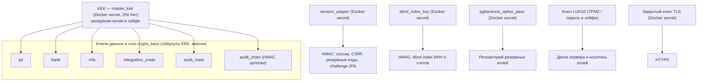

# Криптографическая защита UGEKAZNA

Используются только проверенные библиотеки: `cryptography` (OpenSSL) для AES-GCM и AES-KW,
`argon2-cffi` для Argon2id, `pyotp` для вычисления TOTP, стандартные модули Python `hmac`,
`hashlib`, `secrets`. Собственные криптографические алгоритмы не реализуются. Реализация:
`backend/app/core/crypto.py`, `backend/app/core/keystore.py`, `backend/app/core/reencrypt.py`,
`backend/app/auth/passwords.py`, `backend/app/auth/totp.py`, `backend/app/auth/sessions.py`,
`backend/app/auth/service.py`, `backend/app/audit/service.py`.

## 1. Алгоритмы

| Назначение | Алгоритм и параметры | Где |
|---|---|---|
| Шифрование полей (ПДн, реквизиты, секреты TOTP, IP/UA в аудите) | AES-256-GCM, nonce 96 бит (CSPRNG), тег 128 бит, AAD обязателен | `backend/app/core/crypto.py` |
| Обёртывание ключей данных (DEK) ключом KEK | AES Key Wrap (RFC 3394), KEK 256 бит | `backend/app/core/crypto.py` |
| Хранение паролей | Argon2id: память 64 МиБ, 3 итерации, параллелизм 4, соль 128 бит, хеш 256 бит (облегчённый профиль `fast_test` приложение принимает только при `ENV=test`) | `backend/app/auth/passwords.py`, `backend/app/core/config.py` |
| Токен сессии | 256 бит CSPRNG (`secrets.token_urlsafe(32)`); в БД только HMAC-SHA256(pepper, «session»‖токен) | `backend/app/auth/sessions.py` |
| Токен CSRF | base64url(HMAC-SHA256(pepper, «csrf»‖токен сессии)) — подписанный double-submit | `backend/app/auth/sessions.py` |
| Токен challenge 2FA | в БД только HMAC-SHA256(pepper, «mfa»‖токен) | `backend/app/auth/service.py` |
| Резервные коды 2FA | 10 кодов по 12 символов алфавита из 31 знака (~59 бит), в БД HMAC-SHA256(pepper, «backup»‖пользователь:код), одноразовые | `backend/app/auth/totp.py`, `backend/app/auth/service.py` |
| Одноразовые пароли | TOTP RFC 6238: HMAC-SHA1, шаг 30 с, 6 цифр, окно ±1 шаг, секрет 160 бит | `backend/app/auth/totp.py` |
| Blind index зашифрованных полей | HMAC-SHA256(ключ индекса, «метка»‖«\|»‖нормализованное значение) | `backend/app/core/crypto.py` |
| Целостность журнала аудита | HMAC-SHA256(DEK `audit_chain` версии v, предыдущий хеш ‖ канонический JSON записи) | `backend/app/audit/service.py` |
| Канал пользователь ↔ сервер | TLS 1.2/1.3, только ECDHE + AES-GCM / ChaCha20-Poly1305 | `deploy/caddy/Caddyfile.prod` |
| Аутентификация в СУБД | SCRAM-SHA-256 | `deploy/postgres/postgresql.conf` |
| Резервные копии | pgBackRest, шифрование репозитория AES-256-CBC, пароль 256 бит энтропии | `deploy/pgbackrest/pgbackrest.conf`, `scripts/gen_secrets.py` |
| Диски сервера | LUKS2, aes-xts-plain64, ключ 512 бит (AES-256-XTS), PBKDF Argon2id — требование к серверу | [../ops/host-hardening.md](../ops/host-hardening.md) |
| Случайные числа | `os.urandom` / `secrets` (getrandom ядра Linux), UUID v4 | — |

## 2. Иерархия ключей



DEK создаются при первом запуске (`ensure_keys`), по одному активному на назначение; ключ
расшифровывается в памяти процесса и кэшируется на 60 с. Назначения `audit_meta` и `audit_chain`
никогда не выводятся из обращения: без них невозможно прочитать IP/UA и проверить цепочку записей,
хранящихся не менее года. Ключ `integration_creds` создан заранее, зашифрованных им данных пока нет
(коннекторы интеграций не включены).

## 3. Формат шифртекста

```
0x01 | версия ключа (2 байта, big-endian) | nonce (12 байт) | шифртекст | тег (16 байт)
```

Первый байт — версия формата (позволяет сменить алгоритм без миграции старых данных), затем версия
DEK, которой зашифровано значение. Хранится в столбцах `bytea` с суффиксом `_enc`.

## 4. Дополнительные данные (AAD)

AAD = три байта заголовка (формат + версия ключа) ‖ `ugk|{назначение}|{схема}.{таблица}.{столбец}:{первичный ключ}`.
Пустой AAD отвергается (`CryptoError("bad_aad")`). Привязка к заголовку исключает подмену версии
ключа, к назначению — использование шифртекста другим назначением, к строке — перенос значения в
другую запись (тесты `test_wrong_aad_is_rejected`, `test_wrong_purpose_is_rejected`,
`test_swapping_to_another_existing_version_gives_integrity`).

| Поле | Назначение | Привязка AAD (после префикса `ugk\|назначение\|`) |
|---|---|---|
| `core.users.totp_secret_enc` | `mfa` | `core.users.totp_secret_enc:{id}` |
| `core.mfa_challenges.pending_secret_enc` | `mfa` | `core.mfa_challenges.pending_secret_enc:{HMAC токена challenge, hex}` |
| `core.sessions.ip_enc` | `pii` | `core.sessions.ip_enc:{id сессии}` |
| `core.audit_log.ip_enc` | `audit_meta` | `core.audit_log.ip_enc:{id записи}` |
| `core.audit_log.ua_enc` | `audit_meta` | `core.audit_log.ua_enc:{id записи}` |
| `dwh.dim_counterparty.inn_enc` | `pii` | `dwh.dim_counterparty.inn_enc:{код}` |
| `dwh.dim_bank.account_enc` | `bank` | `dwh.dim_bank.account_enc:{код}` |

Полнота реестра зашифрованных столбцов проверяется тестом по схеме БД: каждый столбец `*_enc`
типа `bytea` должен быть либо в реестре перешифрования, либо в списке исключений с обоснованием
(`backend/app/core/reencrypt.py`, `backend/tests/test_reencrypt_registry.py`).

## 5. Blind index

Для зашифрованных ИНН и номера счёта хранится `HMAC-SHA256(blind_index_key, "{метка}|{значение}")`
(`dwh.dim_counterparty.inn_bidx`, `dwh.dim_bank.account_bidx`), где значение нормализуется: Unicode
NFKC, приведение регистра (`casefold`), удаление пробельных символов. Шифртекст каждый раз
отличается (случайный nonce), поэтому при загрузке данных изменение значения определяется именно
по индексу. Поиск по индексу в этапе «Основа» не реализован — запланирован в следующих этапах.
Индекс раскрывает только равенство значений (остаточный риск R11 в
[threat-model.md](threat-model.md)). Метки — константы кода без символа `|`, поэтому граница метки
и значения однозначна.

## 6. Жизненный цикл DEK

`active` (шифрует и расшифровывает) → `decrypt_only` (после ротации, только расшифровка) →
`retired` (обёрнутый ключ стирается — криптографическое уничтожение).

- **Ротация** создаёт новую версию и перешифровывает зарегистрированные столбцы. Из интерфейса
  («Администрирование → Ключи шифрования → Ротировать») перешифровываются только столбцы схемы
  `core` (роль `ugk_app`): у приложения нет доступа к `dwh.*`. Столбцы `dwh.dim_counterparty.inn_enc`
  и `dwh.dim_bank.account_enc` перешифровывает команда оператора `rotate-key` (роль `ugk_migrator`,
  отдельная транзакция). Записи аудита (`audit_meta`, `audit_chain`) не перешифровываются —
  журнал дополняется, а не переписывается; старые версии остаются в состоянии `decrypt_only`.
- **Вывод из обращения** — отдельная операция оператора от роли `ugk_migrator` не ранее чем через
  10 минут после ротации (кэш ключей процессов — 60 с). Выводятся только версии, которые не
  используются ни одним зарегистрированным столбцом, и только для назначений с зарегистрированными
  столбцами (`pii`, `bank`, `mfa`). `audit_meta` и `audit_chain` не выводятся никогда;
  `integration_creds` не выводится, пока его столбцы не зарегистрированы.

Порядок действий — [key-management.md](key-management.md).

## 7. Бюджет nonce и периодичность ротации

Nonce 96 бит генерируются случайно. По NIST SP 800-38D (п. 8.3) число шифрований одним ключом при
случайных nonce не должно превышать 2³² (вероятность коллизии ≤ 2⁻³²). Оценка нагрузки: самое
частое шифрование — IP и User-Agent в журнале аудита (2 операции на событие). При 200 пользователях
и 200 событиях в день на пользователя (завышенная оценка: в журнал попадают только события
безопасности и администрирования, а не каждый запрос) получается около 2,9·10⁷ шифрований в год
на ключ `audit_meta`. Это примерно в 150 раз меньше предела 2³² (≈4,3·10⁹) и в 37 раз меньше
внутреннего порога 2³⁰ (≈1,07·10⁹), при достижении которого ключ следует ротировать внепланово.
Автоматический счётчик шифрований не реализован (запланировано); на практике порог контролируется
плановой ротацией.

Плановая ротация каждого DEK — раз в 12 месяцев: ops-check выдаёт предупреждение
`key_rotation_due`, когда активная версия ключа старше 365 дней. KEK меняется раз в 24 месяца и
немедленно при подозрении на компрометацию; автоматического напоминания о возрасте KEK нет
(контролируется по журналу сейфа, [key-management.md](key-management.md)).

## 8. Передача данных

- Пользователь ↔ сервер: только HTTPS (TLS 1.2/1.3, ECDHE + AEAD), HTTP перенаправляется на HTTPS
  (308), HSTS 2 года; сертификат корпоративного УЦ.
- Сервер ↔ SMTP-релей: STARTTLS (включён по умолчанию) или неявный TLS с проверкой сертификата
  релея; пароль SMTP не отправляется без шифрованного канала — приложение не запускается с такой
  конфигурацией (`Settings.problems()`).
- Внутри сервера (Caddy ↔ API ↔ PostgreSQL/Redis): без TLS. Обоснование: контейнеры находятся на
  одном хосте в изолированных сетях Docker `internal: true`, трафик не покидает ядро хоста, доступ к
  хосту — только SSH по ключу из VPN, диски зашифрованы LUKS2; включение TLS не снижает рисков при
  компрометации хоста (ключи TLS хранились бы там же). Если СУБД будет вынесена на отдельный сервер,
  включаются `ssl = on` и записи `hostssl` в `pg_hba.conf`, приложение — `sslmode=verify-full`.

## 9. Ограничения

- Python не гарантирует затирание ключей в памяти (ASVS 8.3.6): время жизни расшифрованных DEK
  ограничено кэшем 60 с и временем жизни процесса.
- HSM не используется: KEK хранится как Docker secret на зашифрованном диске, резервная копия — в
  сейфе ([key-management.md](key-management.md)); переход на HSM возможен без изменения формата
  данных (меняется только способ получения KEK).
- pgBackRest шифрует репозиторий в режиме AES-256-CBC (реализация pgBackRest); целостность файлов
  копии контролируется контрольными суммами манифеста и проверяется ежемесячным восстановлением.
