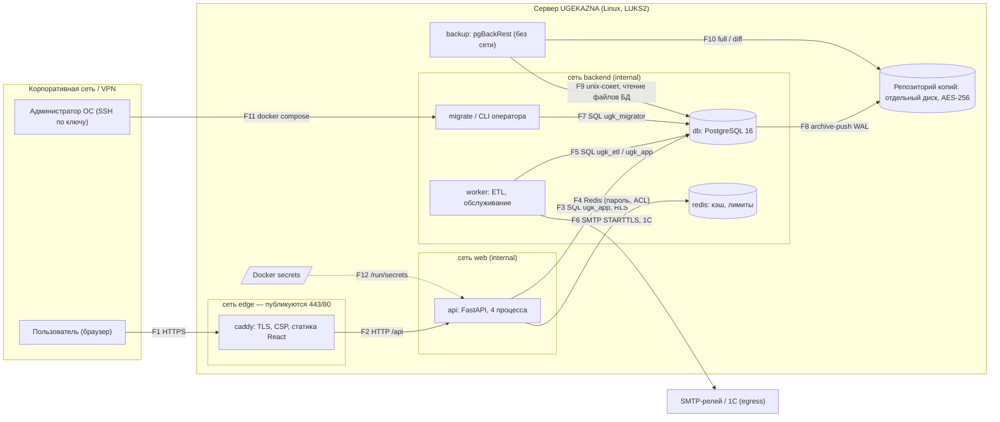

# Модель угроз UGEKAZNA

Метод — STRIDE по элементам диаграммы потоков данных (DFD). Модель пересматривается при каждом
изменении архитектуры и при подключении новых интеграций (1С, банки, Telegram, AI-анализ) —
см. раздел 8.

## 1. Границы и допущения

- Система размещается во внутренней сети организации; доступ пользователей — только через VPN
  по HTTPS с корпоративным сертификатом (ТЗ, раздел 9).
- Сервер — выделенный Linux-хост, укреплённый по [../ops/host-hardening.md](../ops/host-hardening.md):
  LUKS2, ufw + DOCKER-USER, SSH только по ключам, auditd, chrony. Эти меры относятся к хосту и
  выполняются при установке; приложение их не проверяет.
- Администраторы ОС и хранители ключей — доверенные лица; их действия журналируются (auditd,
  журнал аудита приложения для операций с ключами).
- Учётные системы (1С, банки) — источники данных; на этапе «Основа» реальные коннекторы не включены
  (используются синтетические данные и CSV), угрозы интеграций учтены заранее.

## 2. Активы

| Актив | Где хранится | Требование |
|---|---|---|
| Финансовые показатели витрины (ДДС, остатки, платежи, долги) | PostgreSQL: `dwh`, `mart`, `pub` | конфиденциальность, целостность, доступность 99 % в рабочее время |
| Учётные данные пользователей (хеши паролей, секреты TOTP, резервные коды) | `core.users`, `core.backup_codes`, `core.password_history` | конфиденциальность, стойкость к офлайн-подбору |
| Сессии | `core.sessions` (только HMAC токена) | невозможность подделки и кражи |
| Ключи шифрования (KEK, DEK), pepper, ключ blind index | Docker secrets, `core.crypto_keys` (DEK обёрнуты KEK) | конфиденциальность, возможность ротации |
| Журнал аудита | `core.audit_log` (HMAC-цепочка) | целостность, неотказуемость, хранение ≥ 12 месяцев |
| Реквизиты контрагентов и банковские счета | `dwh.dim_counterparty.inn_enc`, `dwh.dim_bank.account_enc` | конфиденциальность |
| Резервные копии | репозиторий pgBackRest на отдельном диске | конфиденциальность (AES-256), доступность (RPO 15 мин, RTO 2 ч) |
| Исходный код и цепочка поставки | репозиторий организации, реестры образов и пакетов | целостность |

## 3. Нарушители

| Нарушитель | Возможности | Мотивация |
|---|---|---|
| Внешний без доступа к VPN | нет сетевого доступа к системе | — (угрозы закрываются периметром организации) |
| Легитимный пользователь | действующая учётная запись и 2FA; может подменять параметры запросов | доступ к данным другого филиала, выгрузка сверх полномочий |
| Злоумышленник с украденным паролем | знает пароль, но не второй фактор | вход от имени пользователя |
| Злоумышленник в сети VPN | перехват/подмена трафика, перебор паролей | доступ к данным, отказ в обслуживании |
| Администратор приложения | права `admin` в интерфейсе | злоупотребление (выдача прав, сокрытие действий) |
| Администратор ОС / Docker | root на сервере | чтение секретов, изменение БД, удаление журналов |
| Компрометированный контейнер | выполнение кода внутри `api`/`worker` | развитие атаки на БД, ключи, хост |
| Цепочка поставки | вредоносная зависимость или базовый образ | закладка, утечка данных |

## 4. Диаграмма потоков данных

Поток F6 к 1С на этапе «Основа» не используется (коннектор не включён); SMTP-релей — единственный
внешний получатель (уведомления о загрузках и ops-check).

## 5. Границы доверия

| Граница | Между | Контроль на границе |
|---|---|---|
| TB1 | VPN ↔ Caddy | TLS 1.2/1.3 (AEAD), HSTS, лимит тела 1 МБ, служебные пути закрыты |
| TB2 | Caddy ↔ API | внутренняя сеть `web`; аутентификация сессией, CSRF, RBAC в API |
| TB3 | API/worker ↔ СУБД | отдельные роли, SCRAM-SHA-256, RLS, `pg_hba` только `samenet` |
| TB4 | контейнер ↔ хост | non-root, read-only, `cap_drop: ALL`, `no-new-privileges`; userns-remap — требование к хосту |
| TB5 | хост ↔ носитель копий | шифрование репозитория AES-256, отдельный диск (LUKS2 — требование к серверу) |
| TB6 | worker ↔ внешние системы | только сеть `egress`, правила DOCKER-USER на хосте, STARTTLS |

## 6. Анализ STRIDE

Обозначения: S — Spoofing (подмена субъекта), T — Tampering (изменение), R — Repudiation (отказ от
действий), I — Information disclosure (раскрытие), D — Denial of service (отказ в обслуживании),
E — Elevation of privilege (повышение привилегий).

| № | Элемент / поток | STRIDE | Угроза | Меры | Проверка |
|---|---|---|---|---|---|
| S1 | F1 вход | S | Подбор или кража пароля | Argon2id, блокировка после 5 ошибок на 15 мин (будет перенесено в настройки администратора, план 04b), лимит 10/мин на IP, TOTP-2FA (обязательна для всех ролей только при включённой `security.mfa_required`, иначе необязательна — остаточный риск R18) | `test_lockout_after_five_failures` |
| S2 | F1 2FA | S | Повторное использование перехваченного кода TOTP | запоминание последнего шага TOTP, 5 попыток на challenge | `test_totp_code_cannot_be_replayed` |
| S3 | F1 сессия | S | Кража cookie сессии через XSS | `HttpOnly; Secure; SameSite=Strict`, префикс `__Host-`, CSP `script-src 'self'` | `test_full_login_sets_hardened_cookies` |
| S4 | F1 канал | T | Перехват и подмена трафика | TLS 1.2/1.3 только ECDHE + AEAD, HSTS, корпоративный сертификат | `test_tls_only_modern_protocols` |
| S5 | F1 запросы | T | Межсайтовая подделка запроса (CSRF) | подписанный double-submit токен, `SameSite=Strict` | `test_csrf_required_for_unsafe_methods` |
| S6 | API | I | Доступ к данным чужого филиала подменой `br` | проверка области в API + RLS в СУБД, событие `security.rls_violation_attempt` | `test_branch_economist_sees_only_own_branch_even_after_cache_warmup` |
| S7 | F4 кэш | I | Выдача кэша другой области данных | хеш области в ключе кэша, версия данных в ключе | `test_scope_and_filters_are_isolated` |
| S8 | API | E | Вызов административных функций без прав | запрет по умолчанию, `require_perm` на каждом маршруте, отказ журналируется (`security.access_denied`) | `test_admin_and_audit_routes_require_matching_permission` |
| S9 | API | D | Перегрузка крупными запросами | тело ≤ 1 МБ (Caddy и middleware), страницы списков ≤ 500, 300 запросов/мин на пользователя, ограничение числа одновременных сессий БД на процесс (`DB_POOL_SIZE`; ожидание свыше 5 с — ответ 503 `service_busy`), `statement_timeout` 5 с | `test_body_limit_without_content_length`, `test_slot_wait_is_bounded_and_returns_503` |
| S10 | API | I | Раскрытие внутренних деталей в ошибках | единый формат ошибок, трассировка только в журнале | `test_unhandled_error_hides_details` |
| S11 | API | R | Отказ пользователя от совершённых действий | журнал аудита с HMAC-цепочкой, `request_id` в ответах и журнале | `test_tampering_in_two_places_reports_both_ids` |
| S12 | D журнал | T | Изменение или удаление записей аудита | запись только через функции SECURITY DEFINER, ключ цепочки вне открытого доступа, якорь начала цепочки | `test_app_role_cannot_write_audit_tables_directly` |
| S13 | D данные | I | Кража дампа или диска | LUKS2 (требование к серверу); поля ПДн и реквизиты — AES-256-GCM; копии — AES-256 | `test_session_ip_is_encrypted` |
| S14 | F3 | E | SQL-инъекция | только параметры SQLAlchemy, идентификаторы из реестров; semgrep, bandit | `scripts/check_repo.sh` |
| S15 | F3 | E | Обход RLS ролью приложения | `NOBYPASSRLS`, `FORCE ROW LEVEL SECURITY`, без контекста — 0 строк | `test_app_role_has_no_bypassrls` |
| S16 | `core.crypto_keys` | T | Подмена или затирание DEK приложением | у `ugk_app` только `SELECT, INSERT, UPDATE(status, retired_at)` | `test_app_role_cannot_rewrite_wrapped_key` |
| S17 | F12 секреты | I | Утечка секретов через репозиторий или конфигурацию | Docker secrets (файлы 0440), gitleaks в CI и pre-commit | `scripts/tests/gitleaks_selftest.sh` |
| S18 | F8, F10 | I | Кража резервных копий | шифрование репозитория AES-256, отдельный зашифрованный диск | `test_pgbackrest_conf_encrypted_without_password` |
| S19 | F8 | T | Запись восстановленной тестовой копией WAL в рабочий репозиторий | архивирование отключено при восстановлении, репозиторий подключён только на чтение | `test_restore_disables_archiving` |
| S20 | F4 | S | Обращение к Redis из других сетей | внутренняя сеть, пароль, ACL без опасных команд | `test_network_isolation` |
| S21 | F6 | I | Вывод данных через исходящие соединения | выход во внешнюю сеть только у worker (сеть `egress`), правила DOCKER-USER на хосте | `test_network_isolation` |
| S22 | контейнеры | E | Выход из контейнера | non-root, read-only, `cap_drop: ALL`, `no-new-privileges`; userns-remap — требование к хосту | `test_every_service_is_hardened` |
| S23 | цепочка поставки | T | Вредоносная зависимость или образ | lock-файлы с хешами, образы по digest, Trivy, SBOM | `test_base_images_pinned_by_digest` |
| S24 | время | T | Рассинхронизация часов: отказ записи аудита (окно ±5 мин), сбои TOTP | chrony на хосте (требование к серверу); `clock_skew` выявляет только расхождение часов приложения и СУБД (более 60 с — критично), дрейф хоста относительно реального времени контролирует chrony | `test_ops_check_detects_clock_skew` |
| S25 | F11 оператор | R | Незафиксированные операции с ключами | события `admin.key.*` в журнале аудита (в том числе `result = "fail"`), auditd на хосте | `test_cli_key_operations_are_audited` |
| S26 | D | D | Потеря данных (сбой диска, шифровальщик, ошибка) | pgBackRest: полная копия ежедневно, разностная каждые 6 ч, WAL не реже чем раз в 15 мин (`archive_timeout`); ежемесячная проверка восстановления | `scripts/backup_selftest.sh` |
| S27 | Caddy | I | Доступ к служебным проверкам извне | `/api/v1/healthz`, `/api/v1/readyz` снаружи → 404 | `test_probes_blocked_before_api_proxy` |
| S28 | смена KEK | D | Отказ системы при смене KEK на работающих процессах | регламент со штатной остановкой `api`/`worker` ([key-management.md](key-management.md), П5) | `test_cli_rewrap_roundtrip` |

## 7. Остаточные риски и принятые решения

| № | STRIDE | Риск | Решение и обоснование |
|---|---|---|---|
| R1 | T, D | Роль `ugk_app` может добавлять строки в `core.crypto_keys`; скомпрометированное приложение способно вставить поддельный ключ и вызвать отказ загрузки ключей | Раскрытия данных нет (ключ обёрнут KEK, чужой ключ не расшифровывает старые данные); отказ проявляется ошибкой `unwrap_failed` при загрузке ключей (журнал приложения, отказ запуска); перенос создания ключей в функцию SECURITY DEFINER — запланировано |
| R2 | D | Шифртекст с неизвестной версией ключа вызывает перечитывание ключей из БД | Шифртексты создаёт только сервер; злоумышленник без права записи в БД не может инициировать; кэш ключей 60 с |
| R3 | T | Ошибки CSRF не учитываются лимитом запросов | Для атаки нужна действующая сессия жертвы; отказ 403 без побочных эффектов; попытки видны в журнале доступа |
| R4 | D | При недоступности Redis лимиты запросов отключаются (fail-open), кэш — тоже | Осознанно: отказ кэша не должен останавливать систему; блокировка входа после 5 ошибок хранится в СУБД и продолжает действовать; `readyz` показывает деградацию (статус 503, `checks.redis = false`; [../ops/monitoring.md](../ops/monitoring.md)) |
| R5 | T, R | Суперпользователь СУБД или root хоста может удалить/изменить данные и журнал | Изменение обнаруживается проверкой HMAC-цепочки (ключ цепочки обёрнут KEK); действия root фиксирует auditd; доступ root ограничен регламентом |
| R6 | S | TOTP использует HMAC-SHA1 | Требование совместимости с приложениями-аутентификаторами (RFC 6238); стойкость HMAC-SHA1 для OTP не снижена |
| R7 | S | Резервные коды 2FA — 12 символов (~59 бит) | Хранятся как HMAC-SHA256 с секретным ключом 256 бит; одноразовые; перебор онлайн ограничен лимитами и блокировкой |
| R8 | S | Политика паролей со сроком 90 дней и составом символов расходится с ASVS 2.1.9/2.1.10 | Требование заказчика («пароль по политике организации», ТЗ, раздел 9) |
| R9 | I | Трафик внутри сервера (API ↔ СУБД/Redis) без TLS (`ssl = off`) | Трафик не покидает хост, сети `internal`, диски LUKS2; при выносе СУБД на отдельный хост — включить TLS ([cryptography.md](cryptography.md), раздел 8) |
| R10 | S | Аутентификация не через AD/СЕИД (ТЗ, раздел 9) | Решение проекта: локальные учётные записи, 2FA подключается пользователем (обязательна при `security.mfa_required`, R18); интеграция с каталогом — отдельная задача |
| R11 | I | Blind index раскрывает равенство значений ИНН/счетов внутри БД | Сейчас индекс служит для обнаружения изменений при загрузке; поиск по нему запланирован; ключ индекса — отдельный секрет; сами значения зашифрованы |
| R12 | I | Уничтожение ключа (crypto-shredding) действует на резервные копии только после истечения их срока (14 полных копий, при ежедневной полной копии — около 14 суток) | Документировано в [key-management.md](key-management.md) |
| R13 | D | Нагрузочный тест не измеряет время входа под пиковой нагрузкой (используются заранее выданные сессии) | Вход проверяется E2E-тестами; лимиты входа защищают от перегрузки ([../ops/load-test.md](../ops/load-test.md)) |
| R14 | D | Архивация WAL при недоступности репозитория копий ограничена очередью 4 ГиБ (`archive-push-queue-max`); при превышении pgBackRest перестаёт сохранять WAL, не поместившиеся в очередь, и сообщает PostgreSQL об успехе | База продолжает работать; цепочка восстановления на момент времени прерывается до следующей резервной копии (любого типа); сбой архивации — `wal_archiver_failed` / `wal_archiver_lag` в ops-check |
| R15 | E | Без userns-remap выход из контейнера даёт процесс с привилегиями root на хосте | Принято: контейнеры не от root, read-only, `cap_drop: ALL`, `no-new-privileges`; userns-remap — требование к серверу ([../ops/host-hardening.md](../ops/host-hardening.md)), приложение его включение не проверяет; автоматическая проверка — запланировано |
| R16 | E | Членство в группе `docker` эквивалентно root на хосте | Принято: право ограничено группой администраторов ОС `ugk-admins`, действия фиксирует auditd (требования к серверу) |
| R17 | E, I | Скомпрометированный процесс `api`/`worker` имеет KEK (секрет `master_kek`), расшифрованные DEK в памяти и пароль своей роли СУБД; он может расшифровать данные в рамках этих ключей и дописывать события в журнал аудита | Принято: права ролей `ugk_app`/`ugk_etl` ограничены (нет записи в таблицы аудита и в `wrapped_key`, RLS), ранее записанные события изменить нельзя без обнаружения проверкой цепочки; при подозрении — П12 ([key-management.md](key-management.md)) |
| R18 | S | 2FA необязательна: учётная запись без TOTP защищена только паролем (кража или подбор пароля, фишинг), включая администраторов | Решение заказчика от 27.10.2026. Меры: блокировка после 5 ошибок и лимит 10/мин на IP (без изменений); пользователь с TOTP всегда подтверждает вход кодом; изменение настроек безопасности и интеграций требует TOTP (`step_up_unavailable` без него); при входе предлагается подключить 2FA; администратор может сделать 2FA обязательной настройкой `security.mfa_required` (действует со следующего входа); отказы фиксируются в журнале (`auth.mfa_offer_dismissed`). Рекомендация: администраторам подключить 2FA организационно обязательно |

## 8. Пересмотр модели

Модель пересматривается: при каждом изменении архитектуры или состава компонентов; при подключении
интеграций (1С — чтение реплики или OData, DirectBank, Telegram-бот, AI-анализ); после инцидента
ИБ; не реже одного раза в год. Результат пересмотра — изменение этого документа в том же запросе на
слияние, что и изменение кода (правило разработки в [secure-configuration.md](secure-configuration.md)).
