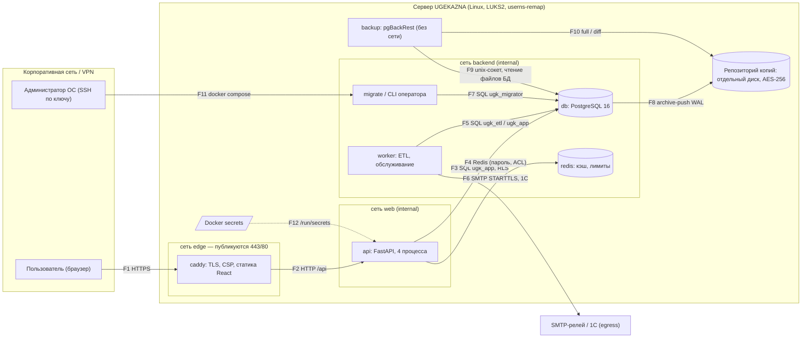
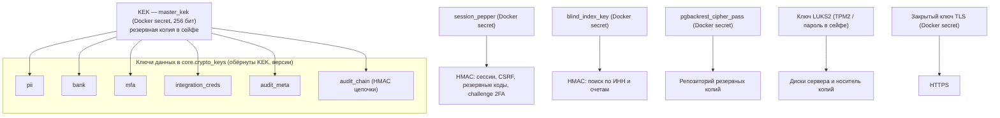

# UGEKAZNA 4-reja: Ops — CI xavfsizlik darvozalari, prod hardening, zaxira/tiklash, yuklama testi, ekspertiza hujjatlari — implementatsiya rejasi

> **For agentic workers:** REQUIRED SUB-SKILL: Use superpowers:subagent-driven-development (recommended) or superpowers:executing-plans to implement this plan task-by-task. Steps use checkbox (`- [ ]`) syntax for tracking.

**Goal:** Poydevorni milliy kiberxavfsizlik ekspertizasiga tayyorlash: Docker'dagi CI xavfsizlik darvozalari (`make check`, `make scan`, pre-commit), digest bilan qotirilgan va hardening qilingan prod stack (`deploy/compose.prod.yml`, korporativ TLS'li Caddy, PostgreSQL 8/16 GB profillari), pgBackRest zaxira/tiklash (RPO 15 daqiqa, RTO 2 soat) va uning avtotesti, k6 yuklama testi, rus tilidagi xavfsizlik (`docs/security/`) va ekspluatatsiya (`docs/ops/`) hujjatlari.

**Architecture:** Hamma asbob Docker'da ishlaydi: skanerlar `deploy/compose.tools.yml` orqali (compose nisbiy yo'llari — Windows va Linux'da bir xil), backend darvozalari `deploy/compose.test.yml`, frontend — `deploy/compose.frontend.yml`; mantiq `scripts/*.sh` da, `Makefile` (Linux/CI) va `scripts/dev.ps1` (Windows) ularni chaqiradi, GitHub Actions va GitLab CI faqat `make check`/`make scan` ni chaqiradi. Prod'da to'rtta o'z image'imiz (`ugekazna-{db,redis,backend,web}:<versiya>`) `deploy/images.lock.env` dagi digest bilan qotirilgan base image'lardan quriladi; DB image = PostgreSQL 16 + pgBackRest + konfiguratsiya (bind-mount yo'q). Zaxira tarmoqsiz `backup` konteynerida unix-socket orqali; tiklash testi alohida compose loyihasida (arxivlash o'chiq), natijasi prod `core.settings`ga CLI orqali yoziladi; `ops-check` DB darajasidagi holatni tekshirib SMTP orqali xabar beradi, `monitor.sh` systemd timer bilan ishlaydi.

**Tech Stack:** Docker Engine ≥ 24, Docker Compose ≥ 2.24; gitleaks 8.21.2, semgrep 1.95.0, hadolint 2.12.0, Trivy 0.57.1 (CycloneDX SBOM), k6 0.54.0; PostgreSQL 16 (`postgres:16-alpine`) + pgBackRest (Alpine paketi) + jq; Caddy 2; Python 3.12 (pytest + pytest-cov, ruff, mypy, bandit, pip-audit, PyYAML, cryptography); Node 22 (tsc, ESLint, Vitest, npm audit); GitHub Actions / GitLab CI; systemd timer'lar.

**Spec:** [docs/superpowers/specs/2026-09-24-poydevor-design.md](../specs/2026-09-24-poydevor-design.md) — 2 (prod qismlari), 3.8, 6.3, 9 (yuklama), 10, 11, 12-bo'limlar. Controller qarorlari: `.superpowers/sdd/planning/plan4-decisions.md`. Kechiktirilgan kamchiliklar ledger'i: `.superpowers/sdd/2026-09-24-01-backend-yadro/progress.md`. TZ: 9 va 10-bo'limlar (`docs/reference/UGEKAZNA_TZ.pdf`).

Bu — poydevor spec'ining 4 rejasidan to'rtinchisi. 1–3-rejalar bajarilgan deb hisoblanadi, ya'ni mavjud: `deploy/compose.yml` (dev: `db`, `redis`, `migrate`, `api`, `worker`, `caddy` — `ugekazna-web:dev`), `deploy/compose.test.yml`, `deploy/compose.frontend.yml` (`node`, `e2e`), `deploy/caddy/Caddyfile.dev`, `deploy/postgres/initdb/01-roles.sh`, `scripts/gen_secrets.py` (+ `smtp_password`), `Makefile`, `README.md`, `backend/app/cli.py` (`create-admin`, `rotate-key`, `retire-keys`, `rewrap-keys`, `audit-verify`, `cleanup`, `etl-run`, `rollback-build`), `backend/app/devtools.py` (`seed-e2e`), `backend/app/worker.py`, `backend/app/etl/notify.py`, `backend/app/dwh/freshness.py`, `frontend/` va `frontend/e2e/`. 1-reja bajarilishidagi ongli o'zgarishlar hujjatlarda aynan shunday tasvirlanadi: shifrmatn `0x01 | versiya (2B) | nonce (12B) | ct | tag (16B)`, AAD = 3 baytli sarlavha + `"ugk|{purpose}|{schema}.{table}.{column}:{pk}"` (bo'sh AAD rad etiladi), maqsadlar `pii, bank, mfa, integration_creds, audit_meta, audit_chain`, DEK'lar KEK bilan RFC 3394; `ugk_app` `core.crypto_keys` da faqat `SELECT, INSERT, UPDATE(status, retired_at)`; rewrap va retire — `ugk_migrator` sifatida operator CLI; `audit_meta` va `audit_chain` kalitlari hech qachon retire qilinmaydi; audit — `audit_chain` DEK'i bilan HMAC-SHA256 zanjiri, yozish faqat `core.audit_reserve()`/`core.audit_append()` orqali (id currval'ga bog'langan, ts DB soatidan ±5 daqiqa, kalit versiyasi tekshiriladi), verify barcha uzilishlarni (`bad_ids`) va zanjir boshini `core.audit_anchor` bilan tekshiradi, saqlash minimumi 12 oy; sessiya 256-bit, faqat HMAC saqlanadi, idle 30 daqiqa / absolyut 12 soat, imzolangan double-submit CSRF (`csrf = b64url(HMAC(pepper, "csrf", token))`) GET/HEAD/OPTIONS dan boshqa hamma metodda; middleware tartibi RequestContext → SecurityHeaders → BodySizeLimit → ilova.

## Global Constraints

- 1–3-rejalarning barcha Global Constraints'lari amal qiladi: UTC, `/api/v1`, xato formati, `TEST="docker compose -f deploy/compose.test.yml run --rm test"`, `NODE="docker compose -f deploy/compose.frontend.yml run --rm node"`, bind-mount'li `docker run` oldidan `MSYS_NO_PATHCONV=1`, buyruqlar repo ildizidan (`C:\Users\uge226\Desktop\ugekazna`) Git Bash'da.
- Har commit xabari oxirida bo'sh qatordan keyin: `Co-Authored-By: Claude Opus 5.5 (1M context) <noreply@anthropic.com>`.
- Host'ga (Windows dev) hech narsa o'rnatilmaydi: kerak — Docker Desktop (Engine ≥ 24, Compose ≥ 2.24) va Git for Windows (Git Bash, `curl`, `od`). Linux/CI: Docker Engine + Compose plugin, `make`, `git`, `curl`, `bash`.
- Skanerlar faqat `docker compose -f deploy/compose.tools.yml run --rm -T <servis>` orqali; versiyalar: `zricethezav/gitleaks:v8.21.2`, `semgrep/semgrep:1.95.0`, `hadolint/hadolint:v2.12.0`, `aquasec/trivy:0.57.1`, `grafana/k6:0.54.0`.
- Darvoza chegaralari (spec 9, 10): `ruff check` xatosiz; `mypy app tools` (strict); `bandit -ll -ii`; `pip-audit --strict --require-hashes`; pytest qamrovi umumiy ≥ 85 %, `app/core`, `app/auth`, `app/dwh` ≥ 95 %; semgrep `--error` (`p/owasp-top-ten`, `p/python`, `p/typescript`, `p/react`); `npm audit --omit=dev --audit-level=high`; gitleaks — butun git tarixi; hadolint `failure-threshold: warning`; Trivy `--severity HIGH,CRITICAL --ignore-unfixed --exit-code 1`.
- Har bir istisno (`# nosec`, `# nosemgrep`, `.trivyignore`, gitleaks allowlist, hadolint `ignored`) `docs/security/sast-exceptions.md` da alohida qator bilan qayd etiladi; istisnosiz bostirish taqiqlangan.
- Base image'lar `deploy/images.lock.env` da `<nom>:<teg>@sha256:<64 hex>` ko'rinishida; prod'da faqat o'z teglarimiz: `ugekazna-db`, `ugekazna-redis`, `ugekazna-backend`, `ugekazna-web` — `:${UGK_VERSION}`.
- Prod UID/GID: backend va caddy `10001:10001`, postgres va backup `70:70`, redis `999:1000`; sirlar guruhi `10001` (Docker `userns-remap` yoqilgan bo'lsa — `/etc/subgid` dagi `dockremap` bazasi + 10001), sir fayllari `0440`, papka `0750`, egasi `root`.
- Caddy konteynerda non-root (web image'da fayl capability'siz `caddy` nusxasi — `no-new-privileges` + `cap_drop: ALL` ostida capability'li binar EPERM beradi): HTTPS `8443`, HTTP `8080`, ichki health `127.0.0.1:8081/health`; host portlari `${UGK_HTTPS_PORT:-443}` va `${UGK_HTTP_PORT:-80}`; TLS faqat `tls1.2 tls1.3`, faqat ECDHE + AEAD shifrlar; `request_body max_size 1MB`; ACME yo'q.
- Zaxira (TZ 9, spec 11): pgBackRest stanza `ugk`, `repo1-cipher-type=aes-256-cbc`, to'liq zaxira har kuni `2000` UTC (01:00 Toshkent), differensial — `0200 0800 1400` UTC (07:00, 13:00, 19:00 Toshkent), `archive_timeout = 15min`, `repo1-retention-full=14`, `repo1-retention-diff=12`; RPO 15 daqiqa, RTO 7200 s; tiklash testi har oy.
- PostgreSQL (spec 6.3): `password_encryption = scram-sha-256`, `shared_preload_libraries = 'pg_stat_statements,auto_explain'`, `log_min_duration_statement = 500ms`, `random_page_cost = 1.1`, `max_connections = 150`, `ssl = off` (ichki tarmoq — `docs/security/cryptography.md` da asoslanadi); profillar `ci`, `8gb`, `16gb` (`UGK_PG_PROFILE`).
- Yuklama normalari (TZ 9): 20 va 50 VU'da sahifa p95 ≤ 2000 ms, filtr p95 ≤ 1000 ms; 100 VU — hisobiy cho'qqi, faqat hisobotga.
- Hujjatlar `docs/security/*.md` va `docs/ops/*.md` — rus tilida, fayl nomlari ASCII; reja prozasi va kod izohlari o'zbekcha. Hujjatda backtick ichida keltirilgan har bir `test_*` nomi va repo yo'li haqiqatan mavjud bo'lishi shart (`backend/tests/ops/test_docs.py` tekshiradi).
- Spec'dan ongli chetlanishlar (11-vazifada spec'ga yoziladi): (1) SBOM — Trivy'ning CycloneDX chiqishi; (2) pre-commit — `.githooks/` + `git config core.hooksPath` (pre-commit freymvorki emas — host'ga o'rnatish kerak bo'lardi); (3) yuklama testida har VU uchun login emas, `seed-load` bilan oldindan yaratilgan sessiyalar; (4) `ssl = off` ichki Docker tarmog'ida; (5) `anonymize-copy` bu rejada yo'q (alohida mini-reja); (6) semgrep'ga `p/react` qo'shildi; (7) `last_restore_test` — API orqali tahrirlanmaydigan tizim yozuvi; (8) Redis ham o'z tegimiz bilan (`ugekazna-redis`) — air-gapped `docker load` digest'ni saqlamaydi.

## Review Focus

1. **Tiklangan nusxa prod repo'ga WAL yozib yuborishi** (tiklash testida `archive_mode` yoqiq qolsa, repo'da yangi timeline paydo bo'ladi va prod arxivi chalkashadi) — kutilgan xatti-harakat: tiklangan klasterda arxivlash o'chiq, repo faqat o'qish uchun ulangan, repo'da `00000002.history` paydo bo'lmaydi: 10-vazifa `scripts/backup_selftest.sh` 8-qadami, `test_restore_disables_archiving`, `test_restore_compose_is_isolated`.
2. **Repo bo'sh yoki tiklash yiqilgan** — `scripts/restore_test.sh` noldan farqli kod bilan chiqadi (bo'sh repo — 3), vaqtinchalik konteyner va volume qolmaydi, prod'ga `last_restore_test = fail` yoziladi: 10-vazifa `scripts/backup_selftest.sh` 2-qadami ("bo'sh repo").
3. **Ilova va DB soatlari farqi** (NTP yo'q — `audit_append` ±5 daqiqa oynasi va TOTP buziladi) — `ops-check` `clock_skew` (critical) beradi: 8-vazifa `test_ops_check_detects_clock_skew`.
4. **gitleaks istisnosi haqiqiy sirni yashirishi** — istisno yo'l bo'yicha emas, aniq qiymat bo'yicha; ochiq test qiymatlari turgan faylga qo'yilgan haqiqiy token baribir topiladi: 2-vazifa `scripts/tests/gitleaks_selftest.sh`.
5. **Oylik tiklash testi o'tkazib yuborilgan yoki yiqilgan** — `ops-check` `restore_test_overdue` (35 kundan eski) yoki `restore_test_failed` beradi va `--notify` bitta xabar yuboradi: 8-vazifa `test_check_restore_rules`, `test_cli_ops_check_notifies_only_on_problems`.

---

## Fayl tuzilishi

```
.gitleaks.toml, .semgrepignore, .hadolint.yaml, .trivyignore     skaner sozlamalari (repo ildizi)
.githooks/pre-commit                                              gitleaks (staged) + ruff (staged .py)
.github/workflows/ci.yml, .gitlab-ci.yml                          ikkala CI ham: make check, make scan
Makefile                                                          yakuniy konsolidatsiya (11-vazifa)
README.md                                                         + darvozalar, prod, hujjatlar bo'limlari
backend/tools/__init__.py, backend/tools/coverage_gate.py         qamrov darvozasi (umumiy + paketlar)
backend/app/ops.py                                                ops-check, tiklash testi natijasi
backend/app/cli.py                                                + restore-test-record/status, ops-check, kalit amallari auditi
backend/app/devtools.py                                           + seed-load (faqat dev/test)
backend/app/audit/service.py                                      + 3 ta AuditAction
backend/app/etl/notify.py                                         + "ops_check" xabar turi
backend/tests/ops/                                                repo darajasidagi testlar (/repo orqali)
backend/tests/test_ops.py, backend/tests/test_devtools_load.py
deploy/compose.tools.yml                                          gitleaks, semgrep, hadolint, trivy
deploy/compose.prod.yml, deploy/prod.env.example                  prod stack
deploy/compose.restore.yml                                        tiklash testi loyihasi
deploy/compose.loadtest.yml                                       k6
deploy/images.lock.env                                            base image digest'lari
deploy/.dockerignore                                              DB image konteksti (faqat postgres/, pgbackrest/)
deploy/postgres/Dockerfile, postgresql.conf, pg_hba.conf, profiles/{ci,8gb,16gb}.conf,
  initdb/00-extensions.sql, bin/ugk-db-entrypoint, certs/
deploy/pgbackrest/pgbackrest.conf, bin/{ugk-pgbackrest-env,ugk-backup,ugk-restore}
deploy/caddy/Caddyfile.prod                                       korporativ TLS, non-root portlar
deploy/tests/                                                     Caddyfile.prod testi (compose, Dockerfile.caddy, stub_api, probe)
deploy/systemd/                                                   monitor (15 daqiqa) va oylik tiklash testi timer'lari
loadtest/k6/ugekazna.js, loadtest/k6/endpoints.json
scripts/check.sh, check_backend.sh, check_frontend.sh, check_repo.sh
scripts/pin_images.sh, build_images.sh, scan.sh, release.sh, check_sbom.py
scripts/secrets_perms.sh, prod_config.sh, gen_selfsigned_tls.py
scripts/restore_test.sh, backup_selftest.sh, load_test.sh, ops/monitor.sh
scripts/tests/{gitleaks_selftest.sh, hook_selftest.sh, db_image_smoke.sh, caddy_prod_test.sh}
scripts/dev.ps1                                                   Windows: Makefile bilan bir xil target'lar
docs/security/  README, threat-model, cryptography, key-management, audit-log, access-control,
                data-classification, asvs-l2, incident-response, secure-configuration, sbom, sast-exceptions
docs/ops/       README, host-hardening, install-upgrade, backup-restore, monitoring, load-test,
                admin-guide, user-guide
```

Chegaralar: `backend/app/ops.py` faqat o'qiydi (bitta istisno — `record_restore_test`); skriptlar prod'ga faqat `docker compose` orqali tegadi; hujjatlar faqat mavjud kod/test/fayllarga havola qiladi.

---
### Task 1: Backend darvozalari Docker'da — `check-backend`, qamrov darvozasi, istisnolar reyestri

**Files:**
- Create: `backend/tools/__init__.py`, `backend/tools/coverage_gate.py`, `backend/tests/ops/__init__.py`, `backend/tests/ops/repo.py`, `scripts/check_backend.sh`, `docs/security/sast-exceptions.md`
- Modify: `deploy/compose.test.yml` (`test` servisi: kesh papkalari, `/repo` mount), `backend/pyproject.toml` (`[tool.ruff] src`), `backend/.dockerignore` (`tools`), `backend/app/worker.py` (`# nosec B108`), `.gitignore` (`build/`), `Makefile`
- Test: `backend/tests/ops/test_coverage_gate.py`

**Interfaces:**
- Consumes: 1-reja `deploy/compose.test.yml` (`test`, `db`, `redis`), `backend/pyproject.toml`.
- Produces:
  - `tools.coverage_gate`: `GateResult(name: str, percent: float, minimum: float)` + `.ok -> bool`; `package_percent(files: dict[str, Any], prefix: str) -> float` (fayl yo'q bo'lsa `ValueError`); `evaluate(report: dict[str, Any], total_min: float, packages: dict[str, float]) -> list[GateResult]` (birinchisi `TOTAL`); `main(argv: list[str] | None = None) -> int` (0 — o'tdi, 1 — chegara buzildi, 2 — ma'lumot xatosi).
  - `tests.ops.repo`: `REPO: Path` (`UGK_REPO`, standart `/repo`), `repo_path(relative: str) -> Path`, `load_script(relative: str, name: str) -> ModuleType`.
  - `scripts/check_backend.sh` — ruff, mypy, bandit, pip-audit, pytest + qamrov darvozasi; `make check-backend`.
  - `docs/security/sast-exceptions.md` — istisnolar reyestri (keyingi vazifalar qator qo'shadi).

- [ ] **Step 1: Yiqiladigan testni yozish**

`backend/tests/ops/__init__.py` — bo'sh fayl.

`backend/tests/ops/test_coverage_gate.py`:
```python
import json
from pathlib import Path
from typing import Any

import pytest

from tools.coverage_gate import GateResult, evaluate, main, package_percent


def _report() -> dict[str, Any]:
    files = {
        "app/core/crypto.py": {"summary": {"covered_lines": 96, "num_statements": 100}},
        "app/core/db.py": {"summary": {"covered_lines": 50, "num_statements": 50}},
        "app/auth/service.py": {"summary": {"covered_lines": 90, "num_statements": 100}},
        "app\\dwh\\builds.py": {"summary": {"covered_lines": 100, "num_statements": 100}},
        "app/etl/runner.py": {"summary": {"covered_lines": 60, "num_statements": 100}},
    }
    return {"files": files, "totals": {"covered_lines": 396, "num_statements": 450}}


def test_gate_passes_when_all_thresholds_met() -> None:
    results = evaluate(_report(), 85, {"app/core": 95, "app/dwh": 95})
    assert [r.name for r in results] == ["TOTAL", "app/core", "app/dwh"]
    assert all(r.ok for r in results)
    assert results[1].percent == pytest.approx(146 / 150 * 100)


def test_gate_fails_below_package_threshold() -> None:
    auth = evaluate(_report(), 85, {"app/auth": 95})[1]
    assert auth == GateResult("app/auth", 90.0, 95.0)
    assert not auth.ok


def test_missing_package_is_an_error() -> None:
    with pytest.raises(ValueError, match="app/nope"):
        package_percent(_report()["files"], "app/nope")


def test_windows_paths_are_normalized() -> None:
    assert package_percent(_report()["files"], "app/dwh/") == 100.0


def test_main_exit_codes(tmp_path: Path, capsys: pytest.CaptureFixture[str]) -> None:
    path = tmp_path / "coverage.json"
    path.write_text(json.dumps(_report()), encoding="utf-8")
    assert main([str(path), "--total", "85", "--package", "app/core=95"]) == 0
    assert main([str(path), "--total", "85", "--package", "app/auth=95"]) == 1
    assert main([str(path), "--total", "85", "--package", "app/nope=95"]) == 2
    out = capsys.readouterr().out
    assert "FAIL app/auth" in out
    assert "XATO" in out
```

- [ ] **Step 2: Test yiqilishini tekshirish**

Run: `$TEST pytest tests/ops/test_coverage_gate.py -v`
Expected: FAIL — `ModuleNotFoundError: No module named 'tools'`.

- [ ] **Step 3: Qamrov darvozasi va repo yordamchisi**

`backend/tools/__init__.py` — bo'sh fayl.

`backend/tools/coverage_gate.py`:
```python
"""Qamrov darvozasi (spec 9): umumiy va paket bo'yicha minimal foizlar.

Ishlatish:
    pytest --cov=app --cov-report=json:/tmp/coverage.json
    python tools/coverage_gate.py /tmp/coverage.json --total 85 --package app/core=95
Chiqish kodi: 0 — hamma chegara bajarildi, 1 — chegara buzildi, 2 — ma'lumot xatosi.
"""

from __future__ import annotations

import argparse
import json
import sys
from dataclasses import dataclass
from pathlib import Path
from typing import Any


@dataclass(frozen=True, slots=True)
class GateResult:
    name: str
    percent: float
    minimum: float

    @property
    def ok(self) -> bool:
        return self.percent + 1e-9 >= self.minimum


def package_percent(files: dict[str, Any], prefix: str) -> float:
    """`prefix` ostidagi fayllar bo'yicha qatorlar qamrovi (Windows yo'llari ham)."""
    norm_prefix = prefix.replace("\\", "/").rstrip("/") + "/"
    covered = 0
    total = 0
    for path, data in files.items():
        if path.replace("\\", "/").startswith(norm_prefix):
            covered += int(data["summary"]["covered_lines"])
            total += int(data["summary"]["num_statements"])
    if total == 0:
        raise ValueError(f"{prefix}: qamrov hisobotida bu paketdan fayl yo'q")
    return 100.0 * covered / total


def evaluate(
    report: dict[str, Any], total_min: float, packages: dict[str, float]
) -> list[GateResult]:
    totals = report["totals"]
    statements = int(totals["num_statements"])
    total_pct = 100.0 * int(totals["covered_lines"]) / statements if statements else 0.0
    results = [GateResult("TOTAL", total_pct, total_min)]
    for prefix, minimum in packages.items():
        results.append(GateResult(prefix, package_percent(report["files"], prefix), minimum))
    return results


def _package(value: str) -> tuple[str, float]:
    prefix, _, minimum = value.partition("=")
    if not prefix or not minimum:
        raise argparse.ArgumentTypeError("format: <yo'l>=<foiz>, masalan app/core=95")
    return prefix, float(minimum)


def main(argv: list[str] | None = None) -> int:
    parser = argparse.ArgumentParser(prog="coverage_gate")
    parser.add_argument("report", type=Path)
    parser.add_argument("--total", type=float, required=True)
    parser.add_argument("--package", type=_package, action="append", default=[])
    args = parser.parse_args(argv)
    report = json.loads(args.report.read_text(encoding="utf-8"))
    try:
        results = evaluate(report, args.total, dict(args.package))
    except ValueError as exc:
        sys.stdout.write(f"XATO: {exc}\n")
        return 2
    for r in results:
        status = "OK  " if r.ok else "FAIL"
        sys.stdout.write(f"{status} {r.name} {r.percent:.2f}% (min {r.minimum:.0f}%)\n")
    return 0 if all(r.ok for r in results) else 1


if __name__ == "__main__":
    raise SystemExit(main())
```

`backend/tests/ops/repo.py`:
```python
"""Repo ildizi (deploy/compose.test.yml: `..:/repo:ro`) va skript modullarini yuklash."""

from __future__ import annotations

import importlib.util
import os
from pathlib import Path
from types import ModuleType

REPO = Path(os.environ.get("UGK_REPO", "/repo"))


def repo_path(relative: str) -> Path:
    if not REPO.is_dir():
        raise RuntimeError(
            f"Repo ildizi topilmadi: {REPO} (deploy/compose.test.yml da '..:/repo:ro' bormi?)"
        )
    return REPO / relative


def load_script(relative: str, name: str) -> ModuleType:
    spec = importlib.util.spec_from_file_location(name, repo_path(relative))
    assert spec is not None and spec.loader is not None
    module = importlib.util.module_from_spec(spec)
    spec.loader.exec_module(module)
    return module
```

- [ ] **Step 4: Test o'tishini tekshirish**

Run: `$TEST pytest tests/ops/test_coverage_gate.py -v`
Expected: 5 passed.

- [ ] **Step 5: Test konteyneri, ruff va ignore sozlamalari**

`deploy/compose.test.yml` — `test` servisining `environment:` bo'limiga qo'shing:
```yaml
      # Linux CI'da /app host foydalanuvchisiga tegishli — keshlar tmpfs'ga (uid 10001 yoza oladi).
      MYPY_CACHE_DIR: /tmp/.mypy_cache
      RUFF_CACHE_DIR: /tmp/.ruff_cache
      # pip-audit (requests) korporativ CA'li tizim to'plamidan foydalansin.
      REQUESTS_CA_BUNDLE: /etc/ssl/certs/ca-certificates.crt
      # Repo darajasidagi testlar (backend/tests/ops) deploy/, scripts/, docs/ ni shu yerdan o'qiydi.
      UGK_REPO: /repo
```
va `volumes:` ro'yxatiga (`- ../backend:/app` dan keyin):
```yaml
      - ..:/repo:ro
```

`backend/pyproject.toml` — `[tool.ruff]` dagi `src` qatorini almashtiring:
```toml
src = ["app", "tests", "tools"]
```

`backend/.dockerignore` — oxiriga qo'shing:
```
tools
```

`.gitignore` — oxiriga qo'shing:
```
# build natijalari (SBOM, image tar'lar, reliz, selftest, yuklama hisobotlari)
build/
```

- [ ] **Step 6: Istisnolar reyestri va ma'lum bandit topilmasi**

`backend/app/worker.py` — `HEARTBEAT = Path("/tmp/worker-heartbeat")` qatoridagi izohni quyidagicha almashtiring (qator mazmuni o'zgarmaydi):
```python
HEARTBEAT = Path("/tmp/worker-heartbeat")  # noqa: S108  # nosec B108 — tmpfs, faqat healthcheck
```

`docs/security/sast-exceptions.md`:
```markdown
# Реестр исключений статического анализа

Любое подавление срабатывания анализатора (`# nosec`, `# noqa: S…`, `# nosemgrep`, allowlist gitleaks,
`.trivyignore`, `ignored` в `.hadolint.yaml`) допускается только с записью в этой таблице.
Реестр пересматривается при каждом релизе (`docs/ops/install-upgrade.md`, раздел «Выпуск релиза»).

| Инструмент | Правило | Место | Обоснование | Добавлено |
|---|---|---|---|---|
| bandit | B108 (временный каталог) | `backend/app/worker.py` (`HEARTBEAT`) | Файл-отметка для healthcheck в tmpfs контейнера (`/tmp`), данных не содержит, каталог недоступен другим пользователям | 2026-09-25 |
| ruff | S608 (SQL из строк) | `backend/app/core/reencrypt.py`, `backend/app/etl/merge.py`, `backend/app/dwh/`, `backend/app/admin/config_service.py`, `backend/app/admin/etl_router.py` | Имена таблиц и столбцов берутся только из реестров в коде (whitelist), значения передаются параметрами | 2026-09-25 |
| ruff | S311 (псевдослучайный генератор) | `backend/app/etl/synthetic/` | Детерминированный генератор синтетических данных, не используется для секретов | 2026-09-25 |
| ruff | S105 (строка похожа на пароль) | `backend/app/audit/service.py` (`AuditAction`) | Коды событий аудита (`auth.password.ok` и т. п.), не пароли | 2026-09-25 |
```

- [ ] **Step 7: `check_backend.sh` va Makefile target'i**

`scripts/check_backend.sh`:
```bash
#!/usr/bin/env bash
# Backend sifat darvozalari (spec 10) — hammasi Docker'da, deploy/compose.test.yml orqali.
# Chegaralar: ruff, mypy --strict, bandit (-ll -ii), pip-audit, pytest qamrovi 85% / 95%.
set -euo pipefail
cd "$(dirname "$0")/.."
TEST=(docker compose -f deploy/compose.test.yml run --rm -T test)
trap 'docker compose -f deploy/compose.test.yml down -v --remove-orphans >/dev/null 2>&1 || true' EXIT

docker compose -f deploy/compose.test.yml build test
echo "== ruff";      "${TEST[@]}" ruff check app tests tools
echo "== mypy";      "${TEST[@]}" mypy app tools
echo "== bandit";    "${TEST[@]}" bandit -q -r app tools -ll -ii
echo "== pip-audit"; "${TEST[@]}" pip-audit --strict --require-hashes --disable-pip \
                       -r requirements.txt --cache-dir /tmp/pip-audit --progress-spinner off
echo "== pytest";    "${TEST[@]}" sh -c 'pytest --cov=app --cov-report=term-missing:skip-covered \
                       --cov-report=json:/tmp/coverage.json \
                     && python tools/coverage_gate.py /tmp/coverage.json --total 85 \
                          --package app/core=95 --package app/auth=95 --package app/dwh=95'
echo "check-backend: OK"
```

```bash
chmod +x scripts/check_backend.sh
```

`Makefile` — oxiriga qo'shing (retsept qatorlari TAB bilan):
```makefile
.PHONY: check-backend
check-backend: ## ruff + mypy + bandit + pip-audit + pytest (qamrov 85%/95%)
	scripts/check_backend.sh
```

- [ ] **Step 8: Darvozani to'liq ishga tushirish**

Run: `scripts/check_backend.sh`
Expected: `== ruff` → `All checks passed!`; `== mypy` → `Success: no issues found`; `== bandit` — chiqishsiz; `== pip-audit` → `No known vulnerabilities found`; `== pytest` → barcha testlar passed, so'ng to'rt qator `OK   TOTAL …`, `OK   app/core …`, `OK   app/auth …`, `OK   app/dwh …`; oxirida `check-backend: OK`.

Topilmalar bilan ishlash tartibi:
- bandit/ruff haqiqiy muammo topsa — kodni tuzating; yolg'on bo'lsa — qatorga `# nosec <ID>` (va kerak bo'lsa `# noqa: <kod>`) qo'shing va `docs/security/sast-exceptions.md` ga qator yozing.
- pip-audit zaiflik topsa — `backend/requirements.in` dagi diapazon ichida yangilang (`make lock`), testlarni qayta ishga tushiring.
- Qamrov darvozasi `FAIL` bersa — testlarni zaiflashtirmang va chegarani pasaytirmang: chiqishdagi `term-missing` jadvalini va `FAIL` qatorlarini nusxalab, vazifani **BLOCKED** holatida controller'ga qaytaring (qaysi paketlarga qancha test yetishmasligi aniq ko'rinsin).

- [ ] **Step 9: Commit**

```bash
git add backend/tools backend/tests/ops backend/pyproject.toml backend/.dockerignore backend/app/worker.py \
        deploy/compose.test.yml scripts/check_backend.sh docs/security/sast-exceptions.md .gitignore Makefile
git update-index --chmod=+x scripts/check_backend.sh
git commit -m "ci(backend): Docker'dagi darvozalar — ruff, mypy, bandit, pip-audit, qamrov 85/95%

Co-Authored-By: Claude Opus 5.5 (1M context) <noreply@anthropic.com>"
```

---

### Task 2: Repo darvozalari — gitleaks, semgrep, hadolint, frontend, `make check` va pre-commit hook

**Files:**
- Create: `deploy/compose.tools.yml`, `.gitleaks.toml`, `.semgrepignore`, `.hadolint.yaml`, `scripts/check_repo.sh`, `scripts/check_frontend.sh`, `scripts/check.sh`, `.githooks/pre-commit`, `scripts/tests/gitleaks_selftest.sh`, `scripts/tests/hook_selftest.sh`
- Modify: `backend/Dockerfile` (`--no-cache-dir`), `docs/security/sast-exceptions.md`, `Makefile`
- Test: `scripts/tests/gitleaks_selftest.sh`, `scripts/tests/hook_selftest.sh`, `scripts/check.sh`

**Interfaces:**
- Consumes: `scripts/check_backend.sh` (1-vazifa); 3-reja `deploy/compose.frontend.yml` (`node`), `npm run check`.
- Produces:
  - `deploy/compose.tools.yml` servislari: `gitleaks` (butun tarix), `gitleaks-staged` (pre-commit), `gitleaks-selftest` (`build/gitleaks-selftest` papkasi), `semgrep`, `hadolint`. 4-vazifa `trivy` ni, 3-vazifa hadolint ro'yxatiga DB Dockerfile'ni qo'shadi.
  - `scripts/check_repo.sh`, `scripts/check_frontend.sh`, `scripts/check.sh` (`make check` = uchalasi ketma-ket).
  - `make check`, `make check-repo`, `make check-frontend`, `make hooks`.

- [ ] **Step 1: Yiqiladigan sinov skriptini yozish (gitleaks allowlist qiymat bo'yicha)**

`scripts/tests/gitleaks_selftest.sh`:
```bash
#!/usr/bin/env bash
# Review Focus 4: gitleaks istisnosi haqiqiy sirni yashirmasligi kerak.
# 1) ochiq test qiymatlari (TEST_KEYS, E2E TOTP siri) — topilmaydi;
# 2) xuddi shu faylga qo'shilgan haqiqiy ko'rinishdagi GitHub token — topilishi SHART.
set -euo pipefail
cd "$(dirname "$0")/../.."
DIR=build/gitleaks-selftest
rm -rf "$DIR"
mkdir -p "$DIR"
trap 'rm -rf "$DIR"' EXIT
RUN=(docker compose -f deploy/compose.tools.yml run --rm -T gitleaks-selftest)

cat > "$DIR/allowed.py" <<'EOF'
MASTER_KEK = "AAECAwQFBgcICQoLDA0ODxAREhMUFRYXGBkaGxwdHh8="
SESSION_PEPPER = "QEFCQ0RFRkdISUpLTE1OT1BRUlNUVVZXWFlaW1xdXl8="
E2E_TOTP_SECRET = "JBSWY3DPEHPK3PXPJBSWY3DPEHPK3PXP"
EOF
"${RUN[@]}"
echo "OK: ochiq test qiymatlari istisno qilingan"

# Token ish vaqtida yasaladi — repo'da haqiqiy ko'rinishdagi token saqlanmaydi.
printf 'GITHUB_TOKEN = "ghp_%s"\n' "$(od -An -N18 -tx1 /dev/urandom | tr -d ' \n')" >> "$DIR/allowed.py"
if "${RUN[@]}"; then
  echo "XATO: gitleaks haqiqiy tokenni topmadi" >&2
  exit 1
fi
echo "OK: haqiqiy token topildi"
```

```bash
chmod +x scripts/tests/gitleaks_selftest.sh
```

- [ ] **Step 2: Skript yiqilishini tekshirish**

Run: `scripts/tests/gitleaks_selftest.sh`
Expected: FAIL — `open deploy/compose.tools.yml: no such file or directory` (yoki `no configuration file provided`).

- [ ] **Step 3: Skaner servislari va sozlamalari**

`deploy/compose.tools.yml`:
```yaml
# Xavfsizlik skanerlari Docker'da (host'ga hech narsa o'rnatilmaydi, spec 10).
# Yo'llar shu faylga nisbatan — Windows (PowerShell/Git Bash) va Linux'da bir xil ishlaydi:
#   docker compose -f deploy/compose.tools.yml run --rm -T <servis>
name: ugekazna-tools

x-tool: &tool
  cap_drop: [ALL]
  security_opt: ["no-new-privileges:true"]

x-git-safe: &git-safe
  # Bind-mount egasi konteyner foydalanuvchisidan farq qiladi — git "dubious ownership" bermasin.
  GIT_CONFIG_COUNT: "1"
  GIT_CONFIG_KEY_0: safe.directory
  GIT_CONFIG_VALUE_0: "*"

services:
  gitleaks:
    <<: *tool
    image: zricethezav/gitleaks:v8.21.2
    environment: *git-safe
    volumes: ["..:/src:ro"]
    command: ["git", "--config", "/src/.gitleaks.toml", "--redact", "--no-banner", "/src"]

  gitleaks-staged:
    <<: *tool
    image: zricethezav/gitleaks:v8.21.2
    environment: *git-safe
    volumes: ["..:/src:ro"]
    command: ["git", "--pre-commit", "--staged", "--config", "/src/.gitleaks.toml",
              "--redact", "--no-banner", "/src"]

  gitleaks-selftest:
    <<: *tool
    image: zricethezav/gitleaks:v8.21.2
    volumes: ["..:/src:ro"]
    command: ["dir", "--config", "/src/.gitleaks.toml", "--redact", "--no-banner",
              "/src/build/gitleaks-selftest"]

  semgrep:
    <<: *tool
    image: semgrep/semgrep:1.95.0
    working_dir: /src
    environment:
      SEMGREP_SEND_METRICS: "off"
      SEMGREP_ENABLE_VERSION_CHECK: "0"
    volumes:
      - "..:/src:ro"
      - "../backend/certs:/certs:ro"
    entrypoint: ["sh", "-c"]
    command:
      - >-
        cat /etc/ssl/certs/ca-certificates.crt /certs/*.crt > /tmp/ca.pem 2>/dev/null;
        export REQUESTS_CA_BUNDLE=/tmp/ca.pem SSL_CERT_FILE=/tmp/ca.pem;
        exec semgrep scan --error --metrics=off --disable-version-check
        --config p/owasp-top-ten --config p/python --config p/typescript --config p/react
        backend/app frontend/src

  hadolint:
    <<: *tool
    image: hadolint/hadolint:v2.12.0
    working_dir: /src
    volumes: ["..:/src:ro"]
    entrypoint: ["/bin/hadolint"]
    command: ["--config", "/src/.hadolint.yaml", "backend/Dockerfile", "frontend/Dockerfile"]
```

`.gitleaks.toml`:
```toml
# Gitleaks (spec 10): standart qoidalar + faqat hujjatlashtirilgan OCHIQ test qiymatlari istisno.
# Istisno yo'l bo'yicha emas, aniq qiymat bo'yicha — shu fayllarga haqiqiy sir qo'yilsa ham topiladi
# (scripts/tests/gitleaks_selftest.sh). Har qiymat docs/security/sast-exceptions.md da qayd etilgan.
title = "ugekazna"

[extend]
useDefault = true

[allowlist]
description = "Ochiq test qiymatlari (prod'da Settings.problems() rad etadi)"
regexes = [
  # deploy/compose.test.yml va backend/app/core/config.py TEST_KEYS
  '''AAECAwQFBgcICQoLDA0ODxAREhMUFRYXGBkaGxwdHh8=''',
  '''ICEiIyQlJicoKSorLC0uLzAxMjM0NTY3ODk6Ozw9Pj8=''',
  '''QEFCQ0RFRkdISUpLTE1OT1BRUlNUVVZXWFlaW1xdXl8=''',
  # backend/app/devtools.py — E2E TOTP siri (RFC 6238 misol qiymati) va E2E paroli (faqat dev/test)
  '''JBSWY3DPEHPK3PXPJBSWY3DPEHPK3PXP''',
  '''E2e-Sinov-Kalit-2026!''',
  # deploy/compose.test.yml — test DB/Redis parollari
  '''^test-(superuser|migrator|app|etl|redis)$''',
]
```

`.semgrepignore`:
```
# Semgrep'dan chiqariladiganlar (spec 10). Bu fayl standart ro'yxat o'rnini bosadi.
node_modules/
backend/tests/
frontend/src/test/
frontend/e2e/
frontend/src/api/schema.d.ts
*.test.ts
*.test.tsx
```

`.hadolint.yaml`:
```yaml
# Hadolint (spec 10): ogohlantirish va undan yuqori — xato.
failure-threshold: warning
ignored:
  # DL3018: apk paket versiyasini qotirish. Base image digest bilan qotirilgan
  # (deploy/images.lock.env); Alpine reliz repozitoriyasi faqat xavfsizlik tuzatishlarini beradi.
  - DL3018
trustedRegistries:
  - docker.io
  - mcr.microsoft.com
```

`backend/Dockerfile` — builder bosqichidagi `pip install` qatorini almashtiring:
```dockerfile
 && /opt/venv/bin/pip install --no-cache-dir --require-hashes --no-deps -r "$REQ"
```

- [ ] **Step 4: Sinov skripti o'tishini tekshirish**

Run: `scripts/tests/gitleaks_selftest.sh`
Expected: birinchi ishga tushirishda gitleaks `no leaks found` → `OK: ochiq test qiymatlari istisno qilingan`; ikkinchisida gitleaks `leaks found: 1` (chiqish kodi 1) → `OK: haqiqiy token topildi`; skript kodi 0.

- [ ] **Step 5: Frontend va repo darvozalari skriptlari**

`scripts/check_frontend.sh`:
```bash
#!/usr/bin/env bash
# Frontend darvozalari (spec 10): tsc + eslint + vitest (npm run check) va npm audit (prod bog'liqliklar).
set -euo pipefail
cd "$(dirname "$0")/.."
NODE=(docker compose -f deploy/compose.frontend.yml run --rm -T node)
"${NODE[@]}" npm ci
echo "== tsc + eslint + vitest"; "${NODE[@]}" npm run check
echo "== npm audit";             "${NODE[@]}" npm audit --omit=dev --audit-level=high
echo "check-frontend: OK"
```

`scripts/check_repo.sh`:
```bash
#!/usr/bin/env bash
# Repo darajasidagi skanerlar (spec 10): gitleaks (butun tarix), semgrep, hadolint.
set -euo pipefail
cd "$(dirname "$0")/.."
TOOLS=(docker compose -f deploy/compose.tools.yml run --rm -T)
echo "== gitleaks"; "${TOOLS[@]}" gitleaks
echo "== semgrep";  "${TOOLS[@]}" semgrep
echo "== hadolint"; "${TOOLS[@]}" hadolint
echo "check-repo: OK"
```

`scripts/check.sh`:
```bash
#!/usr/bin/env bash
# make check (spec 10): repo skanerlari + backend + frontend. Birinchi xatoda to'xtaydi.
set -euo pipefail
cd "$(dirname "$0")/.."
scripts/check_repo.sh
scripts/check_backend.sh
scripts/check_frontend.sh
echo "make check: hammasi yashil"
```

```bash
chmod +x scripts/check_frontend.sh scripts/check_repo.sh scripts/check.sh
```

- [ ] **Step 6: Pre-commit hook va uning sinovi**

`.githooks/pre-commit`:
```bash
#!/usr/bin/env bash
# Pre-commit (spec 10): staged o'zgarishlarda sir yo'qligi (gitleaks) va staged Python fayllarda ruff.
# Ulash: make hooks  (git config core.hooksPath .githooks). Docker ishlab turishi kerak.
set -euo pipefail
cd "$(git rev-parse --show-toplevel)"
docker compose -f deploy/compose.tools.yml run --rm -T gitleaks-staged
mapfile -t PY < <(git diff --cached --name-only --diff-filter=ACM -- 'backend/*.py' | sed 's#^backend/##')
if [ "${#PY[@]}" -gt 0 ]; then
  docker compose -f deploy/compose.test.yml run --rm -T --no-deps test ruff check "${PY[@]}"
fi
```

`scripts/tests/hook_selftest.sh`:
```bash
#!/usr/bin/env bash
# .githooks/pre-commit sinovi: staged sir bo'lsa hook noldan farqli kod qaytaradi, toza o'zgarishda — 0.
set -euo pipefail
cd "$(dirname "$0")/../.."
if ! git diff --cached --quiet; then
  echo "Avval staged o'zgarishlarni commit qiling yoki unstage qiling" >&2
  exit 2
fi
F=build/hook-selftest/leak.txt
mkdir -p "$(dirname "$F")"
cleanup() { git reset -q -- "$F" 2>/dev/null || true; rm -rf build/hook-selftest; }
trap cleanup EXIT

printf 'GITHUB_TOKEN = "ghp_%s"\n' "$(od -An -N18 -tx1 /dev/urandom | tr -d ' \n')" > "$F"
git add -f "$F"
if .githooks/pre-commit; then
  echo "XATO: hook sirli o'zgarishni o'tkazib yubordi" >&2
  exit 1
fi
echo "OK: hook sirli commit'ni to'xtatdi"

git reset -q -- "$F"
printf 'oddiy matn\n' > "$F"
git add -f "$F"
.githooks/pre-commit
echo "OK: toza staged o'zgarish o'tdi"
```

```bash
chmod +x .githooks/pre-commit scripts/tests/hook_selftest.sh
git config core.hooksPath .githooks
scripts/tests/hook_selftest.sh
```
Expected: gitleaks birinchi chaqiruvda `leaks found: 1` → `OK: hook sirli commit'ni to'xtatdi`; ikkinchisida `no leaks found` → `OK: toza staged o'zgarish o'tdi`; oxirida `git diff --cached --quiet` bo'sh (fayl unstage qilingan, papka o'chirilgan).

- [ ] **Step 7: Makefile va istisnolar reyestri**

`Makefile` — oxiriga qo'shing:
```makefile
.PHONY: check check-repo check-frontend hooks
check: ## barcha darvozalar: repo + backend + frontend (spec 10)
	scripts/check.sh
check-repo: ## gitleaks (butun tarix) + semgrep + hadolint
	scripts/check_repo.sh
check-frontend: ## tsc + eslint + vitest + npm audit
	scripts/check_frontend.sh
hooks: ## pre-commit hook'ni ulash
	git config core.hooksPath .githooks
```

`docs/security/sast-exceptions.md` — jadval oxiriga qo'shing:
```markdown
| gitleaks | allowlist (значение) | `backend/app/core/config.py` (`TEST_KEYS`), `deploy/compose.test.yml` | Открытые тестовые ключи; в `ENV=prod` приложение с ними не запускается (`Settings.problems()`) | 2026-09-25 |
| gitleaks | allowlist (значение) | `backend/app/devtools.py`, `frontend/e2e/fixtures.ts` | Пароль и TOTP-секрет E2E (пример из RFC 6238); команда `seed-e2e` отказывает вне `dev`/`test` | 2026-09-25 |
| gitleaks | allowlist (значение) | `deploy/compose.test.yml` | Пароли одноразового тестового стенда (`test-app` и т. п.) | 2026-09-25 |
| hadolint | DL3018 (версии apk) | `deploy/postgres/Dockerfile` | Базовый образ закреплён по digest (`deploy/images.lock.env`); репозиторий релиза Alpine выдаёт только исправления безопасности | 2026-09-25 |
```

- [ ] **Step 8: `make check` ni to'liq ishga tushirish**

Run: `scripts/check.sh`
Expected: `check-repo: OK` (gitleaks `no leaks found`, semgrep `Ran … rules … 0 findings` / `0 blocking`, hadolint — chiqishsiz), `check-backend: OK`, `check-frontend: OK` (vitest barcha testlar passed, `found 0 vulnerabilities`), oxirida `make check: hammasi yashil`.

Topilmalar bilan ishlash tartibi:
- **gitleaks** tarixdan hujjatlashtirilgan ochiq test qiymatini topsa (masalan, 3-rejadagi `NEW_PASSWORD`) — aniq qiymatni `.gitleaks.toml` `regexes` ro'yxatiga izoh bilan qo'shing va `sast-exceptions.md` ga qator yozing. Haqiqiy sir topilsa — to'xtang, sirni **almashtiring** (`docs/security/key-management.md` tartibida) va vazifani BLOCKED bilan qaytaring; tarixni qayta yozish — faqat controller qarori bilan.
- **semgrep**: haqiqiy zaiflik — tuzating. Yolg'on topilma — qatorga `# nosemgrep: <rule-id>` + `sast-exceptions.md` qatori. Agar `…avoid-sqlalchemy-text` qoidasi reyestr identifikatorli `text(f"…")` joylarda ko'p marta ishlasa — `deploy/compose.tools.yml` dagi semgrep buyrug'iga `--exclude-rule <to'liq rule-id>` qo'shing va istisnoni bitta qator bilan qayd eting (asos: ruff S608 va bandit baribir tekshiradi, identifikatorlar reyestrdan).
- **hadolint** ogohlantirishi — Dockerfile'ni tuzating; `ignored` ga faqat asoslangan qoida (reyestrga yozib).
- **npm audit** — `npm update <paket>` bilan lockfile'ni yangilang, `npm run check` qayta yashil bo'lsin.

- [ ] **Step 9: Commit**

```bash
git add deploy/compose.tools.yml .gitleaks.toml .semgrepignore .hadolint.yaml .githooks scripts Makefile \
        backend/Dockerfile docs/security/sast-exceptions.md
git update-index --chmod=+x .githooks/pre-commit scripts/check.sh scripts/check_repo.sh scripts/check_frontend.sh \
        scripts/tests/gitleaks_selftest.sh scripts/tests/hook_selftest.sh
git commit -m "ci: gitleaks (qiymat bo'yicha allowlist), semgrep, hadolint, frontend audit, make check va pre-commit hook

Co-Authored-By: Claude Opus 5.5 (1M context) <noreply@anthropic.com>"
```

---
### Task 3: DB image — PostgreSQL 16 prod konfiguratsiyasi, profillar, pg_hba va pgBackRest skriptlari

**Files:**
- Create: `deploy/postgres/Dockerfile`, `deploy/postgres/postgresql.conf`, `deploy/postgres/pg_hba.conf`, `deploy/postgres/profiles/ci.conf`, `deploy/postgres/profiles/8gb.conf`, `deploy/postgres/profiles/16gb.conf`, `deploy/postgres/initdb/00-extensions.sql`, `deploy/postgres/bin/ugk-db-entrypoint`, `deploy/postgres/certs/README.md`, `deploy/postgres/certs/organization-ca-3.crt` (nusxa), `deploy/pgbackrest/pgbackrest.conf`, `deploy/pgbackrest/bin/ugk-pgbackrest-env`, `deploy/pgbackrest/bin/ugk-backup`, `deploy/pgbackrest/bin/ugk-restore`, `deploy/.dockerignore`, `scripts/tests/db_image_smoke.sh`
- Modify: `deploy/postgres/initdb/01-roles.sh` (parollar DDL logiga tushmasin), `deploy/compose.tools.yml` (hadolint ro'yxati), `Makefile`
- Test: `backend/tests/ops/test_postgres_conf.py`, `scripts/tests/db_image_smoke.sh`

**Interfaces:**
- Consumes: `tests.ops.repo.repo_path` (1-vazifa); 1-reja `deploy/postgres/initdb/01-roles.sh`, `backend/app/core/db.py` (`pool_size=db_pool_size`, `max_overflow=db_pool_size`).
- Produces:
  - Image `ugekazna-db:<teg>` (build konteksti `deploy/`, `-f deploy/postgres/Dockerfile`, build-arg `POSTGRES_IMAGE`), `USER 70:70`, `ENTRYPOINT ["ugk-db-entrypoint"]`, `CMD ["postgres", "-c", "config_file=/etc/postgresql/postgresql.conf"]`; env `UGK_PG_PROFILE ∈ {ci, 8gb, 16gb}` (standart `8gb`).
  - `ugk-backup loop|once <full|diff|incr>|health|due <HHMM>|info|latest` (env: `BACKUP_FULL_AT` = `2000`, `BACKUP_DIFF_AT` = `0200 0800 1400`, `BACKUP_MAX_AGE_SECONDS` = `25200`, `BACKUP_INITIAL_FULL` = `yes`); `latest` — oxirgi zaxira yorlig'i yoki bo'sh satr.
  - `ugk-restore [pgbackrest restore opsiyalari]` — faqat bo'sh `PGDATA` ga (aks holda kod 3), standart `--type=default`, `--archive-mode=off` (`UGK_RESTORE_KEEP_ARCHIVING=yes` bo'lsa arxivlash saqlanadi — faqat prod avariya tiklashida).
  - `ugk-pgbackrest-env` (source qilinadi): `ugk_cipher_conf` — `/run/secrets/pgbackrest_cipher_pass` → `/tmp/pgbackrest/conf.d/cipher.conf` (0600); sinovlarda yo'li `UGK_PGBR_ENV` bilan almashtiriladi.

- [ ] **Step 1: Yiqiladigan statik testlarni yozish**

`backend/tests/ops/test_postgres_conf.py`:
```python
import os
import re
import subprocess
from pathlib import Path

import pytest

from tests.ops.repo import repo_path

PG = "deploy/postgres"
BACKUP = "deploy/pgbackrest/bin/ugk-backup"
ENV_LIB = "deploy/pgbackrest/bin/ugk-pgbackrest-env"
_UNIT_KB = {"kB": 1, "MB": 1024, "GB": 1024 * 1024}


def parse_conf(relative: str) -> dict[str, str]:
    out: dict[str, str] = {}
    for raw in repo_path(relative).read_text(encoding="utf-8").splitlines():
        line = raw.split("#", 1)[0].strip()
        if not line:
            continue
        if line.startswith("include "):
            key, _, value = line.partition(" ")
        else:
            key, _, value = line.partition("=")
        out[key.strip()] = value.strip().strip("'")
    return out


def kb(value: str) -> int:
    match = re.fullmatch(r"(\d+)(kB|MB|GB)", value)
    assert match, value
    return int(match.group(1)) * _UNIT_KB[match.group(2)]


def _sh(script: str, *args: str, env: dict[str, str] | None = None) -> subprocess.CompletedProcess[str]:
    full_env = {**os.environ, "UGK_PGBR_ENV": str(repo_path(ENV_LIB)), **(env or {})}
    return subprocess.run(
        ["sh", str(repo_path(script)), *args], capture_output=True, text=True, env=full_env, check=False
    )


def test_postgresql_conf_security_settings() -> None:
    conf = parse_conf(f"{PG}/postgresql.conf")
    assert conf["password_encryption"] == "scram-sha-256"
    assert conf["shared_preload_libraries"] == "pg_stat_statements,auto_explain"
    assert conf["log_min_duration_statement"] == "500ms"
    assert conf["random_page_cost"] == "1.1"
    assert conf["archive_mode"] == "on"
    assert conf["archive_timeout"] == "15min"
    assert conf["archive_command"] == "pgbackrest --stanza=ugk archive-push %p"
    assert conf["ssl"] == "off"
    assert conf["hba_file"] == "/etc/postgresql/pg_hba.conf"
    assert conf["timezone"] == "UTC"
    assert conf["log_timezone"] == "UTC"
    assert conf["include"] == "/tmp/pg-profile.conf"


def test_max_connections_covers_pools() -> None:
    conf = parse_conf(f"{PG}/postgresql.conf")
    pool = 10 + 10  # Settings.db_pool_size + max_overflow (backend/app/core/db.py)
    # api: 4 uvicorn worker; worker: app + etl engine; migrate/backup/restore/psql: 5
    needed = 4 * pool + 2 * pool + 5 + int(conf["superuser_reserved_connections"])
    assert int(conf["max_connections"]) >= needed


def test_profiles_scale_with_memory() -> None:
    profiles = {name: parse_conf(f"{PG}/profiles/{name}.conf") for name in ("ci", "8gb", "16gb")}
    for key in ("shared_buffers", "effective_cache_size", "work_mem", "maintenance_work_mem"):
        assert kb(profiles["ci"][key]) < kb(profiles["8gb"][key]) < kb(profiles["16gb"][key]), key
    # shared_buffers ≤ 25% DB konteyner limiti (8gb → UGK_DB_MEM=4g, 16gb → 9g)
    assert kb(profiles["8gb"]["shared_buffers"]) <= 4 * 1024 * 1024 // 4
    assert kb(profiles["16gb"]["shared_buffers"]) <= 9 * 1024 * 1024 // 4


def test_pg_hba_only_scram_and_reject() -> None:
    rules = [
        line.split()
        for line in repo_path(f"{PG}/pg_hba.conf").read_text(encoding="utf-8").splitlines()
        if line.strip() and not line.lstrip().startswith("#")
    ]
    assert {rule[-1] for rule in rules} <= {"peer", "scram-sha-256", "reject"}
    assert ["local", "all", "postgres", "peer"] in rules
    host_rules = [rule for rule in rules if rule[0] == "host"]
    for rule in host_rules:
        if rule[-1] != "reject":
            assert rule[3] == "samenet" and rule[2] != "all" and "postgres" not in rule[2], rule
    assert host_rules[-1][-1] == "reject"


def test_pgbackrest_conf_encrypted_without_password() -> None:
    text = repo_path("deploy/pgbackrest/pgbackrest.conf").read_text(encoding="utf-8")
    assert "repo1-cipher-type=aes-256-cbc" in text
    assert "repo1-retention-full=14" in text
    assert "repo1-retention-diff=12" in text
    assert not re.search(r"^\s*repo1-cipher-pass", text, re.M)
    assert "[ugk]" in text
    assert "pg1-path=/var/lib/postgresql/data" in text


@pytest.mark.parametrize(
    ("slot", "kind"),
    [("2000", "full"), ("0200", "diff"), ("0800", "diff"), ("1400", "diff"), ("1234", "none"),
     ("0000", "none")],
)
def test_backup_schedule_slots(slot: str, kind: str) -> None:
    result = _sh(BACKUP, "due", slot)
    assert result.returncode == 0, result.stderr
    assert result.stdout.strip() == kind


def test_backup_schedule_meets_rpo_gaps() -> None:
    text = repo_path(BACKUP).read_text(encoding="utf-8")
    full = re.search(r"BACKUP_FULL_AT:=([0-9 ]+)\}", text)
    diff = re.search(r"BACKUP_DIFF_AT:=([0-9 ]+)\}", text)
    assert full and diff
    minutes = sorted(int(s[:2]) * 60 + int(s[2:]) for s in (full.group(1) + " " + diff.group(1)).split())
    gaps = [b - a for a, b in zip(minutes, minutes[1:], strict=False)] + [minutes[0] + 1440 - minutes[-1]]
    assert max(gaps) <= 6 * 60


def test_entrypoint_rejects_unknown_profile() -> None:
    result = _sh(f"{PG}/bin/ugk-db-entrypoint", "postgres", env={"UGK_PG_PROFILE": "32gb"})
    assert result.returncode == 1
    assert "UGK_PG_PROFILE" in result.stderr


def test_restore_refuses_non_empty_data_dir(tmp_path: Path) -> None:
    data = tmp_path / "data"
    data.mkdir()
    (data / "PG_VERSION").write_text("16\n", encoding="ascii")
    stub = tmp_path / "env.sh"
    stub.write_text("ugk_cipher_conf() { :; }\n", encoding="ascii")
    result = _sh("deploy/pgbackrest/bin/ugk-restore", env={"UGK_PGBR_ENV": str(stub), "PGDATA": str(data)})
    assert result.returncode == 3
    assert "bo'sh emas" in result.stderr


def test_initdb_roles_do_not_log_passwords() -> None:
    text = repo_path(f"{PG}/initdb/01-roles.sh").read_text(encoding="utf-8")
    body = [line.strip() for line in text.split("<<'SQL'", 1)[1].splitlines() if line.strip()]
    assert body[:2] == ["SET log_statement = 'none';", "SET log_min_duration_statement = -1;"]


def test_dockerignore_excludes_secrets() -> None:
    lines = [
        line.strip()
        for line in repo_path("deploy/.dockerignore").read_text(encoding="utf-8").splitlines()
        if line.strip() and not line.startswith("#")
    ]
    assert lines[0] == "*"
    assert set(lines[1:]) == {"!postgres", "!pgbackrest"}
```

- [ ] **Step 2: Testlar yiqilishini tekshirish**

Run: `$TEST pytest tests/ops/test_postgres_conf.py -v`
Expected: FAIL — `FileNotFoundError: … /repo/deploy/postgres/postgresql.conf`.

- [ ] **Step 3: PostgreSQL konfiguratsiyasi va profillar**

`deploy/postgres/postgresql.conf`:
```
# UGEKAZNA PostgreSQL 16 — umumiy prod sozlamalari (spec 6.3, 11).
# Xotiraga bog'liq qiymatlar: profiles/{ci,8gb,16gb}.conf — ugk-db-entrypoint UGK_PG_PROFILE
# bo'yicha /tmp/pg-profile.conf ga ko'chiradi (fayl oxiridagi include).

# --- Ulanishlar ---
listen_addresses = '*'
port = 5432
# api 4 worker × (pool 10 + overflow 10) + worker (app + etl) + migrate/backup/restore + zaxira
max_connections = 150
superuser_reserved_connections = 3
unix_socket_directories = '/var/run/postgresql'
hba_file = '/etc/postgresql/pg_hba.conf'
password_encryption = scram-sha-256
authentication_timeout = 30s
# TLS o'chiq: DB faqat ichki (internal: true) Docker tarmog'ida, trafik host'dan chiqmaydi, disk LUKS2.
# Asoslash: docs/security/cryptography.md, 8-bo'lim. DB boshqa host'ga ko'chsa — ssl = on + hostssl.
ssl = off

# --- Kengaytmalar va diagnostika ---
shared_preload_libraries = 'pg_stat_statements,auto_explain'
pg_stat_statements.max = 5000
pg_stat_statements.track = top
auto_explain.log_min_duration = 2s
auto_explain.log_analyze = off
auto_explain.log_nested_statements = off
track_io_timing = on
jit = off

# --- Loglar (stderr → docker json-file, rotatsiya compose'da) ---
logging_collector = off
log_destination = 'stderr'
log_line_prefix = '%m [%p] %q%u@%d/%a '
log_timezone = 'UTC'
log_min_duration_statement = 500ms
log_connections = on
log_disconnections = on
log_lock_waits = on
log_temp_files = 0
log_autovacuum_min_duration = 10s
log_checkpoints = on
# DDL loglanadi (migratsiyalar auditi). Rol parollari faqat psql \password bilan o'zgartiriladi
# (docs/security/key-management.md) — aks holda parol matni logga tushadi.
log_statement = 'ddl'

# --- Vaqt ---
timezone = 'UTC'

# --- WAL va arxiv (RPO 15 daqiqa) ---
wal_level = replica
wal_compression = on
archive_mode = on
archive_command = 'pgbackrest --stanza=ugk archive-push %p'
archive_timeout = 15min
checkpoint_timeout = 15min
checkpoint_completion_target = 0.9

# --- Rejalashtiruvchi (SSD) ---
random_page_cost = 1.1
effective_io_concurrency = 200
default_statistics_target = 200

# --- Autovacuum ---
autovacuum = on
autovacuum_max_workers = 3
autovacuum_naptime = 30s
autovacuum_vacuum_scale_factor = 0.05
autovacuum_analyze_scale_factor = 0.02
autovacuum_vacuum_cost_limit = 1000

# --- Himoya ---
idle_in_transaction_session_timeout = 60s

include '/tmp/pg-profile.conf'
```

`deploy/postgres/profiles/ci.conf`:
```
# CI va selftest: kichik xotira (DB konteyneri ~1 GB).
shared_buffers = 128MB
effective_cache_size = 512MB
work_mem = 4MB
maintenance_work_mem = 64MB
autovacuum_work_mem = 32MB
wal_buffers = 4MB
max_wal_size = 512MB
min_wal_size = 80MB
max_worker_processes = 4
max_parallel_workers = 2
max_parallel_workers_per_gather = 1
max_parallel_maintenance_workers = 1
```

`deploy/postgres/profiles/8gb.conf`:
```
# 8 GB server: hammasi bitta host'da, DB konteyner limiti UGK_DB_MEM=4g.
shared_buffers = 1GB
effective_cache_size = 3GB
work_mem = 16MB
maintenance_work_mem = 256MB
autovacuum_work_mem = 128MB
wal_buffers = 16MB
max_wal_size = 2GB
min_wal_size = 512MB
max_worker_processes = 4
max_parallel_workers = 2
max_parallel_workers_per_gather = 1
max_parallel_maintenance_workers = 1
```

`deploy/postgres/profiles/16gb.conf`:
```
# 16 GB server: DB konteyner limiti UGK_DB_MEM=9g, UGK_DB_CPUS=4.
shared_buffers = 2GB
effective_cache_size = 6GB
work_mem = 32MB
maintenance_work_mem = 512MB
autovacuum_work_mem = 256MB
wal_buffers = 16MB
max_wal_size = 4GB
min_wal_size = 1GB
max_worker_processes = 8
max_parallel_workers = 4
max_parallel_workers_per_gather = 2
max_parallel_maintenance_workers = 2
```

`deploy/postgres/pg_hba.conf`:
```
# UGEKAZNA pg_hba (spec 3.4): superuser — faqat lokal socket (peer, backup konteyneri ham uid 70);
# ilova rollari — faqat konteyner ulangan ichki tarmoqdan (samenet), scram-sha-256. Qolgani — rad.
# TYPE  DATABASE   USER                              ADDRESS    METHOD
local   all        postgres                                     peer
local   all        all                                          reject
host    ugekazna   ugk_app,ugk_etl,ugk_migrator      samenet    scram-sha-256
host    all        all                               0.0.0.0/0  reject
host    all        all                               ::/0       reject
```

`deploy/postgres/initdb/00-extensions.sql`:
```sql
-- pg_stat_statements (spec 6.3). Superuser kerak — shu sabab initdb'da, Alembic migratsiyasida emas.
-- Mavjud klasterda bir marta:
--   docker compose -f deploy/compose.prod.yml ... exec db psql -U postgres -d ugekazna \
--     -f /docker-entrypoint-initdb.d/00-extensions.sql
CREATE EXTENSION IF NOT EXISTS pg_stat_statements;
```

`deploy/postgres/initdb/01-roles.sh` — heredoc (`<<'SQL'`) ichidagi birinchi `CREATE ROLE` qatoridan OLDIN ikki qator qo'shing:
```sql
SET log_statement = 'none';
SET log_min_duration_statement = -1;
```
(Sabab: prod konfiguratsiyasida `log_statement = 'ddl'` — `CREATE ROLE … PASSWORD` matni initdb logiga tushmasin.)

- [ ] **Step 4: pgBackRest konfiguratsiyasi va skriptlari**

`deploy/pgbackrest/pgbackrest.conf`:
```
# pgBackRest (spec 11, TZ 9): shifrlangan repo, WAL arxivi, saqlash muddatlari.
# Shifr paroli bu faylda YO'Q: ugk_cipher_conf uni /run/secrets/pgbackrest_cipher_pass dan
# /tmp/pgbackrest/conf.d/cipher.conf ga yozadi (PGBACKREST_CONFIG_INCLUDE_PATH, image ENV).
[global]
repo1-path=/var/lib/pgbackrest
repo1-cipher-type=aes-256-cbc
repo1-retention-full=14
repo1-retention-diff=12
compress-level=3
process-max=2
start-fast=y
archive-check=y
log-level-console=info
log-level-stderr=warn
log-level-file=off
lock-path=/tmp/pgbackrest/lock
spool-path=/tmp/pgbackrest/spool

[ugk]
pg1-path=/var/lib/postgresql/data
pg1-socket-path=/var/run/postgresql
pg1-user=postgres
```

`deploy/pgbackrest/bin/ugk-pgbackrest-env`:
```sh
# shellcheck shell=sh
# Source qilinadi (ugk-db-entrypoint, ugk-backup, ugk-restore). Shifr parolini env'ga emas,
# tmpfs'dagi 0600 include fayliga yozadi — `docker inspect` va /proc/*/environ'da ko'rinmaydi.
ugk_cipher_conf() {
  if [ ! -r /run/secrets/pgbackrest_cipher_pass ]; then
    echo "ugk: /run/secrets/pgbackrest_cipher_pass o'qilmadi" >&2
    return 1
  fi
  (
    umask 077
    mkdir -p /tmp/pgbackrest/conf.d /tmp/pgbackrest/lock /tmp/pgbackrest/spool
    printf '[global]\nrepo1-cipher-pass=%s\n' "$(cat /run/secrets/pgbackrest_cipher_pass)" \
      > /tmp/pgbackrest/conf.d/cipher.conf
  )
}
```

`deploy/postgres/bin/ugk-db-entrypoint`:
```sh
#!/bin/sh
# DB konteyneri kirish nuqtasi: xotira profilini tanlash va pgBackRest shifr parolini tmpfs'ga
# yozish (archive_command uchun), so'ng rasmiy docker-entrypoint.sh (initdb, 00/01 skriptlar).
set -eu
profile="${UGK_PG_PROFILE:-8gb}"
case "$profile" in
  ci|8gb|16gb) ;;
  *) echo "ugk-db-entrypoint: noma'lum UGK_PG_PROFILE=$profile (ci|8gb|16gb)" >&2; exit 1 ;;
esac
umask 077
cp "/etc/postgresql/profiles/$profile.conf" /tmp/pg-profile.conf
. "${UGK_PGBR_ENV:-/usr/local/bin/ugk-pgbackrest-env}"
if [ -r /run/secrets/pgbackrest_cipher_pass ]; then
  ugk_cipher_conf
else
  echo "ugk-db-entrypoint: pgbackrest_cipher_pass yo'q — WAL arxivlanmaydi" >&2
fi
exec docker-entrypoint.sh "$@"
```

`deploy/pgbackrest/bin/ugk-backup`:
```sh
#!/bin/sh
# pgBackRest rejalashtiruvchisi va bir martalik zaxira (spec 11, TZ 9). Vaqtlar UTC, HHMM.
#   ugk-backup loop               — doimiy: jadval bo'yicha full/diff (backup servisi)
#   ugk-backup once full|diff|incr — hozir bitta zaxira (make backup)
#   ugk-backup health             — healthcheck: oxirgi zaxira xatosiz va BACKUP_MAX_AGE_SECONDS dan yangi
#   ugk-backup due HHMM           — shu daqiqada qaysi zaxira kerak: full|diff|none
#   ugk-backup info               — pgbackrest info (JSON)
#   ugk-backup latest             — oxirgi zaxira yorlig'i (yo'q bo'lsa bo'sh satr)
set -eu
. "${UGK_PGBR_ENV:-/usr/local/bin/ugk-pgbackrest-env}"

STANZA=ugk
: "${BACKUP_FULL_AT:=2000}"
: "${BACKUP_DIFF_AT:=0200 0800 1400}"
: "${BACKUP_MAX_AGE_SECONDS:=25200}"
: "${BACKUP_INITIAL_FULL:=yes}"
STATE=/tmp/ugk-backup
mkdir -p "$STATE"

log() {
  printf '{"ts":"%s","event":"%s","detail":"%s"}\n' "$(date -u +%Y-%m-%dT%H:%M:%SZ)" "$1" "${2:-}"
}

due_type() {
  for t in $BACKUP_FULL_AT; do
    if [ "$1" = "$t" ]; then echo full; return 0; fi
  done
  for t in $BACKUP_DIFF_AT; do
    if [ "$1" = "$t" ]; then echo diff; return 0; fi
  done
  echo none
}

info_json() {
  pgbackrest --stanza="$STANZA" --output=json info
}

last_backup_stop() {
  info_json | jq -r '[.[0].backup[]?.timestamp.stop] | max // 0'
}

run_backup() {
  log backup_started "$1"
  if pgbackrest --stanza="$STANZA" --type="$1" backup; then
    rm -f "$STATE/failed"
    log backup_ok "$1"
    return 0
  fi
  date -u +%s > "$STATE/failed"
  log backup_failed "$1"
  return 1
}

prepare() {
  ugk_cipher_conf
  until pg_isready -q -h /var/run/postgresql -U postgres; do sleep 2; done
  pgbackrest --stanza="$STANZA" stanza-create
  pgbackrest --stanza="$STANZA" check
}

health() {
  if [ -f "$STATE/failed" ]; then
    echo "oxirgi zaxira xato bilan tugagan"
    return 1
  fi
  age=$(( $(date -u +%s) - $(last_backup_stop) ))
  if [ "$age" -gt "$BACKUP_MAX_AGE_SECONDS" ]; then
    echo "oxirgi muvaffaqiyatli zaxira ${age} s oldin"
    return 1
  fi
  echo "ok: oxirgi zaxira ${age} s oldin"
}

loop() {
  prepare
  if [ "$BACKUP_INITIAL_FULL" = yes ] && [ "$(last_backup_stop)" = 0 ]; then
    run_backup full || true
  fi
  last_slot=""
  while :; do
    slot="$(date -u +%H%M)"
    kind="$(due_type "$slot")"
    if [ "$kind" != none ] && [ "$slot" != "$last_slot" ]; then
      run_backup "$kind" || true
      last_slot="$slot"
    fi
    sleep 20
  done
}

case "${1:-loop}" in
  loop) loop ;;
  once) ugk_cipher_conf; run_backup "${2:?full|diff|incr}" ;;
  health) health ;;
  due) due_type "${2:?HHMM}" ;;
  info) ugk_cipher_conf; info_json ;;
  latest) ugk_cipher_conf; info_json | jq -r '.[0].backup[-1].label // empty' ;;
  *) echo "ugk-backup: noma'lum buyruq: $1" >&2; exit 2 ;;
esac
```

`deploy/pgbackrest/bin/ugk-restore`:
```sh
#!/bin/sh
# Zaxiradan tiklash — faqat BO'SH data katalogiga (spec 11; TZ 10, qabul mezoni 6).
#   ugk-restore                      — oxirgi zaxira + WAL oxirigacha (--type=default)
#   ugk-restore --type=time --target="2026-09-25 10:00:00+05"   — vaqt nuqtasiga (PITR)
#   ugk-restore --set=20260925-200000F                          — aniq zaxira
# Standart: tiklangan klasterda arxivlash O'CHIQ (--archive-mode=off) — tiklash testi prod
# repo'ga WAL yubormasligi uchun. Prod avariya tiklashida: UGK_RESTORE_KEEP_ARCHIVING=yes.
set -eu
. "${UGK_PGBR_ENV:-/usr/local/bin/ugk-pgbackrest-env}"
PGDATA="${PGDATA:-/var/lib/postgresql/data}"
if [ -n "$(ls -A "$PGDATA" 2>/dev/null)" ]; then
  echo "ugk-restore: $PGDATA bo'sh emas — tiklash rad etildi" >&2
  exit 3
fi
ugk_cipher_conf
has_type=no
for arg in "$@"; do
  case "$arg" in --type=*) has_type=yes ;; esac
done
if [ "$has_type" = no ]; then
  set -- --type=default "$@"
fi
if [ "${UGK_RESTORE_KEEP_ARCHIVING:-no}" != yes ]; then
  set -- --archive-mode=off "$@"
fi
exec pgbackrest --stanza=ugk --pg1-path="$PGDATA" "$@" restore
```

- [ ] **Step 5: DB image Dockerfile va build konteksti**

```bash
mkdir -p deploy/postgres/certs
cp backend/certs/organization-ca-3.crt deploy/postgres/certs/ 2>/dev/null || echo "CA topilmadi — proksisiz tarmoqda kerak emas"
```

`deploy/postgres/certs/README.md`:
```markdown
# Korporativ CA

`*.crt` (PEM) — TLS-inspeksiya qiluvchi proksi orqasida `apk add` ishlashi uchun DB image build'ida
tizim CA to'plamiga qo'shiladi (`deploy/postgres/Dockerfile`). Ochiq sertifikat, sir emas.
```

`deploy/.dockerignore`:
```
# deploy/ — DB image build konteksti. Faqat kerakli papkalar: sirlar (deploy/secrets) hech qachon
# kontekstga tushmasin.
*
!postgres
!pgbackrest
```

`deploy/postgres/Dockerfile`:
```dockerfile
# syntax=docker/dockerfile:1.7
# UGEKAZNA DB image: PostgreSQL 16 + pgBackRest + prod konfiguratsiyasi (spec 2, 6.3, 11).
# Build konteksti — deploy/ (deploy/.dockerignore faqat postgres/ va pgbackrest/ ni o'tkazadi):
#   docker build -f deploy/postgres/Dockerfile --build-arg POSTGRES_IMAGE=... -t ugekazna-db:<v> deploy
ARG POSTGRES_IMAGE=postgres:16-alpine
FROM ${POSTGRES_IMAGE}

COPY postgres/certs/ /tmp/certs/
RUN if ls /tmp/certs/*.crt >/dev/null 2>&1; then cat /tmp/certs/*.crt >> /etc/ssl/certs/ca-certificates.crt; fi \
 && apk add --no-cache pgbackrest jq \
 && rm -rf /tmp/certs \
 && install -d -o postgres -g postgres -m 0750 /var/lib/pgbackrest \
 && install -d -m 0755 /etc/pgbackrest /etc/postgresql/profiles

COPY postgres/postgresql.conf postgres/pg_hba.conf /etc/postgresql/
COPY postgres/profiles/ /etc/postgresql/profiles/
COPY postgres/initdb/ /docker-entrypoint-initdb.d/
COPY pgbackrest/pgbackrest.conf /etc/pgbackrest/pgbackrest.conf
COPY --chmod=0755 postgres/bin/ugk-db-entrypoint pgbackrest/bin/ugk-pgbackrest-env \
     pgbackrest/bin/ugk-backup pgbackrest/bin/ugk-restore /usr/local/bin/

ENV PGBACKREST_CONFIG_INCLUDE_PATH=/tmp/pgbackrest/conf.d
USER 70:70
ENTRYPOINT ["ugk-db-entrypoint"]
CMD ["postgres", "-c", "config_file=/etc/postgresql/postgresql.conf"]
```

`deploy/compose.tools.yml` — `hadolint` servisining `command:` qatorini almashtiring:
```yaml
    command: ["--config", "/src/.hadolint.yaml", "backend/Dockerfile", "frontend/Dockerfile",
              "deploy/postgres/Dockerfile"]
```

- [ ] **Step 6: Statik testlar o'tishini tekshirish**

Run: `$TEST pytest tests/ops/test_postgres_conf.py -v`
Expected: 16 passed (parametrlangan 6 ta slot bilan).

- [ ] **Step 7: Image smoke-testi**

`scripts/tests/db_image_smoke.sh`:
```bash
#!/usr/bin/env bash
# DB image smoke-testi: read-only rootfs + ci profili bilan initdb, kengaytmalar, rollar,
# pgBackRest mavjudligi va initdb loglarida parol yo'qligi.
set -euo pipefail
export MSYS_NO_PATHCONV=1
cd "$(dirname "$0")/../.."
IMAGE=ugekazna-db:smoke
NAME=ugk-db-smoke
docker build -q -f deploy/postgres/Dockerfile -t "$IMAGE" deploy >/dev/null
docker rm -f -v "$NAME" >/dev/null 2>&1 || true
trap 'docker rm -f -v "$NAME" >/dev/null 2>&1 || true' EXIT
docker run -d --name "$NAME" --read-only --tmpfs /tmp --tmpfs /var/run/postgresql \
  -e UGK_PG_PROFILE=ci -e POSTGRES_DB=ugekazna -e POSTGRES_PASSWORD=smoke-superuser-pw \
  -e DB_MIGRATOR_PASSWORD=smoke-migrator-pw -e DB_APP_PASSWORD=smoke-app-pw -e DB_ETL_PASSWORD=smoke-etl-pw \
  "$IMAGE" >/dev/null
# initdb vaqtinchalik server bilan ishlaydi — "init process complete" dan keyingina tekshiramiz.
# (pipefail ostida `grep -q` ishlatilmaydi: erta chiqish SIGPIPE beradi va shart yolg'on bo'lib qoladi.)
for _ in $(seq 1 90); do
  if docker logs "$NAME" 2>&1 | grep "PostgreSQL init process complete" >/dev/null      && docker exec "$NAME" psql -U postgres -d ugekazna -tAc "SELECT 1" >/dev/null 2>&1; then
    break
  fi
  sleep 2
done
q() { docker exec "$NAME" psql -U postgres -d ugekazna -tAc "$1"; }
check() {
  if [ "$2" != "$3" ]; then echo "XATO: $1: kutilgan '$3', olingan '$2'" >&2; exit 1; fi
  echo "OK: $1 = $2"
}
check shared_preload_libraries "$(q 'SHOW shared_preload_libraries')" "pg_stat_statements,auto_explain"
check password_encryption "$(q 'SHOW password_encryption')" "scram-sha-256"
check archive_timeout "$(q 'SHOW archive_timeout')" "15min"
check shared_buffers "$(q 'SHOW shared_buffers')" "128MB"
check pg_stat_statements "$(q "SELECT count(*) FROM pg_extension WHERE extname = 'pg_stat_statements'")" "1"
check ugk_roles "$(q "SELECT count(*) FROM pg_roles WHERE rolname IN ('ugk_app','ugk_etl','ugk_migrator')")" "3"
docker exec "$NAME" pgbackrest version
if docker logs "$NAME" 2>&1 | grep -e smoke-app-pw -e smoke-migrator-pw -e smoke-etl-pw >/dev/null; then
  echo "XATO: rol paroli konteyner logida" >&2
  exit 1
fi
echo "OK: loglarda parol yo'q"
```

```bash
chmod +x scripts/tests/db_image_smoke.sh
scripts/tests/db_image_smoke.sh
```
Expected: oltita `OK: … = …` qatori (`shared_preload_libraries = pg_stat_statements,auto_explain`, `password_encryption = scram-sha-256`, `archive_timeout = 15min`, `shared_buffers = 128MB`, `pg_stat_statements = 1`, `ugk_roles = 3`), `pgBackRest 2.x` versiya qatori, `OK: loglarda parol yo'q`. (Smoke'da shifr paroli berilmagani uchun loglarda `archive-push` xatolari bo'lishi normal.) Agar `apk add` sertifikat xatosi bersa — `deploy/postgres/certs/` ga korporativ CA nusxalanganini tekshiring.

`Makefile` — oxiriga qo'shing:
```makefile
.PHONY: db-smoke
db-smoke: ## DB image smoke-testi (profil, kengaytmalar, rollar, pgBackRest)
	scripts/tests/db_image_smoke.sh
```

- [ ] **Step 8: hadolint va to'liq testlar**

Run: `docker compose -f deploy/compose.tools.yml run --rm -T hadolint && $TEST pytest -q`
Expected: hadolint chiqishsiz (kod 0); pytest — barcha testlar passed.

- [ ] **Step 9: Commit**

```bash
git add deploy/postgres deploy/pgbackrest deploy/.dockerignore deploy/compose.tools.yml \
        backend/tests/ops/test_postgres_conf.py scripts/tests/db_image_smoke.sh Makefile
git update-index --chmod=+x deploy/postgres/bin/ugk-db-entrypoint deploy/pgbackrest/bin/ugk-backup \
        deploy/pgbackrest/bin/ugk-restore scripts/tests/db_image_smoke.sh
git commit -m "feat(deploy): DB image — PostgreSQL 16 prod sozlamalari, 8/16 GB profillar, pg_hba, pgBackRest skriptlari

Co-Authored-By: Claude Opus 5.5 (1M context) <noreply@anthropic.com>"
```

---
### Task 4: Ta'minot zanjiri — base image digest'lari, prod image'lar, Trivy, CycloneDX SBOM, reliz paketi

**Files:**
- Create: `deploy/images.lock.env` (skript natijasi), `scripts/pin_images.sh`, `scripts/build_images.sh`, `scripts/scan.sh`, `scripts/release.sh`, `scripts/check_sbom.py`, `.trivyignore`
- Modify: `backend/Dockerfile` (`ARG PYTHON_IMAGE`), `frontend/Dockerfile` (`ARG NODE_IMAGE`, `ARG CADDY_IMAGE`), `deploy/compose.tools.yml` (`trivy`), `Makefile`
- Test: `backend/tests/ops/test_supply_chain.py`, `scripts/scan.sh`

**Interfaces:**
- Consumes: `deploy/postgres/Dockerfile` (3-vazifa, `ARG POSTGRES_IMAGE`), `tests.ops.repo.repo_path/load_script` (1-vazifa), `deploy/compose.tools.yml` (2-vazifa).
- Produces:
  - `deploy/images.lock.env`: `PYTHON_IMAGE`, `NODE_IMAGE`, `CADDY_IMAGE`, `POSTGRES_IMAGE`, `REDIS_IMAGE` — har biri `<nom>:<teg>@sha256:<64 hex>`.
  - `scripts/build_images.sh <VERSION>` → `ugekazna-backend:<V>`, `ugekazna-web:<V>`, `ugekazna-db:<V>`, `ugekazna-redis:<V>` (redis — qotirilgan digest'ning qayta teglangani).
  - `scripts/scan.sh [VERSION]` → `build/images/<nom>.tar`, `build/sbom/{ugekazna-backend,ugekazna-web,ugekazna-db,ugekazna-redis,frontend-npm}.cdx.json`; Trivy HIGH/CRITICAL (tuzatish mavjud) → kod 1.
  - `scripts/release.sh <VERSION>` → `build/release/ugekazna-<V>.tar.gz` (ichida `images/ugekazna-images-<V>.tar`, `sbom/`, `deploy/` + `deploy/release.env`, `scripts/`, `docs/security/`, `docs/ops/`, `Makefile`, `COMMIT`, `SHA256SUMS`).
  - `scripts/check_sbom.py`: `REQUIRED: dict[str, set[str]]`, `check(path: Path) -> list[str]`, `main(argv: list[str]) -> int` (0/1/2).
  - `make pin-images`, `make scan [VERSION=…]`, `make release VERSION=…`.

- [ ] **Step 1: Yiqiladigan testlarni yozish**

`backend/tests/ops/test_supply_chain.py`:
```python
import json
import re
from pathlib import Path
from typing import Any

import pytest

from tests.ops.repo import load_script, repo_path

REQUIRED = {"PYTHON_IMAGE", "NODE_IMAGE", "CADDY_IMAGE", "POSTGRES_IMAGE", "REDIS_IMAGE"}
PINNED = re.compile(r"^[a-z0-9./_-]+:[A-Za-z0-9._-]+@sha256:[0-9a-f]{64}$")


def _lock() -> dict[str, str]:
    out: dict[str, str] = {}
    for line in repo_path("deploy/images.lock.env").read_text(encoding="utf-8").splitlines():
        if line.strip() and not line.startswith("#"):
            key, _, value = line.partition("=")
            out[key] = value
    return out


def test_base_images_pinned_by_digest() -> None:
    lock = _lock()
    assert set(lock) == REQUIRED
    for key, ref in lock.items():
        assert PINNED.match(ref), f"{key}={ref}"


@pytest.mark.parametrize(
    ("dockerfile", "args"),
    [
        ("backend/Dockerfile", {"PYTHON_IMAGE"}),
        ("frontend/Dockerfile", {"NODE_IMAGE", "CADDY_IMAGE"}),
        ("deploy/postgres/Dockerfile", {"POSTGRES_IMAGE"}),
    ],
)
def test_dockerfiles_use_pinned_args(dockerfile: str, args: set[str]) -> None:
    text = repo_path(dockerfile).read_text(encoding="utf-8")
    froms = re.findall(r"^FROM\s+(\S+)", text, re.M)
    assert froms and all(ref.startswith("${") for ref in froms), froms
    assert args <= set(re.findall(r"^ARG\s+([A-Z_]+)=", text, re.M))


def _bom(path: Path, components: list[dict[str, Any]], fmt: str = "CycloneDX") -> Path:
    path.write_text(
        json.dumps({"bomFormat": fmt, "specVersion": "1.5", "components": components}),
        encoding="utf-8",
    )
    return path


def test_check_sbom_accepts_valid(tmp_path: Path) -> None:
    check_sbom = load_script("scripts/check_sbom.py", "check_sbom")
    ok = _bom(
        tmp_path / "ugekazna-backend.cdx.json",
        [{"name": "fastapi"}, {"name": "argon2-cffi"},
         {"name": "opt/venv", "components": [{"name": "cryptography"}]}],
    )
    assert check_sbom.check(ok) == []
    assert check_sbom.main([str(ok)]) == 0


def test_check_sbom_rejects_invalid(tmp_path: Path) -> None:
    check_sbom = load_script("scripts/check_sbom.py", "check_sbom")
    missing = _bom(tmp_path / "frontend-npm.cdx.json", [{"name": "lodash"}])
    wrong = _bom(tmp_path / "ugekazna-redis.cdx.json", [{"name": "redis"}], fmt="SPDX")
    empty = _bom(tmp_path / "ugekazna-web.cdx.json", [])
    errors = check_sbom.check(missing) + check_sbom.check(wrong) + check_sbom.check(empty)
    assert any("react" in e for e in errors)
    assert any("CycloneDX" in e for e in errors)
    assert any("komponent" in e for e in errors)
    assert check_sbom.main([str(missing)]) == 1
    assert check_sbom.main([]) == 2
```

- [ ] **Step 2: Testlar yiqilishini tekshirish**

Run: `$TEST pytest tests/ops/test_supply_chain.py -v`
Expected: FAIL — `FileNotFoundError: … deploy/images.lock.env`, `test_dockerfiles_use_pinned_args[backend/Dockerfile-…]` — `AssertionError: ['python:3.12-slim-bookworm', …]`.

- [ ] **Step 3: Dockerfile'larda base image ARG'lari**

`backend/Dockerfile` — `# syntax=…` qatoridan keyin qo'shing:
```dockerfile
# Standart teg — dev uchun; prod build'da deploy/images.lock.env dagi digest beriladi (scripts/build_images.sh).
ARG PYTHON_IMAGE=python:3.12-slim-bookworm
```
va ikkala `FROM` qatorini almashtiring:
```dockerfile
FROM ${PYTHON_IMAGE} AS builder
```
```dockerfile
FROM ${PYTHON_IMAGE} AS runtime
```

`frontend/Dockerfile` — `# syntax=…` qatoridan keyin qo'shing:
```dockerfile
# Standart teglar — dev uchun; prod build'da deploy/images.lock.env dagi digest'lar beriladi.
ARG NODE_IMAGE=node:22-alpine
ARG CADDY_IMAGE=caddy:2-alpine
```
va `FROM` qatorlarini almashtiring:
```dockerfile
FROM ${NODE_IMAGE} AS build
```
```dockerfile
FROM ${CADDY_IMAGE} AS web
```

- [ ] **Step 4: Digest'larni qotirish skripti va lock fayl**

`scripts/pin_images.sh`:
```bash
#!/usr/bin/env bash
# Base image'larni hozirgi digest'iga qotiradi va deploy/images.lock.env ni qayta yozadi.
# Yangilash tartibi (docs/ops/install-upgrade.md, "Обновление базовых образов"):
#   scripts/pin_images.sh → git diff deploy/images.lock.env → make check scan backup-selftest → commit.
set -euo pipefail
cd "$(dirname "$0")/.."
IMAGES=(
  "PYTHON_IMAGE=python:3.12-slim-bookworm"
  "NODE_IMAGE=node:22-alpine"
  "CADDY_IMAGE=caddy:2-alpine"
  "POSTGRES_IMAGE=postgres:16-alpine"
  "REDIS_IMAGE=redis:7-alpine"
)
OUT=deploy/images.lock.env
TMP="$(mktemp)"
{
  echo "# Uchinchi tomon base image'lar digest bo'yicha qotirilgan (spec 2). Qo'lda tahrirlamang."
  echo "# Yangilash: scripts/pin_images.sh. Yaratilgan: $(date -u +%Y-%m-%dT%H:%M:%SZ)"
} > "$TMP"
for entry in "${IMAGES[@]}"; do
  var="${entry%%=*}"
  ref="${entry#*=}"
  docker pull -q "$ref" >/dev/null
  digest="$(docker image inspect --format '{{range .RepoDigests}}{{println .}}{{end}}' "$ref" \
            | sed -n 's/.*@\(sha256:[0-9a-f]\{64\}\)$/\1/p' | head -n 1)"
  if [ -z "$digest" ]; then
    echo "XATO: $ref uchun digest topilmadi" >&2
    exit 1
  fi
  echo "$var=$ref@$digest" >> "$TMP"
done
mv "$TMP" "$OUT"
cat "$OUT"
```

```bash
chmod +x scripts/pin_images.sh
scripts/pin_images.sh
```
Expected: `deploy/images.lock.env` — ikki izoh qatori va beshta qator, masalan `POSTGRES_IMAGE=postgres:16-alpine@sha256:<64 hex>`. (`sed` butun kirishni o'qiydi, `head -n 1` bitta qatorni oladi — SIGPIPE xavfi yo'q.)

- [ ] **Step 5: Build, skan, SBOM va reliz skriptlari**

`scripts/build_images.sh`:
```bash
#!/usr/bin/env bash
# Prod image'lari qotirilgan base image'lardan (deploy/images.lock.env):
#   ugekazna-backend, ugekazna-web, ugekazna-db, ugekazna-redis — hammasi :<VERSION>.
# Redis ham qayta teglanadi: `docker save/load` digest havolasini saqlamaydi (air-gapped o'rnatish).
# Foydalanish: scripts/build_images.sh <VERSION>
set -euo pipefail
cd "$(dirname "$0")/.."
VERSION="${1:?VERSION kerak, masalan 1.0.0}"
set -a
# shellcheck disable=SC1091
. deploy/images.lock.env
set +a
docker build -t "ugekazna-backend:$VERSION" --build-arg "PYTHON_IMAGE=$PYTHON_IMAGE" backend
docker build -t "ugekazna-web:$VERSION" --target web \
  --build-arg "NODE_IMAGE=$NODE_IMAGE" --build-arg "CADDY_IMAGE=$CADDY_IMAGE" frontend
docker build -t "ugekazna-db:$VERSION" -f deploy/postgres/Dockerfile \
  --build-arg "POSTGRES_IMAGE=$POSTGRES_IMAGE" deploy
docker pull -q "$REDIS_IMAGE" >/dev/null
docker tag "$REDIS_IMAGE" "ugekazna-redis:$VERSION"
echo "Image'lar tayyor: ugekazna-{backend,web,db,redis}:$VERSION"
```

`scripts/check_sbom.py`:
```python
"""SBOM tekshiruvi (spec 10; ASVS 14.2.5): CycloneDX formati, bo'sh emas, kutilgan komponentlar bor.

    python scripts/check_sbom.py build/sbom/*.cdx.json
Chiqish kodi: 0 — hammasi to'g'ri, 1 — xato topildi, 2 — fayl berilmagan.
"""

from __future__ import annotations

import json
import sys
from collections.abc import Iterator
from pathlib import Path
from typing import Any

# Fayl nomi (".cdx.json" siz) → albatta bo'lishi kerak bo'lgan komponentlar (kichik harf).
REQUIRED: dict[str, set[str]] = {
    "ugekazna-backend": {"fastapi", "cryptography", "argon2-cffi"},
    "ugekazna-db": {"pgbackrest"},
    "ugekazna-web": set(),
    "ugekazna-redis": set(),
    "frontend-npm": {"react", "react-dom"},
}


def _names(components: list[dict[str, Any]]) -> Iterator[str]:
    for component in components:
        yield str(component.get("name", "")).lower()
        yield from _names(component.get("components", []))


def check(path: Path) -> list[str]:
    try:
        data = json.loads(path.read_text(encoding="utf-8"))
    except (OSError, ValueError) as exc:
        return [f"{path.name}: o'qib bo'lmadi ({exc})"]
    errors: list[str] = []
    if data.get("bomFormat") != "CycloneDX":
        errors.append(f"{path.name}: bomFormat CycloneDX emas")
    names = set(_names(data.get("components", [])))
    if not names:
        errors.append(f"{path.name}: komponentlar yo'q")
    missing = REQUIRED.get(path.name.removesuffix(".cdx.json"), set()) - names
    if missing:
        errors.append(f"{path.name}: kutilgan komponentlar yo'q: {', '.join(sorted(missing))}")
    return errors


def main(argv: list[str]) -> int:
    if not argv:
        sys.stdout.write("Foydalanish: check_sbom.py <fayl.cdx.json>...\n")
        return 2
    errors = [error for arg in argv for error in check(Path(arg))]
    for error in errors:
        sys.stdout.write(error + "\n")
    if not errors:
        sys.stdout.write(f"OK: {len(argv)} ta SBOM tekshirildi\n")
    return 1 if errors else 0


if __name__ == "__main__":
    raise SystemExit(main(sys.argv[1:]))
```

`.trivyignore`:
```
# Trivy istisnolari (spec 10). Har qator: CVE-ID; ustidagi izohda — sabab, ta'sir tahlili va
# qayta ko'rib chiqish sanasi. Faqat tuzatishi hali yo'q yoki bizni ta'sir qilmaydigan zaifliklar
# (tuzatilmaganlar --ignore-unfixed bilan baribir o'tkaziladi). Har yozuv docs/security/sast-exceptions.md da.
```

`deploy/compose.tools.yml` — `services:` oxiriga qo'shing:
```yaml
  trivy:
    <<: *tool
    image: aquasec/trivy:0.57.1
    # build/ host foydalanuvchisiga tegishli (Linux CI) — skriptlar UGK_UID/UGK_GID ni eksport qiladi.
    user: "${UGK_UID:-0}:${UGK_GID:-0}"
    environment:
      HOME: /tmp
      TRIVY_CACHE_DIR: /build/.trivy-cache
      # Korporativ TLS proksi: tizim to'plami + backend/certs/*.crt (Go SSL_CERT_DIR).
      SSL_CERT_DIR: /certs:/etc/ssl/certs
    volumes:
      - "..:/src:ro"
      - "../build:/build"
      - "../backend/certs:/certs:ro"
```

`scripts/scan.sh`:
```bash
#!/usr/bin/env bash
# make scan (spec 10): prod image'larini qotirilgan base'lardan quradi, Trivy (HIGH/CRITICAL,
# tuzatish mavjud → xato) va CycloneDX SBOM (build/sbom/). Foydalanish: scripts/scan.sh [VERSION]
set -euo pipefail
cd "$(dirname "$0")/.."
VERSION="${1:-$(git describe --tags --always --dirty)}"
UGK_UID="$(id -u)"
UGK_GID="$(id -g)"
export UGK_UID UGK_GID
scripts/build_images.sh "$VERSION"
mkdir -p build/images build/sbom build/.trivy-cache
TRIVY=(docker compose -f deploy/compose.tools.yml run --rm -T trivy)
status=0
for name in ugekazna-backend ugekazna-web ugekazna-db ugekazna-redis; do
  docker save -o "build/images/$name.tar" "$name:$VERSION"
  echo "== trivy $name:$VERSION"
  if ! "${TRIVY[@]}" image --input "/build/images/$name.tar" --severity HIGH,CRITICAL \
       --ignore-unfixed --exit-code 1 --ignorefile /src/.trivyignore --no-progress; then
    status=1
  fi
  "${TRIVY[@]}" image --input "/build/images/$name.tar" --format cyclonedx \
    --output "/build/sbom/$name.cdx.json" --no-progress
done
echo "== SBOM: frontend (npm, prod bog'liqliklar)"
"${TRIVY[@]}" fs --format cyclonedx --output /build/sbom/frontend-npm.cdx.json --no-progress \
  /src/frontend/package-lock.json
docker compose -f deploy/compose.test.yml run --rm -T --no-deps test \
  sh -c 'python /repo/scripts/check_sbom.py /repo/build/sbom/*.cdx.json'
if [ "$status" -ne 0 ]; then
  echo "make scan: Trivy HIGH/CRITICAL zaiflik topdi (yuqoridagi jadvallar)" >&2
fi
exit "$status"
```

`scripts/release.sh`:
```bash
#!/usr/bin/env bash
# Reliz paketi (docs/ops/install-upgrade.md): image'lar (docker save), SBOM, deploy/, scripts/,
# docs/security, docs/ops, Makefile, deploy/release.env, COMMIT, SHA256SUMS.
# Natija: build/release/ugekazna-<VERSION>.tar.gz. Foydalanish: scripts/release.sh <VERSION>
set -euo pipefail
cd "$(dirname "$0")/.."
VERSION="${1:?VERSION kerak, masalan 1.0.0}"
if [ -n "$(git status --porcelain)" ]; then
  echo "XATO: ishchi daraxt toza emas — reliz faqat commit qilingan holatdan" >&2
  exit 1
fi
scripts/scan.sh "$VERSION"
OUT="build/release/ugekazna-$VERSION"
rm -rf "$OUT"
mkdir -p "$OUT/images" "$OUT/sbom"
docker save -o "$OUT/images/ugekazna-images-$VERSION.tar" \
  "ugekazna-backend:$VERSION" "ugekazna-web:$VERSION" "ugekazna-db:$VERSION" "ugekazna-redis:$VERSION"
cp build/sbom/*.cdx.json "$OUT/sbom/"
git archive --format=tar HEAD deploy scripts docs/security docs/ops Makefile | tar -x -C "$OUT"
printf 'UGK_VERSION=%s\n' "$VERSION" > "$OUT/deploy/release.env"
git rev-parse HEAD > "$OUT/COMMIT"
(cd "$OUT" && find . -type f ! -name SHA256SUMS -print0 | sort -z | xargs -0 sha256sum > SHA256SUMS)
tar -C build/release -czf "build/release/ugekazna-$VERSION.tar.gz" "ugekazna-$VERSION"
echo "Reliz: build/release/ugekazna-$VERSION.tar.gz"
```

```bash
chmod +x scripts/build_images.sh scripts/scan.sh scripts/release.sh
```

`Makefile` — oxiriga qo'shing:
```makefile
VERSION ?= $(shell git describe --tags --always --dirty)

.PHONY: pin-images scan release
pin-images: ## base image'larni joriy digest'ga qotirish (deploy/images.lock.env)
	scripts/pin_images.sh
scan: ## prod image'lar + Trivy (HIGH/CRITICAL) + CycloneDX SBOM: make scan [VERSION=…]
	scripts/scan.sh $(VERSION)
release: ## reliz paketi: make release VERSION=1.0.0
	scripts/release.sh $(VERSION)
```

- [ ] **Step 6: Testlar o'tishini tekshirish**

Run: `$TEST pytest tests/ops/test_supply_chain.py -v`
Expected: 6 passed.

- [ ] **Step 7: To'liq skan**

Run: `scripts/scan.sh scan-check`
Expected: to'rtta `== trivy ugekazna-…:scan-check` bloki, har birida `Total: 0 (HIGH: 0, CRITICAL: 0)`; `OK: 5 ta SBOM tekshirildi`; kod 0. `build/sbom/` da beshta `*.cdx.json`.

Topilmalar bilan ishlash:
- Tuzatishi bor HIGH/CRITICAL — base image uchun `scripts/pin_images.sh` (yangi digest), Python/npm paketlari uchun lock yangilash; so'ng `scripts/check.sh` va `scripts/scan.sh` qayta yashil bo'lsin.
- Ta'sir qilmasligi isbotlangan zaiflik — `.trivyignore` ga CVE-ID (ustida sabab, qayta ko'rib chiqish sanasi) va `docs/security/sast-exceptions.md` ga qator.
- `check_sbom` `ugekazna-db.cdx.json: kutilgan komponentlar yo'q: pgbackrest` bersa — Trivy Alpine paketlarini ko'rmayapti: `ugekazna-db:scan-check` ichida `apk info pgbackrest` ni tekshiring.

- [ ] **Step 8: Commit**

```bash
git add deploy/images.lock.env deploy/compose.tools.yml backend/Dockerfile frontend/Dockerfile .trivyignore \
        scripts/pin_images.sh scripts/build_images.sh scripts/scan.sh scripts/release.sh scripts/check_sbom.py \
        backend/tests/ops/test_supply_chain.py Makefile
git update-index --chmod=+x scripts/pin_images.sh scripts/build_images.sh scripts/scan.sh scripts/release.sh
git commit -m "ci(supply-chain): base image digest'lari, prod image'lar, Trivy HIGH/CRITICAL, CycloneDX SBOM, reliz paketi

Co-Authored-By: Claude Opus 5.5 (1M context) <noreply@anthropic.com>"
```

---

### Task 5: CI workflow'lari — GitHub Actions va GitLab CI (bir xil make target'lar)

**Files:**
- Create: `.github/workflows/ci.yml`, `.gitlab-ci.yml`
- Test: `backend/tests/ops/test_ci_workflows.py`

**Interfaces:**
- Consumes: `make check` (2-vazifa), `make scan` (4-vazifa).
- Produces: ikkala CI: `check` (butun tarix bilan) → `scan` (SBOM artefakti `build/sbom/`, 90 kun); GitHub — haftalik `schedule` (yangi CVE'lar uchun qayta skan). Runner talabi: Linux, Docker Engine + Compose ≥ 2.24, `make`, `git`.

- [ ] **Step 1: Yiqiladigan testni yozish**

`backend/tests/ops/test_ci_workflows.py`:
```python
from typing import Any

import yaml

from tests.ops.repo import repo_path


def _load(relative: str) -> Any:
    return yaml.safe_load(repo_path(relative).read_text(encoding="utf-8"))


def _github_runs(workflow: dict[str, Any]) -> list[str]:
    return [
        step["run"].strip()
        for job in workflow["jobs"].values()
        for step in job["steps"]
        if "run" in step
    ]


def test_github_runs_same_make_targets() -> None:
    assert _github_runs(_load(".github/workflows/ci.yml")) == ["make check", "make scan"]


def test_gitlab_runs_same_make_targets() -> None:
    ci = _load(".gitlab-ci.yml")
    scripts = [
        line.strip()
        for job in ci.values()
        if isinstance(job, dict) and "script" in job
        for line in job["script"]
    ]
    assert scripts == ["make check", "make scan"]


def test_full_history_for_gitleaks() -> None:
    workflow = _load(".github/workflows/ci.yml")
    for job in workflow["jobs"].values():
        checkout = next(s for s in job["steps"] if str(s.get("uses", "")).startswith("actions/checkout@"))
        assert checkout["with"]["fetch-depth"] == 0
    assert _load(".gitlab-ci.yml")["variables"]["GIT_DEPTH"] == "0"


def test_github_token_is_read_only() -> None:
    workflow = _load(".github/workflows/ci.yml")
    assert workflow["permissions"] == {"contents": "read"}
    triggers = workflow.get("on", workflow.get(True))  # YAML 1.1: `on` → True
    assert {"push", "pull_request", "schedule"} <= set(triggers)
```

- [ ] **Step 2: Test yiqilishini tekshirish**

Run: `$TEST pytest tests/ops/test_ci_workflows.py -v`
Expected: FAIL — `FileNotFoundError: … .github/workflows/ci.yml`.

- [ ] **Step 3: Workflow fayllari**

`.github/workflows/ci.yml`:
```yaml
# UGEKAZNA CI (spec 10). Hamma tekshiruv Docker'da — runner'ga faqat Docker, Compose, make, git kerak.
# GitLab CI (.gitlab-ci.yml) aynan shu make target'larni chaqiradi.
name: ci

on:
  push:
    branches: [main]
  pull_request:
  schedule:
    - cron: "0 3 * * 1"   # har dushanba 03:00 UTC — yangi CVE'lar uchun qayta skan

permissions:
  contents: read

concurrency:
  group: ci-${{ github.ref }}
  cancel-in-progress: true

jobs:
  check:
    runs-on: ubuntu-24.04
    timeout-minutes: 60
    steps:
      - uses: actions/checkout@v4
        with:
          fetch-depth: 0   # gitleaks butun tarixni skanerlaydi
      - name: make check
        run: make check

  scan:
    needs: check
    runs-on: ubuntu-24.04
    timeout-minutes: 60
    steps:
      - uses: actions/checkout@v4
        with:
          fetch-depth: 0
      - name: make scan
        run: make scan
      - name: SBOM
        if: always()
        uses: actions/upload-artifact@v4
        with:
          name: sbom
          path: build/sbom/*.cdx.json
          retention-days: 90
```

`.gitlab-ci.yml`:
```yaml
# UGEKAZNA CI (spec 10). Runner: Linux, shell executor, Docker Engine + Compose v2.24+, make, git
# (teg: docker-shell). Hamma tekshiruv Docker'da. GitHub Actions bilan bir xil make target'lar.
# Haftalik qayta skan: CI/CD → Schedules (masalan, "0 3 * * 1").
stages: [check, scan]

variables:
  GIT_DEPTH: "0"          # gitleaks butun tarixni skanerlaydi
  GIT_STRATEGY: clone

default:
  tags: [docker-shell]
  interruptible: true

check:
  stage: check
  timeout: 1h
  script:
    - make check

scan:
  stage: scan
  timeout: 1h
  script:
    - make scan
  artifacts:
    when: always
    expire_in: 90 days
    paths:
      - build/sbom/
```

- [ ] **Step 4: Testlar o'tishini tekshirish**

Run: `$TEST pytest tests/ops/test_ci_workflows.py -v`
Expected: 4 passed.

- [ ] **Step 5: Commit**

```bash
git add .github/workflows/ci.yml .gitlab-ci.yml backend/tests/ops/test_ci_workflows.py
git commit -m "ci: GitHub Actions va GitLab CI — make check, make scan, SBOM artefakti

Co-Authored-By: Claude Opus 5.5 (1M context) <noreply@anthropic.com>"
```

---
### Task 6: `deploy/compose.prod.yml` — hardening qilingan prod stack, sirlar va ularning huquqlari

**Files:**
- Create: `deploy/compose.prod.yml`, `deploy/prod.env.example`, `scripts/secrets_perms.sh`, `scripts/prod_config.sh`
- Modify: `scripts/gen_secrets.py` (`pgbackrest_cipher_pass`), `deploy/secrets.example/README.md`, `.gitignore`, `Makefile`
- Test: `backend/tests/ops/test_compose_prod.py`, `backend/tests/ops/test_gen_secrets.py`

**Interfaces:**
- Consumes: image'lar `ugekazna-{db,redis,backend,web}:${UGK_VERSION}` (4-vazifa), `ugk-db-entrypoint`/`ugk-backup` (3-vazifa), 1–2-reja backend (`python -m app.worker`, `alembic upgrade head`, Dockerfile healthcheck), 3-reja `web` image (`/srv`).
- Produces:
  - Servislar: `db`, `redis`, `migrate` (bir martalik, operator CLI ham shu orqali: `run --rm migrate python -m app.cli …`), `api`, `worker`, `caddy`, `backup`; tarmoqlar: `edge` (faqat caddy, portlar), `web` (internal: caddy ↔ api), `backend` (internal), `egress` (faqat worker — SMTP/1C); `backup` — `network_mode: none` (unix-socket orqali).
  - Volume'lar: `db_data`, `pg_run` (umumiy socket), `etl_inbox`, `pgbackrest_repo` (external, nomi `${UGK_BACKUP_VOLUME:-ugk_pgbackrest_repo}`).
  - Sirlar: 1-rejadagilar + `smtp_password`, `pgbackrest_cipher_pass`, `tls_cert` (`tls_cert.pem`), `tls_key` (`tls_key.pem`); papka `${UGK_SECRETS_DIR:-./secrets}`.
  - Ishga tushirish: `docker compose -f deploy/compose.prod.yml --env-file deploy/prod.env --env-file deploy/release.env …`; `make prod-config` (sintaksis tekshiruvi vaqtinchalik sirlar bilan).
  - `scripts/secrets_perms.sh <papka>` — `root:<gid> 0440`, papka `0750` (userns-remap'ni hisobga oladi).

- [ ] **Step 1: Yiqiladigan testlarni yozish**

`backend/tests/ops/test_compose_prod.py`:
```python
import re
from typing import Any

import pytest
import yaml

from tests.ops.repo import repo_path

SERVICES = {"db", "redis", "migrate", "api", "worker", "caddy", "backup"}
BACKEND = ("migrate", "api", "worker")
SECRET_WORDS = ("PASSWORD", "KEK", "PEPPER", "SECRET", "CIPHER", "TOKEN")


@pytest.fixture(scope="module")
def compose() -> dict[str, Any]:
    return yaml.safe_load(repo_path("deploy/compose.prod.yml").read_text(encoding="utf-8"))


def test_expected_services(compose: dict[str, Any]) -> None:
    assert set(compose["services"]) == SERVICES


def test_every_service_is_hardened(compose: dict[str, Any]) -> None:
    for name, svc in compose["services"].items():
        assert svc.get("read_only") is True, name
        assert svc.get("cap_drop") == ["ALL"], name
        assert "cap_add" not in svc and svc.get("privileged") is not True, name
        assert "no-new-privileges:true" in svc.get("security_opt", []), name
        assert int(svc.get("pids_limit", 0)) > 0, name
        assert svc.get("mem_limit") and svc.get("cpus"), name
        assert re.fullmatch(r"[1-9]\d*:[1-9]\d*", str(svc.get("user", ""))), f"{name}: user"
        assert svc["logging"]["driver"] == "json-file", name
        assert svc["logging"]["options"]["max-size"] and svc["logging"]["options"]["max-file"], name
        assert svc.get("tmpfs"), name


def test_restart_policies(compose: dict[str, Any]) -> None:
    for name, svc in compose["services"].items():
        assert svc["restart"] == ("no" if name == "migrate" else "unless-stopped"), name


def test_healthchecks(compose: dict[str, Any]) -> None:
    for name, svc in compose["services"].items():
        if name == "migrate":
            assert svc["healthcheck"] == {"disable": True}
        else:
            assert svc["healthcheck"]["test"], name


def test_images_are_own_versioned_images(compose: dict[str, Any]) -> None:
    for name, svc in compose["services"].items():
        assert re.fullmatch(r"ugekazna-(db|redis|backend|web):\$\{UGK_VERSION:\?[^}]*\}", svc["image"]), name
        assert "build" not in svc, name


def test_no_source_bind_mounts(compose: dict[str, Any]) -> None:
    named = set(compose["volumes"])
    for name, svc in compose["services"].items():
        for volume in svc.get("volumes", []):
            assert volume.split(":", 1)[0] in named, f"{name}: {volume}"
    assert compose["services"]["caddy"]["configs"][0]["target"] == "/etc/caddy/Caddyfile"


def test_network_isolation(compose: dict[str, Any]) -> None:
    networks = compose["networks"]
    assert networks["backend"]["internal"] is True and networks["web"]["internal"] is True
    assert not networks["edge"].get("internal") and not networks["egress"].get("internal")
    expected = {
        "db": ["backend"], "redis": ["backend"], "migrate": ["backend"],
        "api": ["backend", "web"], "worker": ["backend", "egress"], "caddy": ["edge", "web"],
    }
    for name, nets in expected.items():
        assert sorted(compose["services"][name]["networks"]) == nets, name
    assert compose["services"]["backup"]["network_mode"] == "none"


def test_only_caddy_publishes_unprivileged_ports(compose: dict[str, Any]) -> None:
    for name, svc in compose["services"].items():
        if name != "caddy":
            assert "ports" not in svc, name
    targets = {port.rsplit(":", 1)[1] for port in compose["services"]["caddy"]["ports"]}
    assert targets == {"8443", "8080"}


def test_no_secrets_in_environment(compose: dict[str, Any]) -> None:
    for name, svc in compose["services"].items():
        for key, value in (svc.get("environment") or {}).items():
            if any(word in key.upper() for word in SECRET_WORDS):
                assert key.endswith("_FILE") and str(value).startswith("/run/secrets/"), f"{name}: {key}"


def test_secrets_are_scoped(compose: dict[str, Any]) -> None:
    s = {name: set(svc.get("secrets", [])) for name, svc in compose["services"].items()}
    assert "db_migrator_password" not in s["api"] | s["worker"]
    assert s["caddy"] == {"tls_cert", "tls_key"}
    assert "tls_key" not in s["worker"] and "tls_cert" in s["worker"]
    assert s["backup"] == {"pgbackrest_cipher_pass"}
    assert "master_kek" not in s["db"] | s["redis"] | s["caddy"] | s["backup"]


def test_api_runs_four_uvicorn_workers(compose: dict[str, Any]) -> None:
    command = compose["services"]["api"]["command"]
    assert command[command.index("--workers") + 1] == "4"
    assert "--reload" not in command


def test_backend_services_run_in_prod_mode(compose: dict[str, Any]) -> None:
    for name in BACKEND:
        assert compose["services"][name]["environment"]["ENV"] == "prod", name


def test_backup_schedule_matches_script_defaults(compose: dict[str, Any]) -> None:
    env = compose["services"]["backup"]["environment"]
    assert env["BACKUP_FULL_AT"] == "2000"
    assert env["BACKUP_DIFF_AT"] == "0200 0800 1400"


def test_prod_env_example_documents_all_variables() -> None:
    raw = repo_path("deploy/compose.prod.yml").read_text(encoding="utf-8")
    used = set(re.findall(r"\$\{([A-Z0-9_]+)", raw)) - {"UGK_VERSION"}
    example = repo_path("deploy/prod.env.example").read_text(encoding="utf-8")
    documented = set(re.findall(r"^([A-Z0-9_]+)=", example, re.M))
    assert used <= documented, sorted(used - documented)
```

`backend/tests/ops/test_gen_secrets.py`:
```python
import os
import stat
from pathlib import Path

from tests.ops.repo import load_script

EXPECTED = {
    "master_kek", "blind_index_key", "session_pepper", "db_superuser_password",
    "db_migrator_password", "db_app_password", "db_etl_password", "redis_password",
    "smtp_password", "pgbackrest_cipher_pass",
}


def test_generates_all_secrets_once(tmp_path: Path) -> None:
    gen = load_script("scripts/gen_secrets.py", "gen_secrets")
    gen.main(tmp_path)
    assert {p.name for p in tmp_path.iterdir()} == EXPECTED
    assert len((tmp_path / "pgbackrest_cipher_pass").read_text(encoding="ascii")) >= 40
    assert stat.S_IMODE(os.stat(tmp_path / "master_kek").st_mode) == 0o600


def test_existing_secrets_are_not_overwritten(tmp_path: Path) -> None:
    gen = load_script("scripts/gen_secrets.py", "gen_secrets")
    (tmp_path / "pgbackrest_cipher_pass").write_text("keep", encoding="ascii")
    gen.main(tmp_path)
    assert (tmp_path / "pgbackrest_cipher_pass").read_text(encoding="ascii") == "keep"
```

- [ ] **Step 2: Testlar yiqilishini tekshirish**

Run: `$TEST pytest tests/ops/test_compose_prod.py tests/ops/test_gen_secrets.py -v`
Expected: FAIL — `FileNotFoundError: … deploy/compose.prod.yml`; `test_generates_all_secrets_once` — `pgbackrest_cipher_pass` yo'q.

- [ ] **Step 3: Sirlar generatori va hujjati**

`scripts/gen_secrets.py` — `PASSWORDS` kortejiga oxirgi element sifatida qo'shing:
```python
    "pgbackrest_cipher_pass",
```
(`secrets.token_urlsafe(32)` — 43 belgi. `tls_cert.pem`/`tls_key.pem` generatsiya qilinmaydi: prod'da korporativ sertifikat, sinovlarda `scripts/gen_selfsigned_tls.py` — 7-vazifa.)

`deploy/secrets.example/README.md` — jadval oxiriga qo'shing:
```markdown
| smtp_password | ichki SMTP relay paroli (bo'sh bo'lishi mumkin) |
| pgbackrest_cipher_pass | pgBackRest repo AES-256 paroli — mavjud repo uchun O'ZGARTIRIB BO'LMAYDI |
| tls_cert.pem | korporativ TLS sertifikati (PEM, to'liq zanjir: server + oraliq CA) |
| tls_key.pem | shu sertifikatning yopiq kaliti (PEM, parolsiz) |
```
va fayl oxiridagi "Prod (Linux)" qatorini almashtiring:
```markdown
Prod (Linux): `sudo scripts/secrets_perms.sh <sirlar papkasi>` — `root:10001` (userns-remap bo'lsa
`root:<subgid bazasi + 10001>`), fayllar `0440`, papka `0750`. Batafsil: `docs/ops/install-upgrade.md`.
```

`scripts/secrets_perms.sh`:
```bash
#!/usr/bin/env bash
# Prod sirlari huquqlari (spec 2): egasi root, guruh — konteynerlardagi 10001 guruhi, fayllar 0440,
# papka 0750. Docker userns-remap yoqilgan bo'lsa konteyner gid 10001 host'da (dockremap subgid bazasi
# + 10001) ga mos keladi. Foydalanish (root): scripts/secrets_perms.sh /opt/ugekazna/shared/secrets
set -euo pipefail
DIR="${1:?sirlar papkasi kerak}"
if [ "$(id -u)" -ne 0 ]; then
  echo "root sifatida ishga tushiring" >&2
  exit 1
fi
GID=10001
if docker info --format '{{json .SecurityOptions}}' | grep 'name=userns' >/dev/null; then
  BASE="$(awk -F: '$1 == "dockremap" { print $2; exit }' /etc/subgid)"
  if [ -z "$BASE" ]; then
    echo "/etc/subgid da dockremap yozuvi yo'q" >&2
    exit 1
  fi
  GID=$((BASE + 10001))
fi
chown root:"$GID" "$DIR"
chmod 0750 "$DIR"
find "$DIR" -maxdepth 1 -type f -exec chown root:"$GID" {} + -exec chmod 0440 {} +
echo "OK: $DIR → root:$GID (fayllar 0440, papka 0750)"
```

- [ ] **Step 4: Prod compose va env namunasi**

`deploy/compose.prod.yml`:
```yaml
# UGEKAZNA prod stack (spec 2, 11). O'rnatish/yangilash: docs/ops/install-upgrade.md
#   docker compose -f deploy/compose.prod.yml --env-file deploy/prod.env --env-file deploy/release.env up -d
# Image'lar: ugekazna-{db,redis,backend,web}:${UGK_VERSION} — scripts/build_images.sh qotirilgan
# base image'lardan (deploy/images.lock.env) quradi. Build yo'q, manba kodi bind-mount qilinmaydi.
# Sirlar: ${UGK_SECRETS_DIR} (root:10001 yoki userns-remap gid, 0440) — scripts/secrets_perms.sh.
name: ugekazna

x-hardening: &hardening
  restart: unless-stopped
  read_only: true
  cap_drop: [ALL]
  security_opt: ["no-new-privileges:true"]
  pids_limit: 256
  logging:
    driver: json-file
    options: {max-size: "20m", max-file: "5"}

x-backend-env: &backend-env
  ENV: prod
  BASE_URL: https://${UGK_DOMAIN:?UGK_DOMAIN kerak}
  DB_HOST: db
  REDIS_HOST: redis

secrets:
  db_superuser_password: {file: "${UGK_SECRETS_DIR:-./secrets}/db_superuser_password"}
  db_migrator_password: {file: "${UGK_SECRETS_DIR:-./secrets}/db_migrator_password"}
  db_app_password: {file: "${UGK_SECRETS_DIR:-./secrets}/db_app_password"}
  db_etl_password: {file: "${UGK_SECRETS_DIR:-./secrets}/db_etl_password"}
  redis_password: {file: "${UGK_SECRETS_DIR:-./secrets}/redis_password"}
  master_kek: {file: "${UGK_SECRETS_DIR:-./secrets}/master_kek"}
  blind_index_key: {file: "${UGK_SECRETS_DIR:-./secrets}/blind_index_key"}
  session_pepper: {file: "${UGK_SECRETS_DIR:-./secrets}/session_pepper"}
  smtp_password: {file: "${UGK_SECRETS_DIR:-./secrets}/smtp_password"}
  pgbackrest_cipher_pass: {file: "${UGK_SECRETS_DIR:-./secrets}/pgbackrest_cipher_pass"}
  tls_cert: {file: "${UGK_SECRETS_DIR:-./secrets}/tls_cert.pem"}
  tls_key: {file: "${UGK_SECRETS_DIR:-./secrets}/tls_key.pem"}

configs:
  caddyfile: {file: ./caddy/Caddyfile.prod}

services:
  db:
    <<: *hardening
    image: ugekazna-db:${UGK_VERSION:?UGK_VERSION kerak (deploy/release.env)}
    user: "70:70"
    group_add: ["10001"]
    pids_limit: 512
    environment:
      POSTGRES_USER: postgres
      POSTGRES_DB: ugekazna
      POSTGRES_PASSWORD_FILE: /run/secrets/db_superuser_password
      POSTGRES_INITDB_ARGS: "--encoding=UTF8 --locale=C.UTF-8 --data-checksums"
      UGK_PG_PROFILE: ${UGK_PG_PROFILE:-8gb}
    secrets: [db_superuser_password, db_migrator_password, db_app_password, db_etl_password,
              pgbackrest_cipher_pass]
    volumes:
      - db_data:/var/lib/postgresql/data
      - pg_run:/var/run/postgresql
      - pgbackrest_repo:/var/lib/pgbackrest
    tmpfs: ["/tmp:uid=70,gid=70,mode=0700"]
    shm_size: 256m
    mem_limit: ${UGK_DB_MEM:-4g}
    cpus: ${UGK_DB_CPUS:-2}
    stop_grace_period: 60s
    networks: [backend]
    healthcheck:
      test: ["CMD", "pg_isready", "-q", "-h", "/var/run/postgresql", "-U", "postgres", "-d", "ugekazna"]
      interval: 10s
      timeout: 5s
      retries: 30
      start_period: 60s

  redis:
    <<: *hardening
    image: ugekazna-redis:${UGK_VERSION:?UGK_VERSION kerak (deploy/release.env)}
    user: "999:1000"
    group_add: ["10001"]
    secrets: [redis_password]
    tmpfs: ["/tmp:uid=999,gid=1000,mode=0700"]
    # ACL: standart foydalanuvchi parol bilan, xavfli buyruqlar (CONFIG, FLUSHALL, KEYS, DEBUG…) yopiq.
    command:
      - sh
      - -c
      - >-
        umask 077 &&
        printf 'user default on >%s ~* &* +@all -@dangerous\n' "$$(cat /run/secrets/redis_password)"
        > /tmp/users.acl &&
        exec redis-server --aclfile /tmp/users.acl --save '' --appendonly no
        --maxmemory 256mb --maxmemory-policy allkeys-lru --protected-mode yes
    mem_limit: 384m
    cpus: 0.5
    networks: [backend]
    healthcheck:
      test: ["CMD-SHELL", "REDISCLI_AUTH=\"$$(cat /run/secrets/redis_password)\" redis-cli ping | grep PONG"]
      interval: 10s
      timeout: 3s
      retries: 30

  migrate:
    <<: *hardening
    restart: "no"
    image: ugekazna-backend:${UGK_VERSION:?UGK_VERSION kerak (deploy/release.env)}
    user: "10001:10001"
    environment: *backend-env
    secrets: [db_migrator_password, db_app_password, master_kek, blind_index_key, session_pepper]
    command: ["alembic", "upgrade", "head"]
    tmpfs: ["/tmp:uid=10001,gid=10001,mode=0700"]
    mem_limit: 512m
    cpus: 1
    networks: [backend]
    healthcheck:
      disable: true
    depends_on:
      db: {condition: service_healthy}

  api:
    <<: *hardening
    image: ugekazna-backend:${UGK_VERSION:?UGK_VERSION kerak (deploy/release.env)}
    user: "10001:10001"
    pids_limit: 512
    environment: *backend-env
    secrets: [db_app_password, redis_password, master_kek, blind_index_key, session_pepper]
    tmpfs: ["/tmp:uid=10001,gid=10001,mode=0700"]
    # Faqat caddy ulanadi (`web` internal tarmog'i) — X-Forwarded-For'ga ishonish xavfsiz.
    command: ["uvicorn", "app.main:app", "--host", "0.0.0.0", "--port", "8000", "--workers", "4",
              "--proxy-headers", "--forwarded-allow-ips", "*", "--no-server-header", "--no-access-log"]
    mem_limit: 1536m
    cpus: 2
    networks: [backend, web]
    healthcheck:
      test: ["CMD", "python", "-c",
             "import urllib.request; urllib.request.urlopen('http://127.0.0.1:8000/api/v1/healthz', timeout=3)"]
      interval: 30s
      timeout: 5s
      retries: 3
      start_period: 30s
    depends_on:
      migrate: {condition: service_completed_successfully}
      redis: {condition: service_healthy}

  worker:
    <<: *hardening
    image: ugekazna-backend:${UGK_VERSION:?UGK_VERSION kerak (deploy/release.env)}
    user: "10001:10001"
    environment:
      <<: *backend-env
      ETL_FILE_DIR: /data/inbox
      SMTP_HOST: ${SMTP_HOST:-}
      SMTP_PORT: ${SMTP_PORT:-25}
      SMTP_FROM: ${SMTP_FROM:-ugekazna@localhost}
      SMTP_TO: ${SMTP_TO:-}
      SMTP_USER: ${SMTP_USER:-}
    # tls_cert — faqat ochiq sertifikat (ops-check --tls-cert muddatni tekshiradi), kalit berilmaydi.
    secrets: [db_app_password, db_etl_password, redis_password, master_kek, blind_index_key,
              session_pepper, smtp_password, tls_cert]
    volumes:
      - etl_inbox:/data/inbox:ro
    tmpfs: ["/tmp:uid=10001,gid=10001,mode=0700"]
    command: ["python", "-m", "app.worker"]
    mem_limit: 1g
    cpus: 1
    networks: [backend, egress]
    healthcheck:
      test: ["CMD", "python", "-c",
             "import os, sys, time; sys.exit(0 if time.time() - os.stat('/tmp/worker-heartbeat').st_mtime < 180 else 1)"]
      interval: 60s
      timeout: 5s
      retries: 3
      start_period: 60s
    depends_on:
      migrate: {condition: service_completed_successfully}
      redis: {condition: service_healthy}

  caddy:
    <<: *hardening
    image: ugekazna-web:${UGK_VERSION:?UGK_VERSION kerak (deploy/release.env)}
    user: "10001:10001"
    environment:
      UGK_DOMAIN: ${UGK_DOMAIN:?UGK_DOMAIN kerak}
    configs:
      - source: caddyfile
        target: /etc/caddy/Caddyfile
    secrets: [tls_cert, tls_key]
    tmpfs:
      - "/tmp:uid=10001,gid=10001,mode=0700"
      - "/data:uid=10001,gid=10001,mode=0700"
      - "/config:uid=10001,gid=10001,mode=0700"
    ports:
      - "${UGK_BIND_ADDR:-0.0.0.0}:${UGK_HTTPS_PORT:-443}:8443"
      - "${UGK_BIND_ADDR:-0.0.0.0}:${UGK_HTTP_PORT:-80}:8080"
    mem_limit: 256m
    cpus: 1
    networks: [edge, web]
    healthcheck:
      test: ["CMD", "wget", "-q", "-O", "/dev/null", "http://127.0.0.1:8081/health"]
      interval: 30s
      timeout: 5s
      retries: 3
    depends_on:
      api: {condition: service_healthy}

  backup:
    <<: *hardening
    image: ugekazna-db:${UGK_VERSION:?UGK_VERSION kerak (deploy/release.env)}
    user: "70:70"
    group_add: ["10001"]
    entrypoint: ["ugk-backup"]
    command: ["loop"]
    environment:
      BACKUP_FULL_AT: "2000"
      BACKUP_DIFF_AT: "0200 0800 1400"
      BACKUP_INITIAL_FULL: ${UGK_BACKUP_INITIAL_FULL:-yes}
    secrets: [pgbackrest_cipher_pass]
    volumes:
      - db_data:/var/lib/postgresql/data:ro
      - pg_run:/var/run/postgresql
      - pgbackrest_repo:/var/lib/pgbackrest
    tmpfs: ["/tmp:uid=70,gid=70,mode=0700"]
    mem_limit: 512m
    cpus: 1
    network_mode: none
    healthcheck:
      test: ["CMD", "ugk-backup", "health"]
      interval: 5m
      timeout: 60s
      retries: 1
      start_period: 2h
    depends_on:
      db: {condition: service_healthy}

networks:
  edge: {}
  web:
    internal: true
  backend:
    internal: true
  egress: {}

volumes:
  db_data: {}
  pg_run: {}
  etl_inbox: {}
  pgbackrest_repo:
    external: true
    name: ${UGK_BACKUP_VOLUME:-ugk_pgbackrest_repo}
```

`deploy/prod.env.example`:
```
# Prod o'zgaruvchilari. Nusxa: /opt/ugekazna/shared/prod.env (git'ga tushmaydi), reliz papkasida
# deploy/prod.env → shu faylga symlink. Batafsil: docs/ops/install-upgrade.md.
# UGK_VERSION bu yerda emas — reliz paketidagi deploy/release.env da.

# Tizim manzili (korporativ sertifikatdagi DNS nomi bilan bir xil)
UGK_DOMAIN=ugekazna.uge.local
# Portlar qaysi interfeysda ochiladi (VPN tomonidagi IP; 0.0.0.0 — hammasi, ufw/DOCKER-USER cheklaydi)
UGK_BIND_ADDR=0.0.0.0
UGK_HTTPS_PORT=443
UGK_HTTP_PORT=80

# PostgreSQL profili: 8gb | 16gb (ci — faqat sinov). 16gb uchun: UGK_DB_MEM=9g, UGK_DB_CPUS=4
UGK_PG_PROFILE=8gb
UGK_DB_MEM=4g
UGK_DB_CPUS=2

# Sirlar papkasi (scripts/secrets_perms.sh bilan himoyalangan)
UGK_SECRETS_DIR=/opt/ugekazna/shared/secrets
# Zaxira repozitoriysi — alohida disk ustidagi external volume (docs/ops/backup-restore.md)
UGK_BACKUP_VOLUME=ugk_pgbackrest_repo
# Birinchi ishga tushishda darhol to'liq zaxira (yes|no)
UGK_BACKUP_INITIAL_FULL=yes

# Ichki SMTP relay (ETL va ops-check xabarnomalari). Bo'sh — faqat loglarga.
SMTP_HOST=
SMTP_PORT=25
SMTP_FROM=ugekazna@uge.uz
SMTP_TO=
SMTP_USER=
```

`.gitignore` — oxiriga qo'shing:
```
# prod host'ga xos fayllar
deploy/prod.env
deploy/release.env
```

- [ ] **Step 5: Testlar o'tishini tekshirish**

Run: `$TEST pytest tests/ops/test_compose_prod.py tests/ops/test_gen_secrets.py -v`
Expected: 16 passed.

- [ ] **Step 6: `docker compose config` bilan sintaksis tekshiruvi**

`scripts/prod_config.sh`:
```bash
#!/usr/bin/env bash
# compose.prod.yml sintaksisi va interpolatsiyasini tekshiradi (docker compose config -q).
# `config` sir fayllari mavjudligini talab qiladi — mazmuni tekshirilmaydi, shuning uchun bo'sh fayllar.
set -euo pipefail
cd "$(dirname "$0")/.."
DIR=build/prod-config/secrets
rm -rf build/prod-config
mkdir -p "$DIR"
for name in db_superuser_password db_migrator_password db_app_password db_etl_password redis_password \
            master_kek blind_index_key session_pepper smtp_password pgbackrest_cipher_pass \
            tls_cert.pem tls_key.pem; do
  : > "$DIR/$name"
done
# UGK_SECRETS_DIR compose fayli papkasiga (deploy/) nisbatan.
UGK_VERSION=config-check UGK_SECRETS_DIR=../build/prod-config/secrets \
  docker compose -f deploy/compose.prod.yml --env-file deploy/prod.env.example config -q
echo "prod-config: OK"
```

```bash
chmod +x scripts/prod_config.sh
```

`Makefile` — oxiriga qo'shing (retsept qatorlari TAB bilan):
```makefile
.PHONY: prod-config
prod-config: ## compose.prod.yml sintaksisi (docker compose config, bo'sh sinov sirlari bilan)
	scripts/prod_config.sh
```

Run: `scripts/prod_config.sh`
Expected: `prod-config: OK`, ogohlantirishsiz. Xato bo'lsa — compose sintaksisini tuzating va 5-qadam testlarini qayta ishga tushiring.

- [ ] **Step 7: Commit**

```bash
git add deploy/compose.prod.yml deploy/prod.env.example deploy/secrets.example/README.md scripts/gen_secrets.py \
        scripts/secrets_perms.sh scripts/prod_config.sh backend/tests/ops/test_compose_prod.py \
        backend/tests/ops/test_gen_secrets.py .gitignore Makefile
git update-index --chmod=+x scripts/secrets_perms.sh scripts/prod_config.sh
git commit -m "feat(deploy): prod compose — hardening, tarmoq izolyatsiyasi, backup servisi, sirlar huquqlari

Co-Authored-By: Claude Opus 5.5 (1M context) <noreply@anthropic.com>"
```

---
### Task 7: `Caddyfile.prod` — korporativ TLS, non-root portlar, yopiq probe'lar va xatti-harakat testi

**Files:**
- Create: `deploy/caddy/Caddyfile.prod`, `deploy/tests/compose.caddy-test.yml`, `deploy/tests/stub_api.py`, `deploy/tests/Dockerfile.caddy`, `deploy/tests/srv/index.html`, `deploy/tests/srv/assets/app.js`, `deploy/tests/probe_caddy.py`, `scripts/gen_selfsigned_tls.py`, `scripts/tests/caddy_prod_test.sh`
- Modify: `deploy/caddy/Caddyfile.dev` (probe'lar `handle` bloklarida), `frontend/Dockerfile` (`web` bosqichi — capability'siz caddy binari), `Makefile`
- Test: `backend/tests/ops/test_caddy_prod.py`, `scripts/tests/caddy_prod_test.sh`

**Interfaces:**
- Consumes: `app.core.middleware.SECURITY_HEADERS`, `HSTS` (1-reja), 3-reja statik fayllar sxemasi (`/srv`, `/assets/*`), `deploy/compose.prod.yml` (6-vazifa: `configs.caddyfile`, sirlar `tls_cert`/`tls_key`, env `UGK_DOMAIN`), `deploy/images.lock.env` (`CADDY_IMAGE`).
- Produces:
  - `deploy/caddy/Caddyfile.prod`: `http_port 8080`, `https_port 8443`, `http://{$UGK_DOMAIN}` → 308 HTTPS, `http://:8081` (`bind 127.0.0.1`) → `/health`, asosiy sayt `{$UGK_DOMAIN}` — `tls /run/secrets/tls_cert /run/secrets/tls_key` (tls1.2/1.3, ECDHE+AEAD), `/api/v1/healthz` va `/api/v1/readyz` → 404, `/api/*` → `api:8000` (`Content-Disposition` standarti bilan), qolgani — `/srv` (SPA).
  - `scripts/gen_selfsigned_tls.py --out DIR --name DNS [--cert-file F] [--key-file F] [--days N] [--mode 0600]` — faqat sinov/selftest.
  - `make test-caddy`.

- [ ] **Step 1: Yiqiladigan statik testni yozish**

`backend/tests/ops/test_caddy_prod.py`:
```python
import re

from app.core.middleware import HSTS, SECURITY_HEADERS
from tests.ops.repo import repo_path


def _caddy() -> str:
    return repo_path("deploy/caddy/Caddyfile.prod").read_text(encoding="utf-8")


def test_caddy_prod_basics() -> None:
    text = _caddy()
    code = "\n".join(line for line in text.splitlines() if not line.lstrip().startswith("#"))
    for needle in (
        "admin off", "auto_https disable_redirects", "http_port 8080", "https_port 8443",
        "max_size 1MB", "tls /run/secrets/tls_cert /run/secrets/tls_key", "-Server", "bind 127.0.0.1",
        "reverse_proxy api:8000",
    ):
        assert needle in text, needle
    assert "tls internal" not in code
    assert "acme" not in code.lower()  # izohlardan tashqari


def test_probes_blocked_before_api_proxy() -> None:
    text = _caddy()
    api = text.index("handle /api/*")
    for probe in ("/api/v1/healthz", "/api/v1/readyz"):
        match = re.search(r"handle " + re.escape(probe) + r" \{\s*respond 404\s*\}", text)
        assert match, probe
        assert match.start() < api, probe


def test_security_headers_match_backend() -> None:
    text = _caddy()
    for name, value in SECURITY_HEADERS.items():
        assert f'{name} "{value}"' in text, name
    assert f'Strict-Transport-Security "{HSTS}"' in text


def test_tls_only_modern_protocols() -> None:
    text = _caddy()
    assert "protocols tls1.2 tls1.3" in text
    match = re.search(r"ciphers ([^\n]+)", text)
    assert match
    ciphers = match.group(1).split()
    assert ciphers
    assert all(c.startswith("TLS_ECDHE_") and ("GCM" in c or "CHACHA20" in c) for c in ciphers)
```

- [ ] **Step 2: Test yiqilishini tekshirish**

Run: `$TEST pytest tests/ops/test_caddy_prod.py -v`
Expected: FAIL — `FileNotFoundError: … deploy/caddy/Caddyfile.prod`.

- [ ] **Step 3: Prod Caddyfile**

`deploy/caddy/Caddyfile.prod`:
```
# UGEKAZNA prod (spec 2, 3.7). Korporativ sertifikat — Docker secrets (tls_cert, tls_key); ACME yo'q.
# Konteyner non-root (uid 10001): HTTPS 8443, HTTP 8080 (host'da 443/80 ga ulanadi),
# ichki health — 127.0.0.1:8081 (tashqaridan yopiq). Domen — UGK_DOMAIN (deploy/prod.env).
{
	admin off
	auto_https disable_redirects
	http_port 8080
	https_port 8443
	servers {
		protocols h1 h2
	}
}

# HTTP → HTTPS (host'da 80 → konteyner 8080). Manzilda port yo'q — host'dagi 443.
http://{$UGK_DOMAIN} {
	redir https://{$UGK_DOMAIN}{uri} 308
}

# Konteyner healthcheck'i uchun (compose.prod.yml: wget http://127.0.0.1:8081/health).
http://:8081 {
	bind 127.0.0.1
	handle /health {
		respond "ok" 200
	}
	handle {
		respond 404
	}
}

{$UGK_DOMAIN} {
	tls /run/secrets/tls_cert /run/secrets/tls_key {
		protocols tls1.2 tls1.3
		ciphers TLS_ECDHE_ECDSA_WITH_AES_256_GCM_SHA384 TLS_ECDHE_RSA_WITH_AES_256_GCM_SHA384 TLS_ECDHE_ECDSA_WITH_AES_128_GCM_SHA256 TLS_ECDHE_RSA_WITH_AES_128_GCM_SHA256 TLS_ECDHE_ECDSA_WITH_CHACHA20_POLY1305_SHA256 TLS_ECDHE_RSA_WITH_CHACHA20_POLY1305_SHA256
		curves x25519 secp256r1 secp384r1
	}

	# Kirish jurnali JSON (Cookie/Authorization Caddy tomonidan yashiriladi).
	log {
		output stdout
		format json
	}

	encode zstd gzip

	request_body {
		max_size 1MB
	}

	header {
		Strict-Transport-Security "max-age=63072000; includeSubDomains"
		X-Content-Type-Options "nosniff"
		X-Frame-Options "DENY"
		Referrer-Policy "no-referrer"
		Permissions-Policy "accelerometer=(), camera=(), geolocation=(), gyroscope=(), magnetometer=(), microphone=(), payment=(), usb=()"
		Cross-Origin-Opener-Policy "same-origin"
		Cross-Origin-Resource-Policy "same-origin"
		Content-Security-Policy "default-src 'self'; script-src 'self'; style-src 'self'; img-src 'self' data: blob:; connect-src 'self'; font-src 'self'; object-src 'none'; frame-ancestors 'none'; base-uri 'none'; form-action 'self'"
		-Server
	}

	# ASVS 14.4.2: API javobi brauzerda sahifa sifatida ochilmasin. `?` — faqat backend o'zi
	# Content-Disposition bermagan bo'lsa (CSV eksportning fayl nomi saqlanadi).
	header /api/* ?Content-Disposition "attachment; filename=\"api.json\""

	# Probe'lar faqat ichki tarmoq uchun. `handle` bloklari `respond` dan oldin bajariladi va yo'l
	# uzunligi bo'yicha saralanadi — shuning uchun alohida handle, `/api/*` proksisidan oldin.
	handle /api/v1/healthz {
		respond 404
	}
	handle /api/v1/readyz {
		respond 404
	}

	handle /api/* {
		reverse_proxy api:8000
	}

	# Frontend: ugekazna-web image'idagi /srv (frontend/Dockerfile `web` bosqichi).
	handle {
		root * /srv

		@assets path /assets/*
		header @assets Cache-Control "public, max-age=31536000, immutable"

		@notAssets not path /assets/*
		header @notAssets Cache-Control "no-cache"

		@spa {
			not path /assets/*
			file {
				try_files {path} /index.html
			}
		}
		rewrite @spa {file_match.relative}

		file_server
	}
}
```

`deploy/caddy/Caddyfile.dev` — quyidagi ikki qatorni:
```
	@probes path /api/v1/healthz /api/v1/readyz
	respond @probes 404
```
shu bloklar bilan almashtiring (Caddy'da `handle` `respond` dan oldin bajariladi — eski ko'rinishda probe'lar `handle /api/*` orqali API'ga o'tib ketardi):
```
	# Probe'lar faqat ichki tarmoq uchun (alohida handle — `/api/*` proksisidan oldin).
	handle /api/v1/healthz {
		respond 404
	}
	handle /api/v1/readyz {
		respond 404
	}
```

`frontend/Dockerfile` — `web` bosqichida `FROM ${CADDY_IMAGE} AS web` qatoridan keyin qo'shing:
```dockerfile
# Rasmiy image'dagi /usr/bin/caddy da fayl capability'si bor (cap_net_bind_service=+ep).
# Prod'da `cap_drop: [ALL]` + `no-new-privileges` ostida bunday binarni ishga tushirish EPERM beradi
# ("exec /usr/bin/caddy: operation not permitted"). Capability'siz nusxa PATH'da oldinda turadi:
# prod'da non-root 8443/8080 da ishlaydi, dev'da (root + NET_BIND_SERVICE) 443 da ham ishlaydi.
RUN cp /usr/bin/caddy /usr/local/bin/caddy
```

- [ ] **Step 4: Statik test o'tishini tekshirish**

Run: `$TEST pytest tests/ops/test_caddy_prod.py -v`
Expected: 4 passed.

- [ ] **Step 5: Sinov sertifikati generatori**

`scripts/gen_selfsigned_tls.py`:
```python
"""Sinov va selftest uchun o'z-o'zidan imzolangan TLS sertifikat (ECDSA P-256).
PROD'DA ISHLATILMAYDI — prod'da korporativ sertifikat (docs/ops/install-upgrade.md).

    python scripts/gen_selfsigned_tls.py --out DIR --name ugk.test \
        [--cert-file tls_cert] [--key-file tls_key] [--days 30] [--mode 0600]
"""

from __future__ import annotations

import argparse
import os
import sys
from datetime import UTC, datetime, timedelta
from pathlib import Path

from cryptography import x509
from cryptography.hazmat.primitives import hashes, serialization
from cryptography.hazmat.primitives.asymmetric import ec
from cryptography.x509.oid import NameOID


def build(name: str, days: int) -> tuple[bytes, bytes]:
    key = ec.generate_private_key(ec.SECP256R1())
    subject = x509.Name([x509.NameAttribute(NameOID.COMMON_NAME, name)])
    now = datetime.now(UTC)
    cert = (
        x509.CertificateBuilder()
        .subject_name(subject)
        .issuer_name(subject)
        .public_key(key.public_key())
        .serial_number(x509.random_serial_number())
        .not_valid_before(now - timedelta(minutes=5))
        .not_valid_after(now + timedelta(days=days))
        .add_extension(x509.SubjectAlternativeName([x509.DNSName(name)]), critical=False)
        .sign(key, hashes.SHA256())
    )
    key_pem = key.private_bytes(
        serialization.Encoding.PEM,
        serialization.PrivateFormat.PKCS8,
        serialization.NoEncryption(),
    )
    return cert.public_bytes(serialization.Encoding.PEM), key_pem


def main(argv: list[str] | None = None) -> int:
    parser = argparse.ArgumentParser(prog="gen_selfsigned_tls")
    parser.add_argument("--out", type=Path, required=True)
    parser.add_argument("--name", required=True)
    parser.add_argument("--cert-file", default="tls_cert")
    parser.add_argument("--key-file", default="tls_key")
    parser.add_argument("--days", type=int, default=30)
    parser.add_argument("--mode", default="0600")
    args = parser.parse_args(argv)
    args.out.mkdir(parents=True, exist_ok=True)
    cert, key = build(args.name, args.days)
    for filename, data in ((args.cert_file, cert), (args.key_file, key)):
        path = args.out / filename
        path.write_bytes(data)
        os.chmod(path, int(args.mode, 8))
    sys.stdout.write(f"Sinov sertifikati: {args.out / args.cert_file} ({args.name}, {args.days} kun)\n")
    return 0


if __name__ == "__main__":
    raise SystemExit(main())
```

- [ ] **Step 6: Xatti-harakat testi (hammasi ichki Docker tarmog'ida)**

`deploy/tests/stub_api.py`:
```python
"""API o'rnini bosuvchi stub (Caddyfile.prod testi): tanani TO'LIQ o'qiydi (Caddy'ning `max_size`
cheklovi faqat tana o'qilganda ishlaydi — haqiqiy API ham o'qiydi), metod va yo'lni qaytaradi."""

from http.server import BaseHTTPRequestHandler, ThreadingHTTPServer


class Handler(BaseHTTPRequestHandler):
    def _reply(self) -> None:
        remaining = int(self.headers.get("Content-Length") or 0)
        while remaining > 0:
            chunk = self.rfile.read(min(65536, remaining))
            if not chunk:
                break
            remaining -= len(chunk)
        body = f"stub {self.command} {self.path}".encode()
        self.send_response(200)
        self.send_header("Content-Type", "text/plain; charset=utf-8")
        self.send_header("Content-Length", str(len(body)))
        self.end_headers()
        self.wfile.write(body)

    do_GET = _reply
    do_POST = _reply

    def log_message(self, format: str, *args: object) -> None:  # noqa: A002
        return


ThreadingHTTPServer(("0.0.0.0", 8000), Handler).serve_forever()  # noqa: S104 — sinov konteyneri
```

`deploy/tests/Dockerfile.caddy`:
```dockerfile
# Caddyfile.prod testi uchun Caddy: prod web image'idagi kabi fayl capability'siz binar nusxasi
# (frontend/Dockerfile `web` bosqichi) va sinov statikasi.
ARG CADDY_IMAGE=caddy:2-alpine
FROM ${CADDY_IMAGE}
RUN cp /usr/bin/caddy /usr/local/bin/caddy
COPY srv/ /srv/
```

`deploy/tests/srv/index.html`:
```html
<!doctype html>
<html lang="ru"><head><meta charset="utf-8"><title>UGEKAZNA test</title></head>
<body><div id="root"></div><script type="module" src="/assets/app.js"></script></body></html>
```

`deploy/tests/srv/assets/app.js`:
```js
export const ok = true;
```

`deploy/tests/compose.caddy-test.yml`:
```yaml
# Caddyfile.prod xatti-harakati testi (scripts/tests/caddy_prod_test.sh). Port ochilmaydi —
# probe konteyneri caddy'ga ichki `web` tarmog'ida ulanadi.
name: ugekazna-caddytest

services:
  certgen:
    build: {context: ../../backend, args: {INSTALL_DEV: "true"}}
    image: ugekazna-backend:dev
    user: "0:0"
    command: ["python", "/scripts/gen_selfsigned_tls.py", "--out", "/certs", "--name", "ugk.test",
              "--mode", "0444"]
    volumes:
      - certs:/certs
      - ../../scripts:/scripts:ro

  stub:
    image: ugekazna-backend:dev
    command: ["python", "/tests/stub_api.py"]
    volumes: ["./stub_api.py:/tests/stub_api.py:ro"]
    networks:
      web:
        aliases: [api]

  caddy:
    build:
      context: .
      dockerfile: Dockerfile.caddy
      args:
        CADDY_IMAGE: ${CADDY_IMAGE:-caddy:2-alpine}
    image: ugekazna-caddytest:local
    user: "10001:10001"
    read_only: true
    cap_drop: [ALL]
    security_opt: ["no-new-privileges:true"]
    environment:
      UGK_DOMAIN: ugk.test
    tmpfs:
      - "/tmp:uid=10001,gid=10001"
      - "/data:uid=10001,gid=10001"
      - "/config:uid=10001,gid=10001"
    volumes:
      - ../caddy/Caddyfile.prod:/etc/caddy/Caddyfile:ro
      - certs:/run/secrets:ro
    networks: [web]
    depends_on:
      certgen: {condition: service_completed_successfully}
      stub: {condition: service_started}

  probe:
    image: ugekazna-backend:dev
    command: ["python", "/tests/probe_caddy.py"]
    volumes:
      - ./probe_caddy.py:/tests/probe_caddy.py:ro
      - certs:/certs:ro
    networks: [web]
    depends_on: [caddy]

volumes:
  certs: {}

networks:
  web: {}
```

`deploy/tests/probe_caddy.py`:
```python
"""Caddyfile.prod xatti-harakati: probe'lar yopiq, API proksi, tana limiti, xavfsizlik sarlavhalari,
TLS versiyalari, HTTP→HTTPS, SPA fallback, kesh sarlavhalari, ichki health tashqaridan yopiq.
Faqat stdlib. Chiqish kodi: 0 — hammasi to'g'ri, 1 — xatolar ro'yxati chiqariladi."""

from __future__ import annotations

import http.client
import socket
import ssl
import sys
import time

HOST = "caddy"
NAME = "ugk.test"
CSP = (
    "default-src 'self'; script-src 'self'; style-src 'self'; img-src 'self' data: blob:; "
    "connect-src 'self'; font-src 'self'; object-src 'none'; frame-ancestors 'none'; "
    "base-uri 'none'; form-action 'self'"
)
failures: list[str] = []


def _ctx(version: ssl.TLSVersion | None = None) -> ssl.SSLContext:
    # Sertifikat va nom TO'LIQ tekshiriladi: ishonch langari — certgen yaratgan sinov sertifikati.
    ctx = ssl.create_default_context(cafile="/certs/tls_cert")
    if version is not None:
        ctx.minimum_version = version
        ctx.maximum_version = version
    return ctx


class _Conn(http.client.HTTPSConnection):
    """caddy:8443 ga ulanadi, lekin SNI va Host — ugk.test."""

    def connect(self) -> None:
        sock = socket.create_connection((HOST, 8443), self.timeout)
        self.sock = self._context.wrap_socket(sock, server_hostname=NAME)


def https(method: str, path: str, body: bytes | None = None) -> tuple[int, dict[str, str], bytes]:
    conn = _Conn(NAME, 8443, context=_ctx(), timeout=10)
    try:
        conn.request(method, path, body=body, headers={"Host": NAME})
        resp = conn.getresponse()
        return resp.status, {k.lower(): v for k, v in resp.getheaders()}, resp.read()
    finally:
        conn.close()


def expect(name: str, condition: bool, detail: object = "") -> None:
    print(("OK   " if condition else "FAIL ") + name + (f" — {detail}" if not condition else ""))
    if not condition:
        failures.append(name)


def wait_ready() -> None:
    for _ in range(60):
        try:
            https("GET", "/")
            return
        except OSError:
            time.sleep(1)
    print("FAIL caddy 60 s ichida tayyor bo'lmadi")
    sys.exit(1)


def main() -> int:
    wait_ready()

    for probe in ("/api/v1/healthz", "/api/v1/readyz"):
        status, _, body = https("GET", probe)
        expect(f"{probe} tashqaridan 404", status == 404 and not body.startswith(b"stub"), status)

    status, headers, body = https("GET", "/api/v1/auth/me")
    expect("/api proksi", status == 200 and body == b"stub GET /api/v1/auth/me", (status, body[:60]))
    expect("API Content-Disposition", headers.get("content-disposition") == 'attachment; filename="api.json"',
           headers.get("content-disposition"))

    status, _, _ = https("POST", "/api/v1/auth/login", body=b"x" * (1536 * 1024))
    expect("tana > 1 MB → 413", status == 413, status)

    status, headers, body = https("GET", "/")
    expect("/ → 200 text/html", status == 200 and headers.get("content-type", "").startswith("text/html"), status)
    expect("CSP", headers.get("content-security-policy") == CSP, headers.get("content-security-policy"))
    expect("HSTS", headers.get("strict-transport-security") == "max-age=63072000; includeSubDomains")
    expect("nosniff", headers.get("x-content-type-options") == "nosniff")
    expect("X-Frame-Options", headers.get("x-frame-options") == "DENY")
    expect("Referrer-Policy", headers.get("referrer-policy") == "no-referrer")
    expect("Server sarlavhasi yo'q", "server" not in headers, headers.get("server"))
    expect("index.html no-cache", headers.get("cache-control") == "no-cache", headers.get("cache-control"))

    status, headers, _ = https("GET", "/assets/app.js")
    expect("asset immutable", status == 200 and "immutable" in headers.get("cache-control", ""), status)
    status, _, _ = https("GET", "/assets/nope.js")
    expect("yo'q asset → 404", status == 404, status)
    status, _, body = https("GET", "/deep/link")
    expect("SPA fallback", status == 200 and b'id="root"' in body, status)

    for version in (ssl.TLSVersion.TLSv1_2, ssl.TLSVersion.TLSv1_3):
        with socket.create_connection((HOST, 8443), 10) as raw, _ctx(version).wrap_socket(
            raw, server_hostname=NAME
        ) as tls:
            cipher = tls.cipher()
            aead = cipher is not None and ("GCM" in cipher[0] or "CHACHA20" in cipher[0])
            expect(f"{version.name} AEAD", aead, cipher)

    plain = http.client.HTTPConnection(HOST, 8080, timeout=10)
    plain.request("GET", "/x?y=1", headers={"Host": NAME})
    resp = plain.getresponse()
    expect("HTTP → HTTPS 308", resp.status == 308 and resp.getheader("Location") == f"https://{NAME}/x?y=1",
           (resp.status, resp.getheader("Location")))
    plain.close()

    try:
        socket.create_connection((HOST, 8081), 3).close()
        expect("8081 tashqaridan yopiq", False, "ulanish muvaffaqiyatli")
    except OSError:
        expect("8081 tashqaridan yopiq", True)

    print(f"Jami xato: {len(failures)}")
    return 1 if failures else 0


if __name__ == "__main__":
    raise SystemExit(main())
```

`scripts/tests/caddy_prod_test.sh`:
```bash
#!/usr/bin/env bash
# Caddyfile.prod xatti-harakati testi (7-vazifa). Caddy image — prod bilan bir xil digest.
set -euo pipefail
cd "$(dirname "$0")/../.."
set -a
# shellcheck disable=SC1091
. deploy/images.lock.env
set +a
C=(docker compose -f deploy/tests/compose.caddy-test.yml)
trap '"${C[@]}" down -v --remove-orphans >/dev/null 2>&1 || true' EXIT
"${C[@]}" build certgen caddy
"${C[@]}" run --rm -T probe
```

```bash
chmod +x scripts/tests/caddy_prod_test.sh
```

`Makefile` — oxiriga qo'shing:
```makefile
.PHONY: test-caddy
test-caddy: ## Caddyfile.prod xatti-harakati (probe'lar, TLS, sarlavhalar, 1 MB, SPA)
	scripts/tests/caddy_prod_test.sh
```

- [ ] **Step 7: Xatti-harakat testini ishga tushirish**

Run: `scripts/tests/caddy_prod_test.sh`
Expected: 20 ta `OK   …` qatori (`/api/v1/healthz tashqaridan 404`, `/api/v1/readyz tashqaridan 404`, `/api proksi`, `API Content-Disposition`, `tana > 1 MB → 413`, `/ → 200 text/html`, `CSP`, `HSTS`, `nosniff`, `X-Frame-Options`, `Referrer-Policy`, `Server sarlavhasi yo'q`, `index.html no-cache`, `asset immutable`, `yo'q asset → 404`, `SPA fallback`, `TLSv1_2 AEAD`, `TLSv1_3 AEAD`, `HTTP → HTTPS 308`, `8081 tashqaridan yopiq`), `Jami xato: 0`, kod 0. `FAIL` bo'lsa — Caddyfile'ni tuzating (testni zaiflashtirmang), 4-qadam testini ham qayta ishga tushiring.

Dev Caddyfile tuzatishini tekshirish (dev stack ishlab turgan bo'lsa):
```bash
docker compose -f deploy/compose.yml up -d --build caddy
curl -sk -o /dev/null -w "%{http_code}\n" https://localhost:8443/api/v1/healthz
```
Expected: `404`.

- [ ] **Step 8: Commit**

```bash
git add deploy/caddy/Caddyfile.prod deploy/caddy/Caddyfile.dev deploy/tests frontend/Dockerfile scripts/gen_selfsigned_tls.py \
        scripts/tests/caddy_prod_test.sh backend/tests/ops/test_caddy_prod.py Makefile
git update-index --chmod=+x scripts/tests/caddy_prod_test.sh
git commit -m "feat(deploy): Caddyfile.prod — korporativ TLS, non-root portlar, probe'lar yopiq; xatti-harakat testi

Co-Authored-By: Claude Opus 5.5 (1M context) <noreply@anthropic.com>"
```

---
### Task 8: Operator CLI — tiklash testi natijasi, `ops-check`, kalit amallari auditi

**Files:**
- Create: `backend/app/ops.py`
- Modify: `backend/app/cli.py` (`restore-test-record`, `restore-test-status`, `ops-check`; `rotate-key`/`retire-keys`/`rewrap-keys` auditi), `backend/app/audit/service.py` (`AuditAction`: 3 ta yangi), `backend/app/etl/notify.py` (`Kind` + `"ops_check"`)
- Test: `backend/tests/test_ops.py`

**Interfaces:**
- Consumes: `get_engine(role)`, `app.dwh.freshness.freshness(conn, now) -> Freshness(last_success_at, stale, max_age_hours, active_build_id)` (2-reja), `record`, `AuditEvent`, `AuditAction` (1-reja), `build_notifier(settings)`, `Notification(kind, subject, body)` (2-reja), `keystore.rewrap_all` (1-reja), `tests.etl_helpers.RecordingNotifier` (2-reja), `tests.helpers.login` (1-reja).
- Produces:
  - `app.ops`: `RESTORE_KEY = "last_restore_test"`, `RESTORE_MAX_AGE = timedelta(days=35)`, `RTO_SECONDS = 7200`, `DEK_MAX_AGE = timedelta(days=365)`, `CLOCK_SKEW_MAX = timedelta(seconds=60)`; `Problem(code, level: "warning"|"critical", message)`; `RestoreResult(at, result: "ok"|"fail", duration_seconds, backup, details)` + `.rto_ok`; `record_restore_test(conn, result) -> int` (versiya); `last_restore_test(conn) -> dict | None`; `check_restore(value, now) -> list[Problem]`; `check_tls(path, now) -> list[Problem]`; `ops_check(now=None, tls_cert=None, app_clock=_utcnow) -> list[Problem]`; `report(problems) -> str`.
  - Muammo kodlari: `audit_default_rows`, `audit_partition_missing`, `stale_data`, `restore_test_missing`, `restore_test_failed`, `restore_test_rto`, `restore_test_overdue`, `key_rotation_due`, `clock_skew`, `tls_cert_expiring`, `host` (`--extra`).
  - CLI: `python -m app.cli restore-test-record --result ok|fail --duration-seconds N --backup LABEL [--details TEXT]` (0); `restore-test-status` (0 — muammo yo'q, 1 — yo'q/xato/eskirgan); `ops-check [--json] [--notify] [--tls-cert PATH] [--extra TEXT]…` (0 — muammo yo'q, 1 — bor).
  - `AuditAction.KEY_RETIRED = "admin.key.retired"`, `KEY_REWRAP_STARTED = "admin.key.rewrap_started"`, `RESTORE_TEST_RECORDED = "ops.restore_test.recorded"`; CLI kalit amallari `details.via = "cli"` bilan auditga yoziladi (`admin.key.rotated` ham).
  - `Notification.kind` — `"ops_check"` qo'shildi.

- [ ] **Step 1: Yiqiladigan testlarni yozish**

`backend/tests/test_ops.py`:
```python
import base64
import os
from collections.abc import Callable, Iterator
from datetime import UTC, datetime, timedelta
from pathlib import Path
from typing import Any

import pytest
from cryptography import x509
from cryptography.hazmat.primitives import hashes, serialization
from cryptography.hazmat.primitives.asymmetric import ec
from cryptography.x509.oid import NameOID
from fastapi.testclient import TestClient
from sqlalchemy import text

from app import cli, ops
from app.core import keystore
from app.core.config import get_settings
from app.core.db import get_engine
from app.main import create_app
from tests.etl_helpers import RecordingNotifier
from tests.helpers import SeedUser, login

NOW = datetime(2026, 9, 25, 12, 0, tzinfo=UTC)


def _result(**overrides: Any) -> ops.RestoreResult:
    base: dict[str, Any] = {
        "at": NOW, "result": "ok", "duration_seconds": 1800,
        "backup": "20260925-200000F", "details": "core.users 5;",
    }
    return ops.RestoreResult(**{**base, **overrides})


@pytest.fixture
def clean_restore_setting() -> Iterator[None]:
    yield
    with get_engine("migrator").begin() as conn:
        conn.execute(text("DELETE FROM core.settings WHERE key = :k"), {"k": ops.RESTORE_KEY})


def _audit_count(action: str) -> int:
    with get_engine("app").connect() as conn:
        return int(conn.execute(
            text("SELECT count(*) FROM core.audit_log WHERE action = :a AND details->>'via' = 'cli'"),
            {"a": action},
        ).scalar_one())


def _cert(tmp_path: Path, days: int) -> Path:
    key = ec.generate_private_key(ec.SECP256R1())
    name = x509.Name([x509.NameAttribute(NameOID.COMMON_NAME, "ugk.test")])
    cert = (
        x509.CertificateBuilder().subject_name(name).issuer_name(name).public_key(key.public_key())
        .serial_number(x509.random_serial_number())
        .not_valid_before(NOW - timedelta(days=1)).not_valid_after(NOW + timedelta(days=days))
        .sign(key, hashes.SHA256())
    )
    path = tmp_path / f"cert-{days}.pem"
    path.write_bytes(cert.public_bytes(serialization.Encoding.PEM))
    return path


def test_record_restore_test_versions(clean_restore_setting: None) -> None:
    with get_engine("app").begin() as conn:
        assert ops.record_restore_test(conn, _result(result="fail")) == 1
        assert ops.record_restore_test(conn, _result(duration_seconds=9000)) == 2
        value = ops.last_restore_test(conn)
    assert value is not None
    assert value["result"] == "ok"
    assert value["duration_seconds"] == 9000
    assert value["rto_ok"] is False
    assert value["backup"] == "20260925-200000F"


def test_restore_setting_not_editable_via_api(
    clean_restore_setting: None, make_user: Callable[..., SeedUser]
) -> None:
    with TestClient(create_app(), base_url="https://testserver") as client:
        login(client, make_user("admin"))
        response = client.put("/api/v1/admin/settings/last_restore_test", json={"value": {"result": "ok"}})
    assert response.status_code == 404


@pytest.mark.parametrize(
    ("value", "codes"),
    [
        (None, {"restore_test_missing"}),
        ({"at": NOW.isoformat(), "result": "ok", "rto_ok": True}, set()),
        ({"at": NOW.isoformat(), "result": "fail", "rto_ok": True}, {"restore_test_failed"}),
        ({"at": (NOW - timedelta(days=36)).isoformat(), "result": "ok", "rto_ok": True},
         {"restore_test_overdue"}),
        ({"at": NOW.isoformat(), "result": "ok", "rto_ok": False}, {"restore_test_rto"}),
    ],
)
def test_check_restore_rules(value: dict[str, Any] | None, codes: set[str]) -> None:
    assert {p.code for p in ops.check_restore(value, NOW)} == codes


def test_ops_check_detects_clock_skew() -> None:
    skewed = ops.ops_check(app_clock=lambda: datetime.now(UTC) + timedelta(minutes=10))
    found = [p for p in skewed if p.code == "clock_skew"]
    assert found and found[0].level == "critical"
    assert "clock_skew" not in {p.code for p in ops.ops_check()}


def test_ops_check_flags_audit_default_rows() -> None:
    row = {"id": 9_000_000_001, "ts": datetime(2001, 1, 1, tzinfo=UTC)}
    with get_engine("migrator").begin() as conn:
        conn.execute(
            text(
                "INSERT INTO core.audit_log (id, ts, action, result, chain_key_version, prev_hash, hash) "
                "VALUES (:id, :ts, 'test.default', 'ok', 1, decode(repeat('00', 32), 'hex'), "
                "decode(repeat('00', 32), 'hex'))"
            ),
            row,
        )
    try:
        assert "audit_default_rows" in {p.code for p in ops.ops_check()}
    finally:
        with get_engine("migrator").begin() as conn:
            conn.execute(text("DELETE FROM core.audit_log WHERE id = :id"), {"id": row["id"]})


def test_ops_check_key_rotation_due() -> None:
    with get_engine("migrator").begin() as conn:
        key_id, created_at = conn.execute(text(
            "SELECT id, created_at FROM core.crypto_keys "
            "WHERE purpose = 'integration_creds' AND status = 'active'")).one()
        conn.execute(text("UPDATE core.crypto_keys SET created_at = now() - interval '400 days' "
                          "WHERE id = :i"), {"i": key_id})
    try:
        due = [p for p in ops.ops_check() if p.code == "key_rotation_due"]
        assert any("integration_creds" in p.message for p in due)
    finally:
        with get_engine("migrator").begin() as conn:
            conn.execute(text("UPDATE core.crypto_keys SET created_at = :c WHERE id = :i"),
                         {"c": created_at, "i": key_id})


def test_tls_expiry_warning(tmp_path: Path) -> None:
    assert ops.check_tls(_cert(tmp_path, 90), NOW) == []
    assert [p.level for p in ops.check_tls(_cert(tmp_path, 20), NOW)] == ["warning"]
    assert [p.level for p in ops.check_tls(_cert(tmp_path, 5), NOW)] == ["critical"]


def test_cli_restore_test_record_and_status(
    clean_restore_setting: None, capsys: pytest.CaptureFixture[str]
) -> None:
    assert cli.main(["restore-test-status"]) == 1
    assert cli.main(["restore-test-record", "--result", "ok", "--duration-seconds", "1200",
                     "--backup", "20260925-200000F", "--details", "core.users 5;"]) == 0
    assert cli.main(["restore-test-status"]) == 0
    assert '"result": "ok"' in capsys.readouterr().out
    with get_engine("app").connect() as conn:
        recorded = conn.execute(text(
            "SELECT count(*) FROM core.audit_log WHERE action = 'ops.restore_test.recorded'")).scalar_one()
    assert recorded >= 1


def test_cli_ops_check_notifies_only_on_problems(
    monkeypatch: pytest.MonkeyPatch, capsys: pytest.CaptureFixture[str]
) -> None:
    notifier = RecordingNotifier()
    monkeypatch.setattr(cli, "build_notifier", lambda settings: notifier)
    monkeypatch.setattr(ops, "ops_check", lambda **kwargs: [])
    assert cli.main(["ops-check", "--notify"]) == 0
    assert notifier.kinds == []

    stale = [ops.Problem("stale_data", "warning", "Данные витрины устарели")]
    monkeypatch.setattr(ops, "ops_check", lambda **kwargs: stale)
    assert cli.main(["ops-check", "--notify", "--extra", "backup: unhealthy"]) == 1
    assert notifier.kinds == ["ops_check"]
    assert "backup: unhealthy" in notifier.items[0].body
    assert cli.main(["ops-check", "--json"]) == 1
    assert '"code": "stale_data"' in capsys.readouterr().out


def test_cli_key_operations_are_audited(tmp_path: Path) -> None:
    before = {a: _audit_count(a) for a in
              ("admin.key.rotated", "admin.key.retired", "admin.key.rewrap_started")}
    assert cli.main(["rotate-key", "--purpose", "integration_creds"]) == 0
    assert cli.main(["retire-keys", "--grace-minutes", "0"]) == 0
    new_kek = os.urandom(32)
    path = tmp_path / "kek"
    path.write_text(base64.b64encode(new_kek).decode("ascii"), encoding="ascii")
    assert cli.main(["rewrap-keys", "--new-kek-file", str(path)]) == 0
    with get_engine("migrator").begin() as conn:
        keystore.rewrap_all(conn, new_kek, get_settings().key_bytes("master_kek"))
    keystore.invalidate_keyring()
    assert _audit_count("admin.key.rotated") == before["admin.key.rotated"] + 1
    assert _audit_count("admin.key.retired") >= before["admin.key.retired"] + 1
    assert _audit_count("admin.key.rewrap_started") == before["admin.key.rewrap_started"] + 1
```

- [ ] **Step 2: Testlar yiqilishini tekshirish**

Run: `$TEST pytest tests/test_ops.py -v`
Expected: FAIL — `ImportError: cannot import name 'ops' from 'app'`.

- [ ] **Step 3: `app/ops.py`**

`backend/app/ops.py`:
```python
"""Ekspluatatsiya tekshiruvlari (docs/ops/monitoring.md) va tiklash testi natijasi (spec 11, TZ 9).

`ops_check()` DB darajasidagi holatni faqat o'qiydi: audit default partitsiyasi, keyingi oy audit
partitsiyasi, ma'lumot yangiligi, oylik tiklash testi, faol DEK yoshi, ilova va DB soatlari farqi
(`core.audit_append` ±5 daqiqa oynasi va TOTP uchun NTP shart), ixtiyoriy — TLS sertifikat muddati.
Yagona yozuvchi — `record_restore_test`: `core.settings` dagi `last_restore_test` tizim yozuvi.
Bu kalit `DEFAULT_SETTINGS` da yo'q — admin API uni ko'rsatmaydi va tahrirlay olmaydi (404).
"""

from __future__ import annotations

import json
from collections.abc import Callable
from dataclasses import dataclass
from datetime import UTC, datetime, timedelta
from pathlib import Path
from typing import Any, Literal

from cryptography import x509
from sqlalchemy import text
from sqlalchemy.engine import Connection

from app.core.db import get_engine
from app.dwh.freshness import freshness

RESTORE_KEY = "last_restore_test"
RESTORE_MAX_AGE = timedelta(days=35)
RTO_SECONDS = 7200
DEK_MAX_AGE = timedelta(days=365)
CLOCK_SKEW_MAX = timedelta(seconds=60)
TLS_WARN = timedelta(days=30)
TLS_CRITICAL = timedelta(days=7)

Level = Literal["warning", "critical"]
RestoreStatus = Literal["ok", "fail"]


@dataclass(frozen=True, slots=True)
class Problem:
    code: str
    level: Level
    message: str


@dataclass(frozen=True, slots=True)
class RestoreResult:
    at: datetime
    result: RestoreStatus
    duration_seconds: int
    backup: str
    details: str

    @property
    def rto_ok(self) -> bool:
        return self.duration_seconds <= RTO_SECONDS


def _utcnow() -> datetime:
    return datetime.now(UTC)


def record_restore_test(conn: Connection, result: RestoreResult) -> int:
    """Yangi versiya qatori (oldingisi is_current = false). Versiya raqamini qaytaradi."""
    value = {
        "at": result.at.astimezone(UTC).isoformat(),
        "result": result.result,
        "duration_seconds": result.duration_seconds,
        "rto_ok": result.rto_ok,
        "backup": result.backup[:64],
        "details": result.details[:2000],
    }
    conn.execute(text("SELECT pg_advisory_xact_lock(hashtext('ugk_restore_test'))"))
    version = int(
        conn.execute(
            text("SELECT coalesce(max(version), 0) + 1 FROM core.settings WHERE key = :k"),
            {"k": RESTORE_KEY},
        ).scalar_one()
    )
    conn.execute(
        text("UPDATE core.settings SET is_current = false WHERE key = :k AND is_current"),
        {"k": RESTORE_KEY},
    )
    conn.execute(
        text("INSERT INTO core.settings (key, version, value) VALUES (:k, :v, CAST(:val AS jsonb))"),
        {"k": RESTORE_KEY, "v": version, "val": json.dumps(value, ensure_ascii=False)},
    )
    return version


def last_restore_test(conn: Connection) -> dict[str, Any] | None:
    value = conn.execute(
        text("SELECT value FROM core.settings WHERE key = :k AND is_current"), {"k": RESTORE_KEY}
    ).scalar_one_or_none()
    return None if value is None else dict(value)


def check_restore(value: dict[str, Any] | None, now: datetime) -> list[Problem]:
    if value is None:
        return [Problem("restore_test_missing", "warning",
                        "Тест восстановления из резервной копии ещё не проводился")]
    at = datetime.fromisoformat(str(value["at"]))
    problems: list[Problem] = []
    if value.get("result") != "ok":
        problems.append(Problem("restore_test_failed", "critical",
                                f"Тест восстановления {at:%d.%m.%Y} завершился ошибкой"))
    elif not value.get("rto_ok", False):
        problems.append(Problem(
            "restore_test_rto", "warning",
            f"Восстановление заняло {value.get('duration_seconds')} с — больше RTO {RTO_SECONDS} с"))
    if now - at > RESTORE_MAX_AGE:
        problems.append(Problem("restore_test_overdue", "warning",
                                f"Тест восстановления не проводился с {at:%d.%m.%Y} (норма — ежемесячно)"))
    return problems


def check_tls(path: Path, now: datetime) -> list[Problem]:
    cert = x509.load_pem_x509_certificate(path.read_bytes())
    expires = cert.not_valid_after_utc
    left = expires - now
    if left <= TLS_CRITICAL:
        return [Problem("tls_cert_expiring", "critical", f"TLS-сертификат истекает {expires:%d.%m.%Y}")]
    if left <= TLS_WARN:
        return [Problem("tls_cert_expiring", "warning", f"TLS-сертификат истекает {expires:%d.%m.%Y}")]
    return []


def _next_month(now: datetime) -> str:
    first = now.astimezone(UTC).replace(day=1)
    return (first + timedelta(days=32)).strftime("%Y%m")


def ops_check(
    now: datetime | None = None,
    tls_cert: Path | None = None,
    app_clock: Callable[[], datetime] = _utcnow,
) -> list[Problem]:
    now = now or _utcnow()
    problems: list[Problem] = []
    with get_engine("app").connect() as conn:
        default_rows = int(conn.execute(text(
            "SELECT count(*) FROM core.audit_log WHERE tableoid = 'core.audit_log_default'::regclass"
        )).scalar_one())
        if default_rows:
            problems.append(Problem(
                "audit_default_rows", "warning",
                f"В партиции core.audit_log_default {default_rows} записей — "
                "проверьте обслуживание партиций (worker, задача partitions)"))
        partition = f"core.audit_log_{_next_month(now)}"
        if conn.execute(text("SELECT to_regclass(:n)"), {"n": partition}).scalar() is None:
            problems.append(Problem("audit_partition_missing", "critical",
                                    f"Нет партиции {partition} — записи аудита попадут в default"))
        state = freshness(conn, now)
        if state.stale:
            problems.append(Problem("stale_data", "warning",
                                    f"Данные витрины не обновлялись более {state.max_age_hours} ч"))
        problems.extend(check_restore(last_restore_test(conn), now))
        rows = conn.execute(text(
            "SELECT purpose, created_at FROM core.crypto_keys WHERE status = 'active' ORDER BY purpose"))
        for purpose, created_at in rows:
            if now - created_at > DEK_MAX_AGE:
                problems.append(Problem("key_rotation_due", "warning",
                                        f"Ключ {purpose}: активная версия старше 365 дней"))
        db_now: datetime = conn.execute(text("SELECT clock_timestamp()")).scalar_one()
    skew = abs(db_now - app_clock())
    if skew > CLOCK_SKEW_MAX:
        problems.append(Problem(
            "clock_skew", "critical",
            f"Часы приложения и СУБД расходятся на {int(skew.total_seconds())} с — проверьте chrony/NTP"))
    if tls_cert is not None:
        problems.extend(check_tls(tls_cert, now))
    return problems


def report(problems: list[Problem]) -> str:
    if not problems:
        return "ops-check: замечаний нет"
    return "\n".join(f"[{p.level.upper()}] {p.code}: {p.message}" for p in problems)
```

- [ ] **Step 4: AuditAction va xabar turi**

`backend/app/audit/service.py` — `AuditAction` ichida `RLS_VIOLATION` qatoridan OLDIN qo'shing:
```python
    KEY_RETIRED = "admin.key.retired"
    KEY_REWRAP_STARTED = "admin.key.rewrap_started"
    RESTORE_TEST_RECORDED = "ops.restore_test.recorded"
```

`backend/app/etl/notify.py` — `Kind` ni almashtiring:
```python
Kind = Literal["etl_failed", "etl_quality", "control_totals", "stale_data", "ops_check"]
```

- [ ] **Step 5: CLI buyruqlari va kalit amallari auditi**

`backend/app/cli.py`:

1) Modul docstring'iga qo'shing:
```
restore-test-record — tiklash testi natijasini yozish (scripts/restore_test.sh chaqiradi)
restore-test-status — oxirgi tiklash testi: 0 — joyida, 1 — yo'q/xato/eskirgan
ops-check      — ekspluatatsiya tekshiruvi: [--json] [--notify] [--tls-cert PATH] [--extra TEXT]
```

2) Import'larga qo'shing:
```python
import hashlib
import json
from dataclasses import asdict

from app import ops
from app.etl.notify import Notification
```
(`build_notifier`, `record`, `AuditEvent`, `AuditAction`, `get_settings`, `get_engine`, `datetime`, `UTC`, `Path` — 1–2-rejalardan allaqachon import qilingan; `Notification` ni mavjud `from app.etl.notify import build_notifier` qatoriga qo'shish ham mumkin.)

3) Yangi funksiyalar (`_rollback` dan keyin):
```python
def _kek_id(kek: bytes) -> str:
    """KEK'ning ochiq identifikatori — seyfdagi nusxani moslash uchun; kalitni oshkor qilmaydi."""
    return hashlib.sha256(b"ugk-kek-id|" + kek).hexdigest()[:16]


def _restore_record(result: str, duration: int, backup: str, details: str) -> int:
    status: ops.RestoreStatus = "ok" if result == "ok" else "fail"
    restore = ops.RestoreResult(at=datetime.now(UTC), result=status, duration_seconds=duration,
                                backup=backup, details=details)
    with get_engine("app").begin() as conn:
        version = ops.record_restore_test(conn, restore)
    record(AuditEvent(action=AuditAction.RESTORE_TEST_RECORDED, result=status,
                      object_type="restore_test", object_id=backup[:64],
                      details={"duration_seconds": duration, "rto_ok": restore.rto_ok,
                               "version": version}))
    _out(f"last_restore_test v{version}: {status}, {duration} s, zaxira {backup}")
    return 0


def _restore_status() -> int:
    with get_engine("app").connect() as conn:
        value = ops.last_restore_test(conn)
    _out(json.dumps(value, ensure_ascii=False, indent=2) if value is not None else "null")
    return 1 if ops.check_restore(value, datetime.now(UTC)) else 0


def _ops_check(as_json: bool, notify: bool, tls_cert: Path | None, extra: list[str]) -> int:
    problems = [ops.Problem("host", "critical", item) for item in extra]
    problems.extend(ops.ops_check(tls_cert=tls_cert))
    if as_json:
        _out(json.dumps([asdict(p) for p in problems], ensure_ascii=False))
    else:
        _out(ops.report(problems))
    if notify and problems:
        build_notifier(get_settings()).notify(Notification(
            "ops_check", f"UGEKAZNA: замечаний — {len(problems)}", ops.report(problems)))
    return 1 if problems else 0
```

4) Kalit amallari auditi:
- `_rotate` ichida, muvaffaqiyat xabari (`_out(f"{purpose.value}: yangi versiya …")`) dan OLDIN:
```python
    record(AuditEvent(action=AuditAction.KEY_ROTATED, object_type="key", object_id=purpose.value,
                      details={"version": version, "reencrypted": count, "via": "cli"}))
```
- `_retire` ichidagi sikl tanasiga (`_out(...)` qatoridan keyin):
```python
        record(AuditEvent(action=AuditAction.KEY_RETIRED, object_type="key", object_id=purpose,
                          details={"versions": retired, "grace_minutes": grace_minutes, "via": "cli"}))
```
- `_rewrap` ichida, KEK uzunligi tekshiruvidan KEYIN va `rewrap_all` tranzaksiyasidan OLDIN (rewrap'dan keyin keyring keshi eski KEK bilan qayta yuklanib xato berishi mumkin — shuning uchun hodisa oldin yoziladi, natija CLI chiqishida):
```python
    record(AuditEvent(action=AuditAction.KEY_REWRAP_STARTED, object_type="key", object_id="kek",
                      details={"new_kek_id": _kek_id(new_kek), "via": "cli"}))
```

5) `main()` — parser'ga (`rollback-build` dan keyin) qo'shing:
```python
    p = sub.add_parser("restore-test-record")
    p.add_argument("--result", choices=["ok", "fail"], required=True)
    p.add_argument("--duration-seconds", type=int, required=True)
    p.add_argument("--backup", required=True)
    p.add_argument("--details", default="")
    sub.add_parser("restore-test-status")
    p = sub.add_parser("ops-check")
    p.add_argument("--json", action="store_true")
    p.add_argument("--notify", action="store_true")
    p.add_argument("--tls-cert", type=Path, default=None)
    p.add_argument("--extra", action="append", default=[])
```
va dispetcherga (`rollback-build` tarmog'idan keyin):
```python
    if args.command == "restore-test-record":
        return _restore_record(args.result, args.duration_seconds, args.backup, args.details)
    if args.command == "restore-test-status":
        return _restore_status()
    if args.command == "ops-check":
        return _ops_check(args.json, args.notify, args.tls_cert, args.extra)
```

- [ ] **Step 6: Testlar o'tishini tekshirish**

Run: `$TEST pytest tests/test_ops.py -v`
Expected: 14 passed (`test_check_restore_rules` — 5 ta parametr).

- [ ] **Step 7: To'liq testlar, lint va tiplar**

Run: `$TEST pytest -q && $TEST ruff check app tests tools && $TEST mypy app tools`
Expected: barcha testlar passed; `All checks passed!`; `Success: no issues found`.

- [ ] **Step 8: Commit**

```bash
git add backend/app/ops.py backend/app/cli.py backend/app/audit/service.py backend/app/etl/notify.py \
        backend/tests/test_ops.py
git commit -m "feat(ops): ops-check (audit partitsiyalari, freshness, tiklash testi, DEK yoshi, soat farqi, TLS), restore-test yozuvi, kalit amallari auditi

Co-Authored-By: Claude Opus 5.5 (1M context) <noreply@anthropic.com>"
```

---
### Task 9: Yuklama testi — `seed-load` sessiyalari va k6 (20/50/100 VU)

**Ruling (sessiyalar):** har VU uchun haqiqiy login o'rniga `seed-load` oldindan yaratilgan sessiyalar beradi. Sabab: login IP bo'yicha 10/daq bilan cheklangan (bitta k6 konteyneri — bitta IP), TOTP qadamini qayta ishlatish taqiqi bir foydalanuvchi bilan parallel kirishni imkonsiz qiladi, 100 ta Argon2id (64 MiB) bir vaqtda — sahifa emas, login o'lchovi bo'lib qolardi. Login yo'li Playwright E2E'da (3-reja) tekshiriladi. Xatarimiz: login'ning cho'qqi yuklamadagi kechikishi o'lchanmaydi — `docs/ops/load-test.md` da qayd etiladi.

**Files:**
- Create: `loadtest/k6/ugekazna.js`, `loadtest/k6/endpoints.json`, `deploy/compose.loadtest.yml`, `scripts/load_test.sh`
- Modify: `backend/app/devtools.py` (`seed-load`), `Makefile`
- Test: `backend/tests/test_devtools_load.py`, `scripts/load_test.sh` (`UGK_LOAD_DURATION=20s`)

**Interfaces:**
- Consumes: 3-reja `app.devtools` (`ALLOWED_ENVS`, `E2E_PASSWORD`, `E2eUser`, `_upsert(db, spec, password_hash, now) -> User`, `seed_e2e`, `_out`), `app.auth.sessions.create(db, user_id, ip, ua, now) -> NewSession(id, token, csrf, absolute_expires_at)` (1-reja), dev stack (`deploy/compose.yml`: `api`, `caddy`, tarmoq `ugekazna_edge`, Caddy ichki CA), `/api/v1/auth/me`, `/api/v1/meta/{menu,branches,periods,freshness}` (1–2-reja; `/meta/branches` — `Cache` + `pub` view + RLS).
- Produces:
  - `app.devtools`: `LOAD_PREFIX = "load_"`, `LOAD_MAX_USERS = 500`, `LOAD_BRANCH_EVERY = 3`, `load_users(count) -> list[E2eUser]` (har 3-foydalanuvchi — `economist_filiala`, filial `2 + (i // 3) % 15`, qolganlari `rukovodstvo`), `seed_load(count) -> list[dict]` (`{"username", "token", "csrf", "branches"}`); CLI `python -m app.devtools seed-load --users N` — bitta JSON qatori stdout'ga (oxirgi qator), dev/test'dan tashqarida kod 2.
  - `loadtest/k6/endpoints.json` — `page` va `filter` ro'yxatlari (`{br}`, `{per}` o'rinbosarlari bilan kengaytiriladi).
  - `scripts/load_test.sh` → `build/loadtest/report.md` (protokol), `build/loadtest/summary.json`; k6 kodi (99 — chegara buzilgan).
  - `make load-test`.

- [ ] **Step 1: Yiqiladigan testlarni yozish**

`backend/tests/test_devtools_load.py`:
```python
import json

import pytest
from fastapi.testclient import TestClient

from app import devtools
from app.core.config import Settings
from app.main import create_app


def _cookie(entry: dict[str, object]) -> dict[str, str]:
    return {"Cookie": f"__Host-ugk_session={entry['token']}"}


def _seed(capsys: pytest.CaptureFixture[str], users: int) -> list[dict[str, object]]:
    assert devtools.main(["seed-load", "--users", str(users)]) == 0
    return json.loads(capsys.readouterr().out.strip().splitlines()[-1])


def test_seed_load_refuses_outside_dev_and_test(
    monkeypatch: pytest.MonkeyPatch, capsys: pytest.CaptureFixture[str]
) -> None:
    monkeypatch.setattr(devtools, "get_settings", lambda: Settings(env="prod"))
    assert devtools.main(["seed-load", "--users", "2"]) == 2
    assert "Rad etildi" in capsys.readouterr().out


def test_seed_load_sessions_work_and_respect_scope(capsys: pytest.CaptureFixture[str]) -> None:
    data = _seed(capsys, 3)
    assert [d["username"] for d in data] == ["load_001", "load_002", "load_003"]
    assert data[0]["branches"] == [] and data[2]["branches"] == [3]
    with TestClient(create_app(), base_url="https://testserver") as client:
        me = client.get("/api/v1/auth/me", headers=_cookie(data[0]))
        assert me.status_code == 200
        assert me.json()["username"] == "load_001"
        branches = client.get("/api/v1/meta/branches", headers=_cookie(data[2]))
        assert branches.status_code == 200
        assert [b["id"] for b in branches.json()] == [3]


def test_seed_load_is_idempotent_and_revokes_old_sessions(capsys: pytest.CaptureFixture[str]) -> None:
    first = _seed(capsys, 2)
    second = _seed(capsys, 2)
    with TestClient(create_app(), base_url="https://testserver") as client:
        assert client.get("/api/v1/auth/me", headers=_cookie(first[0])).status_code == 401
        assert client.get("/api/v1/auth/me", headers=_cookie(second[0])).status_code == 200


def test_seed_load_rejects_bad_count() -> None:
    with pytest.raises(SystemExit):
        devtools.main(["seed-load", "--users", "0"])
    with pytest.raises(SystemExit):
        devtools.main(["seed-load", "--users", "501"])
```

- [ ] **Step 2: Testlar yiqilishini tekshirish**

Run: `$TEST pytest tests/test_devtools_load.py -v`
Expected: FAIL — `SystemExit: 2` (`invalid choice: 'seed-load'`).

- [ ] **Step 3: `seed-load` buyrug'i**

`backend/app/devtools.py`:

1) Modul docstring'iga qo'shing:
```
    python -m app.devtools seed-load --users 100

`seed-load` yuklama testi (k6) uchun `load_NNN` foydalanuvchilarini yaratadi/tiklaydi va har biriga
TAYYOR sessiya ochadi (login'siz); natija — stdout'dagi oxirgi qator, JSON ro'yxat.
```

2) Import'larga qo'shing:
```python
import json

from app.auth import sessions
```

3) `seed_e2e` dan keyin qo'shing:
```python
LOAD_PREFIX = "load_"
LOAD_MAX_USERS = 500
LOAD_BRANCH_EVERY = 3  # har 3-foydalanuvchi — filial iqtisodchisi (RLS va scope keshi ham yuklansin)


def load_users(count: int) -> list[E2eUser]:
    users: list[E2eUser] = []
    for i in range(1, count + 1):
        username = f"{LOAD_PREFIX}{i:03d}"
        full_name = f"Нагрузочный {i:03d}"
        if i % LOAD_BRANCH_EVERY == 0:
            branch = 2 + (i // LOAD_BRANCH_EVERY) % 15
            users.append(E2eUser(username, full_name, "economist_filiala", totp=True,
                                 must_change=False, branch_ids=(branch,)))
        else:
            users.append(E2eUser(username, full_name, "rukovodstvo", totp=True, must_change=False))
    return users


def seed_load(count: int) -> list[dict[str, object]]:
    """Yuklama testi foydalanuvchilari va tayyor sessiyalar (docs/ops/load-test.md, Ruling)."""
    bootstrap_runtime()
    now = datetime.now(UTC)
    password_hash = passwords.hash_password(E2E_PASSWORD)
    out: list[dict[str, object]] = []
    with new_session() as db:
        for spec in load_users(count):
            user = _upsert(db, spec, password_hash, now)
            new = sessions.create(db, user.id, "127.0.0.1", "k6-loadtest", now)
            out.append({"username": spec.username, "token": new.token, "csrf": new.csrf,
                        "branches": list(spec.branch_ids)})
        db.commit()
    return out


def _load_count(value: str) -> int:
    count = int(value)
    if not 1 <= count <= LOAD_MAX_USERS:
        raise argparse.ArgumentTypeError(f"1..{LOAD_MAX_USERS} oralig'ida bo'lishi kerak")
    return count
```

4) `main()` ni almashtiring:
```python
def main(argv: list[str] | None = None) -> int:
    parser = argparse.ArgumentParser(prog="python -m app.devtools")
    sub = parser.add_subparsers(dest="command", required=True)
    sub.add_parser("seed-e2e", help="E2E foydalanuvchilarini yaratish/tiklash (faqat dev/test)")
    load = sub.add_parser("seed-load", help="yuklama testi foydalanuvchilari va sessiyalari (faqat dev/test)")
    load.add_argument("--users", type=_load_count, default=100)
    args = parser.parse_args(argv)
    if args.command == "seed-load":
        env = get_settings().env
        if env not in ALLOWED_ENVS:
            _out(f"Rad etildi: seed-load faqat dev/test muhitida ishlaydi (ENV={env})")
            return 2
        sys.stdout.write(json.dumps(seed_load(args.users), ensure_ascii=False) + "\n")
        return 0
    return seed_e2e()
```

- [ ] **Step 4: Testlar o'tishini tekshirish**

Run: `$TEST pytest tests/test_devtools_load.py tests/test_devtools.py -v`
Expected: 4 + 3 passed (3-rejaning `seed-e2e` testlari ham yashil).

- [ ] **Step 5: k6 skripti va endpoint ro'yxati**

`loadtest/k6/endpoints.json`:
```json
{
  "_comment": "page — sahifa ochilishidagi parallel so'rovlar (qobiq), filter — filtr almashtirishdagi so'rovlar. Bo'lim endpointlari paydo bo'lganda shu ro'yxatlarga qo'shing, masalan \"/api/v1/kazna/svod?br={br}&per={per}\" ({br} — foydalanuvchi doirasidagi filial, {per} — davr).",
  "page": [
    "/api/v1/auth/me",
    "/api/v1/meta/menu",
    "/api/v1/meta/branches",
    "/api/v1/meta/periods",
    "/api/v1/meta/freshness"
  ],
  "filter": [
    "/api/v1/meta/branches",
    "/api/v1/meta/freshness"
  ]
}
```

`loadtest/k6/ugekazna.js`:
```js
// UGEKAZNA yuklama testi (TZ 9; spec 6.5, 9): sahifa ochish va filtr almashtirish p95.
// Sessiyalar oldindan yaratiladi (python -m app.devtools seed-load) — har VU o'z foydalanuvchisi.
// Ketma-ket ssenariylar: 20, 50, 100 VU (har biri DURATION, oralig'i 30 s). Normalar 20 va 50 VU uchun.
import http from 'k6/http';
import { check, sleep } from 'k6';
import { SharedArray } from 'k6/data';
import { Trend } from 'k6/metrics';

const BASE = __ENV.BASE_URL || 'https://caddy';
const DURATION = __ENV.DURATION || '3m';
const sessions = new SharedArray('sessions', () => JSON.parse(open(__ENV.SESSIONS_FILE || '/work/sessions.json')));
const endpoints = JSON.parse(open('./endpoints.json'));
const PERIODS = ['ytd', 'q1', 'q2', 'q3', 'm01', 'm02', 'm03', 'm04', 'm05', 'm06', 'm07', 'm08'];

const pageLoad = new Trend('page_load', true);
const filterChange = new Trend('filter_change', true);

function seconds(value) {
  const match = /^(\d+)(s|m)$/.exec(value);
  if (!match) {
    throw new Error(`DURATION formati 30s yoki 3m bo'lishi kerak, berilgan: ${value}`);
  }
  return Number(match[1]) * (match[2] === 'm' ? 60 : 1);
}

const STEP = seconds(DURATION) + 30;

export const options = {
  scenarios: {
    vu20: { executor: 'constant-vus', vus: 20, duration: DURATION, startTime: '0s' },
    vu50: { executor: 'constant-vus', vus: 50, duration: DURATION, startTime: `${STEP}s` },
    vu100: { executor: 'constant-vus', vus: 100, duration: DURATION, startTime: `${2 * STEP}s` },
  },
  thresholds: {
    'page_load{scenario:vu20}': ['p(95)<2000'],
    'filter_change{scenario:vu20}': ['p(95)<1000'],
    'page_load{scenario:vu50}': ['p(95)<2000'],
    'filter_change{scenario:vu50}': ['p(95)<1000'],
    // 100 VU — hisobiy cho'qqi: submetrika hisobotga chiqishi uchun, amalda cheklamaydi.
    'page_load{scenario:vu100}': ['p(95)<600000'],
    'filter_change{scenario:vu100}': ['p(95)<600000'],
    http_req_failed: ['rate<0.01'],
    checks: ['rate>0.99'],
  },
};

const etags = {};

function fill(path, session) {
  const branch = session.branches.length > 0
    ? session.branches[0]
    : 1 + Math.floor(Math.random() * 16);
  const period = PERIODS[Math.floor(Math.random() * PERIODS.length)];
  return path.replace('{br}', String(branch)).replace('{per}', period);
}

function batch(paths, session, trend) {
  const urls = paths.map((path) => BASE + fill(path, session));
  const requests = urls.map((url) => {
    const headers = {};
    if (etags[url]) {
      headers['If-None-Match'] = etags[url];
    }
    return ['GET', url, null, {
      cookies: { '__Host-ugk_session': session.token },
      headers,
      tags: { name: url.split('?')[0].replace(BASE, '') },
    }];
  });
  const started = Date.now();
  const responses = http.batch(requests);
  trend.add(Date.now() - started);
  responses.forEach((response, index) => {
    check(response, { 'status 200/304': (r) => r.status === 200 || r.status === 304 });
    const etag = response.headers.Etag;
    if (etag) {
      etags[urls[index]] = etag;
    }
  });
}

export default function () {
  const session = sessions[(__VU - 1) % sessions.length];
  batch(endpoints.page, session, pageLoad);
  sleep(1 + Math.random() * 2);
  for (let i = 0; i < 3; i += 1) {
    batch(endpoints.filter, session, filterChange);
    sleep(1 + Math.random() * 2);
  }
}

function p95(data, metric) {
  const item = data.metrics[metric];
  if (!item || !item.values || item.values['p(95)'] === undefined) {
    return null;
  }
  return Math.round(item.values['p(95)']);
}

export function handleSummary(data) {
  const rows = ['vu20', 'vu50', 'vu100'].map((scenario) => {
    const page = p95(data, `page_load{scenario:${scenario}}`);
    const filter = p95(data, `filter_change{scenario:${scenario}}`);
    const ok = page !== null && filter !== null && page <= 2000 && filter <= 1000;
    let verdict = 'справочно';
    if (scenario !== 'vu100') {
      verdict = ok ? 'соответствует' : 'НЕ соответствует';
    }
    const show = (value) => (value === null ? '—' : String(value));
    return `| ${scenario.slice(2)} | ${show(page)} | ${show(filter)} | ${verdict} |`;
  });
  const failed = data.metrics.http_req_failed
    ? (data.metrics.http_req_failed.values.rate * 100).toFixed(2)
    : '—';
  const report = [
    '# Протокол нагрузочного теста UGEKAZNA',
    '',
    `Дата (UTC): ${new Date().toISOString()}; стенд: ${BASE}; длительность ступени: ${DURATION}.`,
    'Норматив (ТЗ, раздел 9): открытие страницы ≤ 2000 мс, смена фильтра ≤ 1000 мс (p95) при 20 и 50 пользователях; 100 — расчётный пик (справочно).',
    '',
    '| Пользователей | Страница p95, мс | Фильтр p95, мс | Итог |',
    '|---|---|---|---|',
    ...rows,
    '',
    `Доля ошибочных запросов: ${failed} %.`,
    '',
  ].join('\n');
  return {
    '/work/summary.json': JSON.stringify(data, null, 2),
    '/work/report.md': report,
    stdout: report,
  };
}
```

- [ ] **Step 6: k6 konteyneri va ishga tushirish skripti**

`deploy/compose.loadtest.yml`:
```yaml
# k6 yuklama testi (scripts/load_test.sh). Dev stack'ning `ugekazna_edge` tarmog'ida https://caddy ga
# ulanadi; TLS dev Caddy'ning ichki CA'si bilan TO'LIQ tekshiriladi (build/loadtest/caddy-root.crt).
name: ugekazna-load

services:
  k6:
    image: grafana/k6:0.54.0
    # build/loadtest host foydalanuvchisiga tegishli (Linux) — skript UGK_UID/UGK_GID ni eksport qiladi.
    user: "${UGK_UID:-12345}:${UGK_GID:-12345}"
    working_dir: /scripts
    cap_drop: [ALL]
    security_opt: ["no-new-privileges:true"]
    environment:
      BASE_URL: https://caddy
      SESSIONS_FILE: /work/sessions.json
      DURATION: ${UGK_LOAD_DURATION:-3m}
      SSL_CERT_FILE: /work/caddy-root.crt
    volumes:
      - ../loadtest/k6:/scripts:ro
      - ../build/loadtest:/work
    networks: [edge]

networks:
  edge:
    external: true
    name: ugekazna_edge
```

`scripts/load_test.sh`:
```bash
#!/usr/bin/env bash
# Yuklama testi (TZ 9; docs/ops/load-test.md). Oldindan: dev stack ishlab turibdi
# (docker compose -f deploy/compose.yml up -d --build) va sintetik ma'lumot yuklangan (make seed-synthetic).
# k6: 20 → 50 → 100 VU. Natija: build/loadtest/report.md (protokol), build/loadtest/summary.json.
# Muhit: UGK_LOAD_DURATION — har bosqich davomiyligi (standart 3m; tez tekshiruv: 20s).
set -euo pipefail
cd "$(dirname "$0")/.."
mkdir -p build/loadtest
UGK_UID="$(id -u)"
UGK_GID="$(id -g)"
export UGK_UID UGK_GID
SESSIONS=build/loadtest/sessions.json
trap 'rm -f "$SESSIONS"' EXIT   # jonli sessiya tokenlari diskda qolmasin

docker compose -f deploy/compose.yml exec -T caddy cat /data/caddy/pki/authorities/local/root.crt \
  > build/loadtest/caddy-root.crt
docker compose -f deploy/compose.yml exec -T api python -m app.devtools seed-load --users 100 \
  | tr -d '\r' | tail -n 1 > "$SESSIONS"

set +e
docker compose -f deploy/compose.loadtest.yml run --rm -T k6 run /scripts/ugekazna.js
code=$?
set -e
echo "Protokol: build/loadtest/report.md (k6 chiqish kodi: $code; 99 — norma buzilgan)"
exit "$code"
```

```bash
chmod +x scripts/load_test.sh
```

`Makefile` — oxiriga qo'shing:
```makefile
.PHONY: load-test
load-test: ## k6 yuklama testi: dev stack + sintetik ma'lumot (≈ 11 daqiqa; UGK_LOAD_DURATION=20s — tez)
	scripts/load_test.sh
```

- [ ] **Step 7: Tez smoke va to'liq yuklama**

```bash
docker compose -f deploy/compose.yml up -d --build
docker compose -f deploy/compose.yml exec -T worker python -m app.cli etl-run --source synthetic --mode full
UGK_LOAD_DURATION=20s scripts/load_test.sh
scripts/load_test.sh
```
Expected: tez smoke (~2 daqiqa) — protokol jadvalida uchta qator, `http_req_failed` < 1 %, `checks` > 99 %; to'liq ishga tushirish (~11 daqiqa) — 20 va 50 qatorlarida `соответствует`, k6 kodi 0, `build/loadtest/report.md` mavjud. Agar norma buzilsa (kod 99) — testni zaiflashtirmang: `report.md` va `summary.json` ni saqlab, qaysi endpoint sekinligini (`http_req_duration` bo'yicha `name` teglari) ko'rsatib vazifani BLOCKED bilan qaytaring. Windows'dagi Docker Desktop resurslari (CPU/RAM) protokolda qayd etiladi — rasmiy qabul testi test konturida (docs/ops/load-test.md).

- [ ] **Step 8: Commit**

```bash
git add backend/app/devtools.py backend/tests/test_devtools_load.py loadtest deploy/compose.loadtest.yml \
        scripts/load_test.sh Makefile
git update-index --chmod=+x scripts/load_test.sh
git commit -m "test(load): seed-load sessiyalari va k6 — 20/50/100 VU, p95 normalari, protokol

Co-Authored-By: Claude Opus 5.5 (1M context) <noreply@anthropic.com>"
```

---
### Task 10: Tiklash testi, zaxira/tiklash avtotesti va monitoring skripti

**Files:**
- Create: `deploy/compose.restore.yml`, `scripts/restore_test.sh`, `scripts/backup_selftest.sh`, `scripts/ops/monitor.sh`, `deploy/systemd/ugekazna-monitor.service`, `deploy/systemd/ugekazna-monitor.timer`, `deploy/systemd/ugekazna-restore-test.service`, `deploy/systemd/ugekazna-restore-test.timer`
- Modify: `Makefile`
- Test: `backend/tests/ops/test_restore_scripts.py`, `scripts/backup_selftest.sh`

**Interfaces:**
- Consumes: `deploy/compose.prod.yml` (6-vazifa; servislar, `UGK_BACKUP_INITIAL_FULL`), `ugk-backup latest|once|info`, `ugk-restore` (3-vazifa), `scripts/build_images.sh` (4-vazifa), `scripts/gen_secrets.py`, `scripts/gen_selfsigned_tls.py` (6–7-vazifalar), CLI `restore-test-record`, `restore-test-status`, `ops-check` (8-vazifa), `create-admin`, `etl-run`, `audit-verify` (1–2-reja), `python -m app.devtools seed-load` (9-vazifa).
- Produces:
  - `scripts/restore_test.sh` — env: `UGK_ENV_FILES` (vergul bilan, standart `deploy/prod.env,deploy/release.env`), `UGK_PROJECT` (`ugekazna`), `UGK_LOG_DIR` (`build/restore-test`), `UGK_RESTORE_KEEP=1` (vaqtinchalik klasterni qoldirish); kodlar: 0 — ok, 1 — tekshiruv xatosi, 3 — zaxira yo'q; har holatda prod'ga `restore-test-record`.
  - `deploy/compose.restore.yml` — loyiha `<UGK_PROJECT>-restore`, servislar `restore-db`, `check`, tarmoq `restore` (internal), repo `:ro`.
  - `scripts/ops/monitor.sh` — `SERVICES=(db redis api worker caddy backup)`; worker ichida `ops-check --notify --tls-cert /run/secrets/tls_cert --extra …`.
  - systemd: monitor — `OnCalendar=*:0/15`; tiklash testi — `OnCalendar=Sat *-*-01..07 21:00:00 Asia/Tashkent`.
  - `make backup [TYPE=full|diff]`, `make backup-status`, `make restore-test`, `make backup-selftest`, `make monitor`.

- [ ] **Step 1: Yiqiladigan statik testlarni yozish**

`backend/tests/ops/test_restore_scripts.py`:
```python
import re
from typing import Any

import yaml

from tests.ops.repo import repo_path


def _yaml(relative: str) -> Any:
    return yaml.safe_load(repo_path(relative).read_text(encoding="utf-8"))


def test_restore_compose_is_isolated() -> None:
    compose = _yaml("deploy/compose.restore.yml")
    assert compose["networks"]["restore"]["internal"] is True
    assert compose["volumes"]["pgbackrest_repo"]["external"] is True
    assert "pgbackrest_repo:/var/lib/pgbackrest:ro" in compose["services"]["restore-db"]["volumes"]
    for name, svc in compose["services"].items():
        assert svc["networks"] == ["restore"] and "ports" not in svc, name
        assert svc["read_only"] is True and svc["cap_drop"] == ["ALL"], name
        assert svc["restart"] == "no", name


def test_restore_disables_archiving() -> None:
    compose = _yaml("deploy/compose.restore.yml")
    assert "archive_mode=off" in compose["services"]["restore-db"]["command"]
    assert "--archive-mode=off" in repo_path("deploy/pgbackrest/bin/ugk-restore").read_text(encoding="utf-8")
    script = repo_path("scripts/restore_test.sh").read_text(encoding="utf-8")
    assert "SHOW archive_mode" in script
    assert "restore-test-record" in script


def test_monitor_covers_all_long_running_services() -> None:
    compose = _yaml("deploy/compose.prod.yml")
    text = repo_path("scripts/ops/monitor.sh").read_text(encoding="utf-8")
    match = re.search(r"^SERVICES=\(([^)]*)\)", text, re.M)
    assert match
    assert set(match.group(1).split()) == set(compose["services"]) - {"migrate"}


def test_timers_schedule() -> None:
    monitor = repo_path("deploy/systemd/ugekazna-monitor.timer").read_text(encoding="utf-8")
    restore = repo_path("deploy/systemd/ugekazna-restore-test.timer").read_text(encoding="utf-8")
    assert "OnCalendar=*:0/15" in monitor
    assert "OnCalendar=Sat *-*-01..07 21:00:00 Asia/Tashkent" in restore
    assert "Persistent=true" in monitor and "Persistent=true" in restore
```

- [ ] **Step 2: Testlar yiqilishini tekshirish**

Run: `$TEST pytest tests/ops/test_restore_scripts.py -v`
Expected: FAIL — `FileNotFoundError: … deploy/compose.restore.yml`.

- [ ] **Step 3: Tiklash compose loyihasi va skripti**

`deploy/compose.restore.yml`:
```yaml
# Tiklash testi (spec 11; TZ 10, qabul mezoni 6): oxirgi zaxirani vaqtinchalik klasterga tiklaydi.
# Prod'ga tegmaydi: alohida loyiha (scripts/restore_test.sh: -p <UGK_PROJECT>-restore), ichki tarmoq,
# repo faqat o'qish, tiklangan klasterda arxivlash o'chiq (ugk-restore --archive-mode=off + -c archive_mode=off).
name: ugekazna-restore

x-hardening: &hardening
  restart: "no"
  read_only: true
  cap_drop: [ALL]
  security_opt: ["no-new-privileges:true"]
  pids_limit: 512
  logging:
    driver: json-file
    options: {max-size: "20m", max-file: "3"}

secrets:
  db_migrator_password: {file: "${UGK_SECRETS_DIR:-./secrets}/db_migrator_password"}
  db_app_password: {file: "${UGK_SECRETS_DIR:-./secrets}/db_app_password"}
  master_kek: {file: "${UGK_SECRETS_DIR:-./secrets}/master_kek"}
  blind_index_key: {file: "${UGK_SECRETS_DIR:-./secrets}/blind_index_key"}
  session_pepper: {file: "${UGK_SECRETS_DIR:-./secrets}/session_pepper"}
  pgbackrest_cipher_pass: {file: "${UGK_SECRETS_DIR:-./secrets}/pgbackrest_cipher_pass"}

services:
  restore-db:
    <<: *hardening
    image: ugekazna-db:${UGK_VERSION:?UGK_VERSION kerak}
    user: "70:70"
    group_add: ["10001"]
    environment:
      UGK_PG_PROFILE: ci
    secrets: [pgbackrest_cipher_pass]
    volumes:
      - scratch:/var/lib/postgresql/data
      - pgbackrest_repo:/var/lib/pgbackrest:ro
    tmpfs:
      - "/tmp:uid=70,gid=70,mode=0700"
      - "/var/run/postgresql:uid=70,gid=70,mode=0775"
    command: ["postgres", "-c", "config_file=/etc/postgresql/postgresql.conf", "-c", "archive_mode=off"]
    mem_limit: 2g
    cpus: 2
    networks: [restore]
    healthcheck:
      test: ["CMD", "pg_isready", "-q", "-h", "/var/run/postgresql", "-U", "postgres"]
      interval: 10s
      timeout: 5s
      retries: 30

  check:
    <<: *hardening
    image: ugekazna-backend:${UGK_VERSION:?UGK_VERSION kerak}
    user: "10001:10001"
    environment:
      ENV: prod
      BASE_URL: https://restore.invalid
      DB_HOST: restore-db
    secrets: [db_migrator_password, db_app_password, master_kek, blind_index_key, session_pepper]
    tmpfs: ["/tmp:uid=10001,gid=10001,mode=0700"]
    mem_limit: 512m
    cpus: 1
    networks: [restore]
    healthcheck:
      disable: true

volumes:
  scratch: {}
  pgbackrest_repo:
    external: true
    name: ${UGK_BACKUP_VOLUME:-ugk_pgbackrest_repo}

networks:
  restore:
    internal: true
```

`scripts/restore_test.sh`:
```bash
#!/usr/bin/env bash
# Oylik tiklash testi (spec 11; TZ 9: "восстановление проверяется ежемесячно с записью результата";
# TZ 10, qabul mezoni 6). Oxirgi zaxirani alohida compose loyihasidagi vaqtinchalik klasterga
# tiklaydi (WAL oxirigacha, arxivlash O'CHIQ, repo faqat o'qish) va tekshiradi: alembic current =
# head, audit-verify ok, asosiy jadvallar qator soni, umumiy vaqt ≤ RTO (7200 s).
# Natija: $UGK_LOG_DIR/restore-test-<UTC>.log va prod core.settings `last_restore_test` (CLI orqali).
#
# Muhit:
#   UGK_ENV_FILES     vergul bilan ajratilgan env fayllar (standart: deploy/prod.env,deploy/release.env)
#   UGK_PROJECT       prod compose loyihasi (standart: ugekazna)
#   UGK_LOG_DIR       log papkasi (standart: build/restore-test; systemd'da /var/log/ugekazna)
#   UGK_RESTORE_KEEP  1 — vaqtinchalik klasterni tahlil uchun qoldirish (keyin: ... -restore down -v)
# Chiqish kodi: 0 — ok, 1 — tekshiruv xatosi, 3 — repo'da zaxira yo'q.
set -euo pipefail
export MSYS_NO_PATHCONV=1
ROOT="$(cd "$(dirname "$0")/.." && (pwd -W 2>/dev/null || pwd))"
DEPLOY="$ROOT/deploy"
: "${UGK_ENV_FILES:=$DEPLOY/prod.env,$DEPLOY/release.env}"
: "${UGK_PROJECT:=ugekazna}"
: "${UGK_LOG_DIR:=$ROOT/build/restore-test}"
: "${UGK_RESTORE_KEEP:=0}"
ENV_ARGS=()
IFS=',' read -r -a ENV_FILES <<< "$UGK_ENV_FILES"
for f in "${ENV_FILES[@]}"; do ENV_ARGS+=(--env-file "$f"); done
PROD=(docker compose -p "$UGK_PROJECT" -f "$DEPLOY/compose.prod.yml" "${ENV_ARGS[@]}")
RESTORE=(docker compose -p "$UGK_PROJECT-restore" -f "$DEPLOY/compose.restore.yml" "${ENV_ARGS[@]}")

mkdir -p "$UGK_LOG_DIR"
LOG="$UGK_LOG_DIR/restore-test-$(date -u +%Y%m%dT%H%M%SZ).log"
exec > >(tee -a "$LOG") 2>&1

START=$(date +%s)
RESULT=fail
BACKUP_LABEL=none
DETAILS="kutilmagan xato — log: $LOG"

psql_restore() { "${RESTORE[@]}" exec -T restore-db psql -U postgres -d ugekazna -tAc "$1" | tr -d '\r'; }

finish() {
  local code=$?
  local duration=$(( $(date +%s) - START ))
  if [ "$UGK_RESTORE_KEEP" != 1 ]; then
    "${RESTORE[@]}" down -v --remove-orphans >/dev/null 2>&1 || true
  fi
  echo "== natija: $RESULT, ${duration} s, zaxira: $BACKUP_LABEL (kod $code)"
  "${PROD[@]}" run --rm -T --no-deps migrate python -m app.cli restore-test-record \
      --result "$RESULT" --duration-seconds "$duration" --backup "$BACKUP_LABEL" --details "$DETAILS" \
    || echo "OGOHLANTIRISH: natijani prod bazaga yozib bo'lmadi" >&2
  exit "$code"
}
trap finish EXIT
fail() { DETAILS="$2"; echo "XATO: $2" >&2; exit "$1"; }

echo "== 1/6 oxirgi zaxira"
BACKUP_LABEL="$("${PROD[@]}" exec -T backup ugk-backup latest | tr -d '\r')"
if [ -z "$BACKUP_LABEL" ]; then
  BACKUP_LABEL=none
  fail 3 "repo'da zaxira yo'q"
fi
echo "zaxira: $BACKUP_LABEL"

echo "== 2/6 tiklash: WAL oxirigacha, arxivlash o'chiq, repo faqat o'qish"
"${RESTORE[@]}" down -v --remove-orphans >/dev/null 2>&1 || true
"${RESTORE[@]}" run --rm -T restore-db ugk-restore || fail 1 "pgbackrest restore xatosi"

echo "== 3/6 PostgreSQL: WAL replay va promote"
"${RESTORE[@]}" up -d restore-db
promoted=no
for _ in $(seq 1 720); do
  if [ "$(psql_restore 'SELECT pg_is_in_recovery()' 2>/dev/null || true)" = f ]; then
    promoted=yes
    break
  fi
  sleep 10
done
[ "$promoted" = yes ] || fail 1 "klaster 2 soat ichida recovery'dan chiqmadi"
[ "$(psql_restore 'SHOW archive_mode')" = off ] || fail 1 "tiklangan klasterda archive_mode off emas"

echo "== 4/6 sxema versiyasi"
CURRENT="$("${RESTORE[@]}" run --rm -T check alembic current 2>&1)" || fail 1 "alembic current xatosi"
echo "$CURRENT"
case "$CURRENT" in
  *"(head)"*) ;;
  *) fail 1 "sxema head emas" ;;
esac

echo "== 5/6 audit zanjiri"
"${RESTORE[@]}" run --rm -T check python -m app.cli audit-verify || fail 1 "audit-verify: zanjir buzilgan"

echo "== 6/6 qatorlar soni"
COUNTS="$(psql_restore "SELECT 'core.users=' || count(*) FROM core.users
  UNION ALL SELECT 'core.audit_log=' || count(*) FROM core.audit_log
  UNION ALL SELECT 'core.etl_run=' || count(*) FROM core.etl_run
  UNION ALL SELECT 'dwh.fact_cashflow=' || count(*) FROM dwh.fact_cashflow
  UNION ALL SELECT 'mart.agg_cash_month=' || count(*) FROM mart.agg_cash_month")"
echo "$COUNTS"
DETAILS="$(printf '%s' "$COUNTS" | tr '\n' ';')"
USERS="$(printf '%s\n' "$COUNTS" | sed -n 's/^core\.users=//p')"
[ "${USERS:-0}" -gt 0 ] || fail 1 "core.users bo'sh — $DETAILS"
if [ $(( $(date +%s) - START )) -gt 7200 ]; then
  fail 1 "RTO (7200 s) oshdi — $DETAILS"
fi
RESULT=ok
```

- [ ] **Step 4: Monitoring skripti va systemd unit'lari**

`scripts/ops/monitor.sh`:
```bash
#!/usr/bin/env bash
# Prod monitoring (docs/ops/monitoring.md). systemd timer har 15 daqiqada ishga tushiradi.
#  1) har uzoq ishlaydigan servis ishlayapti va unhealthy emas;
#  2) ops-check worker ichida (DB holati, tiklash testi, kalitlar yoshi, soat farqi, TLS muddati),
#     muammo bo'lsa SMTP orqali bitta xabar (worker'dagi SMTP_* sozlamalari).
# Muhit: UGK_PROJECT (ugekazna), UGK_ENV_FILES (deploy/prod.env,deploy/release.env).
# Chiqish kodi: 0 — hammasi joyida, 1 — muammo (journald: SyslogIdentifier=ugekazna-monitor).
set -euo pipefail
ROOT="$(cd "$(dirname "$0")/../.." && (pwd -W 2>/dev/null || pwd))"
DEPLOY="$ROOT/deploy"
: "${UGK_ENV_FILES:=$DEPLOY/prod.env,$DEPLOY/release.env}"
: "${UGK_PROJECT:=ugekazna}"
ENV_ARGS=()
IFS=',' read -r -a ENV_FILES <<< "$UGK_ENV_FILES"
for f in "${ENV_FILES[@]}"; do ENV_ARGS+=(--env-file "$f"); done
P=(docker compose -p "$UGK_PROJECT" -f "$DEPLOY/compose.prod.yml" "${ENV_ARGS[@]}")
SERVICES=(db redis api worker caddy backup)

extra=()
for svc in "${SERVICES[@]}"; do
  state="$("${P[@]}" ps --format '{{.State}} {{.Health}}' "$svc" 2>/dev/null | tr -d '\r' | sed -n 1p)"
  case "$state" in
    "running healthy"|"running starting") ;;
    *) extra+=(--extra "$svc: ${state:-не запущен}") ;;
  esac
done

if "${P[@]}" ps --format '{{.State}}' worker 2>/dev/null | grep running >/dev/null; then
  if "${P[@]}" exec -T worker python -m app.cli ops-check --notify \
       --tls-cert /run/secrets/tls_cert "${extra[@]}"; then
    exit 0
  fi
  exit 1
fi
logger -t ugekazna-monitor -p user.err "worker ishlamayapti: ${extra[*]}" 2>/dev/null || true
echo "worker ishlamayapti — ops-check bajarilmadi: ${extra[*]}" >&2
exit 1
```

`deploy/systemd/ugekazna-monitor.service`:
```
[Unit]
Description=UGEKAZNA monitoring: servislar holati va ops-check
Documentation=file:/opt/ugekazna/current/docs/ops/monitoring.md
After=docker.service
Requires=docker.service

[Service]
Type=oneshot
WorkingDirectory=/opt/ugekazna/current
ExecStart=/opt/ugekazna/current/scripts/ops/monitor.sh
SyslogIdentifier=ugekazna-monitor
```

`deploy/systemd/ugekazna-monitor.timer`:
```
[Unit]
Description=UGEKAZNA monitoring har 15 daqiqada

[Timer]
OnCalendar=*:0/15
Persistent=true
RandomizedDelaySec=30

[Install]
WantedBy=timers.target
```

`deploy/systemd/ugekazna-restore-test.service`:
```
[Unit]
Description=UGEKAZNA oylik tiklash testi (zaxiradan vaqtinchalik klasterga)
Documentation=file:/opt/ugekazna/current/docs/ops/backup-restore.md
After=docker.service
Requires=docker.service

[Service]
Type=oneshot
WorkingDirectory=/opt/ugekazna/current
Environment=UGK_LOG_DIR=/var/log/ugekazna
ExecStart=/opt/ugekazna/current/scripts/restore_test.sh
SyslogIdentifier=ugekazna-restore-test
TimeoutStartSec=3h
```

`deploy/systemd/ugekazna-restore-test.timer`:
```
[Unit]
Description=UGEKAZNA tiklash testi har oyning birinchi shanbasida 21:00 (Toshkent)

[Timer]
OnCalendar=Sat *-*-01..07 21:00:00 Asia/Tashkent
Persistent=true

[Install]
WantedBy=timers.target
```

- [ ] **Step 5: Statik testlar o'tishini tekshirish**

Run: `$TEST pytest tests/ops/test_restore_scripts.py -v`
Expected: 4 passed.

- [ ] **Step 6: Zaxira/tiklash avtotesti**

`scripts/backup_selftest.sh`:
```bash
#!/usr/bin/env bash
# Zaxira/tiklash avtotesti (Docker; sekin — 10–25 daqiqa): make backup-selftest.
# Prod compose'ni alohida loyihada (ugekazna-selftest) sinov sirlari va `ci` profili bilan ko'taradi:
#  1) prod stack hardening bilan ishga tushadi (servislar healthy, migrate 0);
#  2) bo'sh repo: restore_test.sh → kod 3, vaqtinchalik klaster qolmaydi, last_restore_test = fail;
#  3) sintetik ma'lumot + prod API smoke (Caddy → api → Redis ACL/kesh, probe'lar yopiq, 80→308);
#  4) to'liq zaxira;  5) zaxiradan KEYIN yozuv + WAL arxivi;  6) restore_test.sh → ok;
#  7) tiklangan nusxada zaxiradan keyingi yozuv bor (WAL replay — RPO mexanizmi);
#  8) prod repo'da tiklangan klasterning timeline'i yo'q, pgbackrest check ok;
#  9) monitor.sh: sog' stack → 0; backup to'xtatilsa → 1.
set -euo pipefail
export MSYS_NO_PATHCONV=1
ROOT="$(cd "$(dirname "$0")/.." && (pwd -W 2>/dev/null || pwd))"
cd "$ROOT"
VERSION=selftest
PROJECT=ugekazna-selftest
WORK="$ROOT/build/selftest"
VOLUME=ugekazna_selftest_repo
export UGK_PROJECT="$PROJECT" UGK_ENV_FILES="$WORK/selftest.env" UGK_LOG_DIR="$WORK/logs"
P=(docker compose -p "$PROJECT" -f deploy/compose.prod.yml --env-file "$WORK/selftest.env")
R=(docker compose -p "$PROJECT-restore" -f deploy/compose.restore.yml --env-file "$WORK/selftest.env")
CURL=(curl -s --cacert "$WORK/secrets/tls_cert.pem" --resolve ugk.selftest:18443:127.0.0.1)

cleanup() {
  "${R[@]}" down -v --remove-orphans >/dev/null 2>&1 || true
  "${P[@]}" down -v --remove-orphans >/dev/null 2>&1 || true
  docker volume rm "$VOLUME" >/dev/null 2>&1 || true
}
step() { printf '\n######## %s\n' "$*"; }
die() { echo "SELFTEST XATO: $*" >&2; exit 1; }
wait_healthy() {
  for _ in $(seq 1 "$2"); do
    if [ "$("${P[@]}" ps --format '{{.Health}}' "$1" 2>/dev/null | tr -d '\r' | sed -n 1p)" = healthy ]; then
      return 0
    fi
    sleep 1
  done
  "${P[@]}" logs --tail=80 "$1" || true
  die "$1 $2 s ichida healthy bo'lmadi"
}
psql_prod() { "${P[@]}" exec -T db psql -U postgres -d ugekazna -tAc "$1" | tr -d '\r'; }

step "0. image'lar, sinov sirlari va sertifikat"
scripts/build_images.sh "$VERSION"
if [ -f "$WORK/selftest.env" ]; then cleanup; fi
trap cleanup EXIT
rm -rf "$WORK"
mkdir -p "$WORK/secrets" "$WORK/logs"
docker run --rm --user "$(id -u):$(id -g)" -v "$ROOT/scripts:/s:ro" -v "$WORK/secrets:/out" \
  "ugekazna-backend:$VERSION" sh -c 'python /s/gen_secrets.py /out >/dev/null &&
    python /s/gen_selfsigned_tls.py --out /out --name ugk.selftest --days 90 \
      --cert-file tls_cert.pem --key-file tls_key.pem'
chmod 0444 "$WORK"/secrets/*   # faqat sinov: uid 70/999/10001 konteynerlari o'qiy olsin
cat > "$WORK/selftest.env" <<EOF
UGK_VERSION=$VERSION
UGK_DOMAIN=ugk.selftest
UGK_BIND_ADDR=127.0.0.1
UGK_HTTPS_PORT=18443
UGK_HTTP_PORT=18080
UGK_PG_PROFILE=ci
UGK_DB_MEM=1g
UGK_DB_CPUS=1
UGK_SECRETS_DIR=$WORK/secrets
UGK_BACKUP_VOLUME=$VOLUME
UGK_BACKUP_INITIAL_FULL=no
SMTP_HOST=
SMTP_PORT=25
SMTP_FROM=ugekazna@selftest.local
SMTP_TO=
SMTP_USER=
EOF
docker volume create "$VOLUME" >/dev/null

step "1. prod stack (read_only, cap_drop, non-root, ci profili)"
"${P[@]}" up -d
for svc in db redis api worker caddy; do wait_healthy "$svc" 300; done
[ "$("${P[@]}" ps -a --format '{{.State}} {{.ExitCode}}' migrate | tr -d '\r')" = "exited 0" ] \
  || die "migrate 0 kodi bilan tugamadi"

step "2. bo'sh repo: restore_test.sh → 3, qoldiq yo'q, fail yozilgan"
set +e
scripts/restore_test.sh
code=$?
set -e
[ "$code" -eq 3 ] || die "bo'sh repo'da kutilgan kod 3, olingan $code"
[ -z "$("${R[@]}" ps -a -q | tr -d '\r')" ] || die "vaqtinchalik klaster konteynerlari qoldi"
STATUS="$("${P[@]}" run --rm -T --no-deps migrate python -m app.cli restore-test-status || true)"
case "$STATUS" in *'"result": "fail"'*) ;; *) die "bo'sh repo natijasi fail sifatida yozilmadi" ;; esac

step "3. sintetik ma'lumot va prod API smoke"
"${P[@]}" run --rm -T --no-deps migrate python -m app.cli create-admin \
  --username selftest_admin --full-name "Самопроверка"
"${P[@]}" run --rm -T --no-deps -e ENV=test worker python -m app.cli etl-run --source synthetic --mode full
TOKEN="$("${P[@]}" run --rm -T --no-deps -e ENV=test migrate python -m app.devtools seed-load --users 1 \
  | tr -d '\r' | tail -n 1 | sed -n 's/.*"token": *"\([^"]*\)".*/\1/p')"
[ -n "$TOKEN" ] || die "seed-load sessiya tokenini bermadi"
for i in 1 2; do
  http="$("${CURL[@]}" -o /dev/null -w '%{http_code}' -H "Cookie: __Host-ugk_session=$TOKEN" \
    https://ugk.selftest:18443/api/v1/meta/branches)"
  [ "$http" = 200 ] || die "/meta/branches ($i-chaqiruv) → $http"
done
[ "$("${CURL[@]}" -o /dev/null -w '%{http_code}' https://ugk.selftest:18443/api/v1/healthz)" = 404 ] \
  || die "healthz tashqaridan ochiq"
[ "$(curl -s -o /dev/null -w '%{http_code}' --resolve ugk.selftest:18080:127.0.0.1 http://ugk.selftest:18080/)" = 308 ] \
  || die "HTTP → HTTPS yo'naltirish yo'q"

step "4. to'liq zaxira"
"${P[@]}" exec -T backup ugk-backup once full
[ -n "$("${P[@]}" exec -T backup ugk-backup latest | tr -d '\r')" ] || die "zaxira yorlig'i yo'q"

step "5. zaxiradan keyin yozuv + WAL arxivi"
"${P[@]}" run --rm -T --no-deps migrate python -m app.cli create-admin \
  --username after_backup --full-name "После резервной копии"
before="$(psql_prod 'SELECT archived_count FROM pg_stat_archiver')"
psql_prod 'SELECT pg_switch_wal()' >/dev/null
archived="$before"
for _ in $(seq 1 60); do
  archived="$(psql_prod 'SELECT archived_count FROM pg_stat_archiver')"
  if [ "$archived" -gt "$before" ]; then break; fi
  sleep 2
done
[ "$archived" -gt "$before" ] || die "WAL segmenti arxivlanmadi (archive-push)"

step "6. restore_test.sh → ok"
UGK_RESTORE_KEEP=1 scripts/restore_test.sh
STATUS="$("${P[@]}" run --rm -T --no-deps migrate python -m app.cli restore-test-status)" \
  || die "restore-test-status muammo ko'rsatdi"
case "$STATUS" in *'"result": "ok"'*) ;; *) die "ok natija yozilmadi: $STATUS" ;; esac

step "7. tiklangan nusxada zaxiradan keyingi yozuv bor (WAL replay)"
restored="$("${R[@]}" exec -T restore-db psql -U postgres -d ugekazna -tAc \
  "SELECT count(*) FROM core.users WHERE username = 'after_backup'" | tr -d '\r')"
[ "$restored" = 1 ] || die "zaxiradan keyingi yozuv tiklanmadi (count=$restored)"
"${R[@]}" down -v --remove-orphans >/dev/null

step "8. prod repo toza: tiklangan klaster timeline'i yo'q"
history="$("${P[@]}" exec -T backup sh -c \
  'find /var/lib/pgbackrest/archive -name "00000002.history*" | wc -l' | tr -d '\r ')"
[ "$history" = 0 ] || die "repo'da 00000002.history bor — tiklangan klaster WAL yuborgan"
"${P[@]}" exec -T backup pgbackrest --stanza=ugk check >/dev/null || die "prod WAL arxivi buzilgan"

step "9. monitor.sh"
scripts/ops/monitor.sh || die "monitor sog' stack'da muammo ko'rsatdi"
"${P[@]}" stop backup >/dev/null
if scripts/ops/monitor.sh; then die "monitor to'xtatilgan backup'ni sezmadi"; fi
"${P[@]}" start backup >/dev/null

printf '\nSELFTEST: OK\n'
```

```bash
chmod +x scripts/restore_test.sh scripts/backup_selftest.sh scripts/ops/monitor.sh
```

`Makefile` — oxiriga qo'shing:
```makefile
PROD := docker compose -f deploy/compose.prod.yml --env-file deploy/prod.env --env-file deploy/release.env

.PHONY: backup backup-status restore-test backup-selftest monitor
backup: ## prod: bir martalik zaxira — make backup [TYPE=full|diff]
	$(PROD) exec -T backup ugk-backup once $(or $(TYPE),full)
backup-status: ## prod: pgBackRest info va oxirgi tiklash testi
	$(PROD) exec -T backup ugk-backup info
	$(PROD) run --rm -T --no-deps migrate python -m app.cli restore-test-status
restore-test: ## prod: tiklash testi (vaqtinchalik klaster, natija core.settings'ga)
	scripts/restore_test.sh
backup-selftest: ## zaxira/tiklash avtotesti Docker'da (sekin, 10–25 daqiqa)
	scripts/backup_selftest.sh
monitor: ## prod: servislar holati + ops-check (systemd timer bilan bir xil)
	scripts/ops/monitor.sh
```

- [ ] **Step 7: Avtotestni ishga tushirish**

Run: `scripts/backup_selftest.sh`
Expected: `######## 0.` … `######## 9.` bo'limlari xatosiz, 2-qadamda restore_test chiqishi `XATO: repo'da zaxira yo'q` va `== natija: fail, … (kod 3)`, 6-qadamda `== 6/6 qatorlar soni` ostida `core.users=2` (yoki ko'proq) va `== natija: ok`, 9-qadamda ikkinchi monitor chaqiruvi `[CRITICAL] host: backup: …` chiqaradi; oxirida `SELFTEST: OK`. Yiqilsa — `build/selftest/logs/` dagi restore-test loglari va `docker compose -p ugekazna-selftest -f deploy/compose.prod.yml --env-file build/selftest/selftest.env logs <servis>` bo'yicha sababni tuzating (hardening'ni olib tashlamang, testni zaiflashtirmang).

- [ ] **Step 8: Commit**

```bash
git add deploy/compose.restore.yml deploy/systemd scripts/restore_test.sh scripts/backup_selftest.sh \
        scripts/ops/monitor.sh backend/tests/ops/test_restore_scripts.py Makefile
git update-index --chmod=+x scripts/restore_test.sh scripts/backup_selftest.sh scripts/ops/monitor.sh
git commit -m "feat(ops): oylik tiklash testi, zaxira/tiklash avtotesti (RPO/izolyatsiya), monitor.sh va systemd timer'lar

Co-Authored-By: Claude Opus 5.5 (1M context) <noreply@anthropic.com>"
```

---
### Task 11: `Makefile` konsolidatsiyasi, `scripts/dev.ps1` (Windows), README va spec'dagi chetlanishlar

**Files:**
- Create: `scripts/dev.ps1`
- Modify: `Makefile` (to'liq almashtirish), `README.md`, `docs/superpowers/specs/2026-09-24-poydevor-design.md` (14-bo'lim)
- Test: `backend/tests/ops/test_make_targets.py`

**Interfaces:**
- Consumes: 1–10-vazifalardagi skriptlar va target'lar; 1–3-rejalar target'lari (`secrets`, `lock`, `build`, `up`, `down`, `logs`, `create-admin`, `test`, `lint`, `typecheck`, `etl-run`, `seed-synthetic`, `rollback-build`, `fe-install`, `fe-check`, `web`, `e2e`).
- Produces:
  - Yakuniy `Makefile`: `STACK=dev|prod` (operator buyruqlari uchun), `VERSION`, `make help`; spec 11 target'lari: `up`, `down`, `migrate`, `seed-synthetic`, `create-admin`, `etl-run`, `rollback-build`, `backup`, `restore-test`, `rotate-keys`, `audit-verify`, `check`, `scan` (+ `anonymize-copy` — ongli ravishda yo'q).
  - `scripts/dev.ps1 <target> [-Version V] [-Purpose P] [-Username U] [-FullName N]` — Makefile bilan bir xil nomlar (dev va darvoza target'lari; prod target'lar Linux host'da).

- [ ] **Step 1: Yiqiladigan testni yozish**

`backend/tests/ops/test_make_targets.py`:
```python
import re

from tests.ops.repo import REPO, repo_path

SPEC_TARGETS = {  # spec 11 (anonymize-copy — ongli chetlanish, spec 14-bo'lim)
    "up", "down", "migrate", "seed-synthetic", "create-admin", "etl-run", "rollback-build",
    "backup", "restore-test", "rotate-keys", "audit-verify", "check", "scan",
}
WINDOWS_TARGETS = {
    "help", "secrets", "build", "up", "down", "logs", "web", "create-admin", "seed-synthetic",
    "audit-verify", "rotate-keys", "ops-check", "test", "lint", "typecheck", "check", "check-backend",
    "check-frontend", "check-repo", "hooks", "fe-install", "fe-check", "e2e", "pin-images", "scan",
    "release", "prod-config", "test-caddy", "db-smoke", "backup-selftest", "load-test",
}


def _make_targets() -> tuple[set[str], set[str]]:
    text = repo_path("Makefile").read_text(encoding="utf-8")
    defined = set(re.findall(r"^([a-z0-9-]+):", text, re.M))
    documented = set(re.findall(r"^([a-z0-9-]+):.*## ", text, re.M))
    return defined, documented


def _ps1_targets() -> set[str]:
    text = repo_path("scripts/dev.ps1").read_text(encoding="utf-8")
    return set(re.findall(r'^\s+"([a-z0-9-]+)"\s*\{', text, re.M))


def test_spec_targets_present() -> None:
    defined, _ = _make_targets()
    assert SPEC_TARGETS <= defined, sorted(SPEC_TARGETS - defined)


def test_every_make_target_has_help() -> None:
    defined, documented = _make_targets()
    assert defined == documented, sorted(defined - documented)


def test_windows_script_covers_make_targets() -> None:
    defined, _ = _make_targets()
    ps1 = _ps1_targets()
    assert WINDOWS_TARGETS <= ps1, sorted(WINDOWS_TARGETS - ps1)
    assert ps1 <= defined, sorted(ps1 - defined)
    assert repo_path("scripts/dev.ps1").read_text(encoding="utf-8").isascii()


def test_shell_scripts_have_shebang_and_lf() -> None:
    scripts = [
        *REPO.glob("scripts/*.sh"), *REPO.glob("scripts/tests/*.sh"), *REPO.glob("scripts/ops/*.sh"),
        *REPO.glob("deploy/postgres/bin/*"), *REPO.glob("deploy/pgbackrest/bin/ugk-backup"),
        *REPO.glob("deploy/pgbackrest/bin/ugk-restore"), REPO / ".githooks/pre-commit",
    ]
    assert len(scripts) >= 15
    for script in scripts:
        data = script.read_bytes()
        assert data.startswith(b"#!"), script
        assert b"\r\n" not in data, script
```

- [ ] **Step 2: Test yiqilishini tekshirish**

Run: `$TEST pytest tests/ops/test_make_targets.py -v`
Expected: FAIL — `test_spec_targets_present` (`['audit-verify', 'migrate', 'rotate-keys']`), `test_every_make_target_has_help`, `test_windows_script_covers_make_targets` (`FileNotFoundError: … scripts/dev.ps1`).

- [ ] **Step 3: Yakuniy Makefile**

`Makefile` (to'liq almashtiring; retsept qatorlari TAB bilan):
```makefile
# UGEKAZNA — Linux/CI buyruqlari (`make help`). Windows: scripts/dev.ps1 <target> — xuddi shu nomlar.
# STACK=dev (standart: deploy/compose.yml) yoki STACK=prod (deploy/compose.prod.yml + deploy/prod.env
# + deploy/release.env) — operator buyruqlari (create-admin, audit-verify, rotate-keys, …) uchun.
SHELL   := /bin/bash
STACK   ?= dev
VERSION ?= $(shell git describe --tags --always --dirty)

DEV  := docker compose -f deploy/compose.yml
PROD := docker compose -f deploy/compose.prod.yml --env-file deploy/prod.env --env-file deploy/release.env
TEST := docker compose -f deploy/compose.test.yml run --rm test
NODE := docker compose -f deploy/compose.frontend.yml run --rm node

ifeq ($(STACK),prod)
  STACK_COMPOSE := $(PROD)
else ifeq ($(STACK),dev)
  STACK_COMPOSE := $(DEV)
else
  $(error STACK faqat dev yoki prod bo'lishi mumkin)
endif
CLI := $(STACK_COMPOSE) run --rm -T migrate python -m app.cli

.DEFAULT_GOAL := help

.PHONY: help
help: ## buyruqlar ro'yxati
	@grep -hE '^[a-z0-9-]+:.*## ' $(MAKEFILE_LIST) | awk -F':.*## ' '{printf "  %-16s %s\n", $$1, $$2}'

# ── Dev stack ────────────────────────────────────────────────────────────────
.PHONY: secrets lock build up down logs web
secrets: ## sirlarni yaratish (mavjudlariga tegmaydi)
	python3 scripts/gen_secrets.py
lock: ## requirements*.txt ni hash bilan qulflash (pip-compile --generate-hashes)
	docker run --rm -v "$(CURDIR)/backend:/w" -w /w python:3.12-slim-bookworm sh -c \
	  "pip install -q 'pip-tools>=7.5' && \
	   pip-compile -q --strip-extras --generate-hashes --allow-unsafe -o requirements.txt requirements.in && \
	   pip-compile -q --strip-extras --generate-hashes --allow-unsafe -o requirements-dev.txt requirements-dev.in"
build: ## dev image'larini qurish
	$(DEV) build
up: ## dev stack'ni ishga tushirish (https://localhost:8443)
	$(DEV) up -d
down: ## dev stack'ni to'xtatish
	$(DEV) down
logs: ## dev loglari
	$(DEV) logs -f --tail=100
web: ## frontend'ni qayta qurish va Caddy'ni yangilash
	$(DEV) up -d --build caddy

# ── Operator buyruqlari (STACK=dev|prod) ────────────────────────────────────
.PHONY: migrate create-admin seed-synthetic etl-run rollback-build audit-verify rotate-keys retire-keys ops-check
migrate: ## alembic upgrade head (migrate servisi)
	$(STACK_COMPOSE) run --rm -T migrate
create-admin: ## make create-admin u=admin n="Администратор" [STACK=prod]
	$(CLI) create-admin --username "$(u)" --full-name "$(n)"
seed-synthetic: ## dev: sintetik ma'lumotni to'liq yuklash
	$(DEV) exec -T worker python -m app.cli etl-run --source synthetic --mode full
etl-run: ## make etl-run SOURCE=file MODE=incremental [STACK=prod]
	$(STACK_COMPOSE) exec -T worker python -m app.cli etl-run --source "$(SOURCE)" --mode "$(MODE)"
rollback-build: ## aktiv build'ni qaytarish: make rollback-build [BUILD=id] [STACK=prod]
	$(STACK_COMPOSE) exec -T worker python -m app.cli rollback-build $(if $(BUILD),--build $(BUILD),)
audit-verify: ## audit HMAC-zanjirini tekshirish (buzilgan bo'lsa kod 2) [STACK=prod]
	$(CLI) audit-verify
rotate-keys: ## DEK rotatsiyasi + qayta shifrlash: make rotate-keys PURPOSE=pii [STACK=prod]
	$(CLI) rotate-key --purpose "$(PURPOSE)"
retire-keys: ## ishlatilmayotgan eski DEK'larni yo'q qilish (ugk_migrator) [STACK=prod]
	$(CLI) retire-keys --grace-minutes 10
ops-check: ## ekspluatatsiya tekshiruvi worker ichida [STACK=prod]
	$(STACK_COMPOSE) exec -T worker python -m app.cli ops-check

# ── Sifat darvozalari (spec 10) ────────────────────────────────────────────────
.PHONY: test lint typecheck check check-backend check-frontend check-repo hooks fe-install fe-check e2e
test: ## backend testlari (pytest)
	$(TEST) pytest
lint: ## ruff
	$(TEST) ruff check app tests tools
typecheck: ## mypy --strict
	$(TEST) mypy app tools
check: ## barcha darvozalar: repo + backend + frontend
	scripts/check.sh
check-backend: ## ruff + mypy + bandit + pip-audit + pytest (qamrov 85%/95%)
	scripts/check_backend.sh
check-frontend: ## tsc + eslint + vitest + npm audit
	scripts/check_frontend.sh
check-repo: ## gitleaks (butun tarix) + semgrep + hadolint
	scripts/check_repo.sh
hooks: ## pre-commit hook'ni ulash
	git config core.hooksPath .githooks
fe-install: ## frontend bog'liqliklari (package-lock.json bo'yicha)
	$(NODE) npm ci
fe-check: ## tsc + eslint + vitest
	$(NODE) npm run check
e2e: ## Playwright E2E (dev stack ishlab turishi kerak)
	./scripts/e2e.sh

# ── Ta'minot zanjiri va reliz ─────────────────────────────────────────────────
.PHONY: pin-images scan release
pin-images: ## base image'larni joriy digest'ga qotirish (deploy/images.lock.env)
	scripts/pin_images.sh
scan: ## prod image'lar + Trivy (HIGH/CRITICAL) + CycloneDX SBOM [VERSION=…]
	scripts/scan.sh $(VERSION)
release: ## reliz paketi: make release VERSION=1.0.0
	scripts/release.sh $(VERSION)

# ── Deploy testlari ──────────────────────────────────────────────────────────
.PHONY: prod-config test-caddy db-smoke backup-selftest load-test
prod-config: ## compose.prod.yml sintaksisi (docker compose config)
	scripts/prod_config.sh
test-caddy: ## Caddyfile.prod xatti-harakati (probe'lar, TLS, sarlavhalar, 1 MB, SPA)
	scripts/tests/caddy_prod_test.sh
db-smoke: ## DB image smoke-testi (profil, kengaytmalar, rollar, pgBackRest)
	scripts/tests/db_image_smoke.sh
backup-selftest: ## zaxira/tiklash avtotesti Docker'da (sekin, 10–25 daqiqa)
	scripts/backup_selftest.sh
load-test: ## k6 yuklama testi: dev stack + sintetik ma'lumot (UGK_LOAD_DURATION=20s — tez)
	scripts/load_test.sh

# ── Prod (Linux host, reliz papkasi) ─────────────────────────────────────────
.PHONY: prod-up prod-down prod-ps backup backup-status restore-test monitor
prod-up: ## prod: ishga tushirish/yangilash (migrate avtomatik)
	$(PROD) up -d
prod-down: ## prod: to'xtatish (volume'lar saqlanadi)
	$(PROD) down
prod-ps: ## prod: servislar holati
	$(PROD) ps
backup: ## prod: bir martalik zaxira — make backup [TYPE=full|diff]
	$(PROD) exec -T backup ugk-backup once $(or $(TYPE),full)
backup-status: ## prod: pgBackRest info va oxirgi tiklash testi
	$(PROD) exec -T backup ugk-backup info
	$(PROD) run --rm -T --no-deps migrate python -m app.cli restore-test-status
restore-test: ## prod: tiklash testi (vaqtinchalik klaster, natija core.settings'ga)
	scripts/restore_test.sh
monitor: ## prod: servislar holati + ops-check (systemd timer bilan bir xil)
	scripts/ops/monitor.sh
```

- [ ] **Step 4: Windows skripti**

`scripts/dev.ps1` (faqat ASCII — Windows PowerShell 5.1 BOM'siz UTF-8'ni ANSI deb o'qiydi):
```powershell
<#
UGEKAZNA - Windows buyruqlari (Makefile bilan bir xil nomlar; ro'yxat: scripts\dev.ps1 help).
Foydalanish:
  powershell -ExecutionPolicy Bypass -File scripts\dev.ps1 <target> [-Version 1.0.0] [-Purpose pii]
      [-Username admin] [-FullName "Administrator"]
Bash skriptlari Git Bash (Git for Windows) orqali, qolganlari to'g'ridan-to'g'ri docker compose.
Prod target'lari (prod-up, backup, restore-test, monitor) - faqat Linux host'da: make <target>.
#>
param(
    [Parameter(Position = 0)][string]$Target = "help",
    [string]$Version = "",
    [string]$Purpose = "",
    [string]$Username = "",
    [string]$FullName = ""
)
$ErrorActionPreference = "Stop"
Set-Location (Split-Path -Parent $PSScriptRoot)

function Get-GitBash {
    $candidates = @(
        "$env:ProgramFiles\Git\bin\bash.exe",
        "${env:ProgramFiles(x86)}\Git\bin\bash.exe",
        "$env:LOCALAPPDATA\Programs\Git\bin\bash.exe"
    )
    foreach ($candidate in $candidates) {
        if (Test-Path $candidate) { return $candidate }
    }
    throw "Git Bash topilmadi (Git for Windows o'rnatilgan bo'lishi kerak)"
}

function Invoke-Bash([string]$Script, [string[]]$Arguments = @()) {
    $bash = Get-GitBash
    & $bash $Script @Arguments
    if ($LASTEXITCODE -ne 0) { exit $LASTEXITCODE }
}

function Invoke-Docker([string[]]$Arguments) {
    & docker @Arguments
    if ($LASTEXITCODE -ne 0) { exit $LASTEXITCODE }
}

if (-not $Version) { $Version = (& git describe --tags --always --dirty).Trim() }
$Dev = @("compose", "-f", "deploy/compose.yml")
$Test = @("compose", "-f", "deploy/compose.test.yml", "run", "--rm", "test")
$Node = @("compose", "-f", "deploy/compose.frontend.yml", "run", "--rm", "node")
$Cli = $Dev + @("run", "--rm", "-T", "migrate", "python", "-m", "app.cli")

switch ($Target) {
    "help" {
        Get-Content -Encoding UTF8 Makefile | Select-String -Pattern '^([a-z0-9-]+):.*## (.*)$' | ForEach-Object {
            "  {0,-16} {1}" -f $_.Matches[0].Groups[1].Value, $_.Matches[0].Groups[2].Value
        }
    }
    "secrets" { & python scripts/gen_secrets.py; if ($LASTEXITCODE -ne 0) { exit $LASTEXITCODE } }
    "build" { Invoke-Docker ($Dev + @("build")) }
    "up" { Invoke-Docker ($Dev + @("up", "-d")) }
    "down" { Invoke-Docker ($Dev + @("down")) }
    "logs" { Invoke-Docker ($Dev + @("logs", "-f", "--tail=100")) }
    "web" { Invoke-Docker ($Dev + @("up", "-d", "--build", "caddy")) }
    "create-admin" { Invoke-Docker ($Cli + @("create-admin", "--username", $Username, "--full-name", $FullName)) }
    "seed-synthetic" {
        Invoke-Docker ($Dev + @("exec", "-T", "worker", "python", "-m", "app.cli", "etl-run", "--source", "synthetic", "--mode", "full"))
    }
    "audit-verify" { Invoke-Docker ($Cli + @("audit-verify")) }
    "rotate-keys" { Invoke-Docker ($Cli + @("rotate-key", "--purpose", $Purpose)) }
    "ops-check" { Invoke-Docker ($Dev + @("exec", "-T", "worker", "python", "-m", "app.cli", "ops-check")) }
    "test" { Invoke-Docker ($Test + @("pytest")) }
    "lint" { Invoke-Docker ($Test + @("ruff", "check", "app", "tests", "tools")) }
    "typecheck" { Invoke-Docker ($Test + @("mypy", "app", "tools")) }
    "check" { Invoke-Bash "scripts/check.sh" }
    "check-backend" { Invoke-Bash "scripts/check_backend.sh" }
    "check-frontend" { Invoke-Bash "scripts/check_frontend.sh" }
    "check-repo" { Invoke-Bash "scripts/check_repo.sh" }
    "hooks" { & git config core.hooksPath .githooks }
    "fe-install" { Invoke-Docker ($Node + @("npm", "ci")) }
    "fe-check" { Invoke-Docker ($Node + @("npm", "run", "check")) }
    "e2e" { Invoke-Bash "scripts/e2e.sh" }
    "pin-images" { Invoke-Bash "scripts/pin_images.sh" }
    "scan" { Invoke-Bash "scripts/scan.sh" @($Version) }
    "release" { Invoke-Bash "scripts/release.sh" @($Version) }
    "prod-config" { Invoke-Bash "scripts/prod_config.sh" }
    "test-caddy" { Invoke-Bash "scripts/tests/caddy_prod_test.sh" }
    "db-smoke" { Invoke-Bash "scripts/tests/db_image_smoke.sh" }
    "backup-selftest" { Invoke-Bash "scripts/backup_selftest.sh" }
    "load-test" { Invoke-Bash "scripts/load_test.sh" }
    default {
        Write-Error "Noma'lum target: $Target (ro'yxat: scripts\dev.ps1 help)"
        exit 2
    }
}
```

- [ ] **Step 5: Testlar o'tishini tekshirish**

Run: `$TEST pytest tests/ops/test_make_targets.py -v`
Expected: 4 passed.

Windows'da tekshirish (PowerShell):
```powershell
powershell -ExecutionPolicy Bypass -File scripts\dev.ps1 help
powershell -ExecutionPolicy Bypass -File scripts\dev.ps1 prod-config
```
Expected: target'lar ro'yxati (izohlari bilan); `prod-config: OK`.

- [ ] **Step 6: README va spec'dagi chetlanishlar**

`README.md` — fayl oxiriga qo'shing:
````markdown
## Sifat darvozalari (CI)

Hammasi Docker'da (host'ga faqat Docker Desktop va Git for Windows kerak). Linux/CI — `make`,
Windows — `powershell -ExecutionPolicy Bypass -File scripts\dev.ps1 <target>`:

| Target | Nima qiladi |
|---|---|
| `check` | gitleaks (butun tarix), semgrep, hadolint, ruff, mypy, bandit, pip-audit, pytest (qamrov ≥ 85 %, `app/core`, `app/auth`, `app/dwh` ≥ 95 %), tsc, eslint, vitest, npm audit |
| `scan` | prod image'lar (digest bilan qotirilgan base) + Trivy HIGH/CRITICAL + CycloneDX SBOM (`build/sbom/`) |
| `hooks` | pre-commit hook: staged o'zgarishlarda gitleaks + ruff |
| `test-caddy`, `db-smoke`, `prod-config` | prod konfiguratsiyasi testlari |
| `backup-selftest` | zaxira/tiklash avtotesti (sekin) |
| `load-test` | k6 yuklama testi (dev stack + sintetik ma'lumot) |

CI: `.github/workflows/ci.yml` va `.gitlab-ci.yml` — ikkalasi ham `make check` va `make scan`.
Istisnolar reyestri: `docs/security/sast-exceptions.md`.

## Prod

O'rnatish, yangilash va orqaga qaytarish: `docs/ops/install-upgrade.md`. Reliz paketi: `make release VERSION=1.0.0`
(image'lar, SBOM, `deploy/`, `scripts/`, hujjatlar, `SHA256SUMS`). Prod stack: `deploy/compose.prod.yml`.

## Hujjatlar

- Xavfsizlik (ekspertiza uchun, rus tilida): `docs/security/README.md`
- Ekspluatatsiya (rus tilida): `docs/ops/README.md`

## Bog'liqliklar

`backend/requirements*.txt` — `make lock` (pip-compile `--generate-hashes`) natijasi, image `--require-hashes`
bilan o'rnatadi. Lock-fayl sarlavhasidagi `--no-index` — pip-tools 7.6.1 sarlavha xususiyati, o'rnatishga ta'sir
qilmaydi; kanonik buyruq — `make lock`.
````

`docs/superpowers/specs/2026-09-24-poydevor-design.md` — fayl oxiriga qo'shing:
```markdown

## 14. 4-reja (Ops) bo'yicha ongli chetlanishlar

1. **SBOM** — Trivy'ning CycloneDX chiqishi (`make scan`: har prod image + frontend npm), alohida
   cyclonedx-py/cyclonedx-npm emas.
2. **Pre-commit** — `.githooks/pre-commit` (`git config core.hooksPath .githooks`): gitleaks (staged) + ruff.
   pre-commit freymvorki host'ga o'rnatishni talab qilardi.
3. **Semgrep** qoidalariga `p/react` qo'shildi; qamrov darvozasi: umumiy ≥ 85 %, `app/core`, `app/auth`,
   `app/dwh` ≥ 95 % (`backend/tools/coverage_gate.py`).
4. **Yuklama testi** har VU uchun login qilmaydi: `python -m app.devtools seed-load` (faqat dev/test) tayyor
   sessiyalar beradi — login IP limiti (10/daq), TOTP qadamini qayta ishlatish taqiqi va Argon2id narxi
   sahifa o'lchovini buzardi. Login yo'li — Playwright E2E.
5. **PostgreSQL `ssl = off`** ichki (`internal: true`) Docker tarmog'ida; asoslash — `docs/security/cryptography.md`.
6. **`anonymize-copy`** bu rejada yo'q: audit zanjirini anonimlashtirib bo'lmaydi, prod KEK test muhitiga
   chiqmasligi kerak — alohida mini-reja (prod host'da tiklash → anonimlashtirish → test KEK bilan qayta o'rash).
7. **`last_restore_test`** — `core.settings` dagi tizim yozuvi, `DEFAULT_SETTINGS` da yo'q: admin API uni
   tahrirlay olmaydi; `python -m app.cli restore-test-record/status`.
8. **Prod image'lar** — `ugekazna-{db,redis,backend,web}:<versiya>`; base image'lar `deploy/images.lock.env` da
   digest bilan. Redis ham qayta teglanadi — `docker save/load` digest havolasini saqlamaydi (air-gapped o'rnatish).
9. **Zaxira jadvali**: to'liq — 01:00, differensial — 07:00, 13:00, 19:00 (Toshkent), WAL `archive_timeout = 15min`;
   tiklash testi — har oyning birinchi shanbasi 21:00 (systemd timer).
10. **Caddy** konteynerda non-root, 8443/8080 portlarda (host 443/80 ga ulanadi); `no-new-privileges` ostida
    fayl capability'lari ishlamagani uchun; `frontend/Dockerfile` `web` bosqichida caddy binarining
    capability'siz nusxasi (`/usr/local/bin/caddy`) ishlatiladi.
```

- [ ] **Step 7: Commit**

```bash
git add Makefile scripts/dev.ps1 README.md docs/superpowers/specs/2026-09-24-poydevor-design.md \
        backend/tests/ops/test_make_targets.py
git commit -m "chore: yakuniy Makefile, scripts/dev.ps1 (Windows), README darvozalar/prod/hujjatlar, spec chetlanishlari

Co-Authored-By: Claude Opus 5.5 (1M context) <noreply@anthropic.com>"
```

---
### Task 12: Xavfsizlik hujjatlari (1/2) — tahdid modeli, kriptografiya, kalitlar reglamenti, audit, kirish matritsasi, ma'lumotlar tasnifi

**Files:**
- Create: `docs/security/README.md`, `docs/security/threat-model.md`, `docs/security/cryptography.md`, `docs/security/key-management.md`, `docs/security/audit-log.md`, `docs/security/access-control.md`, `docs/security/data-classification.md`
- Test: `backend/tests/ops/test_docs.py`

**Interfaces:**
- Consumes: 1–3-rejalar implementatsiyasi (kripto, audit, sessiyalar, RBAC/RLS, rollar seed'i), 1–11-vazifalar (prod stack, zaxira, CLI, skriptlar).
- Produces: `backend/tests/ops/test_docs.py` — `SECURITY_DOCS`, `OPS_DOCS` to'plamlari (13–15-vazifalar kengaytiradi), `test_required_docs_exist`, `test_doc_file_names_are_ascii`, `test_threat_model_has_dfd_and_stride`. Hujjatlar ichidagi havolalar (`test_*` nomlari, repo yo'llari, nisbiy linklar) 15-vazifada barcha hujjatlar tayyor bo'lgach tekshiriladi.

- [ ] **Step 1: Yiqiladigan testni yozish**

`backend/tests/ops/test_docs.py`:
```python
"""docs/security va docs/ops (spec 3.8, 11, 12): tarkib, ASCII nomlar, haqiqiy kod/testlarga havolalar."""

import re
from pathlib import Path

from tests.ops.repo import REPO

SECURITY = REPO / "docs/security"
OPS = REPO / "docs/ops"
SECURITY_DOCS = {
    "README.md", "threat-model.md", "cryptography.md", "key-management.md", "audit-log.md",
    "access-control.md", "data-classification.md", "sast-exceptions.md",
}
OPS_DOCS: set[str] = set()
STRIDE = ("Spoofing", "Tampering", "Repudiation", "Information disclosure", "Denial of service",
          "Elevation of privilege")


def _docs() -> list[Path]:
    return sorted([*SECURITY.glob("*.md"), *OPS.glob("*.md")])


def test_required_docs_exist() -> None:
    for folder, names in ((SECURITY, SECURITY_DOCS), (OPS, OPS_DOCS)):
        missing = sorted(name for name in names if not (folder / name).is_file())
        assert not missing, (folder.name, missing)


def test_doc_file_names_are_ascii() -> None:
    assert all(path.name.isascii() for path in _docs())


def test_threat_model_has_dfd_and_stride() -> None:
    text = (SECURITY / "threat-model.md").read_text(encoding="utf-8")
    assert "```mermaid" in text
    for word in STRIDE:
        assert word in text, word
    assert len(re.findall(r"^\| S\d+ \|", text, re.M)) >= 25
```

- [ ] **Step 2: Test yiqilishini tekshirish**

Run: `$TEST pytest tests/ops/test_docs.py -v`
Expected: FAIL — `test_required_docs_exist` (`['README.md', 'access-control.md', …]`), `test_threat_model_has_dfd_and_stride` (`FileNotFoundError`).

- [ ] **Step 3: Hujjatlar to'plami indeksi**

`docs/security/README.md`:
````markdown
# Документы по информационной безопасности UGEKAZNA

Пакет подготовлен для экспертизы информационной безопасности системы UGEKAZNA — аналитической
надстройки (BI-слоя) над UGE ERP для АО «Узбекгидроэнерго». Документы описывают фактическую
реализацию этапа «Основа» (ТЗ, раздел 10) и проверяются автоматически: тест
`test_cited_tests_exist` сверяет упомянутые в документах тесты, а `test_cited_paths_exist` — файлы
репозитория (`backend/tests/ops/test_docs.py`).

## Состав пакета

| Документ | Содержание |
|---|---|
| [threat-model.md](threat-model.md) | Модель угроз: активы, нарушители, диаграмма потоков данных, анализ STRIDE, остаточные риски |
| [asvs-l2.md](asvs-l2.md) | Соответствие OWASP ASVS 4.0.3, уровень 2: требование → реализация → проверка |
| [cryptography.md](cryptography.md) | Криптография: алгоритмы, иерархия ключей, формат шифртекста, AAD, бюджет nonce |
| [key-management.md](key-management.md) | Регламент управления ключами и секретами: реестр, ротация, уничтожение, хранение KEK |
| [audit-log.md](audit-log.md) | Журнал аудита: события, HMAC-цепочка, проверка, хранение, доступ |
| [access-control.md](access-control.md) | Матрица доступа: роли, разделы, разрешения, область данных, роли СУБД |
| [data-classification.md](data-classification.md) | Классификация данных и меры защиты каждого класса |
| [incident-response.md](incident-response.md) | Регламент реагирования на инциденты ИБ |
| [secure-configuration.md](secure-configuration.md) | Контрольный список безопасной конфигурации и правила разработки |
| [sbom.md](sbom.md) | Перечень программных компонентов (SBOM, CycloneDX) |
| [sast-exceptions.md](sast-exceptions.md) | Реестр исключений статического анализа |

Эксплуатационные документы (укрепление сервера, установка, резервное копирование, мониторинг,
руководства администратора и пользователя): [../ops/README.md](../ops/README.md).

## Кратко о системе

- **Назначение.** Система не ведёт первичный учёт: читает данные учётных систем, рассчитывает
  показатели по единым формулам и показывает их в веб-интерфейсе (ТЗ, раздел 1).
- **Размещение.** Один сервер Linux во внутренней сети, внешний доступ только через VPN; диски
  зашифрованы LUKS2; все компоненты — контейнеры Docker (`deploy/compose.prod.yml`).
- **Компоненты.** Caddy 2 (TLS, статика React), API на FastAPI (4 процесса uvicorn), фоновый worker
  (загрузки ETL, обслуживание), PostgreSQL 16, Redis 7 (кэш и лимиты), pgBackRest (резервные копии).
- **Исходный код.** `backend/`, `frontend/`, `deploy/`; проектная спецификация —
  `docs/superpowers/specs/2026-09-24-poydevor-design.md`.

## Как проверить заявленное

| Проверка | Команда (Linux; Windows — `scripts/dev.ps1 <цель>`) | Что подтверждает |
|---|---|---|
| Статический анализ и тесты | `make check` | gitleaks, semgrep, hadolint, ruff, mypy, bandit, pip-audit, pytest (покрытие ≥ 85 %, ядро ≥ 95 %), tsc, eslint, vitest, npm audit |
| Образы и SBOM | `make scan` | Trivy (HIGH/CRITICAL), CycloneDX для каждого образа и фронтенда |
| Конфигурация периметра и СУБД | `make test-caddy`, `make db-smoke`, `make prod-config` | TLS 1.2/1.3, заголовки безопасности, закрытые служебные пути, параметры PostgreSQL |
| Резервное копирование | `make backup-selftest` | копирование, восстановление с воспроизведением WAL, изоляция тестового восстановления |
| Производительность | `make load-test` | нормативы ТЗ (раздел 9) |
| Целостность журнала аудита | `make audit-verify` | HMAC-цепочка без разрывов |
| Сквозные сценарии | `make e2e` | вход, 2FA, разграничение по филиалам в браузере |

## Ответственность

Владелец системы — отдел финансирования и контроля денежных потоков; администратор — служба ИТ
(ТЗ, раздел 10). Документы относятся к конкретному релизу: пакет релиза содержит SBOM, контрольные
суммы `SHA256SUMS` и копию этих документов (`scripts/release.sh`).
````

- [ ] **Step 4: Tahdid modeli**

`docs/security/threat-model.md`:
````markdown
# Модель угроз UGEKAZNA

Метод — STRIDE по элементам диаграммы потоков данных (DFD). Модель пересматривается при каждом
изменении архитектуры и при подключении новых интеграций (1С, банки, Telegram, AI-анализ) —
см. раздел 8.

## 1. Границы и допущения

- Система размещается во внутренней сети организации; доступ пользователей — только через VPN
  по HTTPS с корпоративным сертификатом (ТЗ, раздел 9).
- Сервер — выделенный Linux-хост, укреплённый по [../ops/host-hardening.md](../ops/host-hardening.md):
  LUKS2, ufw + DOCKER-USER, SSH только по ключам, auditd, chrony.
- Администраторы ОС и хранители ключей — доверенные лица; их действия журналируются (auditd,
  журнал аудита приложения для операций с ключами).
- Учётные системы (1С, банки) — источники данных; в этапе «Основа» реальные коннекторы не включены
  (используются синтетические данные и CSV), угрозы интеграций учтены заранее.

## 2. Активы

| Актив | Где хранится | Требование |
|---|---|---|
| Финансовые показатели витрины (ДДС, остатки, платежи, долги) | PostgreSQL: `dwh`, `mart`, `pub` | конфиденциальность, целостность, доступность 99 % в рабочее время |
| Учётные данные пользователей (хеши паролей, секреты TOTP, резервные коды) | `core.users`, `core.backup_codes`, `core.password_history` | конфиденциальность, стойкость к офлайн-подбору |
| Сессии | `core.sessions` (только HMAC токена) | невозможность подделки и кражи |
| Ключи шифрования (KEK, DEK), pepper, ключ blind index | Docker secrets, `core.crypto_keys` (DEK обёрнуты KEK) | конфиденциальность, возможность ротации |
| Журнал аудита | `core.audit_log` (HMAC-цепочка) | целостность, неотказуемость, хранение ≥ 1 года |
| Реквизиты контрагентов и банковские счета | `dwh.dim_counterparty.inn_enc`, `dwh.dim_bank.account_enc` | конфиденциальность |
| Резервные копии | репозиторий pgBackRest на отдельном диске | конфиденциальность (AES-256), доступность (RPO 15 мин, RTO 2 ч) |
| Исходный код и цепочка поставки | репозиторий организации, реестры образов и пакетов | целостность |

## 3. Нарушители

| Нарушитель | Возможности | Мотивация |
|---|---|---|
| Внешний без доступа к VPN | нет сетевого доступа к системе | — (угрозы закрываются периметром организации) |
| Легитимный пользователь | действующая учётная запись и 2FA; может подменять параметры запросов | доступ к данным другого филиала, выгрузка сверх полномочий |
| Злоумышленник с украденным паролем | знает пароль, но не второй фактор | вход от имени пользователя |
| Злоумышленник в сети VPN | перехват/подмена трафика, перебор паролей | доступ к данным, отказ в обслуживании |
| Администратор приложения | права `admin` в интерфейсе | злоупотребление (выдача прав, сокрытие действий) |
| Администратор ОС / Docker | root на сервере | чтение секретов, изменение БД, удаление журналов |
| Компрометированный контейнер | выполнение кода внутри `api`/`worker` | развитие атаки на БД, ключи, хост |
| Цепочка поставки | вредоносная зависимость или базовый образ | закладка, утечка данных |

## 4. Диаграмма потоков данных



## 5. Границы доверия

| Граница | Между | Контроль на границе |
|---|---|---|
| TB1 | VPN ↔ Caddy | TLS 1.2/1.3 (AEAD), HSTS, лимит тела 1 МБ, служебные пути закрыты |
| TB2 | Caddy ↔ API | внутренняя сеть `web`; аутентификация сессией, CSRF, RBAC в API |
| TB3 | API/worker ↔ СУБД | отдельные роли, SCRAM-SHA-256, RLS, `pg_hba` только `samenet` |
| TB4 | контейнер ↔ хост | non-root, read-only, `cap_drop: ALL`, `no-new-privileges`, userns-remap |
| TB5 | хост ↔ носитель копий | шифрование репозитория AES-256, LUKS2 отдельного диска |
| TB6 | worker ↔ внешние системы | только сеть `egress`, правила DOCKER-USER, STARTTLS |

## 6. Анализ STRIDE

Обозначения: S — Spoofing (подмена субъекта), T — Tampering (изменение), R — Repudiation (отказ от
действий), I — Information disclosure (раскрытие), D — Denial of service (отказ в обслуживании),
E — Elevation of privilege (повышение привилегий).

| № | Элемент / поток | STRIDE | Угроза | Меры | Проверка |
|---|---|---|---|---|---|
| S1 | F1 вход | S | Подбор или кража пароля | Argon2id, блокировка 5 ошибок / 15 мин, лимит 10/мин на IP, обязательная TOTP-2FA для всех ролей | `test_lockout_after_five_failures` |
| S2 | F1 2FA | S | Повторное использование перехваченного кода TOTP | запоминание последнего шага TOTP, 5 попыток на challenge | `test_totp_code_cannot_be_replayed` |
| S3 | F1 сессия | S | Кража cookie сессии через XSS | `HttpOnly; Secure; SameSite=Strict`, префикс `__Host-`, CSP `script-src 'self'` | `test_full_login_sets_hardened_cookies` |
| S4 | F1 канал | T | Перехват и подмена трафика | TLS 1.2/1.3 только ECDHE + AEAD, HSTS, корпоративный сертификат | `test_tls_only_modern_protocols` |
| S5 | F1 запросы | T | Межсайтовая подделка запроса (CSRF) | подписанный double-submit токен, `SameSite=Strict` | `test_csrf_required_for_unsafe_methods` |
| S6 | API | I | Доступ к данным чужого филиала подменой `br` | проверка области в API + RLS в СУБД, событие `security.rls_violation_attempt` | `test_branch_economist_sees_only_own_branch_even_after_cache_warmup` |
| S7 | F4 кэш | I | Выдача кэша другой области данных | хеш области в ключе кэша, версия данных в ключе | `test_scope_and_filters_are_isolated` |
| S8 | API | E | Вызов административных функций без прав | запрет по умолчанию, `require_perm` на каждом маршруте | `test_admin_and_audit_routes_require_matching_permission` |
| S9 | API | D | Перегрузка крупными запросами | тело ≤ 1 МБ (Caddy и middleware), страницы ≤ 500, 300 запросов/мин на пользователя | `test_body_limit_without_content_length` |
| S10 | API | I | Раскрытие внутренних деталей в ошибках | единый формат ошибок, трассировка только в журнале | `test_unhandled_error_hides_details` |
| S11 | API | R | Отказ пользователя от совершённых действий | журнал аудита с HMAC-цепочкой, `request_id` в ответах и журнале | `test_tampering_in_two_places_reports_both_ids` |
| S12 | D журнал | T | Изменение или удаление записей аудита | запись только через функции SECURITY DEFINER, ключ цепочки вне открытого доступа, якорь начала цепочки | `test_app_role_cannot_write_audit_tables_directly` |
| S13 | D данные | I | Кража дампа или диска | LUKS2; поля ПДн и реквизиты — AES-256-GCM; копии — AES-256 | `test_session_ip_is_encrypted` |
| S14 | F3 | E | SQL-инъекция | только параметры SQLAlchemy, идентификаторы из реестров; semgrep, bandit | `scripts/check_repo.sh` |
| S15 | F3 | E | Обход RLS ролью приложения | `NOBYPASSRLS`, `FORCE ROW LEVEL SECURITY`, без контекста — 0 строк | `test_app_role_has_no_bypassrls` |
| S16 | `core.crypto_keys` | T | Подмена или затирание DEK приложением | у `ugk_app` только `SELECT, INSERT, UPDATE(status, retired_at)` | `test_app_role_cannot_rewrite_wrapped_key` |
| S17 | F12 секреты | I | Утечка секретов через репозиторий или конфигурацию | Docker secrets (файлы 0440), gitleaks в CI и pre-commit | `scripts/tests/gitleaks_selftest.sh` |
| S18 | F8, F10 | I | Кража резервных копий | шифрование репозитория AES-256, отдельный зашифрованный диск | `test_pgbackrest_conf_encrypted_without_password` |
| S19 | F8 | T | Запись восстановленной тестовой копией WAL в рабочий репозиторий | архивирование отключено при восстановлении, репозиторий подключён только на чтение | `test_restore_disables_archiving` |
| S20 | F4 | S | Обращение к Redis из других сетей | внутренняя сеть, пароль, ACL без опасных команд | `test_network_isolation` |
| S21 | F6 | I | Вывод данных через исходящие соединения | выход во внешнюю сеть только у worker, правила DOCKER-USER | `test_network_isolation` |
| S22 | контейнеры | E | Выход из контейнера | non-root, read-only, `cap_drop: ALL`, `no-new-privileges`, userns-remap | `test_every_service_is_hardened` |
| S23 | цепочка поставки | T | Вредоносная зависимость или образ | lock-файлы с хешами, образы по digest, Trivy, SBOM | `test_base_images_pinned_by_digest` |
| S24 | время | T | Рассинхронизация часов: отказ записи аудита (окно ±5 мин), сбои TOTP | chrony на хосте, проверка расхождения `clock_skew` | `test_ops_check_detects_clock_skew` |
| S25 | F11 оператор | R | Незафиксированные операции с ключами | события `admin.key.*` в журнале аудита, auditd на хосте | `test_cli_key_operations_are_audited` |
| S26 | D | D | Потеря данных (сбой диска, шифровальщик, ошибка) | pgBackRest: полная копия ежедневно, разностная каждые 6 ч, WAL каждые 15 мин; ежемесячная проверка восстановления | `scripts/backup_selftest.sh` |
| S27 | Caddy | I | Доступ к служебным проверкам извне | `/api/v1/healthz`, `/api/v1/readyz` снаружи → 404 | `test_probes_blocked_before_api_proxy` |
| S28 | смена KEK | D | Отказ системы при смене KEK на работающих процессах | регламент со штатной остановкой `api`/`worker` ([key-management.md](key-management.md), П5) | `test_cli_rewrap_roundtrip` |

## 7. Остаточные риски и принятые решения

| № | Риск | Решение и обоснование |
|---|---|---|
| R1 | Роль `ugk_app` может добавлять строки в `core.crypto_keys`; скомпрометированное приложение способно вставить поддельный ключ и вызвать отказ загрузки ключей | Раскрытия данных нет (ключ обёрнут KEK, чужой ключ не расшифровывает старые данные); отказ обнаруживается сразу (ошибка `unwrap_failed` при старте, ops-check); перенос создания ключей в функцию SECURITY DEFINER — в плане развития |
| R2 | Шифртекст с неизвестной версией ключа вызывает перечитывание ключей из БД | Шифртексты создаёт только сервер; злоумышленник без права записи в БД не может инициировать; кэш ключей 60 с |
| R3 | Ошибки CSRF не учитываются лимитом запросов | Для атаки нужна действующая сессия жертвы; отказ 403 без побочных эффектов; попытки видны в журнале доступа |
| R4 | При недоступности Redis лимиты запросов отключаются (fail-open) | Осознанно: отказ кэша не должен останавливать систему; блокировка входа после 5 ошибок хранится в СУБД и продолжает действовать; `readyz` показывает деградацию ([../ops/monitoring.md](../ops/monitoring.md)) |
| R5 | Суперпользователь СУБД или root хоста может удалить/изменить данные и журнал | Изменение обнаруживается проверкой HMAC-цепочки (ключ цепочки обёрнут KEK); действия root фиксирует auditd; доступ root ограничен регламентом |
| R6 | TOTP использует HMAC-SHA1 | Требование совместимости с приложениями-аутентификаторами (RFC 6238); стойкость HMAC-SHA1 для OTP не снижена |
| R7 | Резервные коды 2FA — 12 символов (~59 бит) | Хранятся как HMAC-SHA256 с секретным ключом 256 бит; одноразовые; перебор онлайн ограничен лимитами |
| R8 | Политика паролей со сроком 90 дней и составом символов расходится с ASVS 2.1.9/2.1.10 | Требование заказчика («пароль по политике организации», ТЗ, раздел 9) |
| R9 | Трафик внутри сервера (API ↔ СУБД/Redis) без TLS | Трафик не покидает хост, сети `internal`, диски LUKS2; при выносе СУБД на отдельный хост — включить TLS ([cryptography.md](cryptography.md), раздел 8) |
| R10 | Аутентификация не через AD/СЕИД (ТЗ, раздел 9) | Решение проекта: локальные учётные записи с обязательной 2FA для всех ролей; интеграция с каталогом — отдельная задача |
| R11 | Blind index раскрывает равенство значений ИНН/счетов внутри БД | Необходим для точного поиска; ключ индекса отдельный секрет; сами значения зашифрованы |
| R12 | Уничтожение ключа (crypto-shredding) действует на резервные копии только после истечения их срока (14 дней) | Документировано в [key-management.md](key-management.md) |
| R13 | Нагрузочный тест не измеряет время входа под пиковой нагрузкой | Вход проверяется E2E-тестами; лимиты входа защищают от перегрузки ([../ops/load-test.md](../ops/load-test.md)) |

## 8. Пересмотр модели

Модель пересматривается: при каждом изменении архитектуры или состава компонентов; при подключении
интеграций (1С — чтение реплики или OData, DirectBank, Telegram-бот, AI-анализ); после инцидента
ИБ; не реже одного раза в год. Результат пересмотра — изменение этого документа в том же запросе на
слияние, что и изменение кода (правило разработки в [secure-configuration.md](secure-configuration.md)).
````

- [ ] **Step 5: Kriptografiya tavsifi**

`docs/security/cryptography.md`:
````markdown
# Криптографическая защита UGEKAZNA

Используются только проверенные библиотеки: `cryptography` (OpenSSL) для AES-GCM и AES-KW,
`argon2-cffi` для Argon2id, стандартные модули Python `hmac`, `hashlib`, `secrets`. Собственные
криптографические алгоритмы не реализуются. Реализация: `backend/app/core/crypto.py`,
`backend/app/core/keystore.py`, `backend/app/auth/passwords.py`, `backend/app/auth/totp.py`,
`backend/app/auth/sessions.py`, `backend/app/audit/service.py`.

## 1. Алгоритмы

| Назначение | Алгоритм и параметры | Где |
|---|---|---|
| Шифрование полей (ПДн, реквизиты, секреты TOTP, IP/UA в аудите) | AES-256-GCM, nonce 96 бит (CSPRNG), тег 128 бит, AAD обязателен | `backend/app/core/crypto.py` |
| Обёртывание ключей данных (DEK) ключом KEK | AES Key Wrap (RFC 3394), KEK 256 бит | `backend/app/core/crypto.py` |
| Хранение паролей | Argon2id: память 64 МиБ, 3 итерации, параллелизм 4, соль 128 бит | `backend/app/auth/passwords.py` |
| Токен сессии | 256 бит CSPRNG (`secrets.token_urlsafe(32)`); в БД только HMAC-SHA256(pepper, «session»‖токен) | `backend/app/auth/sessions.py` |
| Токен CSRF | base64url(HMAC-SHA256(pepper, «csrf»‖токен сессии)) — подписанный double-submit | `backend/app/auth/sessions.py` |
| Резервные коды 2FA | 12 символов (~59 бит), в БД HMAC-SHA256(pepper), одноразовые | `backend/app/auth/totp.py` |
| Одноразовые пароли | TOTP RFC 6238: HMAC-SHA1, шаг 30 с, 6 цифр, окно ±1 шаг, секрет 160 бит | `backend/app/auth/totp.py` |
| Поиск по зашифрованным полям | blind index: HMAC-SHA256(ключ индекса, «назначение»‖нормализованное значение) | `backend/app/core/crypto.py` |
| Целостность журнала аудита | HMAC-SHA256(DEK `audit_chain` версии v, предыдущий хеш ‖ канонический JSON записи) | `backend/app/audit/service.py` |
| Канал пользователь ↔ сервер | TLS 1.2/1.3, только ECDHE + AES-GCM / ChaCha20-Poly1305 | `deploy/caddy/Caddyfile.prod` |
| Аутентификация в СУБД | SCRAM-SHA-256 | `deploy/postgres/postgresql.conf` |
| Резервные копии | pgBackRest, шифрование репозитория AES-256-CBC, пароль 256 бит энтропии | `deploy/pgbackrest/pgbackrest.conf` |
| Диски сервера | LUKS2, aes-xts-plain64, ключ 512 бит (AES-256-XTS), PBKDF Argon2id | [../ops/host-hardening.md](../ops/host-hardening.md) |
| Случайные числа | `os.urandom` / `secrets` (getrandom ядра Linux), UUID v4 | — |

## 2. Иерархия ключей



DEK создаются при первом запуске (`ensure_keys`), по одному активному на назначение; ключ
расшифровывается в памяти процесса и кэшируется на 60 с. Назначения `audit_meta` и `audit_chain`
никогда не выводятся из обращения: без них невозможно прочитать IP/UA и проверить цепочку записей,
хранящихся не менее года.

## 3. Формат шифртекста

```
0x01 | версия ключа (2 байта, big-endian) | nonce (12 байт) | шифртекст | тег (16 байт)
```

Первый байт — версия формата (позволяет сменить алгоритм без миграции старых данных), затем версия
DEK, которой зашифровано значение. Хранится в столбцах `bytea` с суффиксом `_enc`.

## 4. Дополнительные данные (AAD)

AAD = три байта заголовка (формат + версия ключа) ‖ `ugk|{назначение}|{схема}.{таблица}.{столбец}:{первичный ключ}`.
Пустой AAD отвергается (`CryptoError("bad_aad")`). Привязка к заголовку исключает подмену версии
ключа, к назначению — использование шифртекста другим назначением, к строке — перенос значения в
другую запись (тесты `test_wrong_aad_is_rejected`, `test_wrong_purpose_is_rejected`,
`test_swapping_to_another_existing_version_gives_integrity`).

| Поле | Назначение | Привязка AAD (после префикса `ugk\|назначение\|`) |
|---|---|---|
| `core.users.totp_secret_enc` | `mfa` | `core.users.totp_secret_enc:{id}` |
| `core.sessions.ip_enc` | `pii` | `core.sessions.ip_enc:{id сессии}` |
| `core.audit_log.ip_enc` | `audit_meta` | `core.audit_log.ip:{id записи}` |
| `core.audit_log.ua_enc` | `audit_meta` | `core.audit_log.ua:{id записи}` |
| `dwh.dim_counterparty.inn_enc` | `pii` | `dwh.dim_counterparty.inn_enc:{код}` |
| `dwh.dim_bank.account_enc` | `bank` | `dwh.dim_bank.account_enc:{код}` |

## 5. Blind index

Для точного поиска по ИНН и номеру счёта хранится `HMAC-SHA256(blind_index_key, "{назначение}|{значение}")`,
где значение нормализуется: Unicode NFKC, приведение регистра (`casefold`), удаление пробельных
символов. Индекс раскрывает только равенство значений (остаточный риск R11 в
[threat-model.md](threat-model.md)). Метки назначения — константы кода без символа `|`
(правило разработки), поэтому граница метки и значения однозначна.

## 6. Жизненный цикл DEK

`active` (шифрует и расшифровывает) → `decrypt_only` (после ротации, только расшифровка) →
`retired` (обёрнутый ключ стирается — криптографическое уничтожение). Ротация создаёт новую
версию и сразу перешифровывает все зарегистрированные столбцы; вывод из обращения — отдельная
операция оператора от роли `ugk_migrator` не ранее чем через 10 минут (кэш ключей процессов — 60 с).
Порядок действий — [key-management.md](key-management.md).

## 7. Бюджет nonce и периодичность ротации

Nonce 96 бит генерируются случайно. По NIST SP 800-38D (п. 8.3) число шифрований одним ключом при
случайных nonce не должно превышать 2³² (вероятность коллизии ≤ 2⁻³²). Оценка нагрузки: самое
частое шифрование — IP и User-Agent в журнале аудита (2 операции на событие). При 200 пользователях
и 200 событиях в день на пользователя — около 1,5·10⁷ шифрований в год на ключ `audit_meta`, что на
два порядка меньше внутреннего порога 2³⁰ (≈1,07·10⁹), при котором ключ ротируется внепланово.
Плановая ротация каждого DEK — раз в 12 месяцев (ops-check выдаёт `key_rotation_due`), KEK — раз в
24 месяца, а также немедленно при подозрении на компрометацию.

## 8. Передача данных

- Пользователь ↔ сервер: только HTTPS (TLS 1.2/1.3, ECDHE + AEAD), HTTP перенаправляется на HTTPS
  (308), HSTS 2 года; сертификат корпоративного УЦ.
- Сервер ↔ SMTP-релей: STARTTLS с аутентификацией.
- Внутри сервера (Caddy ↔ API ↔ PostgreSQL/Redis): без TLS. Обоснование: контейнеры находятся на
  одном хосте в изолированных сетях Docker `internal: true`, трафик не покидает ядро хоста, доступ к
  хосту — только SSH по ключу из VPN, диски зашифрованы LUKS2; включение TLS не снижает рисков при
  компрометации хоста (ключи TLS хранились бы там же). Если СУБД будет вынесена на отдельный сервер,
  включаются `ssl = on` и записи `hostssl` в `pg_hba.conf`, приложение — `sslmode=verify-full`.

## 9. Ограничения

- Python не гарантирует затирание ключей в памяти (ASVS 8.3.6): время жизни расшифрованных DEK
  ограничено кэшем 60 с и временем жизни процесса.
- HSM не используется: KEK хранится как Docker secret на зашифрованном диске, резервная копия — в
  сейфе ([key-management.md](key-management.md)); переход на HSM возможен без изменения формата
  данных (меняется только способ получения KEK).
- pgBackRest шифрует репозиторий в режиме AES-256-CBC (реализация pgBackRest); целостность файлов
  копии контролируется контрольными суммами манифеста и проверяется ежемесячным восстановлением.
````

- [ ] **Step 6: Kalitlarni boshqarish reglamenti**

`docs/security/key-management.md`:
````markdown
# Регламент управления ключами и секретами

Регламент основан на жизненном цикле ключей NIST SP 800-57 (создание, хранение, использование,
ротация, вывод из обращения, уничтожение). Все команды выполняются на сервере в каталоге текущего
релиза (`/opt/ugekazna/current`) пользователем из группы администраторов, переменная:

```bash
P="docker compose -f deploy/compose.prod.yml --env-file deploy/prod.env --env-file deploy/release.env"
```

## 1. Реестр секретов

| Секрет | Назначение | Формат | Создание | Хранение | Доступ (контейнеры) | Плановая смена |
|---|---|---|---|---|---|---|
| `master_kek` | KEK: обёртывание DEK | base64, 32 байта | `scripts/gen_secrets.py` | Docker secret; копия в сейфе | api, worker, migrate | 24 месяца (П5) |
| DEK (`pii`, `bank`, `mfa`, `integration_creds`, `audit_meta`, `audit_chain`) | шифрование полей, HMAC аудита | 32 байта, обёрнуты KEK | автоматически при первом запуске | `core.crypto_keys` | через KEK | 12 месяцев (П3) |
| `session_pepper` | HMAC токенов сессий, CSRF, резервных кодов | base64, 32 байта | `scripts/gen_secrets.py` | Docker secret; копия в сейфе | api, worker, migrate | только при компрометации (П9) |
| `blind_index_key` | поиск по ИНН и счетам | base64, 32 байта | `scripts/gen_secrets.py` | Docker secret; копия в сейфе | api, worker, migrate | только при компрометации (П10) |
| `db_superuser_password` | суперпользователь СУБД (только инициализация) | 43 символа | `scripts/gen_secrets.py` | Docker secret | db | 12 месяцев (П6) |
| `db_migrator_password`, `db_app_password`, `db_etl_password` | роли `ugk_migrator`, `ugk_app`, `ugk_etl` | 43 символа | `scripts/gen_secrets.py` | Docker secret | по ролям | 12 месяцев (П6) |
| `redis_password` | Redis ACL | 43 символа | `scripts/gen_secrets.py` | Docker secret | redis, api, worker | 12 месяцев (П7) |
| `pgbackrest_cipher_pass` | шифрование репозитория копий | 43 символа | `scripts/gen_secrets.py` | Docker secret; копия в сейфе | db, backup | не меняется для существующего репозитория (П11) |
| `smtp_password` | учётная запись SMTP-релея | по политике почтовой службы | служба ИТ | Docker secret | worker | по политике организации |
| `tls_cert.pem`, `tls_key.pem` | HTTPS | PEM | корпоративный УЦ | Docker secret | caddy (ключ), worker (только сертификат) | по сроку сертификата (П8) |
| Ключ LUKS2 | шифрование дисков | TPM2 + пароль восстановления | при установке | TPM2; пароль в сейфе | — | по политике организации |

Файлы секретов: владелец `root`, группа контейнеров (10001 или со сдвигом userns-remap), права
`0440`, каталог `0750` — `scripts/secrets_perms.sh`. Секретов нет в коде, образах, переменных
окружения и репозитории (gitleaks в CI и pre-commit).

## 2. Роли

- **Администратор ОС** (служба ИТ) — выполняет процедуры, не имеет права единолично извлекать копию
  KEK из сейфа.
- **Хранители ключей** — два сотрудника (служба ИБ и служба ИТ), вскрытие сейфа — только вдвоём,
  с записью в журнале сейфа.
- **Администратор приложения** — ротация DEK из интерфейса («Ключи шифрования», разрешение `admin:keys`).

## 3. Процедуры

### П1. Первичное создание

```bash
python3 scripts/gen_secrets.py /opt/ugekazna/shared/secrets
cp <сертификат>.pem /opt/ugekazna/shared/secrets/tls_cert.pem
cp <ключ>.pem /opt/ugekazna/shared/secrets/tls_key.pem
sudo scripts/secrets_perms.sh /opt/ugekazna/shared/secrets
```

### П2. Резервная копия KEK и других невосстановимых секретов

Без `master_kek` зашифрованные поля и проверка журнала аудита невосстановимы, без
`pgbackrest_cipher_pass` — резервные копии. Сразу после П1 и после каждой смены:

1. Создать архив `tar -C /opt/ugekazna/shared -cf - secrets | gpg --symmetric --cipher-algo AES256 > ugk-secrets-<дата>.tar.gpg`
   (пароль архива знают только хранители ключей, каждый — половину).
2. Записать архив на два съёмных носителя, вычислить `sha256sum`, носители опечатать и поместить в
   сейф; в журнал сейфа внести дату, контрольную сумму и идентификатор KEK (строка
   `new_kek_id` события `admin.key.rewrap_started` или вывод `sha256("ugk-kek-id|"+ключ)[:16]`).
3. **Хранить все прежние KEK**, пока существуют резервные копии, в которых DEK обёрнуты ими
   (срок хранения копий — 14 полных копий, см. [../ops/backup-restore.md](../ops/backup-restore.md)),
   плюс срок хранения архивных копий, если они выносятся за пределы репозитория.

### П3. Ротация DEK (плановая — раз в 12 месяцев, внеплановая — при подозрении на утечку)

Из интерфейса: «Администрирование → Ключи шифрования → Ротировать» (`admin:keys`). Или:

```bash
$P run --rm -T migrate python -m app.cli rotate-key --purpose pii
```

Создаётся новая активная версия, прежняя переходит в `decrypt_only`, все зарегистрированные
столбцы перешифровываются в той же транзакции; событие `admin.key.rotated`.

### П4. Вывод старых версий из обращения (crypto-shredding)

Не ранее чем через 10 минут после П3 (кэш ключей 60 с):

```bash
$P run --rm -T migrate python -m app.cli retire-keys --grace-minutes 10
```

Выполняется от роли `ugk_migrator` (у приложения нет права изменять `wrapped_key`): версии без
данных получают статус `retired`, обёрнутый ключ стирается; событие `admin.key.retired`.
Назначения `audit_meta` и `audit_chain` не выводятся никогда. Копии старых DEK остаются в резервных
копиях до истечения их срока (риск R12).

### П5. Смена KEK (rewrap) — плановая раз в 24 месяца, в окно обслуживания

Процессы `api` и `worker` держат ключи в кэше и при перечитывании используют KEK, с которым были
запущены: после перешифрования они перестали бы расшифровывать DEK. Поэтому смена выполняется с
остановкой:

1. Внеочередная полная копия: `$P exec -T backup ugk-backup once full`.
2. Новый KEK: `umask 077; head -c 32 /dev/urandom | base64 > /root/ugk-new-kek`, затем
   `chgrp <группа секретов> /root/ugk-new-kek && chmod 0440 /root/ugk-new-kek`.
3. Остановка: `$P stop caddy api worker`.
4. Перешифрование DEK (одна транзакция, роль `ugk_migrator`, событие `admin.key.rewrap_started`
   с идентификатором нового KEK):
   ```bash
   $P run --rm -T -v /root/ugk-new-kek:/run/new_kek:ro migrate \
     python -m app.cli rewrap-keys --new-kek-file /run/new_kek
   ```
5. Замена секрета: прежний файл сохранить для сейфа, новый — на его место:
   `install -m 0440 -o root -g <группа> /root/ugk-new-kek /opt/ugekazna/shared/secrets/master_kek`.
6. Запуск и проверка: `$P up -d`, вход в систему, `$P run --rm -T migrate python -m app.cli audit-verify`.
7. П2 для нового KEK; прежний KEK — в сейф (хранится по правилу П2.3); `shred -u /root/ugk-new-kek`.

Откат: если шаг 4 завершился ошибкой — изменений нет (одна транзакция), запустить сервисы со
старым KEK. Если после шага 5 сервисы не стартуют (`unwrap_failed`) — проверить, что файл
`master_kek` содержит новый ключ; старый KEK после успешного шага 4 уже не подходит.

### П6. Смена паролей ролей СУБД

```bash
$P exec db psql -U postgres -d ugekazna
ugekazna=# \password ugk_app
```
`\password` вычисляет SCRAM-верификатор на стороне клиента — пароль не попадает в журнал СУБД
(при `log_statement = 'ddl'` команда `ALTER ROLE … PASSWORD '…'` записала бы его открыто).
Затем записать новый пароль в файл секрета и перезапустить потребителей:
`$P up -d --force-recreate api worker` (для `ugk_migrator` — только файл; для `ugk_etl` — `worker`).

### П7. Смена пароля Redis

Записать новое значение в `redis_password`, затем `$P up -d --force-recreate redis api worker`.

### П8. Замена сертификата TLS

Файлы `tls_cert.pem` (полная цепочка) и `tls_key.pem` заменить, выполнить
`$P up -d --force-recreate caddy worker`. Срок действия контролирует ops-check (`tls_cert_expiring`,
предупреждение за 30 дней, критично за 7).

### П9. Компрометация `session_pepper`

Новое значение → `$P up -d --force-recreate api worker`. Все сессии, CSRF-токены и резервные коды
2FA становятся недействительными: пользователи входят заново; администратор выполняет сброс 2FA
(«Сбросить 2FA») для выпуска новых резервных кодов — [../ops/admin-guide.md](../ops/admin-guide.md).

### П10. Компрометация `blind_index_key`

Новое значение → перезапуск `api worker` → полная перезагрузка витрины (`make etl-run SOURCE=<источник>
MODE=full STACK=prod` для каждого источника) пересчитывает все `*_bidx`. До завершения поиск по
ИНН/счёту может не находить записи.

### П11. Пароль репозитория копий

Для существующего репозитория pgBackRest пароль изменить нельзя. При компрометации: создать новый
том и новый пароль, `stanza-create`, выполнить полную копию; старый репозиторий хранить до
появления 14 полных копий в новом (или уничтожить сразу, если компрометирован и носитель).

### П12. Компрометация KEK

1. Немедленно П5 с новым KEK. 2. П3 для всех назначений кроме `audit_chain`, затем П4 (данные
перешифрованы ключами, которых злоумышленник не видел). 3. Считать скомпрометированными все
резервные копии, созданные до п. 1 — ограничить доступ к носителям, по истечении срока уничтожить.
4. Реагирование по [incident-response.md](incident-response.md) (сценарий СЦ4).

## 4. Контроль

- Все операции с ключами фиксируются в журнале аудита: `admin.key.rotated`, `admin.key.retired`,
  `admin.key.rewrap_started`; действия на хосте — auditd.
- Возраст активных DEK и срок сертификата проверяет ops-check каждые 15 минут
  ([../ops/monitoring.md](../ops/monitoring.md)).
- Раз в год — сверка журнала сейфа с реестром секретов и тестовое восстановление с ключами из сейфа.
````

- [ ] **Step 7: Audit jurnali tavsifi**

`docs/security/audit-log.md`:
````markdown
# Журнал аудита

Реализация: `backend/app/audit/service.py`, миграция `backend/migrations/versions/0004_audit.py`.
Требования: ТЗ, раздел 9 («Аудит»), спецификация, раздел 3.6.

## 1. Регистрируемые события

| Код | Событие |
|---|---|
| `auth.login.ok` / `auth.login.fail` | успешный / неуспешный вход |
| `auth.password.ok` | пароль принят, запрошен второй фактор |
| `auth.mfa.fail`, `auth.mfa.enrolled`, `auth.mfa.backup_code_used` | ошибка второго фактора, подключение 2FA, использование резервного кода |
| `auth.logout`, `auth.session.revoked` | выход, завершение сеанса |
| `auth.password.changed`, `auth.password.change_fail` | смена пароля, неуспешная попытка |
| `admin.user.created`, `admin.user.updated`, `admin.user.blocked`, `admin.user.unblocked` | управление пользователями |
| `admin.user.password_reset`, `admin.user.mfa_reset` | сброс пароля и 2FA администратором |
| `admin.role.created`, `admin.role.updated`, `admin.position.created`, `admin.position.updated` | изменение ролей и должностей (смена прав) |
| `admin.key.rotated`, `admin.key.retired`, `admin.key.rewrap_started` | операции с ключами шифрования |
| `admin.etl.run_requested`, `etl.run.started`, `etl.run.finished` | запуски загрузок и их результат |
| `admin.build.rolled_back`, `dwh.partitions.dropped` | откат сборки витрины, удаление устаревших партиций |
| `admin.alert_rule.updated`, `admin.fin_assumptions.updated`, `admin.setting.updated` | изменение порогов и допущений финмодели, настроек |
| `audit.exported`, `audit.verified` | выгрузка журнала, проверка цепочки |
| `ops.restore_test.recorded` | результат ежемесячной проверки восстановления |
| `security.rls_violation_attempt` | попытка запросить данные вне своей области |

Выгрузки данных (xlsx/csv по разделам) журналируются по мере появления разделов (следующие этапы).

## 2. Состав записи

`id`, `ts` (UTC), `user_id`, `action`, `result` (`ok`/`fail`/`denied`), `object_type`, `object_id`,
`request_id` (совпадает с заголовком `X-Request-ID` ответа), `details` (JSON), `ip_enc`, `ua_enc`,
`chain_key_version`, `prev_hash`, `hash`. IP и User-Agent зашифрованы (AES-256-GCM, ключ
`audit_meta`). Поля `details` проходят маскирование (пароли, токены, коды, ИНН, счета заменяются
на `***`) и очистку (NUL, некорректные суррогаты, ограничение длины) —
`test_sanitizes_hostile_details_and_still_verifies`.

## 3. Цепочка целостности

`hash = HMAC-SHA256(K[v], prev_hash ‖ канонический JSON записи)`, где `K[v]` — DEK `audit_chain`
версии `chain_key_version`. Ключ хранится обёрнутым KEK, поэтому даже имеющий право записи в БД не
может пересчитать цепочку. Запись выполняется только функциями `core.audit_reserve()` и
`core.audit_append()` (SECURITY DEFINER, владелец `ugk_migrator`), которые проверяют:
совпадение `prev_hash` с головой цепочки; что `id` выдан этим же сеансом из последовательности;
монотонность `id`; что `ts` отличается от часов СУБД не более чем на ±5 минут; что версия ключа
существует и не выведена. Параллельные записи упорядочиваются блокировкой головы цепочки
(`test_concurrent_records_keep_chain_valid`).

**Синхронизация времени обязательна**: при расхождении часов приложения и СУБД более 5 минут
запись аудита отклоняется и операция пользователя завершается ошибкой. На хосте работает chrony
([../ops/host-hardening.md](../ops/host-hardening.md)), расхождение более 60 с ops-check сообщает
как `clock_skew` (критично).

## 4. Права доступа

| Роль | Права на `core.audit_log`, `audit_head`, `audit_anchor` |
|---|---|
| `ugk_app` | только `SELECT`; запись — только через функции |
| `ugk_etl` | нет прав на таблицы (запись — через функции) |
| `ugk_migrator` | владелец; используется только оператором |

Тесты: `test_app_role_cannot_write_audit_tables_directly`, `test_app_role_cannot_write_audit_anchor`,
`test_app_role_cannot_setval_audit_sequence`, `test_etl_role_cannot_select_audit_log`.

## 5. Проверка

- Интерфейс: «Администрирование → Журнал аудита → Проверить цепочку».
- API: `POST /api/v1/audit/verify` (разрешение `audit:read`).
- Командная строка: `make audit-verify STACK=prod` (код возврата 2 при нарушении).

Проверка идёт от якоря `core.audit_anchor` (хеш последней удалённой по сроку записи) до головы
цепочки и сообщает **все** нарушения (до 100 идентификаторов): изменение записи, удаление из
середины, удаление начала без обновления якоря, подделку головы, неизвестную версию ключа
(`test_tampering_in_two_places_reports_both_ids`, `test_deletion_in_the_middle_is_detected_and_then_repaired`,
`test_prefix_deletion_without_anchor_update_is_detected_and_then_repaired`,
`test_forged_head_is_detected_and_then_repaired`). Порядок действий при нарушении — сценарий СЦ3
в [incident-response.md](incident-response.md).

## 6. Хранение

Журнал разбит на месячные партиции; worker ежедневно создаёт партиции на 3 месяца вперёд и
удаляет партиции старше срока `retention.audit_months` (по умолчанию 12). Функция удаления в СУБД
не допускает срок меньше 12 месяцев (`test_drop_old_partitions_respects_12_month_floor`) и перед
удалением переносит хеш последней удаляемой записи в якорь. Записи, не попавшие в месячную
партицию, остаются в `audit_log_default`; их наличие ops-check сообщает как `audit_default_rows`.

## 7. Доступ на чтение и выгрузка

Просмотр и выгрузка — разрешение `audit:read`: роли «Администратор» и «Служба внутреннего контроля»
(ТЗ, раздел 9). Выгрузка CSV (до 50 000 строк) защищена от формульных инъекций и сама
регистрируется событием `audit.exported` (`test_export_csv_is_safe_and_audited`). IP-адрес
расшифровывается только при просмотре пользователем с правом `audit:read`.

## 8. Ограничения

Суперпользователь СУБД или root хоста может физически удалить данные; такие изменения
обнаруживаются проверкой цепочки, но не предотвращаются (остаточный риск R5). Ключ `audit_chain`
никогда не выводится из обращения: его утрата сделала бы проверку старых записей невозможной.
````

- [ ] **Step 8: Kirish matritsasi**

`docs/security/access-control.md`:
````markdown
# Разграничение доступа

## 1. Модель

Пользователь → должность → роль → разрешения + область данных. Роль назначается должности, а не
человеку (ТЗ, раздел 9). Проверка выполняется только на сервере: каждый маршрут API объявляет
требуемое разрешение (`require_perm`), маршруты без явного разрешения требуют действующей сессии;
фронтенд лишь скрывает недоступные элементы. Тесты: `test_every_non_public_route_requires_session`,
`test_admin_and_audit_routes_require_matching_permission`, `test_all_protected_routes_return_401_without_session`.

## 2. Матрица ролей

Роли создаются при первом запуске (`backend/app/auth/permissions.py`), далее управляются
администратором.

| Роль | Обзор | Казначейство | Кредиты | Финмодель | Закупки | Склад | Производство | Инвестиции | Кадры | Выгрузки CSV/XLSX | Администрирование | Журнал аудита | Область данных |
|---|---|---|---|---|---|---|---|---|---|---|---|---|---|
| Руководство | ✓ | ✓ | ✓ | ✓ | ✓ | ✓ | ✓ | ✓ | ✓ | ✓ | — | — | все филиалы |
| Начальник отдела финансирования и контроля денежных потоков | ✓ | ✓ | ✓ | ✓ | ✓ | ✓ | ✓ | ✓ | ✓ | ✓ | — | — | все филиалы |
| Специалист казначейства | ✓ | ✓ | ✓ | ✓ | — | — | — | — | — | ✓ | — | — | все филиалы |
| Экономист филиала | ✓ | ✓ | — | — | — | ✓ | ✓ | — | ✓ | ✓ | — | — | филиалы должности |
| Профильная служба (шаблон) | ✓ | — | — | — | — | — | — | — | — | ✓ | — | — | все филиалы |
| Администратор | ✓ | ✓ | ✓ | ✓ | ✓ | ✓ | ✓ | ✓ | ✓ | ✓ | все | ✓ | все филиалы |
| Служба внутреннего контроля | ✓ | — | — | — | — | — | — | — | — | — | — | ✓ | все филиалы |

Соответствие ТЗ (раздел 1): «Профильные службы — свой раздел и Обзор». Перечень служб в ТЗ не
задан, поэтому системная роль «Профильная служба» — шаблон (Обзор + выгрузки), а роль конкретной
службы (например, «Служба закупок»: Обзор + Закупки + выгрузки) администратор создаёт в интерфейсе
и назначает должностям — [../ops/admin-guide.md](../ops/admin-guide.md), раздел 4.

## 3. Разрешения

| Разрешение | Что даёт |
|---|---|
| `section:<раздел>:view` | просмотр раздела и его данных (9 разделов) |
| `export:csv`, `export:xlsx` | выгрузка таблиц |
| `admin:users` | пользователи: создание, изменение, блокировка, сброс пароля и 2FA |
| `admin:roles` | роли и должности, привязка филиалов |
| `admin:settings` | пороги «Требует внимания», допущения финмодели, настройки; OpenAPI в prod |
| `admin:etl` | журнал загрузок, ручной запуск, сборки витрины и откат |
| `admin:keys` | состояние ключей шифрования, ротация DEK |
| `audit:read` | просмотр, выгрузка и проверка журнала аудита |

Гарантии: у роли «Администратор» всегда есть `admin:users` и `admin:roles`; последнего активного
администратора нельзя заблокировать или лишить прав (`test_last_admin_is_protected`), пользователь
не может заблокировать себя (`test_cannot_block_self`). Изменение должности, роли, пароля или 2FA,
блокировка завершают все сеансы пользователя (`test_block_revokes_sessions`,
`test_change_position_revokes_sessions`).

## 4. Область данных (RLS, два уровня)

1. **API.** Область вычисляется из должности (все филиалы или список). Запрос вне области → 403 и
   событие `security.rls_violation_attempt`.
2. **СУБД.** В начале каждой транзакции задаются `app.branch_ids` и `app.scope_all`; на всех
   таблицах `dwh`, `mart` со столбцом `branch_id` включены `ENABLE` и `FORCE ROW LEVEL SECURITY`;
   представления `pub` работают с `security_invoker`. Без заданного контекста видно 0 строк; итоговая
   строка «все филиалы» (`branch_id = 0`) — только для области «все».

Проверки: `test_rls_scopes`, `test_branch_rls_for_app_role`, `test_pub_views_and_mart_rls_direct_sql`
(прямой SQL от `ugk_app`), `test_branch_economist_sees_only_own_branch_even_after_cache_warmup`
(API с прогретым кэшем), `frontend/e2e/specs/branch-scope.spec.ts` (браузер) — критерий приёмки 2 ТЗ.

## 5. Роли СУБД

| Роль | Назначение | Права |
|---|---|---|
| `postgres` | инициализация кластера, резервное копирование | только локальный сокет (peer); по сети запрещён |
| `ugk_migrator` | миграции, операции с ключами (rewrap, retire) | владелец схем; используется только оператором |
| `ugk_app` | API | `pub` — чтение с RLS; `core` — ограниченно; аудит — чтение и функции записи; ключи — `SELECT, INSERT, UPDATE(status, retired_at)`; `NOBYPASSRLS` |
| `ugk_etl` | загрузки ETL | запись в `stg`, `dwh`, `mart`, журналы загрузок; `core.data_version`; `NOBYPASSRLS`; нет доступа к таблицам аудита |

Тесты: `test_app_role_cannot_create_tables`, `test_app_role_has_no_bypassrls`,
`test_app_role_cannot_read_facts`, `test_etl_role_cannot_select_audit_log`, `test_app_role_cannot_delete_users`.

## 6. Инфраструктура

| Субъект | Доступ |
|---|---|
| Администраторы ОС (группа `ugk-admins`) | SSH по ключу из VPN, `sudo` с журналированием auditd; членство в группе `docker` эквивалентно root — только эта группа |
| Хранители ключей (2 сотрудника) | сейф с копиями KEK и секретов — только вдвоём |
| Контейнеры | каждый — отдельный UID, только нужные секреты (например, `caddy` — только TLS; `backup` — только пароль репозитория) |

## 7. Периодический пересмотр

Ежеквартально владелец системы и служба внутреннего контроля сверяют список пользователей,
должностей и ролей с кадровым составом; результат — запись в журнале аудита (изменения) и акт
сверки. Учётные записи уволенных сотрудников блокируются в день увольнения.
````

- [ ] **Step 9: Ma'lumotlar tasnifi**

`docs/security/data-classification.md`:
````markdown
# Классификация данных

## 1. Классы

| Класс | Определение | Пример |
|---|---|---|
| К1 — критичные секреты | компрометация даёт доступ ко всем данным | KEK, DEK, pepper, ключ blind index, пароли ролей СУБД, пароль репозитория копий, закрытый ключ TLS |
| К2 — персональные и конфиденциальные сведения | ПДн пользователей, аутентификаторы, реквизиты | ФИО, логин, IP, User-Agent, секрет TOTP, хеши паролей, ИНН контрагентов, номера счетов |
| К3 — служебная финансовая информация | данные учёта и расчётные показатели | факты и агрегаты витрины, планы платежей, допущения финмодели |
| К4 — внутренняя справочная | справочники без ПДн | филиалы, статьи ПКМ № 54, меню, периоды |

Раздел «Кадры» содержит только агрегаты по филиалам и категориям без ФИО и других ПДн работников
(ТЗ, раздел 9; `dwh.dim_position` — без персональных полей).

## 2. Элементы данных

| Данные | Где | Класс | Защита при хранении | Доступ | Срок хранения |
|---|---|---|---|---|---|
| KEK | Docker secret `master_kek` | К1 | файл 0440 на LUKS2, копия в сейфе | api, worker, migrate | весь срок + копии (key-management, П2) |
| DEK | `core.crypto_keys.wrapped_key` | К1 | AES-KW (KEK) | через KEK | до вывода из обращения |
| Pepper, ключ blind index, пароли ролей | Docker secrets | К1 | файл 0440 на LUKS2 | по контейнерам | до смены |
| Пароль пользователя | `core.users.password_hash`, `core.password_history` | К2 | Argon2id | только сравнение | история — 5 последних |
| Секрет TOTP | `core.users.totp_secret_enc` | К2 | AES-256-GCM (`mfa`) | при проверке кода | до сброса 2FA |
| Резервные коды | `core.backup_codes.code_hmac` | К2 | HMAC-SHA256(pepper) | только сравнение | до использования / перевыпуска |
| Токен сессии | `core.sessions.token_hmac` | К2 | HMAC-SHA256(pepper) | только сравнение | 30 дней после окончания |
| IP сеанса | `core.sessions.ip_enc` | К2 | AES-256-GCM (`pii`) | владелец сеанса | 30 дней после окончания |
| ФИО и логин пользователя | `core.users` | К2 | LUKS2, RBAC (`admin:users`) | администраторы | срок работы + блокировка |
| IP и User-Agent в аудите | `core.audit_log.ip_enc`, `ua_enc` | К2 | AES-256-GCM (`audit_meta`) | `audit:read` | ≥ 12 месяцев |
| ИНН контрагента | `dwh.dim_counterparty.inn_enc`, `inn_bidx` | К2 | AES-256-GCM (`pii`) + blind index | через RLS/`pub` | 5 лет (факты) |
| Номер банковского счёта | `dwh.dim_bank.account_enc`, `account_bidx` | К2 | AES-256-GCM (`bank`) + blind index | через RLS/`pub` | 5 лет |
| Учётные данные интеграций | `core.integration_credentials` | К1 | AES-256-GCM (`integration_creds`) | worker | до смены (этап 1С) |
| Факты витрины | `dwh.fact_*` | К3 | LUKS2, RLS | `ugk_etl`; `ugk_app` — нет прямого доступа | 5 лет |
| Агрегаты | `mart.agg_*`, представления `pub.*` | К3 | LUKS2, RLS | по разделам и области | 10 лет |
| Промежуточные загрузки | `stg.rows` | К3 | LUKS2; чувствительные поля шифруются до записи | `ugk_etl` | 7 дней |
| Журнал аудита | `core.audit_log` | К2/К3 | HMAC-цепочка, шифрование IP/UA | `audit:read` | ≥ 12 месяцев |
| Журналы контейнеров | Docker json-file | К3 | маскирование секретов и ПДн | администраторы ОС | 5 × 20 МБ на контейнер |
| Резервные копии | репозиторий pgBackRest | К1–К3 | AES-256 + LUKS2 отдельного диска | backup, хранители | 14 полных копий |
| Кэш | Redis (в памяти) | К3 | внутренняя сеть, пароль, ключ с областью данных | api | 1 час, без сохранения на диск |
| Справочники | `dwh.dim_branch`, `dwh.dim_item` | К4 | RBAC | пользователи | постоянно |

## 3. Требования по классам

| Класс | Хранение | Передача | Журналирование | Уничтожение |
|---|---|---|---|---|
| К1 | только Docker secrets / обёрнуто; никогда в коде, образах, переменных окружения, журналах | не передаётся по сети (кроме копии в сейф на носителе) | операции — в журнале аудита | `shred`, криптоуничтожение (retire) |
| К2 | шифрование полей или необратимое хеширование; LUKS2 | TLS | значения маскируются | удаление по сроку, криптоуничтожение |
| К3 | LUKS2, RLS, резервные копии зашифрованы | TLS | доступ фиксируется в журнале доступа, выгрузки — в аудите | удаление партиций по сроку |
| К4 | стандартно | TLS | — | — |
````

- [ ] **Step 10: Testlar o'tishini tekshirish**

Run: `$TEST pytest tests/ops/test_docs.py -v`
Expected: 3 passed (`sast-exceptions.md` 1-vazifada yaratilgan; STRIDE jadvalida 28 qator).

- [ ] **Step 11: Commit**

```bash
git add docs/security backend/tests/ops/test_docs.py
git commit -m "docs(security): tahdid modeli (STRIDE, DFD), kriptografiya, kalitlar reglamenti, audit, kirish matritsasi, ma'lumotlar tasnifi

Co-Authored-By: Claude Opus 5.5 (1M context) <noreply@anthropic.com>"
```

---
### Task 13: Xavfsizlik hujjatlari (2/2) — OWASP ASVS 4.0.3 L2 matritsasi, insidentlarga javob, xavfsiz konfiguratsiya, SBOM

**Files:**
- Create: `docs/security/asvs-l2.md`, `docs/security/incident-response.md`, `docs/security/secure-configuration.md`, `docs/security/sbom.md`
- Modify: `backend/tests/ops/test_docs.py` (`SECURITY_DOCS`, ASVS testlari)
- Test: `backend/tests/ops/test_docs.py`

**Interfaces:**
- Consumes: 12-vazifa `test_docs.py` (`SECURITY`, `SECURITY_DOCS`, `_docs`), 1–11-vazifalar testlari va skriptlari (matritsada keltiriladi).
- Produces: `ASVS_L2` (L1+L2 talablari ID to'plami, ASVS 4.0.3), `ASVS_STATUSES = {"Выполнено", "Частично", "Отклонение (обосновано)", "Н/П"}`, `test_asvs_matrix_covers_all_level2_requirements`, `test_asvs_statuses_are_known`. Matritsa qatori formati: `| <ID> | <талаб> | <status> | <реализация / обоснование> | <проверка> |` (katak ichida `|` yo'q).

- [ ] **Step 1: Yiqiladigan testlarni qo'shish**

`backend/tests/ops/test_docs.py` — `SECURITY_DOCS` ta'rifini almashtiring:
```python
SECURITY_DOCS = {
    "README.md", "threat-model.md", "cryptography.md", "key-management.md", "audit-log.md",
    "access-control.md", "data-classification.md", "sast-exceptions.md", "asvs-l2.md",
    "incident-response.md", "secure-configuration.md", "sbom.md",
}
```
va fayl oxiriga qo'shing:
```python
def _ids(prefix: str, count: int) -> set[str]:
    return {f"{prefix}.{i}" for i in range(1, count + 1)}


# OWASP ASVS 4.0.3: L1 va L2 darajasidagi barcha talablar (faqat L3 va o'chirilganlar kirmaydi).
ASVS_L2 = (
    _ids("1.1", 7) | _ids("1.2", 4) | {"1.4.1", "1.4.4", "1.4.5"} | _ids("1.5", 4) | _ids("1.6", 4)
    | _ids("1.7", 2) | _ids("1.8", 2) | _ids("1.9", 2) | {"1.10.1"} | _ids("1.11", 2) | {"1.12.2"}
    | _ids("1.14", 6)
    | _ids("2.1", 12) | _ids("2.2", 3) | _ids("2.3", 3) | _ids("2.4", 5) | _ids("2.5", 7)
    | _ids("2.6", 3) | _ids("2.7", 6) | _ids("2.8", 6) | _ids("2.9", 3) | _ids("2.10", 4)
    | {"3.1.1"} | _ids("3.2", 4) | _ids("3.3", 4) | _ids("3.4", 5) | _ids("3.5", 3) | {"3.7.1"}
    | {"4.1.1", "4.1.2", "4.1.3", "4.1.5"} | _ids("4.2", 2) | _ids("4.3", 3)
    | _ids("5.1", 5) | _ids("5.2", 8) | _ids("5.3", 10) | _ids("5.4", 3) | _ids("5.5", 4)
    | _ids("6.1", 3) | _ids("6.2", 6) | _ids("6.3", 2) | _ids("6.4", 2)
    | _ids("7.1", 4) | _ids("7.2", 2) | {"7.3.1", "7.3.4"} | _ids("7.4", 3)
    | _ids("8.1", 4) | _ids("8.2", 3) | _ids("8.3", 8)
    | _ids("9.1", 3) | _ids("9.2", 5)
    | _ids("10.2", 2) | _ids("10.3", 3)
    | _ids("11.1", 8)
    | _ids("12.1", 3) | {"12.2.1"} | _ids("12.3", 6) | _ids("12.4", 2) | _ids("12.5", 2) | {"12.6.1"}
    | {"13.1.1", "13.1.3", "13.1.4", "13.1.5"} | {"13.2.1", "13.2.2", "13.2.3", "13.2.5", "13.2.6"}
    | _ids("13.3", 2) | _ids("13.4", 2)
    | _ids("14.1", 4) | _ids("14.2", 6) | {"14.3.2", "14.3.3"} | _ids("14.4", 7) | _ids("14.5", 4)
)
ASVS_STATUSES = {"Выполнено", "Частично", "Отклонение (обосновано)", "Н/П"}


def _asvs_rows() -> list[list[str]]:
    text = (SECURITY / "asvs-l2.md").read_text(encoding="utf-8")
    return [
        [cell.strip() for cell in line.strip().strip("|").split(" | ")]
        for line in text.splitlines()
        if re.match(r"^\| \d+\.\d+\.\d+ \|", line)
    ]


def test_asvs_matrix_covers_all_level2_requirements() -> None:
    ids = [row[0] for row in _asvs_rows()]
    assert len(ids) == len(set(ids)), "takroriy talab ID"
    assert not ASVS_L2 - set(ids), sorted(ASVS_L2 - set(ids))


def test_asvs_statuses_are_known() -> None:
    for row in _asvs_rows():
        assert len(row) == 5, row
        assert row[2] in ASVS_STATUSES, row
        if row[2] != "Выполнено":
            assert row[3] not in ("", "—"), f"{row[0]}: sabab/amalga oshirish ko'rsatilmagan"
```

- [ ] **Step 2: Testlar yiqilishini tekshirish**

Run: `$TEST pytest tests/ops/test_docs.py -v`
Expected: FAIL — `test_required_docs_exist` (`['asvs-l2.md', 'incident-response.md', 'sbom.md', 'secure-configuration.md']`), ASVS testlari — `FileNotFoundError`.

- [ ] **Step 3: ASVS 4.0.3 L2 matritsasi**

`docs/security/asvs-l2.md`:
````markdown
# Соответствие OWASP ASVS 4.0.3, уровень 2

Перечислены все требования уровней 1 и 2 (требования только уровня 3 и удалённые в 4.0.3 не
приводятся; несколько выполненных требований уровня 3 отмечены «L3»). Статусы: **Выполнено**;
**Частично** — выполнено с указанным ограничением; **Отклонение (обосновано)** — осознанное решение
заказчика или проекта с компенсирующими мерами; **Н/П** — функциональность отсутствует в системе.
Колонка «Проверка» — автоматический тест или сценарий, подтверждающий требование (существование
каждого упомянутого теста и файла проверяет `backend/tests/ops/test_docs.py`).

## V1. Архитектура и моделирование угроз

| ID | Требование | Статус | Реализация / обоснование | Проверка |
|---|---|---|---|---|
| 1.1.1 | Безопасный жизненный цикл разработки | Выполнено | Спецификация → план → TDD → ревью каждой задачи; обязательные проверки `make check`, `make scan` в CI (`.gitlab-ci.yml`, `.github/workflows/ci.yml`) | `scripts/check.sh` |
| 1.1.2 | Моделирование угроз при изменениях архитектуры | Выполнено | [threat-model.md](threat-model.md), раздел 8 | — |
| 1.1.3 | Требования безопасности в пользовательских историях | Выполнено | Раздел 3 спецификации `docs/superpowers/specs/2026-09-24-poydevor-design.md`; критерии приёмки ТЗ, раздел 10 | — |
| 1.1.4 | Документированы границы доверия, компоненты и потоки | Выполнено | [threat-model.md](threat-model.md), разделы 4–5 | — |
| 1.1.5 | Анализ архитектуры и внешних сервисов | Выполнено | [threat-model.md](threat-model.md); внешние сервисы — SMTP-релей, будущие коннекторы 1С и банков | — |
| 1.1.6 | Централизованные проверенные механизмы защиты | Выполнено | `backend/app/auth/context.py` (сессия, CSRF, права, RLS), `backend/app/core/crypto.py`, `backend/app/audit/service.py` | `test_every_non_public_route_requires_session` |
| 1.1.7 | Контрольный список безопасной разработки | Выполнено | [secure-configuration.md](secure-configuration.md), раздел 10 | — |
| 1.2.1 | Отдельные низкопривилегированные учётные записи компонентов | Выполнено | UID 10001 (api, worker, migrate, caddy), 70 (db, backup), 999 (redis); `cap_drop: ALL`; userns-remap | `test_every_service_is_hardened` |
| 1.2.2 | Аутентификация между компонентами с минимальными правами | Выполнено | Роли СУБД `ugk_app`, `ugk_etl`, `ugk_migrator` (SCRAM-SHA-256), пароль и ACL Redis | `test_pg_hba_only_scram_and_reject`, `test_app_role_cannot_create_tables` |
| 1.2.3 | Единый проверенный механизм аутентификации | Выполнено | `backend/app/auth/service.py`: пароль (Argon2id) + TOTP | `test_full_login_sets_hardened_cookies` |
| 1.2.4 | Все пути аутентификации одинаковой стойкости | Выполнено | Единственный путь: пароль → второй фактор (TOTP или одноразовый резервный код); API-ключей нет | `test_totp_code_cannot_be_replayed`, `test_enroll_flow_and_backup_codes` |
| 1.4.1 | Контроль доступа в доверенной точке | Выполнено | Только сервер (зависимости FastAPI, RLS СУБД); фронтенд лишь скрывает элементы | `test_admin_and_audit_routes_require_matching_permission` |
| 1.4.4 | Единый механизм контроля доступа | Выполнено | `require_perm`, `AuthContext.assert_branch`, RLS | `test_permission_required` |
| 1.4.5 | Контроль доступа по функциям и атрибутам | Выполнено | Разрешения-функции (`backend/app/auth/permissions.py`), область данных по филиалам | `test_branch_user_gets_own_branches` |
| 1.5.1 | Требования к обработке входных и выходных данных | Выполнено | Строгие модели Pydantic (`extra='forbid'`), тело ≤ 1 МБ, страница ≤ 500 | `test_validation_error_does_not_echo_input` |
| 1.5.2 | Нет сериализации объектов с недоверенными клиентами | Выполнено | Только JSON; pickle и аналоги не используются | — |
| 1.5.3 | Проверка ввода на доверенном уровне | Выполнено | Серверные схемы Pydantic, ограничения СУБД | `test_invalid_username_rejected` |
| 1.5.4 | Кодирование вывода рядом с интерпретатором | Выполнено | React (экранирование JSX), параметризованный SQL, CSV с защитой от формул | `test_export_csv_is_safe_and_audited` |
| 1.6.1 | Политика управления ключами (NIST SP 800-57) | Выполнено | [key-management.md](key-management.md) | — |
| 1.6.2 | Защита ключевого материала | Выполнено | KEK — Docker secret; DEK обёрнуты AES-KW; ключи не попадают в журналы и `repr` | `test_repr_does_not_leak_key_bytes` |
| 1.6.3 | Ключи и пароли заменяемы, есть перешифрование | Выполнено | Ротация DEK с перешифрованием, смена KEK (rewrap), смена паролей ролей | `test_rotate_mfa_reencrypts_and_login_still_works`, `test_cli_rewrap_roundtrip` |
| 1.6.4 | Клиентские секреты не считаются защищёнными | Выполнено | Во фронтенде нет секретов; `mfa_token` только в памяти (`frontend/src/auth/AuthFlow.tsx`) | — |
| 1.7.1 | Единый формат журналирования | Выполнено | structlog JSON с маскированием (`backend/app/core/logging.py`) | `test_mask_hides_sensitive_keys_recursively` |
| 1.7.2 | Передача журналов в систему анализа | Частично | Журналы контейнеров (json-file с ротацией) и журнал аудита в СУБД; передача в SIEM организации — по регламенту [../ops/monitoring.md](../ops/monitoring.md) | — |
| 1.8.1 | Классификация чувствительных данных | Выполнено | [data-classification.md](data-classification.md) | — |
| 1.8.2 | Требования защиты по уровням | Выполнено | [data-classification.md](data-classification.md), раздел 3 | — |
| 1.9.1 | Шифрование связи между компонентами | Отклонение (обосновано) | TLS на периметре; внутри хоста — изолированные сети Docker без TLS ([cryptography.md](cryptography.md), раздел 8) | `test_network_isolation` |
| 1.9.2 | Проверка подлинности сторон соединения | Частично | Периметр — сертификат корпоративного УЦ; внутренние соединения аутентифицируются SCRAM и паролем Redis в изолированной сети | `test_pg_hba_only_scram_and_reject` |
| 1.10.1 | Контроль версий с разграничением доступа и проверкой изменений | Выполнено | Git-репозиторий организации, ревью, pre-commit (`.githooks/pre-commit`) | `scripts/tests/hook_selftest.sh` |
| 1.11.1 | Описание компонентов по функциям | Выполнено | Спецификация, раздел 2; [threat-model.md](threat-model.md), разделы 2–4 | — |
| 1.11.2 | Критичные потоки без несинхронизированного общего состояния | Выполнено | Состояние сессий и 2FA — в СУБД; блокировки для ETL, ключей и аудита | `test_concurrent_records_keep_chain_valid` |
| 1.12.2 | Безопасная отдача загруженных пользователями файлов | Н/П | Пользователи не загружают файлы; CSV для загрузок кладёт администратор в отдельный том | — |
| 1.14.1 | Сегментация компонентов разного уровня доверия | Выполнено | Сети `edge`, `web` (internal), `backend` (internal), `egress`; ufw и DOCKER-USER | `test_network_isolation` |
| 1.14.2 | Подписи и доверенные каналы развёртывания | Частично | Пакет релиза с `SHA256SUMS`, образы по digest; цифровая подпись пакета — по процедуре организации | `test_base_images_pinned_by_digest` |
| 1.14.3 | Сборка предупреждает об уязвимых компонентах | Выполнено | pip-audit, npm audit, Trivy; еженедельный повтор в CI | `scripts/scan.sh` |
| 1.14.4 | Автоматизированная безопасная сборка и развёртывание | Выполнено | `scripts/build_images.sh`, `scripts/release.sh`, `deploy/compose.prod.yml` | `test_every_service_is_hardened` |
| 1.14.5 | Изоляция и контейнеризация | Выполнено | Docker: read-only, `cap_drop: ALL`, `no-new-privileges`, userns-remap | `test_every_service_is_hardened` |
| 1.14.6 | Нет устаревших клиентских технологий | Выполнено | SPA на React; Flash, ActiveX, Java-апплеты не используются | — |

## V2. Аутентификация

| ID | Требование | Статус | Реализация / обоснование | Проверка |
|---|---|---|---|---|
| 2.1.1 | Пароль не короче 12 символов | Выполнено | `backend/app/auth/passwords.py` | `test_short_and_simple` |
| 2.1.2 | Допускается не менее 64 символов, более 128 отклоняется | Частично | Допускается до 256 символов (`backend/app/auth/schemas.py`) — верхняя граница мягче рекомендованной | — |
| 2.1.3 | Пароль не усекается | Выполнено | Argon2id над полной строкой | `test_hash_and_verify` |
| 2.1.4 | Допускаются любые печатные символы Unicode | Выполнено | Набор символов не ограничивается | `test_good_password_passes` |
| 2.1.5 | Пользователь может сменить пароль | Выполнено | `POST /api/v1/auth/password/change`, страница смены пароля | `test_forced_password_change` |
| 2.1.6 | Смена требует текущий пароль | Выполнено | Поле `current_password` | `test_forced_password_change` |
| 2.1.7 | Проверка по списку скомпрометированных паролей | Выполнено | 100 000 распространённых паролей локально (`backend/app/auth/data/common-passwords.txt.gz`) и контекстные слова | `test_common_and_context_words` |
| 2.1.8 | Индикатор стойкости пароля | Частично | Живой список требований на форме (`frontend/src/auth/passwordRules.ts`) вместо шкалы стойкости | `frontend/src/auth/passwordRules.test.ts` |
| 2.1.9 | Нет требований к составу символов | Отклонение (обосновано) | Политика организации (ТЗ, раздел 9): не менее 3 из 4 классов символов | `test_short_and_simple` |
| 2.1.10 | Нет периодической смены и истории паролей | Отклонение (обосновано) | Политика организации: срок 90 дней, запрет 5 последних паролей | `test_expired_password_counts_as_must_change`, `test_reused_password` |
| 2.1.11 | Разрешены вставка и менеджеры паролей | Выполнено | Поля пароля без запрета вставки, атрибуты `autocomplete` | — |
| 2.1.12 | Можно показать вводимый пароль | Выполнено | Кнопка «Показать пароль» (`frontend/src/ui/Field.tsx`) | `frontend/src/ui/controls.test.tsx` |
| 2.2.1 | Защита от перебора и подбора по утечкам | Выполнено | 5 ошибок → блокировка 15 мин; 10 попыток входа в минуту с IP; 5 неверных кодов на challenge 2FA | `test_lockout_after_five_failures`, `test_challenge_dies_after_five_wrong_codes`, `test_limit_exceeded_raises_with_retry_after` |
| 2.2.2 | SMS и e-mail только как вторичные факторы | Н/П | Аутентификаторы SMS и e-mail не используются | — |
| 2.2.3 | Уведомления об изменении аутентификаторов | Частично | Все изменения фиксируются в журнале аудита; адреса e-mail пользователей не хранятся, уведомления не отправляются | `test_reset_password_and_2fa` |
| 2.3.1 | Начальные пароли случайны и не становятся постоянными | Частично | Временный пароль из CSPRNG, смена обязательна при первом входе; срок действия временного пароля не ограничен | `test_temporary_passwords_satisfy_policy`, `test_create_user_and_first_login_requires_enroll` |
| 2.3.2 | Поддержка устройств FIDO/U2F | Отклонение (обосновано) | Для всех ролей обязательна TOTP-2FA; FIDO2 — возможное развитие | — |
| 2.3.3 | Уведомления о продлении срочных аутентификаторов | Частично | По истечении 90 дней пароль требуется сменить при входе; заблаговременных уведомлений нет | `test_expired_password_counts_as_must_change` |
| 2.4.1 | Пароли хранятся стойкой однонаправленной функцией | Выполнено | Argon2id: 64 МиБ, 3 итерации, параллелизм 4 | `test_standard_params_match_spec` |
| 2.4.2 | Соль не менее 32 бит, уникальная | Выполнено | Соль 128 бит на каждый хеш (argon2-cffi) | `test_hash_and_verify` |
| 2.4.3 | PBKDF2 не менее 100 000 итераций | Н/П | PBKDF2 не используется | — |
| 2.4.4 | bcrypt с коэффициентом не менее 10 | Н/П | bcrypt не используется | — |
| 2.4.5 | Дополнительная итерация с секретной солью | Отклонение (обосновано) | Pepper для паролей не применяется (спецификация, раздел 3.1); компенсация: Argon2id 64 МиБ, LUKS2, доступ к таблице только роли приложения | — |
| 2.5.1 | Начальный секрет не передаётся открыто | Выполнено | Временный пароль показывается администратору один раз и передаётся лично | `test_reset_password_and_2fa` |
| 2.5.2 | Нет подсказок и секретных вопросов | Выполнено | Не реализуются | — |
| 2.5.3 | Восстановление не раскрывает текущий пароль | Выполнено | Только сброс на новый временный пароль | `test_reset_password_and_2fa` |
| 2.5.4 | Нет общих и стандартных учётных записей | Выполнено | Первый администратор создаётся командой `create-admin` с индивидуальным логином | `test_cli_create_admin_and_audit_verify` |
| 2.5.5 | Уведомление при замене фактора | Частично | События `auth.mfa.enrolled`, `admin.user.mfa_reset` в журнале; уведомление пользователю не отправляется | `test_reset_password_and_2fa` |
| 2.5.6 | Безопасный механизм восстановления | Выполнено | Только через администратора (сброс пароля или 2FA) и одноразовые резервные коды | `test_enroll_flow_and_backup_codes` |
| 2.5.7 | Подтверждение личности при утрате второго фактора | Выполнено | Организационная мера: личная явка или звонок по внутреннему номеру с проверкой удостоверения ([../ops/admin-guide.md](../ops/admin-guide.md), раздел 3) | — |
| 2.6.1 | Резервные коды одноразовые | Выполнено | Отметка использования при входе | `test_enroll_flow_and_backup_codes` |
| 2.6.2 | Энтропия не менее 112 бит или соль и хеш | Частично | ~59 бит; хранится HMAC-SHA256 с секретным ключом 256 бит вместо соли | `test_backup_codes` |
| 2.6.3 | Стойкость резервных кодов к офлайн-атакам | Выполнено | Без `session_pepper` (Docker secret) перебор по базе невозможен | `test_backup_codes` |
| 2.7.1 | Внеполосные аутентификаторы: SMS и телефон | Н/П | Внеполосные аутентификаторы не используются | — |
| 2.7.2 | Внеполосная проверка: срок действия | Н/П | Внеполосные аутентификаторы не используются | — |
| 2.7.3 | Внеполосная проверка: однократность | Н/П | Внеполосные аутентификаторы не используются | — |
| 2.7.4 | Внеполосная проверка: защищённый канал | Н/П | Внеполосные аутентификаторы не используются | — |
| 2.7.5 | Внеполосная проверка: хранение кода | Н/П | Внеполосные аутентификаторы не используются | — |
| 2.7.6 | Внеполосная проверка: энтропия кода | Н/П | Внеполосные аутентификаторы не используются | — |
| 2.8.1 | Ограниченный срок действия TOTP | Выполнено | Шаг 30 с, окно ±1 шаг | `test_verify_window_is_plus_minus_one_step` |
| 2.8.2 | Защита симметричных ключей OTP | Выполнено | Секрет TOTP зашифрован AES-256-GCM (DEK `mfa`) | `test_rotate_mfa_reencrypts_and_login_still_works` |
| 2.8.3 | Одобренные алгоритмы OTP | Выполнено | RFC 6238 (HMAC-SHA1 — совместимость с приложениями), секрет 160 бит | `test_secret_is_160_bits` |
| 2.8.4 | TOTP однократен в пределах срока | Выполнено | Хранится последний использованный шаг | `test_totp_code_cannot_be_replayed`, `test_verify_accepts_current_and_blocks_replay` |
| 2.8.5 | Повтор кода журналируется, владелец уведомляется | Частично | Повтор отклоняется и журналируется (`auth.mfa.fail`); уведомления владельцу нет | `test_totp_code_cannot_be_replayed` |
| 2.8.6 | Отзыв генератора OTP | Выполнено | Сброс 2FA администратором | `test_reset_password_and_2fa` |
| 2.9.1 | Криптографические аутентификаторы: хранение ключей | Н/П | Криптографические токены не используются | — |
| 2.9.2 | Криптографические аутентификаторы: challenge | Н/П | Криптографические токены не используются | — |
| 2.9.3 | Криптографические аутентификаторы: алгоритмы | Н/П | Криптографические токены не используются | — |
| 2.10.1 | Межсервисные секреты не являются постоянными паролями | Частично | Пароли сервисных ролей — Docker secrets с плановой сменой ([key-management.md](key-management.md)); механизмы ОС (Kerberos и т. п.) не применяются | — |
| 2.10.2 | Сервисные учётные записи без стандартных паролей | Выполнено | Случайные пароли 256 бит (`scripts/gen_secrets.py`) | `test_generates_all_secrets_once` |
| 2.10.3 | Пароли сервисов защищены от офлайн-восстановления | Выполнено | SCRAM-SHA-256 в СУБД; файлы секретов 0440 на LUKS2 | `test_pg_hba_only_scram_and_reject` |
| 2.10.4 | Секреты не в коде и не в репозитории | Выполнено | Docker secrets; тестовые ключи в prod отвергаются; gitleaks в CI и pre-commit | `test_prod_rejects_test_keys_http_and_fast_hash`, `scripts/tests/gitleaks_selftest.sh` |

## V3. Управление сессиями

| ID | Требование | Статус | Реализация / обоснование | Проверка |
|---|---|---|---|---|
| 3.1.1 | Токен сессии не передаётся в URL | Выполнено | Только cookie `__Host-ugk_session` | `test_full_login_sets_hardened_cookies` |
| 3.2.1 | Новый токен при аутентификации | Выполнено | Сессия создаётся только после второго фактора | `test_full_login_sets_hardened_cookies` |
| 3.2.2 | Не менее 64 бит энтропии | Выполнено | 256 бит | `test_stored_token_hmac_matches_and_never_the_raw_token` |
| 3.2.3 | Безопасное хранение в браузере | Выполнено | cookie `HttpOnly; Secure; SameSite=Strict` | `test_full_login_sets_hardened_cookies` |
| 3.2.4 | Генерация одобренным алгоритмом | Выполнено | `secrets.token_urlsafe(32)`; в БД только HMAC | `test_stored_token_hmac_matches_and_never_the_raw_token` |
| 3.3.1 | Выход и истечение аннулируют сессию | Выполнено | Отзыв на сервере, cookie удаляются | `test_me_and_logout`, `test_expired_or_revoked_session_is_401` |
| 3.3.2 | Повторная аутентификация (L2: 12 ч или 30 мин простоя) | Выполнено | Простой 30 мин, абсолютный срок 12 ч | `test_session_slides_idle_expiry`, `test_slide_never_exceeds_absolute_expiry` |
| 3.3.3 | Завершение других сессий после смены пароля | Выполнено | Смена пароля, должности, роли, 2FA и блокировка завершают прочие сессии пользователя | `test_block_revokes_sessions`, `test_change_position_revokes_sessions` |
| 3.3.4 | Просмотр и завершение своих сессий | Частично | «Мои сеансы» (`GET/DELETE /api/v1/auth/sessions`); повторный ввод пароля не требуется | `test_sessions_list_and_revoke`, `test_cannot_revoke_foreign_session` |
| 3.4.1 | Атрибут Secure | Выполнено | cookie сессии и CSRF | `test_full_login_sets_hardened_cookies` |
| 3.4.2 | Атрибут HttpOnly | Выполнено | cookie сессии; CSRF-cookie читается скриптом по схеме double-submit и подписана | `test_full_login_sets_hardened_cookies` |
| 3.4.3 | Атрибут SameSite | Выполнено | `SameSite=Strict` | `test_full_login_sets_hardened_cookies` |
| 3.4.4 | Префикс `__Host-` | Выполнено | `__Host-ugk_session`, `__Host-ugk_csrf` | `test_full_login_sets_hardened_cookies` |
| 3.4.5 | Атрибут Path | Выполнено | `Path=/`, отдельное доменное имя системы | `test_full_login_sets_hardened_cookies` |
| 3.5.1 | Отзыв OAuth-токенов | Н/П | OAuth не используется | — |
| 3.5.2 | Сессионные токены вместо статических ключей | Выполнено | API-ключей нет, только серверные сессии | — |
| 3.5.3 | Подписанные stateless-токены | Н/П | Используются серверные сессии | — |
| 3.7.1 | Проверка перед чувствительными операциями | Частично | Смена пароля требует текущий пароль; административные операции — в сессии с пройденной 2FA без повторного ввода | `test_forced_password_change` |

## V4. Контроль доступа

| ID | Требование | Статус | Реализация / обоснование | Проверка |
|---|---|---|---|---|
| 4.1.1 | Контроль доступа на доверенном уровне | Выполнено | Зависимости FastAPI `get_ctx`, `require_perm` | `test_every_non_public_route_requires_session` |
| 4.1.2 | Атрибуты доступа не изменяются пользователем | Выполнено | Права и область вычисляются на сервере из БД, параметр `br` проверяется | `test_branch_economist_sees_only_own_branch_even_after_cache_warmup` |
| 4.1.3 | Минимальные привилегии | Выполнено | Роли по ТЗ; отдельные роли СУБД | `test_system_roles_match_spec`, `test_app_role_cannot_read_facts` |
| 4.1.5 | Безопасный отказ | Выполнено | Запрет по умолчанию; без контекста RLS — 0 строк; неактивная должность — пустая область | `test_rls_scopes`, `test_inactive_position_has_no_scope` |
| 4.2.1 | Защита от IDOR | Выполнено | RLS на двух уровнях; чужие сеансы недоступны | `test_cannot_revoke_foreign_session`, `test_pub_views_and_mart_rls_direct_sql`, `frontend/e2e/specs/branch-scope.spec.ts` |
| 4.2.2 | Защита от CSRF | Выполнено | Подписанный double-submit для всех методов, кроме GET, HEAD, OPTIONS | `test_csrf_required_for_unsafe_methods`, `test_csrf_unrelated_matching_pair_is_403` |
| 4.3.1 | MFA для административных интерфейсов | Выполнено | 2FA обязательна для всех ролей | `test_create_user_and_first_login_requires_enroll` |
| 4.3.2 | Нет листинга каталогов и служебных файлов | Выполнено | Caddy отдаёт только сборку (`/srv`) без листинга; неизвестные пути → `index.html` | `deploy/tests/probe_caddy.py` |
| 4.3.3 | Разделение обязанностей для ценных операций | Частично | Отдельные разрешения `admin:keys`, `audit:read`; служба внутреннего контроля независима; смена KEK и уничтожение ключей — только оператор ОС (роль `ugk_migrator`) | `test_non_admin_cannot_rotate` |

## V5. Проверка и кодирование данных

| ID | Требование | Статус | Реализация / обоснование | Проверка |
|---|---|---|---|---|
| 5.1.1 | Защита от загрязнения параметров HTTP | Выполнено | Типизированные параметры FastAPI: скалярный параметр принимает одно значение | — |
| 5.1.2 | Защита от массового присваивания | Выполнено | Pydantic `extra='forbid'` | `test_validation_error_does_not_echo_input` |
| 5.1.3 | Позитивная проверка ввода | Выполнено | Регулярные выражения и перечисления (период, логин, назначения ключей) | `test_invalid_username_rejected`, `test_username_format_is_enforced_by_db` |
| 5.1.4 | Строгая типизация по схеме | Выполнено | Pydantic v2 | `test_trigger_unknown_source_or_mode_is_422` |
| 5.1.5 | Перенаправления только на разрешённые адреса | Выполнено | Возврат после входа — только внутренние маршруты (`frontend/src/router/hash.ts`, `safeNext`) | `frontend/src/router/hash.test.ts` |
| 5.2.1 | Санитизация HTML из визуальных редакторов | Н/П | Ввод HTML не предусмотрен | — |
| 5.2.2 | Санитизация неструктурированных данных | Выполнено | Ограничения длины, очистка данных аудита | `test_sanitizes_hostile_details_and_still_verifies` |
| 5.2.3 | Защита от инъекций в почтовые системы | Выполнено | Переводы строк в теме письма отбрасываются | `test_subject_newlines_cannot_inject_headers` |
| 5.2.4 | Нет eval и динамического выполнения кода | Выполнено | Проверяется semgrep и ESLint | `scripts/check_repo.sh` |
| 5.2.5 | Защита от инъекций в шаблоны | Н/П | Серверные шаблоны не используются | — |
| 5.2.6 | Защита от SSRF | Выполнено | Сервер не обращается по адресам из ввода; исходящие соединения — только worker | `test_network_isolation` |
| 5.2.7 | Санитизация пользовательских SVG | Н/П | Пользовательские SVG не принимаются | — |
| 5.2.8 | Санитизация скриптовых форматов | Н/П | Markdown, CSS и шаблоны от пользователей не принимаются | — |
| 5.3.1 | Контекстное кодирование вывода | Выполнено | Ответы JSON; React экранирует вывод | — |
| 5.3.2 | Сохранение кодировки | Выполнено | UTF-8 во всех слоях; CSV с BOM | `test_export_csv_is_safe_and_audited` |
| 5.3.3 | Защита от XSS | Выполнено | Без `dangerouslySetInnerHTML`; CSP без inline-скриптов и стилей | `test_security_headers_present`, `test_security_headers_match_backend` |
| 5.3.4 | Параметризованные запросы | Выполнено | Параметры SQLAlchemy; semgrep и bandit в CI | `scripts/check_repo.sh` |
| 5.3.5 | Контекстная защита там, где параметры невозможны | Выполнено | Идентификаторы SQL — только из реестров кода | `test_ensure_partitions_rejects_unknown_table` |
| 5.3.6 | Защита от JSON-инъекций | Выполнено | Сериализация через pydantic и json, `JSON.parse` в браузере | — |
| 5.3.7 | Защита от LDAP-инъекций | Н/П | LDAP не используется | — |
| 5.3.8 | Защита от инъекций команд ОС | Выполнено | Приложение не вызывает команды ОС; проверяется bandit | `scripts/check_backend.sh` |
| 5.3.9 | Защита от LFI/RFI | Выполнено | Имена файлов загрузки — только из реестра целей | `test_unknown_target_rejected_by_sink` |
| 5.3.10 | Защита от XPath- и XML-инъекций | Н/П | XML не обрабатывается | — |
| 5.4.1 | Безопасная работа с памятью | Выполнено | Языки с управляемой памятью (Python, TypeScript) | — |
| 5.4.2 | Форматные строки без враждебного ввода | Выполнено | Ввод пользователя не используется как шаблон формата | — |
| 5.4.3 | Защита от переполнения целых | Выполнено | Ограничения Pydantic (ge, le), `numeric(20,2)` в СУБД | `test_settings_update_and_validation` |
| 5.5.1 | Целостность сериализованных объектов | Н/П | Сериализация объектов не используется | — |
| 5.5.2 | Защита от XXE | Н/П | XML не разбирается | — |
| 5.5.3 | Десериализация недоверенных данных | Выполнено | Только JSON в строгие модели | `test_validation_error_does_not_echo_input` |
| 5.5.4 | JSON.parse вместо eval | Выполнено | Разбор ответов через `fetch().json()` (`frontend/src/api/client.ts`) | `frontend/src/api/client.test.ts` |

## V6. Криптография при хранении

| ID | Требование | Статус | Реализация / обоснование | Проверка |
|---|---|---|---|---|
| 6.1.1 | Персональные данные хранятся зашифрованными | Выполнено | IP, User-Agent, секреты TOTP, ИНН — AES-256-GCM; диски LUKS2 | `test_session_ip_is_encrypted`, `test_record_stores_encrypted_ip_and_masked_details`, `test_counterparty_inn_encrypted_with_blind_index` |
| 6.1.2 | Медицинские данные зашифрованы | Н/П | Медицинские данные не обрабатываются | — |
| 6.1.3 | Финансовые данные зашифрованы | Выполнено | Номера счетов — AES-256-GCM (`bank`); витрина — LUKS2 и RLS; копии — AES-256 | `test_registry_includes_dwh_columns` |
| 6.2.1 | Безопасный отказ криптомодулей | Выполнено | AEAD без padding-oracle; единая ошибка `CryptoError` | `test_tampered_byte_is_rejected`, `test_integrity_failure_does_not_refresh_cache` |
| 6.2.2 | Проверенные алгоритмы и библиотеки | Выполнено | `cryptography` (OpenSSL), argon2-cffi | `test_roundtrip_uses_active_version` |
| 6.2.3 | Безопасная конфигурация IV и режимов | Выполнено | Случайный nonce 96 бит, режим GCM | `test_same_plaintext_gives_different_ciphertexts` |
| 6.2.4 | Возможность замены алгоритмов и ключей | Выполнено | Байт формата и версия ключа в каждом шифртексте | `test_unknown_version_and_bad_format` |
| 6.2.5 | Нет ECB, PKCS#1 v1.5, 3DES, MD5, SHA-1 | Частично | SHA-1 только внутри HMAC в TOTP (RFC 6238, совместимость); копии — AES-256-CBC (реализация pgBackRest) | — |
| 6.2.6 | Nonce не повторяются | Выполнено | CSPRNG 96 бит, бюджет и ротация ([cryptography.md](cryptography.md), раздел 7) | `test_same_plaintext_gives_different_ciphertexts` |
| 6.3.1 | CSPRNG для неугадываемых значений | Выполнено | `secrets`, `os.urandom` | `test_secret_is_160_bits` |
| 6.3.2 | GUID версии 4 | Выполнено | `uuid.uuid4()` для идентификаторов сеансов | — |
| 6.4.1 | Решение для управления секретами | Выполнено | Docker secrets, иерархия KEK/DEK, регламент | `test_ensure_keys_creates_one_active_key_per_purpose` |
| 6.4.2 | Ключевой материал изолирован | Частично | DEK расшифровываются в памяти процесса (кэш 60 с); HSM не используется — возможное развитие | — |

## V7. Обработка ошибок и журналирование

| ID | Требование | Статус | Реализация / обоснование | Проверка |
|---|---|---|---|---|
| 7.1.1 | Не журналируются учётные данные и токены | Выполнено | Маскирование ключей password, token, cookie, totp, csrf и др. | `test_mask_hides_sensitive_keys_recursively` |
| 7.1.2 | Не журналируются иные чувствительные данные | Выполнено | Маскирование ИНН и счетов; IP в аудите зашифрован | `test_record_stores_encrypted_ip_and_masked_details` |
| 7.1.3 | Журналируются события безопасности | Выполнено | Перечень — [audit-log.md](audit-log.md), раздел 1 | `test_export_csv_is_safe_and_audited` |
| 7.1.4 | Достаточно данных для расследования | Выполнено | Время UTC, пользователь, действие, объект, `request_id`, IP, User-Agent | `test_list_filters_and_decrypts_ip` |
| 7.2.1 | Журналируются все решения аутентификации | Выполнено | `auth.login.ok`, `auth.login.fail`, `auth.mfa.*`, `auth.password.*` | — |
| 7.2.2 | Журналируются решения контроля доступа | Частично | Нарушения области — событие `security.rls_violation_attempt`; прочие отказы 401/403 — журнал доступа приложения | — |
| 7.3.1 | Защита от инъекций в журналы | Выполнено | Структурированный JSON (structlog), очистка NUL и суррогатов | `test_sanitizes_nul_in_details_keys` |
| 7.3.3 | Защита журналов безопасности от изменения (L3) | Выполнено | HMAC-цепочка, запись только через функции SECURITY DEFINER | `test_app_role_cannot_write_audit_tables_directly` |
| 7.3.4 | Синхронизация времени, UTC | Выполнено | chrony на хосте; UTC в приложении и СУБД; контроль расхождения `clock_skew` | `test_ops_check_detects_clock_skew` |
| 7.4.1 | Общее сообщение об ошибке с идентификатором | Выполнено | `{error: {code, message, request_id}}` | `test_unhandled_error_hides_details` |
| 7.4.2 | Обработка исключений во всём коде | Выполнено | Доменные ошибки преобразуются в коды HTTP | `test_app_error_format` |
| 7.4.3 | Обработчик «последней инстанции» | Выполнено | `backend/app/core/errors.py` | `test_unhandled_error_hides_details` |

## V8. Защита данных

| ID | Требование | Статус | Реализация / обоснование | Проверка |
|---|---|---|---|---|
| 8.1.1 | Защита от кэширования на серверной стороне | Выполнено | Ключ кэша включает область данных; API по умолчанию `Cache-Control: no-store` | `test_scope_and_filters_are_isolated` |
| 8.1.2 | Временные копии защищены и очищаются | Выполнено | Redis без сохранения на диск, во внутренней сети; staging очищается через 7 дней | `test_cleanup_staging_removes_old_loads` |
| 8.1.3 | Минимум параметров в запросах | Выполнено | Только необходимые фильтры (`br`, `per`) | — |
| 8.1.4 | Обнаружение аномального числа запросов | Частично | Лимиты 300 в минуту на пользователя и 10 входов в минуту с IP (ответ 429 в журнале доступа); оповещение — через SIEM организации | `test_limit_exceeded_raises_with_retry_after` |
| 8.1.5 | Регулярные копии и проверка восстановления (L3) | Выполнено | pgBackRest, ежемесячная проверка восстановления | `scripts/backup_selftest.sh` |
| 8.1.6 | Защита резервных копий (L3) | Выполнено | AES-256, отдельный носитель с LUKS2 | `test_pgbackrest_conf_encrypted_without_password` |
| 8.2.1 | Заголовки против кэширования в браузере | Выполнено | `no-store` по умолчанию, `private, no-cache` с ETag для данных | `test_etag_304_and_headers` |
| 8.2.2 | Нет чувствительных данных в хранилище браузера | Выполнено | localStorage и sessionStorage не используются для данных сессии; `mfa_token` только в памяти (`frontend/src/auth/AuthFlow.tsx`) | — |
| 8.2.3 | Очистка данных после выхода | Выполнено | Сессия отзывается на сервере, cookie удаляются | `test_me_and_logout` |
| 8.3.1 | Чувствительные данные не в строке запроса | Выполнено | Пароли и коды — только в теле POST | — |
| 8.3.2 | Экспорт и удаление своих данных | Н/П | Пользователи не хранят в системе собственные данные; учётные записи ведёт администратор | — |
| 8.3.3 | Уведомление о сборе персональных данных | Частично | Организационная мера (положение организации о ПДн); в системе — только служебные учётные данные | — |
| 8.3.4 | Выявлены все чувствительные данные | Выполнено | [data-classification.md](data-classification.md) | — |
| 8.3.5 | Аудит доступа к чувствительным данным | Частично | Выгрузки и просмотр журнала аудита регистрируются; просмотр витрины — журнал доступа | `test_export_csv_is_safe_and_audited` |
| 8.3.6 | Затирание чувствительных данных в памяти | Частично | Python не гарантирует затирание; время жизни ключей в памяти ограничено кэшем 60 с | — |
| 8.3.7 | Шифрование одобренными алгоритмами с контролем целостности | Выполнено | AES-256-GCM | `test_tampered_ciphertext_body_is_rejected` |
| 8.3.8 | Сроки хранения и автоматическое удаление | Выполнено | Факты 5 лет, аудит не менее 12 месяцев, сессии 30 дней, staging 7 дней | `test_maintain_partitions_creates_ahead_and_drops_old`, `test_drop_old_partitions_respects_12_month_floor` |

## V9. Передача данных

| ID | Требование | Статус | Реализация / обоснование | Проверка |
|---|---|---|---|---|
| 9.1.1 | TLS для всех клиентских соединений | Выполнено | Caddy, HTTP → HTTPS (308), HSTS | `deploy/tests/probe_caddy.py` |
| 9.1.2 | Только стойкие наборы шифров | Выполнено | ECDHE + AES-GCM или ChaCha20-Poly1305 | `test_tls_only_modern_protocols` |
| 9.1.3 | Только TLS 1.2 и 1.3 | Выполнено | `protocols tls1.2 tls1.3` | `test_tls_only_modern_protocols` |
| 9.2.1 | Доверенные сертификаты | Выполнено | Сертификат корпоративного УЦ; корпоративный CA в образах | — |
| 9.2.2 | Шифрование всех входящих и исходящих соединений | Отклонение (обосновано) | Соединения внутри хоста без TLS ([cryptography.md](cryptography.md), раздел 8); SMTP — STARTTLS | `test_email_is_sent_with_starttls_and_login` |
| 9.2.3 | Аутентификация внешних соединений | Выполнено | SMTP с учётной записью | `test_email_is_sent_with_starttls_and_login` |
| 9.2.4 | Проверка отзыва сертификатов (OCSP) | Частично | Caddy выполняет OCSP stapling, если ответчик корпоративного УЦ доступен из сети сервера | — |
| 9.2.5 | Журналирование сбоев соединений бэкенда | Выполнено | Ошибки SMTP журналируются без остановки работы | `test_smtp_failure_is_logged_not_raised` |

## V10. Вредоносный код

| ID | Требование | Статус | Реализация / обоснование | Проверка |
|---|---|---|---|---|
| 10.2.1 | Нет несанкционированной передачи данных | Выполнено | Нет телеметрии и внешних CDN; исходящие соединения только у worker | `test_network_isolation` |
| 10.2.2 | Нет избыточных разрешений (камера, геолокация) | Выполнено | `Permissions-Policy` запрещает датчики | `test_security_headers_present` |
| 10.3.1 | Подписанные автообновления | Н/П | Автообновления нет; обновление — по регламенту [../ops/install-upgrade.md](../ops/install-upgrade.md) | — |
| 10.3.2 | Целостность кода, нет загрузки из недоверенных источников | Выполнено | CSP `script-src 'self'`, lock-файлы с хешами, образы по digest | `test_base_images_pinned_by_digest` |
| 10.3.3 | Защита от захвата поддоменов | Н/П | Внутреннее доменное имя в DNS организации | — |

## V11. Бизнес-логика

| ID | Требование | Статус | Реализация / обоснование | Проверка |
|---|---|---|---|---|
| 11.1.1 | Шаги процесса выполняются по порядку | Выполнено | Вход → 2FA → смена пароля; сервер не допускает пропуск шагов | `test_must_change_password_blocks_other_routes` |
| 11.1.2 | Реалистичное время шагов | Выполнено | Challenge 2FA действует 5 минут, 5 попыток | `test_challenge_dies_after_five_wrong_codes` |
| 11.1.3 | Лимиты действий на пользователя | Выполнено | 300 запросов в минуту на пользователя | `test_identities_are_independent_and_reset_works` |
| 11.1.4 | Защита от автоматизированной массовой выгрузки | Выполнено | Лимиты, страница ≤ 500, выгрузка журнала ≤ 50 000 строк | `test_limit_exceeded_raises_with_retry_after` |
| 11.1.5 | Бизнес-ограничения по модели угроз | Выполнено | Последний администратор защищён; нельзя заблокировать себя | `test_last_admin_is_protected`, `test_cannot_block_self` |
| 11.1.6 | Нет состояний гонки (TOCTOU) | Выполнено | Advisory lock для ETL, FOR UPDATE, SKIP LOCKED | `test_concurrent_run_is_rejected`, `test_concurrent_records_keep_chain_valid` |
| 11.1.7 | Мониторинг необычной активности | Частично | События `security.rls_violation_attempt`, блокировки входа, ops-check; поведенческая аналитика — средствами SIEM организации | `test_ops_check_flags_audit_default_rows` |
| 11.1.8 | Настраиваемые оповещения | Частично | Оповещения ETL и ops-check по e-mail; пороги задаются в настройках и коде | `test_cli_ops_check_notifies_only_on_problems` |

## V12. Файлы и ресурсы

| ID | Требование | Статус | Реализация / обоснование | Проверка |
|---|---|---|---|---|
| 12.1.1 | Ограничение размера файлов и запросов | Выполнено | Тело запроса ≤ 1 МБ (Caddy и middleware) | `test_body_limit_by_content_length`, `test_body_limit_without_content_length` |
| 12.1.2 | Проверка сжатых файлов | Н/П | Архивы не принимаются | — |
| 12.1.3 | Квоты на файлы пользователя | Н/П | Пользователи не загружают файлы | — |
| 12.2.1 | Проверка типа файлов по содержимому | Выполнено | CSV для загрузок: строгая проверка UTF-8 и формата | `test_non_utf8_file_fails`, `test_thousands_separator_fails_without_retry` |
| 12.3.1 | Имена файлов из ввода не используются в ФС | Выполнено | Имена CSV — только из реестра целей загрузки | `test_unknown_target_rejected_by_sink` |
| 12.3.2 | Защита от LFI через имена файлов | Выполнено | Имена CSV — только из реестра целей загрузки | `test_unknown_target_rejected_by_sink` |
| 12.3.3 | Защита от RFI и SSRF через имена файлов | Выполнено | Удалённые файлы не загружаются | — |
| 12.3.4 | Защита от Reflective File Download | Выполнено | Выгрузки с фиксированным именем и `Content-Disposition: attachment`; для JSON API Caddy задаёт `Content-Disposition` по умолчанию | `test_export_csv_is_safe_and_audited` |
| 12.3.5 | Метаданные файлов не передаются в команды ОС | Выполнено | Команды ОС не вызываются | — |
| 12.3.6 | Нет функциональности из недоверенных источников | Выполнено | Шрифты, скрипты и стили — только из сборки; CDN нет | `test_security_headers_match_backend` |
| 12.4.1 | Файлы из недоверенных источников вне web-root | Выполнено | Каталог загрузок — отдельный том только для worker, только чтение | `test_no_source_bind_mounts` |
| 12.4.2 | Антивирусная проверка файлов | Частично | Файлы поступают из учётных систем организации; антивирус хоста — по регламенту организации | — |
| 12.5.1 | Web-сервер отдаёт только разрешённые файлы | Выполнено | Caddy отдаёт только сборку фронтенда (`/srv`); исходников и копий там нет | `deploy/tests/probe_caddy.py` |
| 12.5.2 | Загруженные файлы не исполняются | Н/П | Пользователи не загружают файлы | — |
| 12.6.1 | Список разрешённых исходящих адресов | Выполнено | Выход наружу только у worker; правила DOCKER-USER ([../ops/host-hardening.md](../ops/host-hardening.md)) | `test_network_isolation` |

## V13. API и веб-сервисы

| ID | Требование | Статус | Реализация / обоснование | Проверка |
|---|---|---|---|---|
| 13.1.1 | Единые кодировки и парсеры | Выполнено | FastAPI и Starlette, UTF-8 | — |
| 13.1.3 | URL API без секретов | Выполнено | Токены только в cookie и заголовках | — |
| 13.1.4 | Авторизация на уровне URI и ресурса | Выполнено | `require_perm` на маршруте и RLS на уровне строк | `test_admin_and_audit_routes_require_matching_permission`, `test_pub_views_and_mart_rls_direct_sql` |
| 13.1.5 | Отклонение неожиданных типов содержимого | Частично | Тело не в формате JSON отклоняется ошибкой проверки (422), а не кодом 415 | `test_validation_error_does_not_echo_input` |
| 13.2.1 | Разрешены только используемые методы | Выполнено | Неописанные методы → 405 | — |
| 13.2.2 | Проверка JSON по схеме | Выполнено | Pydantic и OpenAPI | `test_validation_error_does_not_echo_input` |
| 13.2.3 | Защита REST с cookie от CSRF | Выполнено | Подписанный double-submit | `test_csrf_required_for_put_patch_delete` |
| 13.2.5 | Проверка Content-Type входящих запросов | Частично | См. 13.1.5 | — |
| 13.2.6 | Целостность заголовков и тела при передаче | Выполнено | TLS | `test_tls_only_modern_protocols` |
| 13.3.1 | Проверка XSD (SOAP) | Н/П | SOAP не используется | — |
| 13.3.2 | WS-Security | Н/П | SOAP не используется | — |
| 13.4.1 | Ограничение запросов GraphQL | Н/П | GraphQL не используется | — |
| 13.4.2 | Авторизация в GraphQL | Н/П | GraphQL не используется | — |

## V14. Конфигурация

| ID | Требование | Статус | Реализация / обоснование | Проверка |
|---|---|---|---|---|
| 14.1.1 | Безопасная воспроизводимая сборка | Выполнено | Docker, lock-файлы с хешами, CI | `scripts/check.sh` |
| 14.1.2 | Флаги компилятора против переполнений | Н/П | Интерпретируемые языки; бинарные компоненты — пакеты дистрибутивов в закреплённых образах | — |
| 14.1.3 | Укрепление конфигурации серверов | Выполнено | [../ops/host-hardening.md](../ops/host-hardening.md), `deploy/compose.prod.yml` | `test_every_service_is_hardened` |
| 14.1.4 | Развёртывание по регламенту за разумное время | Выполнено | [../ops/install-upgrade.md](../ops/install-upgrade.md); восстановление из копий | `scripts/backup_selftest.sh` |
| 14.2.1 | Компоненты актуальны | Выполнено | pip-audit, npm audit, Trivy; еженедельно в CI | `scripts/scan.sh` |
| 14.2.2 | Удалены лишние функции и примеры | Выполнено | OpenAPI в prod — только для `admin:settings`; служебные команды разработки отказывают вне dev и test | `test_openapi_available_in_dev`, `test_seed_load_refuses_outside_dev_and_test` |
| 14.2.3 | SRI для ресурсов CDN | Н/П | CDN не используются | — |
| 14.2.4 | Компоненты из доверенных репозиториев | Выполнено | PyPI и npm по lock-файлам с хешами, образы по digest | `test_base_images_pinned_by_digest` |
| 14.2.5 | Ведётся SBOM | Выполнено | CycloneDX ([sbom.md](sbom.md)) | `test_check_sbom_accepts_valid` |
| 14.2.6 | Изоляция сторонних библиотек | Частично | Контейнеры с минимальными правами; изоляция на уровне библиотек не выполняется | — |
| 14.3.2 | Отладочные режимы отключены в prod | Выполнено | `ENV=prod`, без `--reload`, проверка конфигурации при старте | `test_backend_services_run_in_prod_mode`, `test_prod_rejects_test_keys_http_and_fast_hash` |
| 14.3.3 | Нет версий компонентов в заголовках | Выполнено | `-Server` в Caddy, `--no-server-header` в uvicorn | `deploy/tests/probe_caddy.py` |
| 14.4.1 | Content-Type с безопасной кодировкой | Выполнено | `application/json`, `text/html; charset=utf-8`, `text/csv; charset=utf-8` | — |
| 14.4.2 | Content-Disposition для ответов API | Выполнено | Caddy добавляет `attachment; filename="api.json"`, если ответ не задал своё | `deploy/tests/probe_caddy.py` |
| 14.4.3 | Заголовок CSP | Выполнено | `default-src 'self'` и ограничения для остальных типов | `test_security_headers_present` |
| 14.4.4 | X-Content-Type-Options: nosniff | Выполнено | Caddy и middleware | `test_security_headers_present` |
| 14.4.5 | HSTS | Выполнено | `max-age=63072000; includeSubDomains` | `test_security_headers_match_backend` |
| 14.4.6 | Referrer-Policy | Выполнено | `no-referrer` | `test_security_headers_present` |
| 14.4.7 | Запрет встраивания в чужие сайты | Выполнено | `frame-ancestors 'none'`, `X-Frame-Options: DENY` | `test_security_headers_present` |
| 14.5.1 | Только используемые HTTP-методы | Выполнено | Неописанные методы → 405, запись в журнале доступа | — |
| 14.5.2 | Origin не используется для решений доступа | Выполнено | Решения — по сессии и CSRF-токену | — |
| 14.5.3 | Строгий CORS | Выполнено | CORS не включён (один источник) | — |
| 14.5.4 | Заголовки доверенного прокси аутентифицируются | Выполнено | `X-Forwarded-For` принимается только из сети `web` от Caddy; Caddy перезаписывает заголовок | `test_network_isolation` |
````

- [ ] **Step 4: Insidentlarga javob reglamenti**

`docs/security/incident-response.md`:
````markdown
# Регламент реагирования на инциденты информационной безопасности

## 1. Область

Регламент применяется к системе UGEKAZNA: сервер, контейнеры, СУБД, резервные копии, ключи и
секреты, учётные записи пользователей. Он дополняет внутренние регламенты организации по ИБ;
внешнее уведомление уполномоченного органа в сфере кибербезопасности выполняется в порядке и сроки,
установленные законодательством Республики Узбекистан и регламентом организации.

## 2. Роли

| Роль | Кто | Обязанности |
|---|---|---|
| Ответственный за инцидент | дежурный администратор службы ИТ | регистрация, сохранение доказательств, первичные меры, координация |
| Служба ИБ | специалист по ИБ | классификация, расследование, внешние уведомления, решение о закрытии |
| Владелец системы | отдел финансирования и контроля денежных потоков | решения о доступности, информирование пользователей |
| Служба внутреннего контроля | по запросу | анализ журнала аудита |
| Хранители ключей | 2 сотрудника | доступ к сейфу при смене ключей ([key-management.md](key-management.md)) |

## 3. Уровни критичности и сроки

| Уровень | Признаки | Сроки (ТЗ, раздел 10) |
|---|---|---|
| Критический | система недоступна или загрузка не идёт; подтверждённая утечка; компрометация ключей или сервера; нарушение цепочки аудита | реакция — 2 рабочих часа, устранение — 1 рабочий день |
| Высокий | компрометация учётной записи; попытки доступа к данным чужих филиалов; критическая уязвимость используемого компонента | реакция — 2 рабочих часа |
| Средний | массовые ошибки входа, подозрительная активность без ущерба, неуспешное резервное копирование | 3 рабочих дня |
| Низкий | нарушения регламента без последствий | 3 рабочих дня |

## 4. Источники обнаружения

- `scripts/ops/monitor.sh` каждые 15 минут: состояние контейнеров и `ops-check` (коды
  `clock_skew`, `audit_partition_missing`, `restore_test_failed`, `tls_cert_expiring` и др.) —
  письмо ответственному и журнал `journalctl -t ugekazna-monitor`
  ([../ops/monitoring.md](../ops/monitoring.md)).
- Оповещения загрузок: сбой, задержка более 6 часов, расхождение контрольных сумм более 0,1 %.
- Проверка журнала аудита (`make audit-verify STACK=prod`) — любой результат, кроме `ok=True`.
- События аудита: `security.rls_violation_attempt`, серии `auth.login.fail` и `auth.mfa.fail`.
- CI: новые уязвимости (Trivy, pip-audit, npm audit) при еженедельном сканировании.
- auditd на сервере; обращения пользователей.

## 5. Общий порядок действий

1. **Регистрация** в журнале инцидентов: время (UTC и Ташкент), источник, описание, ответственный.
2. **Сохранение доказательств** — до любых изменений. В каталоге текущего релиза:
   ```bash
   P="docker compose -f deploy/compose.prod.yml --env-file deploy/prod.env --env-file deploy/release.env"
   D=/var/log/ugekazna/incident-$(date -u +%Y%m%dT%H%M%SZ); mkdir -p "$D"
   $P ps > "$D/ps.txt"
   $P logs --no-color --timestamps > "$D/containers.log"
   for c in $($P ps -q); do docker inspect "$c" > "$D/inspect-$c.json"; docker diff "$c" > "$D/diff-$c.txt"; done
   $P run --rm -T migrate python -m app.cli audit-verify > "$D/audit-verify.txt" || true
   ausearch -ts today > "$D/auditd.txt" || true
   (cd "$D" && sha256sum * > SHA256SUMS)
   ```
   Дополнительно — выгрузка журнала аудита за период (интерфейс «Журнал аудита → Выгрузить CSV»).
3. **Оценка**: уровень критичности, затронутые данные и пользователи.
4. **Сдерживание** — по сценарию раздела 6.
5. **Устранение** причины.
6. **Восстановление и проверка**: `make ops-check STACK=prod`, `make audit-verify STACK=prod`, вход
   тестовым пользователем, проверка данных за последние сутки.
7. **Разбор**: отчёт (раздел 8) в течение 5 рабочих дней; при необходимости — пересмотр модели угроз
   и регламентов.

## 6. Сценарии

### СЦ1. Компрометация учётной записи пользователя
1. «Администрирование → Пользователи» — заблокировать (все сеансы завершаются сразу).
2. Журнал аудита: фильтр по пользователю за 30 дней — входы (IP), выгрузки, изменения.
3. После проверки личности — сброс пароля и 2FA, разблокировка.
4. При доступе к данным других сотрудников — уровень «Высокий», уведомить службу ИБ.

### СЦ2. Попытки доступа к данным чужого филиала
1. События `security.rls_violation_attempt`: пользователь, запрошенный филиал, время.
2. Сверить должность и область данных пользователя; при ошибке настройки — исправить должность.
3. Если попытки намеренные — СЦ1 и уведомление владельца системы.

### СЦ3. Нарушение целостности журнала аудита
1. Не перезапускать СУБД и не удалять данные; сохранить вывод `audit-verify` (список `bad_ids`).
2. Выполнить восстановление последней копии во временный кластер с сохранением
   (`UGK_RESTORE_KEEP=1 scripts/restore_test.sh`) и сравнить записи `bad_ids` с копией.
3. По auditd и журналам определить, кто имел доступ суперпользователя или root в период между
   копией и обнаружением.
4. Уровень «Критический»; решение о восстановлении записей из копии принимает служба ИБ.

### СЦ4. Компрометация ключей или секретов
Процедуры [key-management.md](key-management.md): KEK — П12; `session_pepper` — П9;
`blind_index_key` — П10; пароли ролей — П6; Redis — П7; репозиторий копий — П11; ключ TLS —
перевыпуск сертификата в УЦ и П8. Все пользователи информируются о повторном входе.

### СЦ5. Компрометация сервера или контейнера
1. Изоляция: `$P stop caddy` (прекращение доступа пользователей), при необходимости — отключение
   сети сервера, кроме консоли управления.
2. Доказательства (раздел 5), снимок дисков средствами виртуализации.
3. Новый сервер по [../ops/host-hardening.md](../ops/host-hardening.md), установка релиза из
   проверенного пакета, восстановление последней копии, созданной до компрометации
   ([../ops/backup-restore.md](../ops/backup-restore.md), раздел 5).
4. Смена всех секретов (СЦ4), включая KEK.

### СЦ6. Потеря или повреждение данных (сбой, шифровальщик, ошибка)
1. Определить момент до повреждения (журналы, аудит).
2. Восстановление на момент времени — [../ops/backup-restore.md](../ops/backup-restore.md),
   раздел 5 (`ugk-restore --type=time --target=…`). RPO — 15 минут, RTO — 2 часа.
3. Для шифровальщика дополнительно — СЦ5.

### СЦ7. Критическая уязвимость в компоненте
1. Оценить применимость (SBOM: `trivy sbom` по файлам из пакета релиза — [sbom.md](sbom.md)).
2. Временные меры (ограничение доступа, отключение функции).
3. Обновление зависимости или базового образа, `make check scan`, выпуск релиза, установка по
   [../ops/install-upgrade.md](../ops/install-upgrade.md).

### СЦ8. Перебор паролей или отказ в обслуживании
1. Журнал доступа Caddy (JSON): источники (IP в сети VPN), частота.
2. Блокировка источника на уровне VPN или межсетевого экрана.
3. Проверка блокировок учётных записей; при необходимости — СЦ1.

### СЦ9. Сбой загрузки данных
1. «Состояние обменов» — ошибка и шаг; витрина продолжает показывать последнюю успешную сборку.
2. Устранить причину, запустить загрузку повторно; при некорректной публикации — откат сборки
   (`make rollback-build STACK=prod`).

## 7. Уведомления

| Кому | Когда |
|---|---|
| Служба ИБ | немедленно при уровнях «Критический» и «Высокий» |
| Владелец системы | при влиянии на доступность или данные |
| Пользователи | при недоступности более 1 часа в рабочее время и при принудительном повторном входе |
| Уполномоченный орган по кибербезопасности | по решению службы ИБ, в установленном порядке |

## 8. Отчёт об инциденте

Номер и уровень; хронология (обнаружение, сдерживание, устранение, восстановление); затронутые
данные и пользователи; причина; выполненные действия (команды, изменения); доказательства (каталог,
контрольные суммы); меры по недопущению; изменения документов.

## 9. Учения

Раз в полгода — штабная тренировка по одному из сценариев СЦ3–СЦ6; ежемесячно — автоматическая
проверка восстановления ([../ops/backup-restore.md](../ops/backup-restore.md)).
````

- [ ] **Step 5: Xavfsiz konfiguratsiya va SBOM hujjatlari**

`docs/security/secure-configuration.md`:
````markdown
# Контрольный список безопасной конфигурации

Список проверяется при вводе в эксплуатацию и при каждом релизе. Автоматические проверки указаны в
колонке «Как проверить».

## 1. Сервер

| Требование | Как проверить |
|---|---|
| Диски данных и копий зашифрованы LUKS2 (aes-xts-plain64, 512 бит) | `cryptsetup luksDump <устройство>` |
| SSH только по ключам, без root, только из VPN | `sshd -T \| grep -E 'passwordauthentication\|permitrootlogin'` |
| Межсетевой экран: 443/80 и SSH только из подсетей VPN, правила DOCKER-USER | `ufw status verbose`, `iptables -L DOCKER-USER` |
| chrony синхронизирован (расхождение < 1 с) | `chronyc tracking` |
| auditd с правилами UGEKAZNA | `auditctl -l \| grep ugk` |
| Автоматические обновления безопасности | `systemctl status unattended-upgrades` |

Подробно — [../ops/host-hardening.md](../ops/host-hardening.md).

## 2. Docker

| Требование | Как проверить |
|---|---|
| `userns-remap`, `live-restore`, `no-new-privileges`, ограничение журналов, `icc: false` | `docker info`, `/etc/docker/daemon.json` |
| Каждый сервис: read-only, `cap_drop: ALL`, `no-new-privileges`, non-root, лимиты памяти/CPU/процессов, ротация журналов, healthcheck | `test_every_service_is_hardened` |
| Только Caddy публикует порты (8443/8080 → 443/80) | `test_only_caddy_publishes_unprivileged_ports` |
| Сети `backend` и `web` внутренние, выход наружу только у worker | `test_network_isolation` |
| Секреты не в переменных окружения | `test_no_secrets_in_environment` |
| Образы — только релизные теги, базовые образы по digest | `test_images_are_own_versioned_images`, `test_base_images_pinned_by_digest` |

## 3. Приложение

| Требование | Как проверить |
|---|---|
| `ENV=prod` для api, worker, migrate | `test_backend_services_run_in_prod_mode` |
| Приложение не стартует с тестовыми ключами, HTTP-адресом, быстрым профилем Argon2, пустым паролем Redis | `test_prod_rejects_test_keys_http_and_fast_hash` |
| uvicorn: 4 процесса, без `--reload`, без заголовка Server | `test_api_runs_four_uvicorn_workers` |
| OpenAPI в prod только с разрешением `admin:settings` | `backend/app/main.py` |
| Команды разработки (`seed-e2e`, `seed-load`) отказывают вне dev/test | `test_seed_load_refuses_outside_dev_and_test` |

## 4. PostgreSQL

| Требование | Как проверить |
|---|---|
| `password_encryption = scram-sha-256`; `pg_hba`: суперпользователь только локально, приложения только `samenet` | `test_pg_hba_only_scram_and_reject` |
| `pg_stat_statements`, `auto_explain`, журнал медленных запросов 500 мс | `test_postgresql_conf_security_settings`, `make db-smoke` |
| Контрольные суммы страниц (`--data-checksums`) при инициализации | `docker compose … exec db psql -U postgres -tAc 'SHOW data_checksums'` → `on` |
| Пароли ролей не попадают в журнал | `test_initdb_roles_do_not_log_passwords` |
| Роли без `BYPASSRLS`, RLS принудительный | `test_app_role_has_no_bypassrls`, `test_all_facts_exist_with_forced_rls` |

## 5. Redis

| Требование | Как проверить |
|---|---|
| Пароль, ACL без опасных команд, без сохранения на диск, `maxmemory 256mb` | `deploy/compose.prod.yml` (сервис `redis`) |
| Только внутренняя сеть | `test_network_isolation` |

## 6. Caddy

| Требование | Как проверить |
|---|---|
| TLS 1.2/1.3, ECDHE + AEAD, корпоративный сертификат, без ACME, `admin off` | `test_caddy_prod_basics`, `test_tls_only_modern_protocols`, `make test-caddy` |
| Заголовки безопасности совпадают с приложением | `test_security_headers_match_backend` |
| `/api/v1/healthz`, `/api/v1/readyz` снаружи — 404; тело ≤ 1 МБ | `test_probes_blocked_before_api_proxy`, `make test-caddy` |

## 7. Секреты и ключи

| Требование | Как проверить |
|---|---|
| Файлы секретов `root:<группа> 0440`, каталог `0750` | `scripts/secrets_perms.sh`, `stat -c '%U:%G %a' <файл>` |
| Копии KEK и пароля репозитория в сейфе | журнал сейфа ([key-management.md](key-management.md), П2) |
| Нет секретов в репозитории | `make check` (gitleaks) |

## 8. Резервное копирование

| Требование | Как проверить |
|---|---|
| Шифрование репозитория, отдельный диск | `test_pgbackrest_conf_encrypted_without_password`, `docker volume inspect ugk_pgbackrest_repo` |
| Копии свежие и без ошибок | healthcheck сервиса `backup`, `make backup-status` |
| Ежемесячная проверка восстановления выполнена успешно | `make backup-status` (`last_restore_test`), `ops-check` |

## 9. CI

| Требование | Как проверить |
|---|---|
| `make check` и `make scan` обязательны для слияния | `.gitlab-ci.yml`, `.github/workflows/ci.yml`, `test_github_runs_same_make_targets` |
| Pre-commit подключён у разработчиков | `git config core.hooksPath` → `.githooks` |
| Исключения анализаторов обоснованы | [sast-exceptions.md](sast-exceptions.md) |

## 10. Правила разработки

1. Эндпоинт данных обязан зависеть от `Ctx` (`get_ctx`): только так в транзакции устанавливается
   контекст RLS (`apply_rls`); без него запросы к `pub.*` возвращают 0 строк.
2. Данные разделов читаются только из представлений `pub.*` (не из `dwh`/`mart` напрямую) —
   шаблон `docs/dev/section-endpoint-pattern.md`.
3. Каждая миграция, создающая таблицу, явно выдаёт `GRANT` нужным ролям (`ALTER DEFAULT PRIVILEGES`
   не используется) и включает `ENABLE` + `FORCE ROW LEVEL SECURITY` для таблиц со столбцом `branch_id`.
4. SQL — только с параметрами; имена таблиц и столбцов — только из реестров кода.
5. Новое чувствительное поле: столбец `*_enc`, регистрация в `REGISTRY` (`backend/app/core/reencrypt.py`),
   AAD `{схема}.{таблица}.{столбец}:{ключ}`, при поиске — blind index.
6. Метки HMAC (`keyed_hash`, `blind_index`) — константы кода без символа `|`.
7. Изменения прав, настроек, ключей, выгрузки — обязательно событие аудита.
8. Новые ключи журналов с чувствительными значениями добавляются в маскирование
   (`backend/app/core/logging.py`).
9. Подавление анализаторов (`# nosec`, `# nosemgrep`, `.trivyignore`, allowlist gitleaks) — только с
   записью в [sast-exceptions.md](sast-exceptions.md).
10. Зависимости — через `make lock` (хеши). Заголовок lock-файла показывает `--no-index` — особенность
    pip-tools 7.6.1, на установку не влияет.
11. Фронтенд: без inline-стилей и скриптов, без `dangerouslySetInnerHTML`, без CDN.
12. Миграции содержат `downgrade`, но деструктивные откаты (0001 — схемы, 0002 — ключи шифрования,
    0004 — журнал аудита) в prod не выполняются никогда ([../ops/install-upgrade.md](../ops/install-upgrade.md)).
13. Перед релизом: `make check`, `make scan`, `make backup-selftest`, `make e2e`, нагрузочный тест на
    тестовом контуре; изменение архитектуры — вместе с изменением [threat-model.md](threat-model.md).
````

`docs/security/sbom.md`:
````markdown
# Перечень программных компонентов (SBOM)

## Формат и состав

SBOM формируется в формате CycloneDX (JSON) инструментом Trivy при каждом `make scan` и при сборке
релиза (`scripts/scan.sh`, `scripts/release.sh`):

| Файл | Содержимое |
|---|---|
| `ugekazna-backend.cdx.json` | образ API/worker: пакеты Debian базового образа, Python-зависимости из `/opt/venv` |
| `ugekazna-web.cdx.json` | образ Caddy со сборкой фронтенда: пакеты Alpine, модули Go в Caddy |
| `ugekazna-db.cdx.json` | образ СУБД: пакеты Alpine, PostgreSQL 16, pgBackRest |
| `ugekazna-redis.cdx.json` | образ Redis |
| `frontend-npm.cdx.json` | npm-зависимости фронтенда (production, по `frontend/package-lock.json`) |

Прямые зависимости и их версии также зафиксированы в lock-файлах с хешами:
`backend/requirements.txt`, `frontend/package-lock.json`; базовые образы — `deploy/images.lock.env`.

## Где находится

- Локально и в CI: каталог `build/sbom/` после `make scan`; в CI — артефакт `sbom` (90 дней).
- В пакете релиза: каталог `sbom/` рядом с образами, с контрольными суммами в `SHA256SUMS`.

## Проверка

`scripts/check_sbom.py` проверяет формат CycloneDX, наличие компонентов и ключевых пакетов
(`fastapi`, `cryptography`, `argon2-cffi`, `pgbackrest`, `react`) — выполняется в `make scan`
(`test_check_sbom_accepts_valid`, `test_check_sbom_rejects_invalid`).

## Повторная проверка уязвимостей

Для установленного релиза без пересборки:

```bash
docker run --rm -v "$PWD/sbom:/sbom:ro" aquasec/trivy:0.57.1 sbom --severity HIGH,CRITICAL /sbom/ugekazna-backend.cdx.json
```

CI повторяет сканирование еженедельно (расписание `schedule` в `.github/workflows/ci.yml`,
расписание CI/CD в GitLab). Обнаруженная уязвимость обрабатывается по сценарию СЦ7
([incident-response.md](incident-response.md)).
````

- [ ] **Step 6: Testlar o'tishini tekshirish**

Run: `$TEST pytest tests/ops/test_docs.py -v`
Expected: 5 passed. Agar `test_asvs_matrix_covers_all_level2_requirements` yetishmayotgan ID'larni ko'rsatsa — matritsaga shu talab uchun qator qo'shing (ASVS 4.0.3 matni bo'yicha), ro'yxatni qisqartirmang.

- [ ] **Step 7: Commit**

```bash
git add docs/security backend/tests/ops/test_docs.py
git commit -m "docs(security): OWASP ASVS 4.0.3 L2 matritsasi, insidentlarga javob, xavfsiz konfiguratsiya, SBOM

Co-Authored-By: Claude Opus 5.5 (1M context) <noreply@anthropic.com>"
```

---
### Task 14: Ekspluatatsiya hujjatlari (1/2) — host hardening, o'rnatish/yangilash/orqaga qaytarish, zaxira va tiklash, monitoring, yuklama testi

**Files:**
- Create: `docs/ops/README.md`, `docs/ops/host-hardening.md`, `docs/ops/install-upgrade.md`, `docs/ops/backup-restore.md`, `docs/ops/monitoring.md`, `docs/ops/load-test.md`
- Modify: `backend/tests/ops/test_docs.py` (`OPS_DOCS`, `test_host_hardening_covers_required_controls`)
- Test: `backend/tests/ops/test_docs.py`

**Interfaces:**
- Consumes: 1–11-vazifalar (prod compose, skriptlar, CLI, systemd, Makefile), 12–13-vazifalar hujjatlari (havolalar).
- Produces: `OPS_DOCS` to'plami; `test_host_hardening_covers_required_controls` (LUKS2, ufw, DOCKER-USER, SSH, auditd, chrony, unattended-upgrades, `userns-remap`, `live-restore`, `no-new-privileges`).

- [ ] **Step 1: Yiqiladigan testlarni qo'shish**

`backend/tests/ops/test_docs.py` — `OPS_DOCS: set[str] = set()` qatorini almashtiring:
```python
OPS_DOCS = {
    "README.md", "host-hardening.md", "install-upgrade.md", "backup-restore.md", "monitoring.md",
    "load-test.md",
}
```
va fayl oxiriga qo'shing:
```python
def test_host_hardening_covers_required_controls() -> None:
    text = (OPS / "host-hardening.md").read_text(encoding="utf-8")
    for needle in ("LUKS2", "aes-xts-plain64", "ufw", "DOCKER-USER", "PasswordAuthentication no",
                   "auditd", "chrony", "unattended-upgrades", '"userns-remap"', '"live-restore"',
                   '"no-new-privileges"', "max-size"):
        assert needle in text, needle
```

- [ ] **Step 2: Testlar yiqilishini tekshirish**

Run: `$TEST pytest tests/ops/test_docs.py -v`
Expected: FAIL — `test_required_docs_exist` (`('ops', ['README.md', 'backup-restore.md', …])`), `test_host_hardening_covers_required_controls` (`FileNotFoundError`).

- [ ] **Step 3: Ops indeksi va host hardening**

`docs/ops/README.md`:
````markdown
# Эксплуатационная документация UGEKAZNA

| Документ | Для кого | Содержание |
|---|---|---|
| [host-hardening.md](host-hardening.md) | администратор ОС | подготовка и укрепление сервера: LUKS2, SSH, межсетевой экран, время, auditd, обновления, Docker |
| [install-upgrade.md](install-upgrade.md) | администратор ОС | установка, обновление, откат, политика отката миграций |
| [backup-restore.md](backup-restore.md) | администратор ОС | резервное копирование, ежемесячная проверка, аварийное восстановление |
| [monitoring.md](monitoring.md) | администратор ОС, служба ИТ | контроль состояния, оповещения, реакция |
| [load-test.md](load-test.md) | служба ИТ, приёмка | нагрузочный тест и протокол |
| [admin-guide.md](admin-guide.md) | администратор приложения | пользователи, должности и роли, 2FA, журнал аудита, ключи |
| [user-guide.md](user-guide.md) | пользователи | вход, 2FA, фильтры, выгрузка и печать |

Документы по безопасности: [../security/README.md](../security/README.md).

Все команды на сервере выполняются в каталоге текущего релиза `/opt/ugekazna/current`; сокращение:

```bash
P="docker compose -f deploy/compose.prod.yml --env-file deploy/prod.env --env-file deploy/release.env"
```

Часы работы и обслуживание (ТЗ, раздел 9): доступность в рабочее время 08:00–20:00 по Ташкенту не
ниже 99 %; плановые работы — вне рабочего времени с предупреждением пользователей.
````

`docs/ops/host-hardening.md`:
````markdown
# Подготовка и укрепление сервера

Целевая ОС — Ubuntu Server 24.04 LTS (для Debian 12 команды совпадают). Выполняется до установки
системы; каждый пункт завершается проверкой. Сводный список — раздел 9.

## 0. Требования

| Параметр | Профиль 8 ГБ | Профиль 16 ГБ |
|---|---|---|
| Процессор | 4 vCPU | 8 vCPU |
| Память | 8 ГБ (`UGK_PG_PROFILE=8gb`, `UGK_DB_MEM=4g`) | 16 ГБ (`UGK_PG_PROFILE=16gb`, `UGK_DB_MEM=9g`, `UGK_DB_CPUS=4`) |
| Системный диск | 40 ГБ | 40 ГБ |
| Диск данных Docker | 200 ГБ SSD, LUKS2 | 400 ГБ SSD, LUKS2 |
| Носитель резервных копий | отдельный физический диск или СХД, не менее 3× объёма БД, LUKS2 | то же |

Сеть: адрес во внутренней сети, доступный из подсетей VPN; DNS-имя сервера совпадает с именем в
сертификате (`UGK_DOMAIN`); доступ сервера к SMTP-релею и DNS организации.

## 1. Шифрование дисков (LUKS2)

Диск данных Docker (`/var/lib/docker`) и носитель копий шифруются LUKS2 с AES-256-XTS:

```bash
cryptsetup luksFormat --type luks2 --cipher aes-xts-plain64 --key-size 512 --hash sha512 --pbkdf argon2id /dev/sdb
cryptsetup open /dev/sdb ugk-data
mkfs.ext4 -L ugk-data /dev/mapper/ugk-data
cryptsetup luksFormat --type luks2 --cipher aes-xts-plain64 --key-size 512 --hash sha512 --pbkdf argon2id /dev/sdc
cryptsetup open /dev/sdc ugk-backup
mkfs.ext4 -L ugk-backup /dev/mapper/ugk-backup
mkdir -p /var/lib/docker /srv/ugk-backup
```

`/etc/crypttab`:
```
ugk-data    /dev/sdb  none  luks,discard,tpm2-device=auto
ugk-backup  /dev/sdc  none  luks,tpm2-device=auto
```
`/etc/fstab`:
```
/dev/mapper/ugk-data    /var/lib/docker  ext4  defaults,noatime,nodev,nosuid  0 2
/dev/mapper/ugk-backup  /srv/ugk-backup  ext4  defaults,noatime,nodev,nosuid,noexec  0 2
```

Разблокировка при загрузке — TPM2 (`systemd-cryptenroll --tpm2-device=auto --tpm2-pcrs=7 /dev/sdb`,
то же для `/dev/sdc`) и отдельный пароль восстановления (`cryptsetup luksAddKey`), который хранится в
сейфе. Без TPM2 пароль вводится при загрузке через консоль управления.

Проверка: `cryptsetup luksDump /dev/sdb | grep -E 'Version|cipher'` → `Version: 2`, `aes-xts-plain64`.

## 2. Учётные записи и SSH

- Администраторы — именные учётные записи в группе `ugk-admins`; `sudo` только для неё.
- Группа `docker` даёт права root: в неё входят только члены `ugk-admins`.
- Вход — только по ключам (ed25519), с адресов VPN.

`/etc/ssh/sshd_config.d/10-ugekazna.conf`:
```
PermitRootLogin no
PasswordAuthentication no
KbdInteractiveAuthentication no
PubkeyAuthentication yes
AuthenticationMethods publickey
AllowGroups ugk-admins
MaxAuthTries 3
LoginGraceTime 30
ClientAliveInterval 300
ClientAliveCountMax 2
X11Forwarding no
AllowTcpForwarding no
AllowAgentForwarding no
KexAlgorithms sntrup761x25519-sha512@openssh.com,curve25519-sha256,curve25519-sha256@libssh.org
Ciphers chacha20-poly1305@openssh.com,aes256-gcm@openssh.com,aes128-gcm@openssh.com
MACs hmac-sha2-512-etm@openssh.com,hmac-sha2-256-etm@openssh.com
```
Применение: `sshd -t && systemctl reload ssh`. Проверка: `sshd -T | grep -E 'passwordauthentication|permitrootlogin'`.

## 3. Межсетевой экран (ufw и DOCKER-USER)

Пример: подсеть VPN `10.10.0.0/16`, внешний интерфейс `ens18`, SMTP-релей `10.20.0.25`, DNS
`10.20.0.53` — замените значениями организации.

```bash
ufw default deny incoming
ufw default allow outgoing
ufw allow from 10.10.0.0/16 to any port 22 proto tcp
ufw enable
```

Docker публикует порты в обход правил INPUT ufw, поэтому трафик к контейнерам ограничивается в
цепочке `DOCKER-USER`. Пакеты в ней уже прошли DNAT — указываются порты контейнера (8443, 8080), а не
443/80. Добавьте в конец `/etc/ufw/after.rules`:
```
*filter
:DOCKER-USER - [0:0]
-A DOCKER-USER -m conntrack --ctstate ESTABLISHED,RELATED -j RETURN
-A DOCKER-USER -i ens18 -s 10.10.0.0/16 -p tcp -m multiport --dports 8443,8080 -j RETURN
-A DOCKER-USER -i ens18 -j DROP
-A DOCKER-USER -o ens18 -d 10.20.0.25 -p tcp -m multiport --dports 25,587 -j RETURN
-A DOCKER-USER -o ens18 -d 10.20.0.53 -p udp --dport 53 -j RETURN
-A DOCKER-USER -o ens18 -j DROP
-A DOCKER-USER -j RETURN
COMMIT
```
Дополнительно в `prod.env` задаётся `UGK_BIND_ADDR` — адрес интерфейса в сторону VPN. После
подключения коннектора 1С добавляется разрешение на его адрес и порт.

Применение: `ufw reload`. Проверка: `ufw status verbose`, `iptables -S DOCKER-USER`; с машины вне VPN
порт 443 недоступен.

## 4. Время (chrony) — обязательно

Точное время обязательно: запись журнала аудита отклоняется, если часы приложения и СУБД расходятся
более чем на 5 минут; коды TOTP действуют 30 секунд; от времени зависят сроки сертификатов и
расписания загрузок.

```bash
apt install -y chrony
cat > /etc/chrony/sources.d/ugekazna.sources <<'EOF'
server ntp1.uge.local iburst
server ntp2.uge.local iburst
EOF
systemctl restart chrony
```
Проверка: `chronyc tracking` — `System time` не более 0,1 с, `Leap status: Normal`. Расхождение часов
приложения и СУБД более 60 с система сообщает сама (`ops-check`, код `clock_skew`). Приложение и
СУБД работают в UTC; часовой пояс хоста на них не влияет.

## 5. Журнал аудита ОС (auditd)

```bash
apt install -y auditd audispd-plugins
```
`/etc/audit/rules.d/ugekazna.rules`:
```
-w /etc/docker/ -p wa -k ugk_docker
-w /usr/bin/dockerd -p x -k ugk_docker
-w /usr/bin/docker -p x -k ugk_docker_cli
-w /opt/ugekazna/shared/ -p rwa -k ugk_secrets
-w /etc/ssh/sshd_config -p wa -k ugk_ssh
-w /etc/ssh/sshd_config.d/ -p wa -k ugk_ssh
-w /etc/sudoers -p wa -k ugk_priv
-w /etc/sudoers.d/ -p wa -k ugk_priv
-w /etc/passwd -p wa -k ugk_identity
-w /etc/group -p wa -k ugk_identity
-w /etc/shadow -p wa -k ugk_identity
-w /etc/chrony/ -p wa -k ugk_time
-a always,exit -F arch=b64 -S adjtimex,settimeofday,clock_settime -k ugk_time
-a always,exit -F arch=b64 -S execve -F euid=0 -F auid>=1000 -F auid!=unset -k ugk_root_cmd
```
`/etc/audit/auditd.conf`: `max_log_file = 50`, `num_logs = 20`, `max_log_file_action = ROTATE`.
Применение: `augenrules --load`. Проверка: `auditctl -l | grep ugk`. Передача журналов в SIEM — по
регламенту организации.

## 6. Обновления безопасности (unattended-upgrades)

```bash
apt install -y unattended-upgrades
```
`/etc/apt/apt.conf.d/52ugekazna`:
```
Unattended-Upgrade::Allowed-Origins { "${distro_id}:${distro_codename}-security"; };
Unattended-Upgrade::Package-Blacklist { "docker-ce"; "docker-ce-cli"; "containerd.io"; "docker-compose-plugin"; };
Unattended-Upgrade::Automatic-Reboot "false";
```
Пакеты Docker и перезагрузки — только в окно обслуживания. Проверка: `unattended-upgrade --dry-run -d`.

## 7. Docker Engine

Установка из официального репозитория Docker (Engine ≥ 24, Compose plugin ≥ 2.24).
`/etc/docker/daemon.json` — **до первого запуска контейнеров**:
```json
{
  "userns-remap": "default",
  "live-restore": true,
  "no-new-privileges": true,
  "icc": false,
  "userland-proxy": false,
  "log-driver": "json-file",
  "log-opts": { "max-size": "20m", "max-file": "5" },
  "default-ulimits": { "nofile": { "Name": "nofile", "Soft": 65536, "Hard": 65536 } }
}
```

- `userns-remap` — root в контейнере не является root на хосте (пользователь `dockremap`). Включать до
  создания томов: данные хранятся в отдельном каталоге `/var/lib/docker/<uid>.<gid>/`.
- При `userns-remap` владельцы файлов на хосте сдвигаются на базу из `/etc/subuid` (`/etc/subgid`),
  обычно 165536: группа секретов — 165536 + 10001 = 175537 (учитывает `scripts/secrets_perms.sh`),
  владелец каталога репозитория копий — 165536 + 70 = 165606.
- `live-restore` — перезапуск dockerd без остановки контейнеров; `no-new-privileges` — по умолчанию для
  всех контейнеров; `icc: false` — запрет обмена на сети по умолчанию.

Применение: `systemctl restart docker`. Проверка: `docker info --format '{{.SecurityOptions}}'` содержит
`name=userns`; `grep dockremap /etc/subuid /etc/subgid`.

## 8. Каталоги

| Путь | Назначение | Владелец и права |
|---|---|---|
| `/opt/ugekazna/releases/<версия>/` | распакованные пакеты релизов | root, 0755 |
| `/opt/ugekazna/current` | ссылка на действующий релиз | root |
| `/opt/ugekazna/shared/prod.env` | параметры площадки | root, 0640 |
| `/opt/ugekazna/shared/secrets/` | секреты | root:<группа 10001 или 175537>, каталог 0750, файлы 0440 |
| `/srv/ugk-backup/repo` | репозиторий pgBackRest | uid 70 (или 165606 при userns-remap), 0750 |
| `/var/log/ugekazna/` | журналы проверки восстановления и инцидентов | root, 0750 |

## 9. Проверочный список

- [ ] LUKS2 на дисках данных и копий, пароль восстановления в сейфе.
- [ ] SSH: только ключи, без root, группа `ugk-admins`, доступ только из VPN.
- [ ] ufw включён, правила DOCKER-USER применены, порт 443 недоступен вне VPN.
- [ ] chrony синхронизирован (`chronyc tracking`).
- [ ] auditd с правилами `ugk_*`.
- [ ] unattended-upgrades только для обновлений безопасности, Docker исключён.
- [ ] `/etc/docker/daemon.json` применён, `userns-remap` активен до создания томов.
- [ ] Каталоги раздела 8 созданы с указанными правами.
````

- [ ] **Step 4: O'rnatish, yangilash va orqaga qaytarish**

`docs/ops/install-upgrade.md`:
````markdown
# Установка, обновление и откат

## 1. Пакет релиза

Выпускается командой `make release VERSION=<версия>` на сборочной машине (из чистого коммита с тегом)
и содержит: `images/ugekazna-images-<версия>.tar` (образы `ugekazna-db`, `ugekazna-redis`,
`ugekazna-backend`, `ugekazna-web`), `sbom/`, `deploy/` (конфигурация, `release.env` с `UGK_VERSION`),
`scripts/`, `docs/security/`, `docs/ops/`, `Makefile`, `COMMIT`, `SHA256SUMS`. Базовые образы
закреплены по digest (`deploy/images.lock.env`); перед выпуском выполняются `make check`, `make scan`,
`make backup-selftest`, E2E и нагрузочный тест на тестовом контуре.

## 2. Первичная установка

Условия: сервер подготовлен по [host-hardening.md](host-hardening.md); получены корпоративный
сертификат (PEM с цепочкой) и ключ; выбран профиль (`8gb` или `16gb`).

1. Проверка и распаковка пакета:
   ```bash
   mkdir -p /opt/ugekazna/releases /opt/ugekazna/shared /var/log/ugekazna
   tar -xzf ugekazna-1.0.0.tar.gz -C /opt/ugekazna/releases
   cd /opt/ugekazna/releases/ugekazna-1.0.0 && sha256sum -c SHA256SUMS
   docker load -i images/ugekazna-images-1.0.0.tar
   ```
2. Параметры площадки: `cp deploy/prod.env.example /opt/ugekazna/shared/prod.env`, заполнить
   `UGK_DOMAIN`, `UGK_BIND_ADDR`, профиль, `SMTP_*`; `chmod 0640 /opt/ugekazna/shared/prod.env`.
3. Секреты ([../security/key-management.md](../security/key-management.md), П1 и П2):
   ```bash
   python3 scripts/gen_secrets.py /opt/ugekazna/shared/secrets
   install -m 0400 <сертификат>.pem /opt/ugekazna/shared/secrets/tls_cert.pem
   install -m 0400 <ключ>.pem /opt/ugekazna/shared/secrets/tls_key.pem
   scripts/secrets_perms.sh /opt/ugekazna/shared/secrets
   ```
   Сразу выполнить резервное копирование секретов в сейф (П2).
4. Том репозитория копий на отдельном диске:
   ```bash
   install -d -m 0750 -o 165606 -g 165606 /srv/ugk-backup/repo   # без userns-remap: -o 70 -g 70
   docker volume create --driver local --opt type=none --opt o=bind \
     --opt device=/srv/ugk-backup/repo ugk_pgbackrest_repo
   ```
5. Активация релиза:
   ```bash
   ln -sfn /opt/ugekazna/releases/ugekazna-1.0.0 /opt/ugekazna/current
   cd /opt/ugekazna/current && ln -sfn /opt/ugekazna/shared/prod.env deploy/prod.env
   $P up -d
   $P ps
   ```
   Миграции выполняет одноразовый сервис `migrate` до запуска `api` и `worker`.
6. Первый администратор: `$P run --rm -T migrate python -m app.cli create-admin --username <логин> --full-name "<ФИО>"`
   — временный пароль выводится один раз; далее — [admin-guide.md](admin-guide.md), раздел 2.
7. Проверки: `https://<домен>/` открывает страницу входа; `curl -s -o /dev/null -w '%{http_code}' https://<домен>/api/v1/healthz`
   → `404` (служебный путь закрыт); `http://<домен>/` → 308 на HTTPS; через 5–30 минут сервис `backup`
   в состоянии `healthy` (первая полная копия).
8. Таймеры мониторинга и проверки восстановления:
   ```bash
   cp deploy/systemd/*.service deploy/systemd/*.timer /etc/systemd/system/
   systemctl daemon-reload
   systemctl enable --now ugekazna-monitor.timer ugekazna-restore-test.timer
   ```
9. Первая проверка восстановления вручную: `scripts/restore_test.sh` ([backup-restore.md](backup-restore.md)).

## 3. Обновление

Выполняется вне рабочего времени с предупреждением пользователей.

1. Проверить и загрузить новый пакет (шаг 1 раздела 2).
2. Внеочередная копия перед миграциями: `$P exec -T backup ugk-backup once full`; сохранить метку
   (`$P exec -T backup ugk-backup latest`) и время начала обновления.
3. Переключить релиз и запустить:
   ```bash
   ln -sfn /opt/ugekazna/releases/ugekazna-1.1.0 /opt/ugekazna/current
   cd /opt/ugekazna/current && ln -sfn /opt/ugekazna/shared/prod.env deploy/prod.env
   $P up -d
   ```
4. Проверки: `$P ps` (все сервисы `healthy`, `migrate` — `exited (0)`), вход, `make ops-check STACK=prod`,
   `make audit-verify STACK=prod`.

## 4. Откат

- **Ошибка миграции** (`migrate` завершился с ошибкой): Alembic выполняет обновление в одной
  транзакции — схема не изменилась, прежние `api` и `worker` продолжают работать. Вернуть ссылку
  `current` на прежний релиз и выполнить `$P up -d`.
- **Проблема после успешного обновления без изменения схемы**: вернуть ссылку `current` и `$P up -d`.
- **Проблема после изменения схемы**: предпочтительно исправление новым релизом. Если нужен возврат —
  (а) `alembic downgrade <ревизия>` только если в примечаниях к релизу откат отмечен как безопасный;
  иначе (б) восстановление на момент перед обновлением ([backup-restore.md](backup-restore.md),
  раздел 5, `--type=time`, время из шага 2) и прежний релиз. Данные, введённые после обновления,
  при варианте (б) теряются — решение принимает владелец системы.

**Политика отката миграций.** Откат ревизий `0001` (удаляет схемы), `0002` (удаляет таблицу ключей
шифрования — все зашифрованные данные становятся невосстановимыми) и `0004` (удаляет журнал аудита и
его цепочку — уничтожает доказательства) в prod **не выполняется никогда**; `alembic downgrade base`
запрещён. Каждая новая миграция в примечаниях к релизу помечается: «откат безопасен» или «только
восстановление из копии».

## 5. Обновление базовых образов

Ежемесячно или при уязвимости: `scripts/pin_images.sh` → `make check scan backup-selftest` →
коммит `deploy/images.lock.env` → выпуск релиза.

## 6. Выпуск релиза (контрольный список)

- [ ] `make check` и `make scan` зелёные; реестр исключений ([../security/sast-exceptions.md](../security/sast-exceptions.md)) пересмотрен.
- [ ] `make backup-selftest` зелёный; E2E зелёные.
- [ ] Нагрузочный тест на тестовом контуре — протокол приложен ([load-test.md](load-test.md)).
- [ ] Примечания к релизу: миграции и возможность их отката.
- [ ] `make release VERSION=…`, контрольные суммы переданы по отдельному каналу.
````

- [ ] **Step 5: Zaxira va tiklash reglamenti**

`docs/ops/backup-restore.md`:
````markdown
# Резервное копирование и восстановление

## 1. Что и когда копируется

| Что | Когда (Ташкент) | Кем |
|---|---|---|
| Полная копия | ежедневно 01:00 | сервис `backup` (`ugk-backup loop`) |
| Разностная копия | 07:00, 13:00, 19:00 | сервис `backup` |
| Журнал транзакций (WAL) | непрерывно, не реже чем раз в 15 минут (`archive_timeout = 15min`) | PostgreSQL `archive_command` → pgBackRest |

Итог: RPO (потеря данных) — не более 15 минут; RTO (время восстановления) — не более 2 часов
(ТЗ, раздел 9). Хранится 14 полных копий, 12 последних разностных и весь WAL для восстановления на
любой момент в этих пределах. Репозиторий зашифрован (AES-256, пароль `pgbackrest_cipher_pass`) и
находится на отдельном зашифрованном носителе (`/srv/ugk-backup`, том `ugk_pgbackrest_repo`).
Файлы данных и конфигурация — `deploy/pgbackrest/pgbackrest.conf`, расписание — `deploy/compose.prod.yml`.

Для восстановления, кроме репозитория, нужны секреты на момент копии: `pgbackrest_cipher_pass`,
`master_kek` (им обёрнуты ключи в копии), пароли ролей — хранятся в сейфе
([../security/key-management.md](../security/key-management.md), П2).

## 2. Контроль

- `make backup-status` — список копий (`pgbackrest info`) и результат последней проверки восстановления.
- Healthcheck сервиса `backup` переходит в `unhealthy`, если последняя копия завершилась ошибкой или
  успешной копии нет более 7 часов; это видит `monitor.sh` ([monitoring.md](monitoring.md)).
- Журнал: `$P logs backup` — события `backup_started`, `backup_ok`, `backup_failed` в JSON.

## 3. Внеочередная копия

`make backup` (полная) или `make backup TYPE=diff`; перед обновлением — обязательно
([install-upgrade.md](install-upgrade.md), раздел 3).

## 4. Ежемесячная проверка восстановления

Выполняется автоматически в первую субботу месяца в 21:00 (таймер `ugekazna-restore-test.timer`)
и вручную командой `scripts/restore_test.sh` (`make restore-test`):

1. Берётся последняя копия; во временном проекте Docker (`ugekazna-restore`, изолированная сеть,
   репозиторий только на чтение) выполняется восстановление с воспроизведением WAL до конца архива;
   архивирование в восстановленной копии отключено.
2. Проверки: ревизия схемы (`alembic current` = head), целостность журнала аудита (`audit-verify`),
   число строк в основных таблицах, общее время не более 7200 с.
3. Результат записывается в журнал `/var/log/ugekazna/restore-test-<время>.log` и в систему
   (`last_restore_test`, событие аудита `ops.restore_test.recorded`); просмотр — `make backup-status`.
4. Временная копия удаляется (`UGK_RESTORE_KEEP=1` — оставить для анализа, затем
   `docker compose -p ugekazna-restore -f deploy/compose.restore.yml down -v`).

Коды завершения: 0 — успешно; 1 — ошибка проверки; 3 — в репозитории нет копий. Отсутствие
успешной проверки более 35 дней или ошибка — оповещение ops-check (`restore_test_overdue`,
`restore_test_failed`). Процедура проверяется автоматически тестом `make backup-selftest`.

## 5. Аварийное восстановление рабочей системы

Применяется при потере или повреждении данных (сценарий СЦ6 в
[../security/incident-response.md](../security/incident-response.md)).

1. Определить точку восстановления: последняя копия или момент времени до повреждения.
2. Остановить сервисы и сохранить повреждённый том (при наличии места):
   ```bash
   $P stop caddy api worker backup db
   docker run --rm --entrypoint tar -v ugekazna_db_data:/from:ro ugekazna-db:<версия> \
     -C /from -czf - . > /srv/ugk-backup/db_data-before-restore.tar.gz
   docker volume rm ugekazna_db_data && docker volume create ugekazna_db_data
   ```
3. Восстановление (архивирование после восстановления сохраняется — новая линия времени продолжает
   писать WAL в репозиторий):
   ```bash
   $P run --rm -T --no-deps -e UGK_RESTORE_KEEP_ARCHIVING=yes db ugk-restore
   # на момент времени:
   $P run --rm -T --no-deps -e UGK_RESTORE_KEEP_ARCHIVING=yes db ugk-restore --type=time --target="2026-09-25 10:00:00+05"
   ```
4. Запуск и проверки: `$P up -d`; `$P ps`; вход; `make audit-verify STACK=prod`; сверка данных за
   последние сутки с учётными системами; `make backup` (новая полная копия).
5. Запись в журнал инцидента: точка восстановления, время начала и окончания (RTO), потерянный
   интервал (RPO).

Восстановление на новом сервере: подготовка по [host-hardening.md](host-hardening.md), установка
того же релиза ([install-upgrade.md](install-upgrade.md), без шагов 3 и 6 — секреты из сейфа),
подключение носителя копий, шаги 3–5 этого раздела.
````

- [ ] **Step 6: Monitoring va yuklama testi hujjatlari**

`docs/ops/monitoring.md`:
````markdown
# Мониторинг и оповещения

## 1. Автоматический контроль

`scripts/ops/monitor.sh` запускается таймером `ugekazna-monitor.timer` каждые 15 минут и:

1. проверяет, что сервисы `db`, `redis`, `api`, `worker`, `caddy`, `backup` запущены и не в
   состоянии `unhealthy`;
2. выполняет `ops-check` внутри `worker` с отправкой письма ответственному (`SMTP_HOST`, `SMTP_TO` в
   `prod.env`) при любых замечаниях; без SMTP замечания пишутся в журнал.

Журнал: `journalctl -t ugekazna-monitor`; вручную — `make monitor`.

## 2. Проверки состояния контейнеров

| Сервис | Healthcheck | Смысл |
|---|---|---|
| `api` | `GET /api/v1/healthz` (живость процесса) | процесс отвечает |
| `worker` | метка времени `/tmp/worker-heartbeat` не старше 3 минут | планировщик работает |
| `db` | `pg_isready` через сокет | СУБД принимает подключения |
| `redis` | `redis-cli ping` | Redis отвечает |
| `caddy` | `http://127.0.0.1:8081/health` внутри контейнера | Caddy работает |
| `backup` | `ugk-backup health` | последняя копия успешна и не старше 7 часов |

## 3. Готовность (`/api/v1/readyz`) и деградация

`/api/v1/readyz` возвращает 200, если доступны СУБД и Redis, и 503 (`{"db": …, "redis": …}`), если нет.
Снаружи путь закрыт (404), проверяется изнутри:
```bash
$P exec -T api python -c "import urllib.request as u; print(u.urlopen('http://127.0.0.1:8000/api/v1/readyz', timeout=3).read().decode())"
```
**Недоступность Redis — деградация, а не отказ**: API продолжает работать без кэша, лимиты запросов
временно отключаются (fail-open), блокировка входа после 5 ошибок продолжает действовать (хранится в
СУБД). Поэтому healthcheck контейнера `api` использует `healthz`, а не `readyz` — Docker не
перезапускает API из-за Redis. Ответ 503 от `readyz` — сигнал «Предупреждение»: восстановить Redis
(`$P up -d redis`).

## 4. Коды ops-check

| Код | Уровень | Значение | Действие |
|---|---|---|---|
| `host` | критично | сервис не запущен или `unhealthy` (передаётся из monitor.sh) | `$P ps`, `$P logs <сервис>`, `$P up -d` |
| `clock_skew` | критично | часы приложения и СУБД расходятся более чем на 60 с | `chronyc tracking`; до исправления запись аудита может отклоняться |
| `audit_partition_missing` | критично | нет партиции журнала аудита на следующий месяц | проверить задачу `partitions` в журнале worker |
| `audit_default_rows` | предупреждение | записи аудита в партиции по умолчанию | то же; записи переносятся при создании партиции |
| `stale_data` | предупреждение | данные не обновлялись более 6 часов (ТЗ, раздел 9) | «Состояние обменов», журнал worker |
| `restore_test_missing`, `restore_test_overdue` | предупреждение | проверки восстановления нет или она старше 35 дней | `make restore-test` |
| `restore_test_failed` | критично | последняя проверка восстановления неуспешна | журнал в `/var/log/ugekazna`, [backup-restore.md](backup-restore.md) |
| `restore_test_rto` | предупреждение | восстановление дольше 7200 с | анализ производительности хранилища копий |
| `key_rotation_due` | предупреждение | активный ключ данных старше 12 месяцев | ротация ([../security/key-management.md](../security/key-management.md), П3) |
| `tls_cert_expiring` | предупреждение / критично | сертификат истекает через 30 / 7 дней | П8 того же регламента |

## 5. Оповещения о загрузках

`worker` сам отправляет письма (ТЗ, раздел 9): сбой загрузки (`etl_failed`), нарушение проверок
качества (`etl_quality`), расхождение с контрольными суммами 1С более 0,1 % (`control_totals`),
отсутствие обновления более 6 часов (`stale_data`, один раз на эпизод).

## 6. Журналы

| Журнал | Где | Хранение |
|---|---|---|
| Контейнеры (JSON) | `$P logs <сервис>` | json-file, 5 × 20 МБ на контейнер |
| Доступ к сайту (Caddy, JSON, без cookie) | `$P logs caddy` | то же |
| Журнал аудита приложения | «Администрирование → Журнал аудита» | не менее 12 месяцев |
| auditd | `/var/log/audit/` | 20 × 50 МБ |
| Проверки восстановления | `/var/log/ugekazna/` | по регламенту организации |

Передача журналов в SIEM организации (агент на хосте читает `/var/lib/docker/containers/*/*-json.log`
и `/var/log/audit/`) — по регламенту службы ИБ.

## 7. Производительность СУБД

- Медленные запросы (> 500 мс) — в журнале `db`; планы запросов дольше 2 с — `auto_explain`.
- Топ запросов:
  ```bash
  $P exec -T db psql -U postgres -d ugekazna -c "SELECT calls, round(mean_exec_time) AS ms, left(query, 80) FROM pg_stat_statements ORDER BY total_exec_time DESC LIMIT 10"
  ```
````

`docs/ops/load-test.md`:
````markdown
# Нагрузочный тест

## 1. Цель

Подтвердить нормативы ТЗ (раздел 9; критерий приёмки 3, раздел 10): открытие страницы раздела — не
более 2 с, смена фильтра филиала или периода — не более 1 с (95-й процентиль) при 20 одновременных
пользователях; 50 пользователей — без деградации; 100 — расчётный пик (справочно).

## 2. Сценарий

- Инструмент — k6 (`loadtest/k6/ugekazna.js`) в Docker; три ступени: 20, 50 и 100 виртуальных
  пользователей по 3 минуты с паузой 30 с.
- Каждый виртуальный пользователь — отдельная учётная запись `load_NNN` (каждая третья — экономист
  филиала, чтобы нагружать разграничение по филиалам и кэш по областям) с заранее созданной сессией
  (`python -m app.devtools seed-load`, только на стендах dev и test).
- «Открытие страницы» — параллельные запросы оболочки: `/auth/me`, `/meta/menu`, `/meta/branches`,
  `/meta/periods`, `/meta/freshness`; «смена фильтра» — повторные запросы данных с `If-None-Match`
  (кэш и ETag). Перечень — `loadtest/k6/endpoints.json`; по мере появления разделов в него
  добавляются их эндпоинты с параметрами `{br}` и `{per}`.
- Пауза пользователя между действиями — 1–3 с.

Время входа (Argon2id, 2FA) в сценарий не входит: вход ограничен 10 попытками в минуту с адреса и
запретом повторного кода TOTP, поэтому одновременный вход 100 пользователей с одного генератора
нагрузки невозможен по построению; вход проверяется E2E-тестами (остаточный риск R13 в
[../security/threat-model.md](../security/threat-model.md)).

## 3. Запуск

На стенде dev или test с синтетическими данными:
```bash
docker compose -f deploy/compose.yml up -d --build
make seed-synthetic
make load-test                      # ≈ 11 минут; быстрая проверка: UGK_LOAD_DURATION=20s make load-test
```
Windows: `scripts\dev.ps1 load-test`.

## 4. Результат и протокол

`build/loadtest/report.md` — протокол для приёмки (таблица p95 по ступеням, доля ошибок, вывод
«соответствует / НЕ соответствует»), `build/loadtest/summary.json` — полные метрики. Пороговые
значения заданы в скрипте: при нарушении для 20 или 50 пользователей k6 завершается с кодом 99.
Доля ошибочных запросов должна быть менее 1 %.

Официальный прогон для приёмки выполняется на тестовом контуре, аналогичном рабочему серверу
(профиль СУБД, число ядер и память — как в [host-hardening.md](host-hardening.md)); в протокол
вносятся параметры стенда. Прогоны на рабочих станциях разработчиков — только для контроля регрессий.
````

- [ ] **Step 7: Testlar o'tishini tekshirish**

Run: `$TEST pytest tests/ops/test_docs.py -v`
Expected: 6 passed.

- [ ] **Step 8: Commit**

```bash
git add docs/ops backend/tests/ops/test_docs.py
git commit -m "docs(ops): host hardening, o'rnatish/yangilash/orqaga qaytarish, zaxira va tiklash, monitoring, yuklama testi

Co-Authored-By: Claude Opus 5.5 (1M context) <noreply@anthropic.com>"
```

---
### Task 15: Ekspluatatsiya hujjatlari (2/2) — administrator va foydalanuvchi qo'llanmalari, hujjatlar havolalari tekshiruvi, yakuniy darvoza

**Files:**
- Create: `docs/ops/admin-guide.md`, `docs/ops/user-guide.md`
- Modify: `backend/tests/ops/test_docs.py` (`OPS_DOCS`, havolalar testlari, foydalanuvchi qo'llanmasi hajmi)
- Test: `backend/tests/ops/test_docs.py`, `scripts/check.sh`

**Interfaces:**
- Consumes: 12–14-vazifalar hujjatlari va `test_docs.py`; 3-reja UI matnlari (ruscha yorliqlar: «Показать пароль», «Мои сеансы», «Сбросить всё», «Ссылка», «Печать», «Требует внимания», «Повторить»); 1-reja admin API (users, positions, roles, reset-password, reset-2fa).
- Produces: `test_cited_tests_exist`, `test_cited_paths_exist`, `test_relative_links_resolve`, `test_user_guide_is_three_to_five_pages` — butun `docs/security` va `docs/ops` bo'yicha.

- [ ] **Step 1: Yiqiladigan testlarni qo'shish**

`backend/tests/ops/test_docs.py` — `OPS_DOCS` ta'rifini almashtiring:
```python
OPS_DOCS = {
    "README.md", "host-hardening.md", "install-upgrade.md", "backup-restore.md", "monitoring.md",
    "load-test.md", "admin-guide.md", "user-guide.md",
}
```
va fayl oxiriga qo'shing:
```python
TEST_NAME = re.compile(r"`(test_[a-z0-9_]+)`")
REPO_PATH = re.compile(r"`((?:backend|frontend|deploy|scripts|docs|loadtest)/[^`\s]+)`")
MD_LINK = re.compile(r"\]\(([^)#\s]+\.md)(?:#[^)]*)?\)")


def _python_test_names() -> set[str]:
    names: set[str] = set()
    for path in (REPO / "backend/tests").rglob("*.py"):
        names |= set(re.findall(r"^\s*def (test_[a-z0-9_]+)\(", path.read_text(encoding="utf-8"), re.M))
    return names


def test_cited_tests_exist() -> None:
    known = _python_test_names()
    missing = [
        f"{doc.name}: {name}"
        for doc in _docs()
        for name in TEST_NAME.findall(doc.read_text(encoding="utf-8"))
        if name not in known
    ]
    assert not missing, missing


def test_cited_paths_exist() -> None:
    missing = []
    for doc in _docs():
        for token in REPO_PATH.findall(doc.read_text(encoding="utf-8")):
            if any(ch in token for ch in "*<>{}$…"):
                continue
            if not (REPO / token.rstrip("/.,")).exists():
                missing.append(f"{doc.name}: {token}")
    assert not missing, missing


def test_relative_links_resolve() -> None:
    missing = [
        f"{doc.name}: {target}"
        for doc in _docs()
        for target in MD_LINK.findall(doc.read_text(encoding="utf-8"))
        if not (doc.parent / target).exists()
    ]
    assert not missing, missing


def test_user_guide_is_three_to_five_pages() -> None:
    words = len(re.findall(r"\w+", (OPS / "user-guide.md").read_text(encoding="utf-8")))
    assert 900 <= words <= 2600, words  # ~300–500 so'z sahifasiga → 3–5 sahifa (TZ 10)
```

- [ ] **Step 2: Testlar yiqilishini tekshirish**

Run: `$TEST pytest tests/ops/test_docs.py -v`
Expected: FAIL — `test_required_docs_exist` (`('ops', ['admin-guide.md', 'user-guide.md'])`), `test_relative_links_resolve` (`README.md: admin-guide.md` va boshqalar), `test_user_guide_is_three_to_five_pages` (`FileNotFoundError`). `test_cited_tests_exist`/`test_cited_paths_exist` yashil bo'lishi kutiladi; qizil bo'lsa — 5-qadamda tuzatiladi.

- [ ] **Step 3: Administrator qo'llanmasi**

`docs/ops/admin-guide.md`:
````markdown
# Руководство администратора UGEKAZNA

## 1. Роли и ответственность

| Кто | Задачи |
|---|---|
| Владелец системы — отдел финансирования и контроля денежных потоков | утверждает доступы, пороги «Требует внимания», допущения финмодели; изменение формул и порогов — только по заявке владельца (ТЗ, раздел 10) |
| Администратор приложения — служба ИТ, роль «Администратор» | пользователи, должности и роли, сброс паролей и 2FA, загрузки данных, сборки витрины, ключи шифрования |
| Администратор ОС — служба ИТ | сервер, установка и обновление, резервные копии, мониторинг ([install-upgrade.md](install-upgrade.md), [backup-restore.md](backup-restore.md), [monitoring.md](monitoring.md)) |
| Служба внутреннего контроля | просмотр и проверка журнала аудита |

Сроки поддержки (ТЗ, раздел 10): критичный сбой (система недоступна, загрузка не идёт) — реакция в
течение 2 рабочих часов, устранение — 1 рабочий день; прочие обращения — 3 рабочих дня.

## 2. Первый запуск

1. Администратор ОС создаёт первую учётную запись администратора
   ([install-upgrade.md](install-upgrade.md), раздел 2, шаг 6) и лично передаёт логин и временный
   пароль. Учётная запись именная; общих учётных записей в системе нет.
2. Первый вход: смена временного пароля → подключение 2FA (QR-код в приложении-аутентификаторе) →
   сохранение 10 резервных кодов.
3. Создайте должности и роли (раздел 4), затем пользователей (раздел 3).

## 3. Пользователи

Меню «Администрирование → Пользователи» (разрешение `admin:users`).

- **Создание.** Логин (латинские буквы, цифры, точка, дефис, подчёркивание; регистр не различается),
  ФИО, должность. Временный пароль показывается один раз — передайте его лично или по телефону после
  идентификации сотрудника. При первом входе пользователь сменит пароль и подключит 2FA.
- **Смена должности** сразу меняет права и область данных; все сеансы пользователя завершаются.
- **Блокировка** немедленно завершает все сеансы. Себя и последнего активного администратора
  заблокировать нельзя. При увольнении учётная запись блокируется в день увольнения и не удаляется
  (сохраняется связь с журналом аудита).
- **Сброс пароля** выдаёт новый временный пароль (показывается один раз); сеансы завершаются,
  при входе пароль нужно сменить.
- **Сброс 2FA** — при утрате или смене телефона, а также для выпуска новых резервных кодов.
  Выполняется **только после подтверждения личности**: личная явка с удостоверением или звонок на
  внутренний номер сотрудника из справочника организации с проверкой данных; способ проверки
  записывается в заявке. После сброса пользователь при следующем входе заново подключает 2FA.
- **Автоматическая блокировка** после 5 неверных паролей снимается через 15 минут. Повторяющиеся
  блокировки — повод проверить журнал аудита (`auth.login.fail`, адреса IP).
- **Срок действия пароля** — 90 дней; система сама потребует смену.

## 4. Должности и роли

Меню «Администрирование → Должности и роли» (разрешение `admin:roles`). Роль назначается должности,
а не человеку (ТЗ, раздел 9); у должности задаётся область данных — все филиалы или выбранные.

| Системная роль | Разделы | Область |
|---|---|---|
| Руководство; Начальник отдела финансирования и контроля денежных потоков | все, выгрузки | все филиалы |
| Специалист казначейства | Обзор, Казначейство, Кредиты, Финмодель, выгрузки | все филиалы |
| Экономист филиала | Обзор, Казначейство, Производство, Склад, Кадры, выгрузки | филиалы должности |
| Профильная служба (шаблон) | Обзор, выгрузки | все филиалы |
| Администратор | все разделы и администрирование, журнал аудита | все филиалы |
| Служба внутреннего контроля | Обзор, журнал аудита | все филиалы |

Полная матрица — [../security/access-control.md](../security/access-control.md).

**Профильные службы.** По ТЗ профильная служба видит «свой раздел и Обзор». Перечень служб ТЗ не
задаёт, поэтому роль каждой службы создаётся здесь:

1. Создайте роль, например «Служба закупок», с разрешениями «Раздел „Обзор“: просмотр»,
   «Раздел „Закупки“: просмотр» и, при необходимости, выгрузками.
2. Создайте должность «Специалист службы закупок» с этой ролью и областью «все филиалы».
3. Назначьте должность сотрудникам службы.

Так же настраиваются, например: производственно-техническая служба — «Производство»; служба
капитального строительства — «Инвестиции»; служба материально-технического снабжения — «Склад»;
служба управления персоналом — «Кадры». Системную роль «Профильная служба» без добавления раздела
не назначайте.

**Экономист филиала.** Создайте должность с ролью «Экономист филиала» и одним филиалом
(например, «Экономист Чарвакской ГЭС»). Пользователь с такой должностью видит только данные своего
филиала, фильтр филиала у него закреплён; запросы к другим филиалам отклоняются и попадают в журнал
аудита (`security.rls_violation_attempt`).

Изменение роли или должности завершает сеансы затронутых пользователей и фиксируется в журнале
(`admin.role.*`, `admin.position.*`). Раз в квартал список пользователей и должностей сверяется с
кадровым составом вместе со службой внутреннего контроля.

## 5. Пороги и допущения

«Пороги „Требует внимания“» и «Допущения финмодели» (разрешение `admin:settings`) меняются только по
заявке владельца системы. Каждое изменение создаёт новую версию (история видна в карточке) и событие
аудита (`admin.alert_rule.updated`, `admin.fin_assumptions.updated`).

## 6. Загрузки данных и сборки витрины

- «Состояние обменов» (разрешение `admin:etl`): источник, время, длительность, объём, результат,
  ошибки (ТЗ, раздел 9). Кнопка запуска ставит загрузку в очередь — фоновый процесс начнёт её в
  течение 30 секунд.
- Если проверка качества не пройдена, новая сборка не публикуется — пользователи продолжают видеть
  предыдущие данные; ответственный получает письмо.
- «Сборки витрины»: при ошибочной публикации — откат к предыдущей сборке (событие
  `admin.build.rolled_back`).

## 7. Журнал аудита

Меню «Администрирование → Журнал аудита» (разрешение `audit:read`, роли «Администратор» и «Служба
внутреннего контроля»).

- Фильтры: период, пользователь, действие (например, `auth.` — все события входа), результат.
- «Выгрузить CSV» — до 50 000 строк; сама выгрузка регистрируется (`audit.exported`).
- «Проверить цепочку» — проверка целостности всех записей. Если найдены нарушения, не удаляйте и не
  исправляйте данные — сообщите службе ИБ (сценарий СЦ3 в
  [../security/incident-response.md](../security/incident-response.md)).

Описание событий — [../security/audit-log.md](../security/audit-log.md).

## 8. Ключи шифрования

Меню «Администрирование → Ключи шифрования» (разрешение `admin:keys`): назначения, версии, статусы.
Кнопка «Ротировать» выполняет плановую ротацию ключа данных (раз в 12 месяцев — напоминание
`key_rotation_due`). Вывод старых версий из обращения и смена главного ключа (KEK) — операции
администратора ОС по [../security/key-management.md](../security/key-management.md).

## 9. Контроль эксплуатации

| Что | Как |
|---|---|
| Состояние системы | письма `ops-check` и `journalctl -t ugekazna-monitor` ([monitoring.md](monitoring.md)) |
| Резервные копии и проверка восстановления | `make backup-status` ([backup-restore.md](backup-restore.md)) |
| Свежесть данных | индикатор в верхней панели, «Состояние обменов» |
| Целостность журнала аудита | «Проверить цепочку» раз в месяц и после инцидентов |

## 10. Типовые обращения

| Обращение | Действие |
|---|---|
| «Забыл пароль» | идентифицировать сотрудника, «Сбросить пароль», передать временный пароль лично |
| «Потерял или сменил телефон» | подтверждение личности (раздел 3), «Сбросить 2FA» |
| «Закончились резервные коды» | подтверждение личности, «Сбросить 2FA» — при подключении выдаются 10 новых кодов |
| «Учётная запись заблокирована» | подождать 15 минут; при повторении — журнал аудита |
| «Не вижу раздел» | проверить роль должности пользователя |
| «Не вижу данные своего филиала» | проверить филиалы в должности |
| «Данные устарели» | «Состояние обменов»; при сбое — [monitoring.md](monitoring.md) |
| «Ошибка с номером запроса» | найти номер запроса в журнале аудита (поле «Запрос») и в журналах сервера |
````

- [ ] **Step 4: Foydalanuvchi qo'llanmasi**

`docs/ops/user-guide.md`:
````markdown
# Руководство пользователя UGEKAZNA

## 1. О системе

UGEKAZNA — аналитическая система АО «Узбекгидроэнерго». Она не заменяет учётные системы: данные
загружаются из 1С и других источников по расписанию (ночью полностью и три раза днём), система
рассчитывает показатели по единым формулам и показывает их в одном окне. Состав доступных разделов и
филиалов зависит от вашей должности; если нужного раздела нет — обратитесь к администратору.

## 2. Вход в систему

### 2.1. Где открыть

Адрес системы сообщает служба ИТ. Система доступна только из сети организации или через VPN, в
актуальных версиях браузеров Chrome, Edge, Firefox или Яндекс Браузер.

### 2.2. Первый вход

1. Введите логин и временный пароль, полученные от администратора.
2. Задайте собственный пароль. Требования: не короче 12 символов; не менее трёх из четырёх видов
   символов (строчные буквы, заглавные буквы, цифры, знаки); пароль не должен содержать логин, быть
   распространённым или совпадать с одним из пяти прежних. Кнопка «Показать пароль» помогает
   проверить набранное.
3. Подключите двухфакторную защиту. Установите на телефон приложение-аутентификатор (например,
   Google Authenticator, Microsoft Authenticator или Яндекс Ключ), отсканируйте QR-код на экране и
   введите шестизначный код из приложения.
4. Сохраните 10 резервных кодов вида `XXXX-XXXX-XXXX`. Они показываются один раз: скачайте файл или
   перепишите коды и храните отдельно от телефона. Каждый код используется только один раз и нужен,
   если телефона нет под рукой.

### 2.3. Обычный вход

Введите логин и пароль, затем код из приложения-аутентификатора (6 цифр, обновляется каждые 30
секунд). Если телефона нет, выберите вход по резервному коду. Один и тот же код нельзя использовать
дважды: если код не принят, дождитесь следующего.

### 2.4. Если вход не удаётся

- Сообщение «Неверный логин или пароль» не уточняет, что именно неверно, — так сделано специально,
  чтобы затруднить подбор.
- После пяти неверных паролей подряд учётная запись блокируется на 15 минут.
- Сообщение о слишком частых попытках показывает, через сколько секунд можно повторить.
- Забыли пароль или потеряли телефон — обратитесь к администратору: он проверит вашу личность и
  выполнит сброс.

### 2.5. Смена пароля

Пароль действует 90 дней, после чего система сама попросит задать новый. Сменить пароль раньше можно
в меню пользователя (правый верхний угол).

## 3. Работа с интерфейсом

### 3.1. Верхняя панель

- **Разделы** сгруппированы: Обзор · Финансы (Казначейство, Кредиты, Финмодель) · Обеспечение
  (Закупки, Склад) · Производство (Производство, Инвестиции) · Персонал (Кадры). Показываются только
  разделы, доступные вашей должности.
- **Поиск** (Ctrl+K, на Mac — Cmd+K) — быстрый переход к разделу, странице, филиалу или периоду по
  первым буквам названия.
- **Ссылка** копирует адрес текущей страницы вместе с фильтрами.
- **Печать** открывает версию страницы для печати.
- **Дата обновления данных** — время последней успешной загрузки. Если данные старше 6 часов,
  индикатор предупреждает об этом: цифры актуальны на указанное время.
- **Меню пользователя** — смена пароля, «Мои сеансы», выход.

### 3.2. Левое меню

Страницы выбранного раздела; текущая страница выделена. Пункт «Требует внимания» отмечает показатели,
вышедшие за утверждённые пороги.

### 3.3. Фильтры

- **Филиал** — все филиалы или один из шестнадцати. Если ваша должность относится к одному филиалу,
  фильтр закреплён на нём.
- **Период** — с начала года, квартал или месяц.
- Выбранные фильтры показываются «чипами» над содержимым: крестик снимает фильтр, «Сбросить всё» —
  все фильтры сразу.

### 3.4. Адрес страницы

Адрес в строке браузера хранит раздел, страницу и фильтры. Его можно сохранить в закладках или
отправить коллеге кнопкой «Ссылка»: коллега с такими же правами увидит ту же картину. Если сеанс
истёк, после повторного входа вы вернётесь на ту же страницу с теми же фильтрами.

### 3.5. Клавиатура

| Клавиши | Действие |
|---|---|
| ← и → | переход к соседнему разделу (если курсор не в поле ввода) |
| Ctrl+K / Cmd+K | поиск |
| Tab, Shift+Tab | переход между элементами страницы |
| Enter или Пробел | открыть выделенную строку таблицы |
| Esc | закрыть окно или панель |

### 3.6. Телефон и планшет

На узком экране меню разделов прокручивается по горизонтали, левое меню открывается кнопкой, фильтры
вынесены в выдвижную панель внизу экрана, а таблицы показываются карточками.

### 3.7. Как читать показатели

- Денежные суммы показываются в миллионах сумов, объёмы электроэнергии — в миллионах кВт·ч; единица
  измерения указана в заголовке карточки или столбца.
- Разряды разделяются пробелом, дробная часть — запятой (например, 12 345,6); даты — в формате
  ДД.ММ.ГГГГ, неделя начинается с понедельника.
- Красным цветом выделяются только отрицательные значения, просроченные обязательства и ошибки.
- Сравнение с прошлым годом за незакрытый месяц выполняется за то же число дней, поэтому
  неполный текущий месяц сравнивается корректно.
- Показатели рассчитываются по единым формулам справочника показателей; если значение вызывает
  сомнение, сообщите администратору страницу (кнопка «Ссылка»), филиал и период.

## 4. Выгрузка и печать

- **Печать.** Кнопка «Печать» формирует страницу без меню и кнопок, на белом фоне; карточки не
  разрываются между листами. В окне печати браузера можно выбрать принтер или сохранение в PDF.
- **Выгрузка.** На карточке с таблицей есть кнопка выгрузки в CSV или Excel — если это разрешено вашей
  роли. Кнопки появляются в разделах по мере их ввода в эксплуатацию. Каждая выгрузка регистрируется
  в журнале аудита (кто, что и когда выгрузил) — это требование технического задания.
- Не передавайте выгруженные файлы за пределы организации и не храните их на личных устройствах.

## 5. Безопасность

- Никому не сообщайте пароль, коды из приложения и резервные коды — в том числе сотрудникам службы ИТ:
  администратору они не нужны.
- Сеанс завершается автоматически после 30 минут бездействия и не позднее чем через 12 часов после
  входа.
- В разделе «Мои сеансы» видно, с каких браузеров и когда выполнен вход. Незнакомый сеанс завершите
  кнопкой и сообщите администратору.
- На общем компьютере по окончании работы выберите «Выйти» в меню пользователя.
- При потере телефона с приложением-аутентификатором немедленно сообщите администратору.

## 6. Если что-то пошло не так

| Ситуация | Что делать |
|---|---|
| Открылась страница входа посреди работы | сеанс истёк — войдите снова, вы вернётесь на ту же страницу |
| «Нет доступа» | раздел не входит в права вашей должности — обратитесь к администратору |
| Предупреждение об устаревших данных | загрузка задерживается; цифры показаны на указанное время |
| Сообщение об ошибке с кнопкой «Повторить» | нажмите «Повторить»; если ошибка повторяется — сообщите администратору номер запроса из сообщения |
| Сообщение о слишком частых запросах | подождите указанное время и повторите |

Обращения принимает служба ИТ (внутренний номер — по справочнику организации). Укажите логин, время,
страницу (скопируйте адрес кнопкой «Ссылка») и номер запроса из сообщения об ошибке, если он есть.
````

- [ ] **Step 5: Hujjatlar testlarini yashil qilish**

Run: `$TEST pytest tests/ops/test_docs.py -v`
Expected: 10 passed. Agar `test_cited_tests_exist` yoki `test_cited_paths_exist` biror nomni topmasa — bu hujjat haqiqiy implementatsiyadan chetlashganini bildiradi: hujjatni haqiqiy test/fayl nomiga moslang (grep: `$TEST sh -c "grep -rn 'def test_' tests | grep <kalit so'z>"`); testni yoki ro'yxatni yumshatmang. `test_user_guide_is_three_to_five_pages` hajmdan tashqarida bo'lsa — matnni mazmunan to'ldiring yoki qisqartiring.

- [ ] **Step 6: Yakuniy darvoza**

Run:
```bash
scripts/check.sh
scripts/tests/caddy_prod_test.sh
scripts/prod_config.sh
```
Expected: `make check: hammasi yashil`, `Jami xato: 0`, `prod-config: OK`. (`scripts/scan.sh` va `scripts/backup_selftest.sh` 4- va 10-vazifalarda yashil bo'lgan; hujjat o'zgarishlari ularga ta'sir qilmaydi.)

- [ ] **Step 7: Commit**

```bash
git add docs/ops backend/tests/ops/test_docs.py
git commit -m "docs(ops): administrator va foydalanuvchi qo'llanmalari; hujjatlardagi test/fayl/link havolalari tekshiruvi

Co-Authored-By: Claude Opus 5.5 (1M context) <noreply@anthropic.com>"
```
